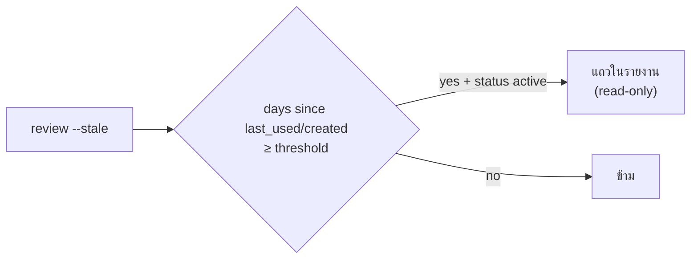

# my-memory-engine

A local-first, cross-harness **agent memory engine** written in Go. It is the rewrite of the
original Python CLI (`~/my-memory`, frozen at tag `python-final`) that powers persistent memory
for AI coding agents: markdown records in a git repo are the source of truth, everything else
(index, cache) is derived and rebuildable.

**Status: production for personal use.** The engine is the writer of record for the `claude` and
`omp` harnesses (live probes 19/19 PASS). Phases P0–P4 of the migration plan are complete; the
repo is `BLOCKED — public gate pending` on two owner-only items: cross-platform (Linux/Windows)
native evidence (G3) and an explicit publication approval.

```
License: MIT (see LICENSE) · Language: Go 1.27 · Module: github.com/atomsbaza/my-memory-engine
S5 recall gate: recall@5 0.8667 · MRR 0.85 · 30 pairs · hook latency p50 61 ms (limit 150 ms)
```

## Features

| Area | What you get |
|---|---|
| **Record store** | Markdown + YAML frontmatter, one file per fact, in a git working tree. Layers: `rule`, `project`, `lesson`, `decision`, `handoff`, `knowledge` plus append-only `ops/`. IDs are content-addressed: `sha1(layer\|scope\|title\|body)[:8]`. |
| **Hybrid retrieval** | SQLite FTS5 (BM25) + TF-IDF sparse vectors over 400-char chunks, fused with Reciprocal Rank Fusion (k=60). Byte-for-byte ranking parity with the Python baseline. |
| **Lifecycle governance** | `archive` (retention score < threshold → cold storage), `promote` (lesson → rule when `uses ≥ N` and `successes == uses`), `compact` (old handoffs merged into knowledge records), `supersede`, `cite`. |
| **Decay** | Per-record `decay` (0–1) and layer-aware `half_life` (rule ∞, project 30d, handoff 3d, else 14d). Unreinforced facts sink; reinforced facts resist decay. |
| **Write guards** | Secret scan, absolute-path refusal, PII regex (email/phone/SSN/card), prompt-injection warnings, near-duplicate block (jaccard ≥ 0.88) / warn band (0.60–0.88), atomicity limits (warn > 1500 chars, refuse > 8000 — suggest a `knowledge` pointer), knowledge layer requires ≥ 1 tag. Failures are observable — never silent. |
| **Idempotent ingest** | Every record carries `content_sha256` over its normalized body (NFC, LF, trailing-space and blank-run collapse). Re-adding identical content is exit 0 naming the existing record instead of a dedup block; cross-scope duplicates warn. `review --stale` reports decay candidates read-only; `links/graph --mentions` opts into bare id mentions (off by default). |
| **Hooks** | Three events (`session-start`, `user-prompt`, `stop`) × four output formats (`text`, `json`, `hermes`, `cursor`) × seven harness registries. Fail-open with a runtime log line; hooks always `exit 0` and never push. |
| **MCP server** | 13 frozen tools over stdio JSON-RPC (`memory_context`, `memory_search`, `memory_show`, `memory_cite`, `memory_add`, `memory_list`, `memory_verify`, `memory_stats`, `memory_sync`, `memory_archive`, `memory_promote`, `memory_compact`, `memory_trace`) + the additive `memory_outcome` (SIM observed), plus read-only Resources and a bootstrap Prompt (see "MCP surfaces"). |
| **Eval gate** | 30-pair golden corpus, recall@5 + MRR + threshold sweep + abstention (no-answer pairs must match nothing — precision must stay 1.0) + update accuracy (`kind:"update"` pairs must surface the current record while the superseded twin stays out of the top-k — floor 0.9), fail-closed against `eval/baseline.json`. Runs as a recurring gate on every engine change that can affect retrieval. |
| **Sync** | Any git remote (GitHub / Bitbucket / self-hosted) through the git CLI. Opt-in per memory home, never `--force`, conflicts stop with a named file. |
| **Observability** | `mem trace <query>` prints the RRF breakdown (fts/vec/scored ranks, retention score) plus per-layer context budgets; `mem stats` reports decay buckets and harness coverage. |
| **Installer** | `mem-install` wires MCP for nine harnesses (claude, codex, gemini, opencode, cursor, hermes, omp, kiro-cli, qoder) plus hooks where supported — idempotent, byte-backup before every write, warns on `core.hooksPath`. |
| **Benchmark** | `tools/benchmark-hook.sh` gates hook p50 latency ≤ 150 ms on a 480-record synthetic corpus (with a delay-based negative control). |

## Build

```sh
go build -o bin/mem ./cmd/mem      # engine
go build -o bin/mem-install ./cmd/mem-install   # harness installer
go test ./...                       # 15 packages, all green

./bin/mem --version                 # mem version 0.1.0 (single source of truth:
                                    # internal/version, also reported in the MCP handshake)
```

Current release: **v0.1.0** (see git tags).

No external services, no daemons, no runtime dependencies beyond the `git` CLI (used only for
commits and explicit sync). Python 3 is **not** required.

## Usage

```sh
# point MEM_HOME at your memory repo (or let it find ~/my-memory)
export MEM_HOME=~/my-memory

mem context                         # rules + scoped records + knowledge pointers (budgeted)
mem search "fts5 ranking" --limit 5
mem links lesson.1a2b0001          # how a record links to others (supersede chain, evidence, body refs)
mem graph                           # self-contained offline HTML viewer of the whole corpus
mem trace "security guard"          # RRF breakdown + layer allocation
mem add --layer lesson --scope global --file - --title "..." < note.md
mem review --stale                  # staleness report: active records unused >= 90 days (read-only)
mem verify                          # schema/secret/path/dup/index audit
mem stats                           # counts, sources, decay buckets, harness coverage
mem archive --dry-run               # retention-based archival plan (--threshold F to retune)
mem promote --dry-run               # lesson → rule candidates (--min-uses N, --force)
mem promote --scan --notify         # mechanical candidates file for the /promote-lessons skill
mem compact --dry-run               # old handoff → knowledge plan (--days N, --min-group N)
mem eval --json                     # retrieval gate against baseline

mem mcp                             # MCP server on stdio (wire from any MCP client)
mem hook --agent claude --event user-prompt --format json   # harness hook entry point
```

### MCP surfaces (tools vs resources vs prompts)

The server exposes three protocol surfaces, separated by who controls the call:

- **Tools (writes + agent-driven calls, frozen + additive):** the 13 frozen
  `memory_*` tools — the surface six installed harnesses already depend on
  (names, descriptions and schemas pinned by `internal/mcp/tools.frozen.json`
  and the contract tests) — served unchanged, then the engine-only additive
  tools from `internal/mcp/tools.additive.json` (v0.3: `memory_outcome`).
  `memory_add` inherits the domain write guards, including the atomicity
  limits and the knowledge-needs-a-tag rule.
- **Resources (host-controlled reads):** the client attaches what it wants;
  a read is never something the model decides to call. Strictly read-only —
  no record is touched (`no_touch` semantics, proven by test):
  - `memory://rules` — active rules as markdown (id + title + body, sorted by rel path).
  - `memory://stats` — the `memory_stats` payload as JSON text.
  - `memory://record/{id}` — one record in full; `{id}` resolves by exact id
    or unique prefix like `mem show`; unknown ids are loud resource errors.
  - `memory://context{?q,scope,budget}` — the budgeted context pack
    (`RenderContext`) with a `provenance:` header listing the included ids.
    Budget defaults to 20000 chars, clamped to 500..20000. Query values must
    be RFC 3986 percent-encoded (space = `%20`, not form-encoded `+` — the
    template matcher rejects `+`).
  - Observability without mutation: a context read logs one inject row
    (event `resource`) and a record read logs a show row — the same rows the
    tool path writes, but `last_used`/`uses` never change.
- **Prompts (user-picked entry points):** `memory_bootstrap` (arguments:
  `scope`, `query`, both optional) renders one user message — the context
  pack, a one-line instruction to treat it as authoritative memory context,
  and the ids to cite.

All three lists are static (no `listChanged` notifications) and stdout stays
pure newline-delimited JSON-RPC (contract-tested).

### SIM alignment — predicted vs observed, provenance, 8 usage rules

Adapted from *Self-Improvement Memory* (SIM/CRSI, Google Cloud AI + DeepMind,
arXiv:2611.18856): the value of a memory is the **attempt history + predicted/observed
outcomes**, not just the diagnosis. v0.3 encodes that into the record format and the
MCP handshake.

**Frontmatter fields (optional, all layers — primary use: lesson):**

| field | written when | cap | meaning |
|---|---|---|---|
| `problem` | add | 80 | root-cause/grouping key for a recurring problem (e.g. `rate-limit-retry`, `premature-completion`) |
| `predicted` | add | 200 | what this record predicts will improve — recorded BEFORE verification |
| `observed` | `mem outcome` | 200 | measured outcome after use: `fixed: …; missed: …; note: …` |
| `model` | add | 40 | policy model / harness this was validated on (e.g. `claude`, `gemini`, `omp`) |

- `mem add --problem P --predicted T --model M` (and `--observed` for completeness);
  `mem outcome <id> [--fixed T] [--missed T] [--note T]` writes `observed`, bumps
  `last_used` and commits — it deliberately does NOT touch `uses` (citing that a record
  changed a decision and measuring what happened are different signals; `mem cite` owns
  the counter). The MCP face is `memory_outcome` (additive tool #14).
- `mem verify` warns when a lesson carries `predicted` but no `observed` after
  `uses ≥ 3` ("predicted ยังไม่ถูกตรวจ — รัน mem outcome") and when `problem`
  exceeds 80 runes; the schema refuses wrong types and over-cap values at write time.
- Retrieval eval grows an update-accuracy category: a golden pair with
  `"kind": "update"` passes only when an expected id is in the top-k AND every id in
  `"stale"` is absent — retrieval must prefer the current record over its superseded
  twin. Gate floor 0.9.

**The 8 SIM usage rules** (Appendix D.2, adapted; carried verbatim in the MCP
`initialize` instructions and pointed at from every session-start injection):

1. Treat every record as prior experience, not an order — a different path is allowed
   whenever current evidence says so.
2. Check each record's provenance before use: `source:` / `model:` / `scope:`.
3. Start from the old diagnosis when it explains the current problem.
4. Reuse the rationale, but re-assess the fix whenever the context/benchmark changed.
5. Revise/replace (`supersede`) when new evidence warrants it.
6. Revisit a previously tried path only with new evidence — not because it was forgotten.
7. Create a new record (new `problem` key) when the old diagnosis no longer explains.
8. Weight task-specific evidence higher when the setting is close, lower when the
   context/benchmark/model differ substantially.

The full block lives in `internal/mcp/mcp.go` (`instructionsFmt`); the session-start
render (hook inject) carries a one-line pointer (`record = prior experience … กฎ SIM
8 ข้อ: README`) instead of the full rules — the render head is outside the section
budgets, so the pointer never displaces record content.

### Staleness report (`review --stale`)

`mem review --stale [--days N] [--limit N] [--json]` is the read-only sibling of the
quarantine exit: it lists **active** records whose `last_used` (falling back to `created`)
is at least `--days` (default **90**) days old, sorted days-desc with ties broken by
taxonomy layer order then id — the same ranking `mem archive` will eventually act on, but
without touching anything (no touch, no git, exit 0 even when empty). `--json` emits one
object per record: `id, layer, scope, status, days, decay, retention, last_used, title, file`.



Why 90: the half-life defaults (project 30d, handoff 3d, rule ∞) leave a record unused
past 90 days at ~a quarter of its project-layer peak — old enough to be noise in every
injection, recent enough that one `mem cite` still recovers it. The report exists so the
decay candidates are visible *before* `mem archive --threshold` collects them.

### Mention edges (`--mentions`, off by default)

Bodies often reference records in plain prose (`…ดู lesson.1a2b0001 ประกอบ`) without a
bracketed `[id: …]` marker. `mem links <id> --mentions` and `mem graph --mentions` add
these bare references as edges of kind `mention` (rendered dotted), deduplicated per
target with the same `+K more` collapse as body-refs, excluding self-references and
ids already inside `[id: …]` markers; dangling mention targets become ghost nodes.

The flag is **off by default** and default output is byte-identical without it: bare
mentions are noisy (log samples, path chatter, hypothetical ids), so the corpus graph
stays quiet unless you ask for the extra edges.

### Idempotent ingest (`content_sha256`)

Every record the engine writes now carries `content_sha256` — the sha256 of its
**normalized body**: NFC unicode form, LF endings, trailing spaces stripped per line,
runs of 3+ blank lines collapsed to one, overall trim. Nothing semantic changes, so the
same fact hashes the same on every machine. An `add` (CLI or `memory_add`) whose
normalized body already exists:

- **same layer + scope** → idempotent success: exit 0, no file written, the result
  message names the existing record: `content ซ้ำเป๊ะ (sha256 …) — มีอยู่แล้ว: <id> (<file>)`.
  This replaces the old duplicate-id exit 3 for byte-identical re-adds — a retry is no
  longer a conflict.
- **different layer/scope** → the write still happens, with a warning naming the twin:
  duplication across scopes can be legitimate.

`mem verify` warns when a record's stored `content_sha256` no longer matches its body
(a hand-edit or a tamper signal) — advisory only, because a stale hash only makes the
next identical add write a new record instead of dedup-ing. Records written before the
field existed stay valid. NFC runs on vendored Unicode tables
(`internal/norm`, generated by `tools/gen-nfc-tables.py` and validated against Python
`unicodedata` over every code point), so no new module dependency is needed.

### Visualising connections (links / graph)

`mem links <id>` answers "how does *this* record connect?" — outbound/inbound supersede
chains, evidence ids, body `[id: …]` refs and dangling references, with `--depth` to walk a
supersede chain transitively and `--related` for same-scope/shared-tag neighbours.

`mem graph` exports the same edge extraction for the **whole corpus**:

```sh
mem graph                                       # ./mem-graph.html — offline viewer (default)
mem graph --format json -o mem-graph.json       # stable JSON schema for tooling
mem graph --scope repo:owner/name --layer lesson,decision
mem graph --related                             # add implicit same-scope / shared-tag edges
```

The HTML viewer is a single self-contained file — force-directed canvas layout with zoom, pan,
draggable nodes, search, per-layer filters, a click-through side panel of every connection, and a
text fallback listing the top 20 nodes. It makes **no external requests** (no CDN, fonts or
images) and renders directly from `file://`.

> **Private data warning.** A generated graph embeds record ids, titles and metadata from your
> memory repo. Never commit or share `mem-graph.html` / `mem-graph.json` — the engine repo's
> `.gitignore` blocks both names, and `mem graph` prints a loud stderr warning when the output
> path lands inside a source repo. Dangling ids (referenced but missing) are kept as dashed grey
> ghost nodes so broken links stay visible; `--include-dangling=false` drops them.

### Lifecycle (archive / promote / compact)

The three maintenance verbs share one contract: **plan first, then mutate** — every id check and
content guard resolves before the first byte is written, so a refusal never leaves a half run.
All three are read-only with `--dry-run` (exit 0) and re-index after a real write.

- `mem archive [--threshold F] [--dry-run]` — moves active records whose retention score
  $S = \text{decay}\cdot 2^{-d/h}\cdot(1+\ln(1+u))\cdot\text{urgency}$ falls below the threshold
  (default 0.15) into `_archive/<layer>/` with `status=archived`.
- `mem promote [--min-uses N] [--force] [--dry-run]` — turns proven lessons (default strict:
  `successes > 0` and `successes == uses`) into rules and marks the lesson `status=promoted`.
- `mem promote --scan [--notify]` — the mechanical half of promotion: groups active lessons by
  primary tag (cross-referencing `ops/failures/*.md`, no LLM) into `ops/promotions-candidates.md`,
  rewriting the file **only when the content changed** (the timestamp header is excluded from the
  digest). `--notify` posts a macOS notification only on a real change — this is what a
  LaunchAgent cron (`com.<owner>.mem-promote`) runs once installed. Judgment and approval stay in the
  `/promote-lessons` skill; the scan never applies anything.
- `mem compact [--days N] [--min-group N] [--dry-run]` — folds handoffs older than `--days`
  (default 7, by `last_used` else `created`) into one `knowledge` record per scope once a scope
  has `--min-group` (default 3) of them, marking each `status=compacted`.

## Architecture

Single modular-monolith binary; every entrypoint (CLI / MCP / hook) calls the same domain layer.
Markdown in the data repo is canonical; the SQLite index under `.memory/` is derived and can be
deleted and rebuilt at any time. Network access exists only in `mem sync`, and only to the remote
you configured.

```
harness (claude, omp, …)
   │  MCP stdio · hooks · CLI
   ▼
engine core ── domain / codec / schema / store / index / sync
   │                    │
   ▼                    ▼
canonical git tree   derived index (.memory/, gitignored)
   └── opt-in: git remote (any host, never force-pushed)
```

Full design: [`docs/spec/design.md`](docs/spec/design.md) (rev 5, passed an independent
architecture gate with 0 blockers). Migration plan and phase gates:
[`docs/spec/plan.md`](docs/spec/plan.md), [`specs/`](specs/).

## Verification story

- **Unit + integration:** `go test ./...` — 15 packages, including fault-injected atomic writes,
  guard refusals, dedup boundary controls, hook fail-open, sync conflict paths and MCP contract
  tests against the frozen snapshot.
- **Differential parity:** every command family (context/search, show/list, write lifecycle,
  verify/stats, render, hook, MCP) is compared byte-for-byte against the Python baseline on a
  fresh clone — **133 probes, 7/7 families PASS** (artifacts live in the private data repo).
- **S5 recall gate:** recall@5 0.8667 / MRR 0.85 on the real corpus, re-run whenever retrieval
  code changes, artifact bound to the binary sha256.
- **Hygiene:** gitleaks (tree + full history) clean, govulncheck clean, 518 synthetic fixtures
  reviewed with provenance labels, private paths scrubbed, identifier gate with a recorded
  `(path, line-shape)` exception for `LICENSE` only.

## Migration state

| Harness | Engine | Notes |
|---|---|---|
| claude | ✅ Go | MCP + hooks cut over, live probe 19/19 |
| omp | ✅ Go | MCP + hooks + extension cut over, live probe 19/19 |
| kiro-cli | ✅ Go (MCP) | registered in `~/.kiro/settings/mcp.json` (global scope), tools 13/13, write/read verified through `kiro-cli chat --trust-all-tools` |
| qoder | ✅ Go (MCP) | registered in `~/.qoder/settings.json` (user scope), tools 13/13, write/read verified through `qoder -p --permission-mode bypassPermissions` |
| codex, gemini, cursor, hermes, opencode | ⏳ deferred | still point at the frozen Python CLI (reads work; writes are refused with a pointer to this engine) |

The Python CLI in the data repo is **read-only legacy** (tag `python-final`): write commands exit
3 with a pointer to this engine; `bin/mem-backup` still works. Rollback per harness:
`tools/cutover-switch.sh --harness <name> --to python` (proven byte-exact).

## Data boundary

- This repo must never contain real corpus records, prompt logs, personal data or secrets —
  `testdata/` holds synthetic fixtures with provenance labels only, enforced by the hygiene gate.
- Real data (records, parity artifacts, spike outputs) lives in the private data repo.
- The repo is **public (MIT)** — the visibility flip was made on 2026-11-10 with the owner's
  recorded approval (`parity/P4/public-approval.md` in the data repo); making it public is done.
  The hygiene gates above still apply unchanged.

## Semantic search (optional)

Embeddings are **off by default** — retrieval is byte-identical to the pre-embedding engine
(no network, no dense stream, `--scores`/`trace` output unchanged). An opt-in local mode adds
semantic ranks as a 4th RRF list (cosine over 400-rune chunks, `w_dense=1.2`, k=60):

```bash
brew install ollama && brew services start ollama   # หรือ `ollama serve`
ollama pull nomic-embed-text                        # 768-dim · 274 MB
mem embed set ollama                                # เขียน block ใน schema/taxonomy.json (มี .bak-<ts>)
mem reindex                                         # สร้าง emb table (~22s สำหรับ ~1.4k chunks)
```

- `mem embed status [--json]` — provider/model/dim, index emb counts, ollama reachable.
- `mem embed set off` + `mem reindex` — กลับ off-mode อย่างสมบูรณ์ (DROP emb table + meta).
- Model mismatch (index ≠ config) fails loudly on search (`mem reindex` required); the
  user-prompt hook fail-opens instead (runtime log) so a dead ollama never breaks a turn.
- **Privacy: local only.** All embedding calls go to `http://127.0.0.1:11434` on this machine;
  nothing leaves it. Remote providers are explicitly out of scope for now.
- Measured on the real corpus (see `parity/P4/embedding-spike.md` in the data repo):
  Δrecall@5 = 0.0000 vs off — off remains the shipped default.

## Docs

- [`docs/spec/design.md`](docs/spec/design.md) — architecture contract (rev 5)
- [`docs/spec/plan.md`](docs/spec/plan.md) — 37-task migration plan with gates
- [`specs/phases/`](specs/phases/) — per-phase specs (P0 language gate … P4 public release)
- [`docs/cli-commands.md`](docs/cli-commands.md) — generated CLI manifest (drift-gated by test)
