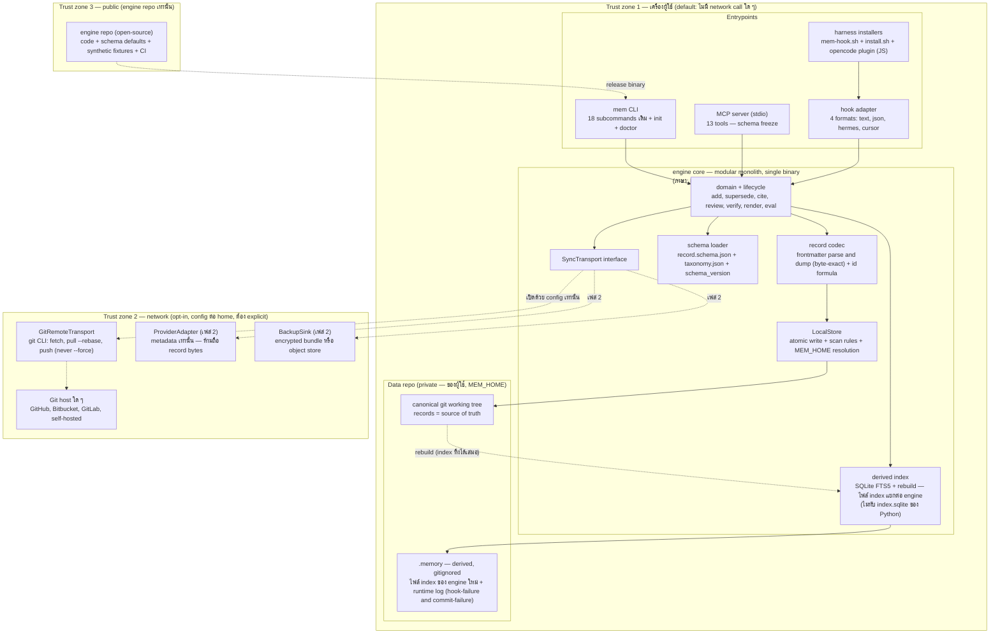
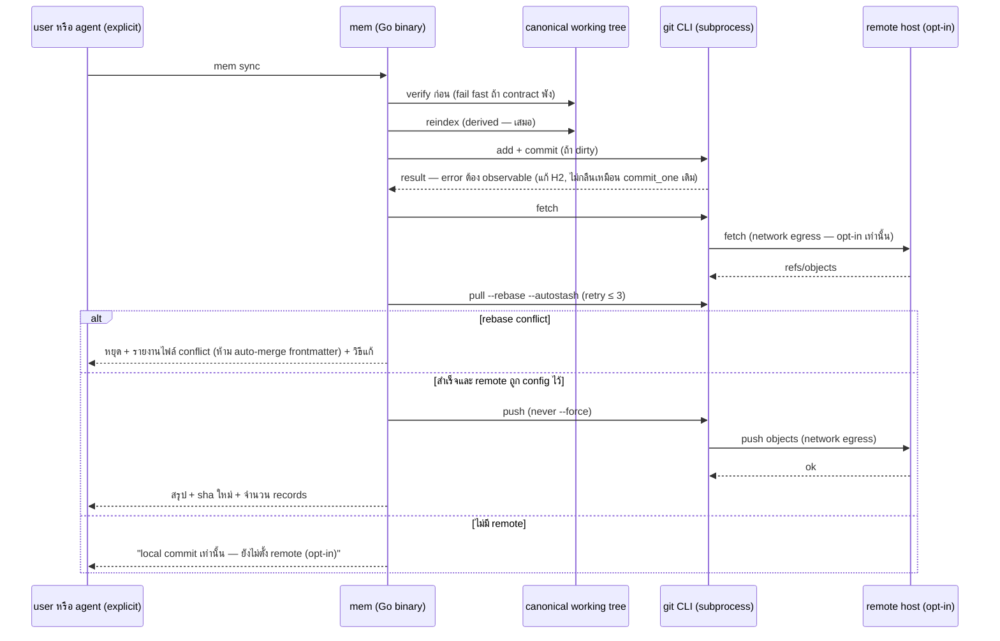

# Design: my-memory → open-source agent-memory framework

- **สถานะ: DRAFT — รอ user review/approval ก่อนเข้าสู่ PLAN** (tech-lead เป็นเจ้าของ PLAN ไม่ใช่เอกสารนี้)
- **ผู้เขียน:** solution-architect subagent · **วันที่:** 2026-10-17 · **Rev:** 5 (2026-10-19 — แก้ตาม independent architecture gate รอบ bounded-correction 6 ข้อ: MAJOR-1 §9.2 แยกจริงเป็น (ก)/(ข) + §9.3 P0/P1/P2 · MAJOR-2 §9.2 S1-fail path (Bun ก่อน) + §10 Rust row = fallback · NIT-1 §6.1 eval pointer §7.3→§7 item 3 · NIT-2 §4.2→§4.3 renumber + เพิ่ม Bun+TS column ในตาราง §4.2 · NIT-3 §5.4 mermaid เพิ่ม G↔R network edges · NIT-4 §9.3 P1 + OQ2 wording ภาษา-agnostic) · Rev 4 (2026-10-17 — **ข้อยกเว้นการแก้ design ครั้งเดียวที่ผู้ใช้อนุมัติหลัง review cap (`docs/workflow/my-memory-framework-migration/log.md` ใน private data repo `~/my-memory` บรรทัด 10)**: (1) MAJOR cycle-3 — §9.2 แยกเป็น (ก) pre-code feasibility spikes (Go: S1/S2 · Bun: B1–B7 · optional S6 · Rust fallback: RS1/RS2) กับ (ข) post-implementation parity gates (S3/S4 = P1 exit; **S5 = P2 exit / P3 entry + recurring private gate** ของทุก engine version/config ที่อาจกระทบ retrieval รวมหลัง P4) — **เอา S5 ออกจาก P0**; (2) เพิ่ม **Bun + TypeScript เป็น first-class conditional candidate** (§4/§9.2/§10/§11/OQ4/OQ7) จาก `research-bun-addendum.md` — หลักฐานคงป้าย [DOC]/[ISSUE-REPORT]/[INFERENCE] ตาม addendum ไม่ยกระดับเป็น fact (ไม่มี runtime measurement ในรันนี้); (3) NITs cycle-3 — G-5 pointer §8.3→§7 item 3; eval row pointer §7.3→§7 item 3; G7 = manual per-harness matrix ไม่ใช่ CI (§1/§6.2/§9.4); §5.4 เพิ่ม edge git CLI↔remote (network trust boundary); parity artifacts จาก corpus จริงอยู่เฉพาะ private data repo `docs/workflow/` + redaction rule (§9.2 ข/§9.3 P2) · Rev 3: แก้ตาม cycle-2 (187-assertion suite = public G3 บน synthetic fixture home; incremental-index trigger "records ≥ 400 หรือ hook p50 > 150 ms" — ~3,000 ผูกกับ semantic-search เท่านั้น) · Rev 2: แก้ตาม cycle-1 (แยก private/public eval gate, failure semantics เมื่อไม่มี git CLI, บันทึกมติผู้ใช้ generic Git remote = resolved decision) · + mechanical fix เพิ่ม: §11.2 evidence-gap row ใส่ Bun B1–B3 ตามลำดับ S1 → B1–B3 → RS1 · §12 เพิ่มแถว OQ7 (เดิม dangling ref 4 จุด) — orchestrator-applied)
- **Evidence base:** `research.md` + `exploration.md` (worktree `wf/my-memory-framework-migration` @ `fcee510` + scaffold `00a3858`) · `log.md` (lane 2-WAY) · Obsidian brief `Projects/my-memory.md` · ADR `decision.8fcde05e` · `learnings.md` (อ่านจากดิสก์แล้ว — **ตรงกับ fallback snapshot ใน brief ทุกหัวข้อ**: orchestrator collision, action-time gates, bounded/resumable jobs, discriminating probes, real clones not worktrees, tool-access verification, on-disk parity verification, golden vectors + provenance, reconcile counts) · **`research-bun-addendum.md`** (Bun evidence — provenance ตรง ๆ: เนื้อหาทั้งหมดมาจากรายงานของ prior research agent ในแชท **ไม่มีการ fetch ใหม่และไม่มีการรันวัดใด ๆ** ในงาน materialize; ป้าย [DOC]/[ISSUE-REPORT]/[INFERENCE]/[OBS-RUN]; **ไม่มี [MEASURED] เลย**; Jev screening ที่ addendum อ้างถึง = unverified claim ไม่มี artifact บนดิสก์)
- **ขอบเขต:** design + plan-input เท่านั้น — ไม่ implement, ไม่สร้าง repo ใหม่, ไม่แก้ source, ไม่สร้าง remote, ไม่ push (ตามมติผู้ใช้รอบนี้)
- **Evidence tags:** `[OBS]` = ตรวจจาก primary source แล้ว (อ้างเลข E/R/H/S/T ตาม research.md/exploration.md) · `[INF]` = suy จาก OBS หลายชิ้น ยังไม่พิสูจน์ runtime · `[ASM]` = สมมติฐานที่ต้องยืนยัน · **ฝั่ง Bun คงป้ายของ addendum ตามเดิม:** `[DOC]` = เอกสารผู้ขายที่ prior agent อ่าน (primary source แต่ไม่ใช่ independent verification และไม่ re-fetch ในรันนี้) · `[ISSUE-REPORT]` = bug report บุคคลที่สาม (แยก official issue ที่ปิดแล้ว vs **unverified user report** — เช่น oven-sh/bun#31247 เป็น unverified user report เท่านั้น ห้ามยกเป็นข้อเท็จจริง) · `[INFERENCE]` = การ suy ของ addendum (ห้ามใช้เป็นเหตุผลเดียวในการตัดสินใจ) · `[MEASURED]` = **ไม่มีเลยฝั่ง Bun** — ห้ามเคลมว่า Bun เร็วกว่า/เล็กกว่า/FTS5 ใช้ได้ครบ จนกว่า spike จะวัดจริง

**Design principles ที่ใช้ (3 ข้อที่ material ที่สุด):**
1. **Data model คือ source of truth** — markdown + YAML frontmatter เป็น canonical; index, cache, provider ใด ๆ เป็น derived และต้อง rebuild ได้เสมอ (สืบทอด ADR `decision.8fcde05e` [OBS])
2. **ออกแบบ failure case ก่อน** — ทุก write path ต้องล้มเหลวแบบ observable (แก้ H2 "silent commit failure"), atomic write (แก้ H3), hook fail-open แต่ต้อง log
3. **Simplest proven pattern** — modular monolith binary เดียว + git CLI; ไม่มี service, ไม่มี protocol ใหม่, ไม่มี daemon จนกว่ามีหลักฐานว่าจำเป็น

---

## 1. TL;DR

**แนะนำ: สร้าง engine repo ใหม่ (public-ready) บนสถาปัตยกรรม A1 — modular monolith binary เดียว + canonical Git working tree + generic sync (§3.1) ซึ่งไม่ผูกกับภาษา · ภาษาตัดสินที่ P0 language gate (§4/§9.2 ก) จาก pre-code spike matrix แบบ bounded (ผลลงดิสก์): **Go = leading conditional** (ล็อกได้ต่อเมื่อผ่าน S1 — FTS5 runtime บน `modernc.org/sqlite` เวอร์ชันที่จะ pin — และ S2 MCP SDK กับ 6 harness ก่อนเขียนโค้ดจริง) · **Bun + TypeScript = first-class conditional candidate** (ต้องผ่าน gates B1–B7; **Bun คือ runtime/toolchain, TypeScript คือภาษา**; หลักฐาน Bun ทั้งหมดเป็น [DOC]/[ISSUE-REPORT]/[INFERENCE] จาก `research-bun-addendum.md` — ไม่มีการวัด runtime ในรันนี้ ห้ามเคลมว่า Bun เร็วกว่า/เล็กกว่า/FTS5 ใช้ได้ครบ จนกว่า spike จะพิสูจน์) · **Rust = fallback** (เลือกได้หลังผ่าน spike RS1/RS2 ของตัวเองเท่านั้น เพราะ E9 ยังเป็น INF)** · เก็บ data repo เดิม (private) เป็นของผู้ใช้ตามเดิม — **มติผู้ใช้ (2026-10-17, resolved — ไม่ใช่ open question): "เลือก storage ได้ (local/GitHub/Bitbucket/อื่น)" = canonical Git working tree เดียว + remote host ผ่าน generic Git transport (git CLI) — GitHub/Bitbucket/อื่น ๆ เป็น remote host ที่ใช้แทนกันได้ ไม่มี provider-specific REST data-storage backend ใน v1** · provider-specific API (GitHub/Bitbucket REST) ถูก defer เป็น optional adapter ที่แตะได้แค่ metadata ห้ามถือ record bytes · migration เป็นแบบ staged side-by-side ต่อ harness (6 ตัว) โดย Python engine ปัจจุบันเป็น writer of record จนกว่า engine ใหม่ผ่าน parity gates ทั้งหมด — **gate parity บน corpus จริง (golden corpus 30 คู่ baseline `recall5=0.8667/mrr=0.85` [OBS], byte-exact codec, ID formula ตรง 100%) รันแบบ private บน real clone ของ data repo (S3/S4 = P1 exit gate; **S5 = P2 exit / P3 entry gate + recurring private gate ของทุก engine version/config ที่อาจกระทบ retrieval รวมหลัง P4** — §9.2 ข) ไม่ใช่ใน public CI และ parity artifacts จาก corpus จริงอยู่เฉพาะ private data repo `docs/workflow/`** · public engine CI รัน **automated gates: G1 eval smoke/regression บน synthetic fixtures ที่มี provenance label + synthetic baseline แยกของตัวเอง, G2, G3 (ported black-box suite 187 assertions [OBS] บน synthetic fixture home), G4–G6 (§9.4) — ส่วน G7 (per-harness MCP/hook probe) เป็น manual matrix ก่อน release ไม่ใช่ CI job** — **ไม่มีข้อมูลจริงใน public CI**; G1 **ไม่ใช่หลักประกัน parity กับ corpus จริงของผู้ใช้** · **format และ ID เดิมคงเดิมทุกไบต์ — ไม่มีการ versioned break ในรอบนี้** · license แนะนำ Apache-2.0 แต่เป็น **user-approval gate ก่อน public push เท่านั้น ไม่ block design/PLAN**

สิ่งที่ไม่ทำใน MVP: semantic/vector search, provider REST adapters, object-store sink, MCP HTTP transport, incremental index, daemon/service — ทั้งหมดมี trigger ชัดเจนใน §11

---

## 2. Goal / Non-goals / Constraints

### 2.1 Goals

| # | Goal | วัดด้วย |
|---|---|---|
| G-1 | Framework engine ใหม่เป็น open-source ได้จริง (ภาษาที่ไม่ใช่ Python, single binary, ติดตั้งง่ายข้าม OS) | release artifacts + install one-command บน macOS/Linux/Windows (บรรลุในเฟส fast-follow public packaging §8.2 — หลัง personal cutover, ไม่ใช่ MVP) |
| G-2 | Record format + ID + MCP tool schema + hook output contract เดิมใช้ได้ต่อโดยไม่แก้ data | **private parity gates §9.2 ข** (S3 byte-exact diff ว่างบน real clone + S4 id ตรง 100% = **P1 exit**; S5 eval บน corpus จริง ≥ baseline = **P2 exit / P3 entry + recurring ทุก engine version/config ที่อาจกระทบ retrieval รวมหลัง P4** — รันในเครื่อง/data repo ไม่ใช่ public CI) + public smoke gates §9.4 (synthetic fixtures เท่านั้น) |
| G-3 | Storage เลือกได้: local-only (default), sync ไป Git host ใด ๆ (GitHub/Bitbucket/self-hosted — interchangeable remote hosts ตามมติผู้ใช้ 2026-10-17), สำรองเข้ารหัส | `mem sync` ผ่าน git CLI กับ remote ที่ user config; ไม่มี network call ใน path อื่น |
| G-4 | Local-first จริง: ใช้ได้เต็มที่โดยไม่มี network/account; secrets ไม่เคยออกจากเครื่อง; remote sync เป็น opt-in ต่อ memory home | trust boundary §8 + audit: grep network call ใน default path = 0 |
| G-5 | แยก engine (public) ออกจาก data (private) เด็ดขาด — lessons/knowledge/ops/credentials ไม่รั่วเข้า engine repo | split checklist **§7 item 3** + gitleaks CI gate ผ่านก่อน push ครั้งแรก |
| G-6 | 6 harness เดิม (claude, codex, gemini, opencode, cursor, hermes) ย้ายมา binary ใหม่ทีละตัวโดย rollback ได้ | per-harness cutover probe §9.4 (**G7 — manual matrix ไม่ใช่ CI job**) |

### 2.2 Non-goals (รอบนี้และใน MVP)

- ไม่ implement โค้ดใด ๆ ในรันนี้ (design/plan only — ผู้ใช้สั่งชัด)
- ไม่สร้าง public remote / ไม่ push / ไม่ publish (gate แยก §8)
- ไม่ทำ multi-user, hosted service, background LLM extraction, graph DB (สืบทอด non-goals เดิม README:620-622 [OBS])
- ไม่ทำ semantic/vector search ใน MVP (trigger เดิมของ repo: paraphrase MRR ≤ 0.40 ขณะที่ authored ≥ 0.70 สองรอบ eval ติดกัน หรือ records > ~3,000 [OBS README:598-601])
- ไม่เปลี่ยน record format / ไม่ migrate data ไป schema ใหม่ (ถ้าจะเปลี่ยนในอนาคต ต้องผ่าน versioned migration policy §9.5)
- ไม่เลือก license แทนผู้ใช้ — แนะนำ + ตั้ง approval question (§12 OQ1)

### 2.3 Constraints (แข็ง)

| # | Constraint | ที่มา |
|---|---|---|
| K1 | Canonical = markdown + YAML frontmatter หนึ่งไฟล์ต่อหนึ่ง fact ใน git repo; index เป็น derived เท่านั้น | ADR `decision.8fcde05e` [OBS] · brief |
| K2 | ใช้งาน fully local ได้ในที่ทำงาน: default ไม่มี network, remote sync ต้อง explicit, secrets อยู่ในเครื่อง | ผู้ใช้สั่ง · brief |
| K3 | ภาษาอื่นที่ไม่ใช่ Python | ผู้ใช้สั่ง |
| K4 | CLI ปัจจุบัน (Python, 2,171 บรรทัด, 18 subcommands [OBS]) ทิ้งได้ — แต่ format + storage + tests + golden corpus คือ acceptance spec ของ rewrite (README:508-509, 604-607 [OBS]) | brief · exploration §6.5 |
| K5 | MCP tool contract (13 tools ตามโค้ดจริง — T2: doc เดิมเขียน 8, rev 5 เขียน 9 [OBS]) + hook 4 output formats (text/json/hermes/cursor [OBS]) ผูกกับ 6 harness ที่ติดตั้งและพิสูจน์แล้วจริง | exploration §3.5-3.6 · brief F7/verification |
| K6 | Solo maintainer: velocity > peak performance; dependency footprint เล็กและ pin ได้ | research C9/C10 |
| K7 | hook ต้อง `exit 0` เสมอและไม่ push (network ใน hook ทำให้ session ค้าง) | AGENTS.md ของ repo [OBS] |
| K8 | Record เดิมทั้งหมด (127 lessons + rules/decisions/knowledge/handoffs/projects) ต้อง parse ได้และ id ต้องไม่เปลี่ยน | R2/R5 [OBS] |

---

## 3. สถาปัตยกรรม: candidates + คำแนะนำ

### 3.1 สาม candidate architectures (ระดับสถาปัตยกรรม ไม่ใช่แค่ภาษา)

#### A1 — Modular monolith binary + canonical Git working tree + generic sync (แนะนำ — สถาปัตยกรรมไม่ผูกภาษา)

- binary เดียว ภายในแบ่งเป็น internal packages/modules ตาม §6; ทุก entrypoint (CLI/MCP/hook) เรียก domain layer ชุดเดียว (สืบทอด boundary ที่ดีอยู่แล้วของ `run_cmd` [OBS exploration §3.5]) · **ภาษาของ binary ตัดสินที่ P0 language gate (§4): Go (leading conditional) หรือ Bun-compiled executable (first-class conditional); Rust (fallback) — component boundary/output contract ทุกข้อในเอกสารนี้เหมือนเดิมไม่ว่าภาษาใดถูกเลือก**
- Storage: LocalStore (filesystem + git working tree) เป็น implementation เดียวที่ default; sync ผ่าน `SyncTransport` interface ซึ่งมี implementation เดียวใน MVP = git CLI subprocess (เหมือนโค้ดเดิม [OBS]) — provider adapter/object store เป็น optional implementations ภายหลัง
- **Failure modes (แยก persistence ออกจาก commit ให้ชัด):** read/search/context **ไม่เคยต้องพึ่ง git CLI หรือ network** · write **persist ไฟล์ markdown ได้เองแบบ atomic โดยไม่ต้องมี git** — แต่ **local git commit (audit/backup/rollback) ต้องมี git CLI**: ถ้า git ไม่มี หรือ commit ล้มเหลว → record ยังอยู่บนดิสก์สถานะ uncommitted และ **failure ต้อง observable เสมอ** — explicit result (เช่น `committed: false` + reason) + หนึ่งบรรทัดใน runtime log (gitignored, `.memory/`) **ห้ามกลืนเงียบแบบ `commit_one` เดิม (แก้ H2)** โดย hook ยัง `exit 0` เสมอ (K7 fail-open — แต่ไม่เงียบ) · `sync` **ต้องมี git CLI** → ถ้าไม่มี แจ้ง error ชัดและหยุด · index พัง → ลบ `.memory/` แล้ว rebuild · binary ใหม่พัง → rollback config harness กลับ Python (P3)
- **สิ่งที่อาจยากภายหลัง:** ถ้าวันหนึ่งต้อง embed core เป็น in-process library ใน harness (ไม่ใช่ subprocess) → โครงสร้าง binary-first ต้องเพิ่ม cgo/library surface — ยอมรับ เพราะ K5 พิสูจน์แล้วว่า subprocess + MCP stdio เพียงพอกับ 6 harness จริง [OBS]

#### A2 — Core library + per-harness native plugins (TS-first)

- เขียน core เป็น TypeScript library แจกเข้า harness ที่เป็น Node โดยตรง (in-process), harness อื่นใช้ CLI wrapper
- ง่ายขึ้น: contributor pool ใหญ่; opencode plugin เป็น JS อยู่แล้ว [OBS]
- ยาก/เสี่ยง: SEA ยัง Stability 1.1 + CI ครอบไม่ทุกแพลตฟอร์ม [OBS E15]; `node:sqlite` ไม่มี FTS5 [OBS E10/E11] → ต้องพึ่ง `better-sqlite3` (native addon per-platform) หรือ Bun ที่พฤติกรรมต่างตาม OS [OBS E12/E13]; harness ที่ไม่ใช่ Node (claude/codex/gemini/cursor/hermes ใช้ shell hook + MCP [OBS]) ไม่ได้อะไรจาก in-process → สุดท้ายต้องมี binary อยู่ดี = สอง distribution paths
- **สถานะ: ปฏิเสธ (ในฐานะสถาปัตยกรรม in-process TS-first)** — เงื่อนไขที่ทำให้ถูก: `node:sqlite` เปิด FTS5 + SEA GA ครบแพลตฟอร์ม (ดู §11.3) · **หมายเหตุสำคัญ: การปฏิเสธ A2 ไม่ปฏิเสธ Bun path — Bun + TypeScript ในฐานะ candidate (§4) ใช้สถาปัตยกรรม A1 (single compiled binary + MCP stdio + hook) ไม่ใช่ A2 (in-process plugin) และเหตุผลปฏิเสธฝั่ง Node (SEA/`node:sqlite`/native addon) ไม่ครอบ Bun (`bun build --compile` + `bun:sqlite` built-in [DOC addendum]) — Bun ถูกประเมินแยกใน §4 ด้วยหลักฐานและ gates ของตัวเอง**

#### A3 — Local daemon + clients + optional cloud sync service (Basic Memory Cloud / Letta style)

- daemon ประจำเครื่อง hold index + sync logic; CLI/MCP เป็น thin clients; cloud tier เป็น optional
- ง่ายขึ้น: incremental index/realtime watch ทำที่ daemon ที่เดียว
- ยาก/ผิด constraint: เพิ่ม process lifecycle + port + auth ในเครื่องผู้ใช้, ขัด K2/K6 (workplace environment อาจห้าม daemon), และ cloud tier ดึง toward provider coupling แบบที่ Mem0 เป็นตัวอย่างลบ [OBS E27]; solo maintainer ต้องซัพพอร์ต 2 deployables
- **สถานะ: ปฏิเสธ** — workload จริงเล็กมาก (repo 2.1 MB, ~160 records, hook p50 ~130 ms [OBS]) ไม่มีแรงกดดันด้าน scale ที่ justify daemon

### 3.2 Component diagram (A1 — แนะนำ)



**หมายเหตุ log สองชนิด (แยกให้ชัด — NIT-1):** "runtime log" ใน `.memory/` (gitignored) คือ log ของ engine ใหม่สำหรับ hook-failure/commit-failure observability เท่านั้น — **คนละอย่างกับ และไม่ได้แทนที่ append-only ledgers ที่ commit จริงใน data repo** (`ops/task-ledger.md`, `ops/backup-ledger.md`, `ops/promotions.md`, `ops/failures/`) ซึ่งคงอยู่ใน data repo ตามเดิมทุกประการ · `ops/recall-log.jsonl` เดิมก็ gitignored อยู่แล้ว [OBS exploration §2.5 S5] — ไม่เปลี่ยน

### 3.3 Data flow — write path และ sync path

**Write path (เหมือนเดิมทุก semantics, ต่างที่ error ต้อง observable):**
1. Request เข้าที่ CLI / MCP `memory_add` / hook `stop` → แปลงเป็น `AddOptions` struct (แทน `argparse.Namespace` — แก้ coupling ข้อ 2 [OBS exploration §3])
2. Guards: secret scan + absolute-path scan (exit 2) → dedup jaccard ≥ 0.88 block (exit 3) / band 0.60–0.88 เตือน → quarantine rules ตามเดิม [OBS]
3. Domain: คำนวณ id = `sha1(layer|scope|title|body)[:8]` (สูตรเดิม ห้ามเปลี่ยน — R2), compose frontmatter ตาม `FRONT_ORDER` เดิม
4. Persistence (แยกจาก commit — MAJOR-2): **atomic write (temp file + rename ใน dir เดียวกัน — แก้ H3)** → reindex เฉพาะ record (MVP: full rebuild ตามเดิมได้; incremental = later) — **ถึงตรงนี้ record persisted บนดิสก์แล้วโดยไม่ต้องมี git CLI** · ขั้นถัดไป **local git commit (audit/backup/rollback) ต้องมี git CLI** (พฤติกรรมเดียวกับปัจจุบันที่ add/stop commit ผ่าน git [OBS exploration §2.4]): git ไม่มี หรือ commit fail → ไฟล์ยังอยู่สถานะ uncommitted + **ต้อง observable (แก้ H2)** — explicit result field (`committed: false` + reason) ใน response และเขียนหนึ่งบรรทัดลง **runtime log (gitignored ใน `.memory/` — ไม่ใช่ `ops/` ledger ที่ commit)** ห้ามกลืน error เด็ดขาด · hook ยัง `exit 0` (K7 fail-open — observable ไม่ใช่ silent)
5. Response: stdout/JSON ตาม exit-code contract เดิม (1/2/3)

**Sync path (explicit เท่านั้น — hook ไม่เคย push, K7):** ดู sequence diagram §5.4

---

## 4. Language decision — conditional: Go (leading) / Bun + TypeScript (first-class) / Rust (fallback)

### 4.1 สถานะ + วิธีตัดสิน (อ่านก่อนตาราง)

**ยังไม่มีภาษาใดถูกล็อกในเอกสารนี้ — language gate อยู่ที่ปลาย P0 (§9.2 ก) หลังผล spike ครบและอยู่บนดิสก์:**

- **Bun คือ runtime/toolchain** (JavaScriptCore + bundler + package manager + TS transpiler ในตัว) · **TypeScript คือภาษา** — การเทียบที่ยุติธรรมคือ "Bun + TypeScript" vs "Go + toolchain" vs "Rust + cargo/rusqlite" · ต่างกันเชิงโครงสร้าง: Go/Rust compile เป็น native code ไม่มี VM ฝังในตัว; Bun compiled executable ฝัง runtime ที่ใช้ JIT [DOC addendum §3]
- **วินัยหลักฐานฝั่ง Bun:** ทุกข้อมาจาก `research-bun-addendum.md` ซึ่ง **ไม่มีการ fetch ใหม่และไม่มีการรันวัดใด ๆ** ในงาน materialize — ป้ายคงเดิม [DOC]/[ISSUE-REPORT]/[INFERENCE]/[OBS-RUN] และ **ไม่มี [MEASURED] เลย** → เอกสารนี้ห้ามเคลมว่า Bun เร็วกว่า/เล็กกว่า/FTS5 ใช้ได้ครบ และ **ห้ามใช้ E14 (vendor benchmark 3–6x) เป็นเหตุผลเลือกภาษา**
- **ความเป็นธรรม (สำคัญ):** FTS5 runtime uncertainty มี **ทั้งสาม stack เท่ากัน** — Go (E4 = INF), Rust (E9 = INF), Bun (E13 = INF; เอกสาร Bun ไม่รับประกัน FTS5) → **ห้ามใช้ uncertainty นี้ทำให้ Bun เป็น blocker เพียงตัวเดียว** · ความต่างจริงคือ Bun **มี gate ของตัวเองมากกว่า** (per-OS SQLite provenance, JIT entitlement/notarization, compiled-binary stdio purity) และ gate หนึ่ง **อยู่นอกการควบคุมของ repo**: macOS ใช้ Apple system SQLite ที่ version ผันตาม OS update ([DOC] + [ISSUE-REPORT #24957 reporter เจอ 3.37.0 บน macOS 12]) ขณะที่ Linux/Windows ใช้ SQLite static ของ Bun — ส่วน Go/Rust คุม SQLite build/pin เองทุก OS
- **Go มีหลักฐานเชิงโครงสร้างที่ OBS แล้ว:** driver เป็น cgo-free port, SQLite 3.53.4, platform matrix ครบ [OBS E3] แต่ **"FTS5 ถูก compile เข้ามา" ยังเป็น [INF E4]** — ห้ามอ้างเป็น fact จนกว่า S1 จะรันจริง (lesson: verify on disk) · จุดแข็งของ Go เรียงตาม criteria: C1 static binary + `CGO_ENABLED=0` cross-compile + GoReleaser [OBS E16] เป็น stack เดียวที่ไม่บังคับผู้ใช้ลง runtime และไม่พึ่ง native addon · C6 MCP Go SDK Tier 1 มี conformance CI [OBS E1/E2] · C8 `zalando/go-keyring` สำหรับ static binary [OBS E23] (MVP ไม่ใช้ — §5.5) · C9 compile เร็ว; ยอมรับ perf แลก: transpiled SQLite ช้ากว่า C ~1.3–2.0x CPU-bound [OBS E5 — self-reported] ซึ่งไม่ material กับ workload ระดับร้อย–พัน records (hook p50 ปัจจุบัน ~130 ms ทั้งที่ Python scan เต็ม 3 รอบ [OBS])
- **Bun มีจุดแข็งจริงที่ Go ไม่มี:** official MCP TypeScript SDK (Tier 1 [OBS E1]) ระบุรองรับ Bun + `serveStdio` ใน README [DOC] · `bun:sqlite` built-in ไม่ต้องพึ่ง native addon แบบ `better-sqlite3` [DOC/E12 เทียบ] · `bun build --compile` = standalone executable 8 targets (หนึ่งไฟล์ต่อ target — ไม่มี universal binary) ครอบ 5 targets ของ OQ4 [DOC] · แชร์ภาษา/ecosystem กับ harness plugin (opencode plugin เป็น JS อยู่แล้ว [OBS]) — แต่ README SDK ยังประกาศ `engines.node >= 20` ใน package.json ด้วย → explicit docs support ≠ production-parity evidence [DOC] ต้องพิสูจน์ด้วย B4
- **คำถามชี้ขาดสองข้อ (เหมือนกันทุก stack — ยังไม่มีใครตอบได้จากเอกสาร):** (1) FTS5 semantics (`CREATE VIRTUAL TABLE`/`MATCH`/bm25/`unicode61`/ข้อความไทย/external-content UPDATE-DELETE) ตรงกับ baseline Python `sqlite3` **บนทุก target OS ที่ประกาศ** · (2) เป็น MCP stdio server ที่สะอาดเท่าของเดิม (stdout purity, 9 tools, handshake instructions) กับ harness จริงทั้งสองข้อปิดได้ด้วย spike เท่านั้น

### 4.2 Decision tree + bounded pre-code spike matrix (P0)

**ลำดับการรัน (bounded — ทั้งหมดเป็นงาน P0 ใน PLAN ไม่ใช่รันนี้; เพดานรวม ~2–2.5 วัน: Go ~ครึ่งวัน + Bun ≤ 1 วันตาม cap ของ addendum + ตัดสิน):**

1. **FTS5 ก่อน (ถูกสุดและชี้ขาดสุด):** S1 ของ Go (~1 ชม.) และ B1–B3 ของ Bun (~2–4 ชม.) — วัดจริงบนทุก target OS ที่ประกาศ เทียบ baseline Python `sqlite3` บน corpus คงที่เดียวกัน · ฝั่ง Bun ต้องบันทึก `sqlite_version` จริงต่อ target (macOS = Apple system / Linux glibc / musl / Windows = static ของ Bun) — ปิดทั้ง E4/E13 พร้อมกัน · ข้อสงสัย oven-sh/bun#31247 (`SQLITE_CORRUPT_VTAB` กับ external-content UPDATE/DELETE) เป็น **unverified user report ที่ถูกปิดเป็น duplicate — ห้ามใช้ตัดสิน Bun ทั้งสองทิศ ให้ใช้ผลวัด B3**
2. **MCP stdio + platform:** S2 ของ Go (~ครึ่งวัน — 9 tools ต่อ 6 harness จริง) และ B4–B6 ของ Bun (~ครึ่งวัน — compiled-binary stdout purity + tool list parity +.codesign/JIT/notarize บนเครื่องสะอาด + git subprocess) · **ความเป็นธรรมของ gate:** S2 วัด 6/6 harness; B4 ใน time-box วัด ≥2 harness — **ถ้า Bun จะถูกเลือกจริง ต้องขยาย B4 เป็น 6/6 ก่อนล็อก language gate** (ต้นทุนเพิ่มเฉพาะเมื่อ Bun เป็นตัวรอด)
3. **B7 (conditional):** ถ้า B1–B3 ตกบน macOS system SQLite → สรุปทางหนี `setCustomSQLite` (pin SQLite เอง — แลกกับคำสัญญา "single executable file" + signing surface ที่เปลี่ยน [INFERENCE]) → เปิดเป็นคำถามผู้ใช้ OQ7
4. **S6 (optional ไม่ block):** สถานะ go-git#1381 (~15 นาที) — เกี่ยวข้องเฉพาะอนาคต Go git in-library; MVP ทุกภาษาใช้ git CLI

**เกณฑ์ตัดสิน (decision criterion):**

- **Hard gate (ตกข้อเดียว = stack นั้นออก):** FTS5 ตรง baseline ทุก target OS ที่ประกาศ · MCP stdio parity (6/6 harness สำหรับ stack ที่จะถูกล็อก หรือมี fallback ราย harness ที่ document) · แจก artifact ได้โดยไม่บังคับผู้ใช้ลง runtime (Go: static binary; Bun: `bun build --compile` + codesign/JIT/notarize ผ่านบนเครื่องสะอาด — B5) · git CLI subprocess ครบ sync path โดยไม่มี silent failure (B6 สำหรับ Bun)
- **Tie-break (เมื่อผ่าน hard gate มากกว่าหนึ่ง stack):** C9 solo velocity · C10 supply chain (Go: เล็ก pin ได้แต่ `modernc.org/libc` "fragile" [E6]; Bun: npm transitive graph ใหญ่สุด [C10/E15] → ต้อง lockfile เข้ม + audit + SBOM) · operational control ของ SQLite (Go pin modernc เวอร์ชันเดียวทุก OS vs Bun macOS inherit ของ Apple → drift + S5 recurring ครอบ macOS upgrade) · ecosystem alignment (Bun/TS แชร์ภาษากับ plugin/harness ecosystem + official TS SDK ระบุ Bun [DOC])

**หลักฐานที่ทำให้ Bun ชนะ:** B1–B7 ผ่านครบ (รวม B5 signing/notarization บนเครื่องสะอาดที่ไม่มี Bun และ B6 git subprocess) **และ** Go ตก S1 หรือ S2 → เลือก Bun · ถ้าผ่าน hard gate ครบทั้งคู่ → ตัดสินด้วย tie-break: ค่าตั้งต้นของ design นี้ยังเอนไป **Go** (SQLite provenance เดียวทุก OS — คุม deterministic retrieval ได้ตรงกว่า, ไม่มี JIT entitlement/notarization workflow เพิ่ม, supply chain เล็กกว่า) **เว้นแต่ผู้ใช้ให้น้ำหนัก TS ecosystem alignment สูงกว่า — บันทึกเป็น user input ใน ADR (§13.2 item 1) ไม่ตัดสินใจแทนผู้ใช้เงียบ ๆ**

**หลักฐานที่ทำให้ Bun แพ้:** B1–B3 ตกบน target ใดที่ประกาศ **และ** B7/`setCustomSQLite` ไม่ยอมรับได้ (OQ7) · หรือ B4 stdout ไม่สะอาดใน compiled binary (banner/warning ปน JSON-RPC = พังทั้ง harness — คลาสปัญหาเดียวกับ hook stdout ที่ gemini ต้องได้ JSON บริสุทธิ์) · หรือ B5 notarize/JIT ไม่ผ่านบนเครื่องสะอาด — **ทุกข้อตัดสินจากผล spike ที่วัดจริงบนดิสก์ ไม่ใช่จากเอกสารหรือ issue report**

**Rust = fallback เท่านั้น:** ถ้าทั้ง Go และ Bun ตก hard gate → รัน RS1 (`rusqlite --features bundled`: FTS5 + bm25 + ไทย เทียบ baseline — E9 เป็น INF **ห้ามเลือก Rust โดยไม่ผ่าน RS1**) + RS2 (Rust SDK stdio parity ≥2 harness → 6/6 ก่อนล็อก) · ถ้าตกทั้งสาม → ทางสุดท้าย Go + CGO `mattn/go-sqlite3` + build tag `sqlite_fts5` [E7] (เสีย single-binary simplicity — ต้อง cross toolchain [E16]) → กลับไปหาผู้ใช้พร้อมหลักฐาน

(ตาราง spike เต็มอยู่ใน §9.2 ก — ผลทุกตัวต้องลงดิสก์ + มี discriminating probe ตาม §9.1)

### 4.3 เปรียบเทียบภาษา (gain/loss/when-wrong)

| มิติ | **Go (แนะนำ, conditional S1)** | **Bun + TypeScript (first-class conditional, B1–B7)** | **Rust (fallback — เฉพาะถ้า Go และ Bun ตก)** | **Node + TypeScript (ปฏิเสธเป็น core)** |
|---|---|---|---|---|
| Gain | single static binary ทุก OS ไม่มี C toolchain [E3/E16]; MCP SDK Tier 1 [E1/E2]; keyring สำหรับ static binary [E23]; compile เร็ว | official MCP TS SDK Tier 1 ระบุ Bun + `serveStdio` [DOC]; `bun:sqlite` built-in ไม่ต้อง native addon [DOC]; `bun build --compile` = standalone executable 8 targets (5 ของ OQ4) [DOC]; แชร์ภาษา/ecosystem กับ harness plugin (opencode เป็น JS) [OBS] | type safety สูงสุด; `rusqlite bundled` = amalgamation ที่เปิด FTS5 default [E8/E9 — ยังเป็น INF ต้อง S-spike เช่นกัน]; ถ้า `gix` ถึง 1.0 จะได้ git in-library | เขียน YAML/frontmatter/JSON เร็วที่สุด; contributor pool ใหญ่สุด; in-process กับ harness ที่เป็น Node |
| Loss | FTS5 ยังไม่พิสูจน์ runtime [E4→S1]; ต้อง pin `modernc.org/libc` ตรงเวอร์ชัน ("fragile" — คำของผู้พัฒนาเอง) [E6]; perf ต่ำกว่า C 1.3–2.0x CPU-bound [E5] | macOS inherit Apple system SQLite → version ผันตาม OS update = drift ต้อง S5 recurring [DOC + ISSUE-REPORT #24957]; JIT entitlement/notarization workflow เพิ่ม; npm transitive graph ใหญ่สุด (C10); **ไม่มี [MEASURED] เลย — ห้ามเคลมเร็วกว่า/เล็กกว่า/FTS5 ครบ จน B1–B7 วัดจริง** | compile ช้า + borrow/async learning cost สำหรับ solo [research §3]; `gix` ยังไม่ production-grade สำหรับ porcelain → ยังต้อง shell out git อยู่ดี [E18]; FTS5 ก็เป็น inference 2 ต่อ [E9] | SEA Stability 1.1, CI ครอบไม่ครบแพลตฟอร์ม, native addon โหลดจาก VFS ไม่ได้ [E15]; `node:sqlite` ไม่มี FTS5 [E10/E11]; npm transitive graph ใหญ่สุด (ขัด C10) |
| When wrong (เงื่อนไขเปิด decision ใหม่) | S1 fail หรือต้องใช้ tokenizer เกิน unicode61 (ICU/trigram) → เสีย single-binary advantage (ต้อง CGO `mattn` + build tag `sqlite_fts5` [E7]) → ประเมิน Bun ก่อน แล้วจึง Rust (§9.2 ก) | B1–B3 ตกบน target ที่ประกาศ และ B7/`setCustomSQLite` ไม่ยอมรับได้ (OQ7) · หรือ B4 stdout ไม่สะอาดใน compiled binary · หรือ B5 notarize/JIT ไม่ผ่านบนเครื่องสะอาด | ต้อง embed git ลึก ๆ ใน-library วันนี้ (gix ยังไม่พร้อม) หรือ solo maintainer ไม่รับ compile-time cost | ต้องแจก binary ให้ผู้ใช้ทั่วไป (SEA ยังไม่ GA) หรือต้อง FTS5 โดยไม่พึ่ง native addon |
| Kotlin/JVM | — | — | — | ตัดออก: MCP SDK Tier 3 [E1] + distribution หนัก |

**หมายเหตุวินัยหลักฐาน:** ตัวเลข ecosystem ใด ๆ ที่ research ติดป้าย INF/ASM (FTS5 ของ modernc/rusqlite/bun, สถานะ go-git#1381 partial clone [E17 confidence กลาง], Bun perf [E14]) จะไม่ถูกอ้างเป็น fact ในเอกสารนี้ — ทั้งหมดถูกแปลงเป็น spike gates ใน §9.2

### 4.4 สิ่งที่ Go ต้องแลก (ยอมรับอย่างชัดแจ้ง)

- dependency policy: pin `modernc.org/libc` + `govulncheck` + SBOM ใน CI (ราคาของ E6)
- ถ้าอนาคตต้อง vector search: `sqlite-vec` มีในโมดูล [E3] แต่ยังไม่ได้วิจัยเทียบ — เป็น reopen condition ไม่ใช่ roadmap item
- perf ceiling ต่ำกว่า C SQLite — Trigger เดิมของ repo ยังใช้: records ≥ 400 หรือ hook p50 > 150 ms → ทำ incremental index (ไม่เกี่ยวกับภาษา)

---

## 5. Storage semantics — "เลือก local/GitHub/Bitbucket" แปลว่าอะไร

### 5.1 คำตอบตรง ๆ

**มติผู้ใช้ 2026-10-17 (resolved decision — ไม่ใช่ open question; บันทึกใน log.md): "เลือก storage ได้" = canonical Git working tree เดียว (LocalStore) + optional remote host ที่ config ต่อ memory home — GitHub/Bitbucket/GitLab/self-hosted เป็น remote host ที่ใช้แทนกันได้ผ่าน generic Git transport (git CLI) · ไม่มี provider-specific REST data-storage backend ใน v1 · provider API เป็นได้แค่ metadata-only/later** — ไม่ใช่ provider implementation แยกต่อค่าย เหตุผลเชิงหลักฐานที่สนับสนุนมติ:

1. Git transport ใช้ budget ของ git operations ซึ่งสูงกว่า REST มาก (Bitbucket: 60,000 git ops/h vs repository-data 1,000–10,000/h; GitHub authenticated 5,000/h ต่อ user) [OBS E19/E20] — sync ส่วนตัวไม่ชน limit เลย
2. Pattern "git-backed markdown + frontmatter" ถูกพิสูจน์ระดับ product แล้ว (Letta MemFS [OBS E26]) และ generic transport = provider-agnostic จริง (URL + credential ของ git เอง)
3. Provider REST API ให้มูลค่าเฉพาะ **metadata operations** (create repo, ตรวจสิทธิ์, PR) ไม่ใช่ data transport [OBS research §4.3] → defer เป็น optional adapter ได้โดยไม่เสีย core value

### 5.2 สี่ชั้นของ storage (แยกหน้าที่ให้ชัด)

| ชั้น | บทบาท | Canonical? | Network? | MVP? |
|---|---|---|---|---|
| **LocalStore** | filesystem + git working tree ที่ `MEM_HOME`; atomic write; scan rules (`_`-prefix skip, append-only `ops/` skip [OBS]) | **ใช่ — source of truth เดียว** | ไม่มี | ✅ |
| **Derived index** | SQLite FTS5 ใน `.memory/` — ไฟล์แยกต่อ engine (`index-go.sqlite`) + `schema_version` stamp (แก้ H1: index เดิมไม่มี version → สอง implementation ทับกันเงียบ) | ไม่ — ลบแล้ว `reindex` ได้เสมอ (C4/ADR) | ไม่มี | ✅ |
| **GitRemoteTransport** | generic: fetch/pull --rebase --autostash/push ผ่าน git CLI; ใช้ได้กับ GitHub/Bitbucket/GitLab/Codeberg/self-hosted ใด ๆ; never `--force` (คง guard เดิม [OBS]) | ไม่ — เป็นสำเนา/transport ของ canonical | มี — **explicit เท่านั้น** | ✅ |
| **ProviderAdapter** | ต่อค่าย (GitHub device flow [E21], Bitbucket tokens) — แตะแค่ metadata/auth เช่น สร้าง repo, ตรวจสิทธิ์ · **ห้ามถือ record bytes** (กฎออกแบบ: adapter อ่าน/เขียน record ผ่าน LocalStore เท่านั้น) | ไม่ | มี | ❌ เฟส 2 |
| **BackupSink** | encrypted bundle (สืบ `mem-backup`: gpg-symmetric + offsite [OBS]) หรือ object store — **backup เท่านั้น ไม่ใช่ sync** (object store ไม่มี merge/conflict model — D4) | ไม่ | มี | ❌ เฟส 2 (bash kit เดิมยังใช้ต่อได้ — §9.3) |

### 5.3 Offline guarantees / conflicts / consent

- **Offline guarantee:** ทุกคำสั่งยกเว้น `sync` (และ provider/backup commands ที่ opt-in) ทำงานได้โดยไม่มี network — ออกแบบเป็น invariant ที่ audit ได้: ไม่มี network syscall ใน domain/store/index paths; CI มี test "ตัด network แล้ว suite ต้องเขียว" (รันใน container ที่ปิด network) · **มิติ git (แยกจาก network):** read/search ไม่ต้องการ git CLI เลย; write persist ไฟล์ได้โดยไม่มี git แต่ local commit ต้องการ git CLI (ไม่มี → observable ตาม §3.1/§3.3); `sync` ต้องการ git CLI
- **Sync conflicts:** ใช้ git semantics — `pull --rebase --autostash` retry ≤ 3 (คงพฤติกรรมเดิม [OBS]); **ไม่ auto-merge frontmatter**; conflict → หยุด + รายงานไฟล์ + ทางออก (`mem doctor` แสดงสถานะ) — หนึ่งไฟล์ต่อ fact ทำให้ conflict surface แคบอยู่แล้ว (ADR consequence [OBS]); multi-machine concurrent write = เคสจริงของผู้ใช้ (6 harness) → เอกสารแนะนำ sync ก่อน/หลัง session เหมือนเดิม
- **Consent boundary:** remote ต้องถูก config ด้วยคำสั่ง explicit ต่อ home (`mem remote set <url>` หรือ git remote ตรง ๆ ก็ได้) — ค่า default = ไม่มี remote; `mem doctor`/`mem stats` ต้องตอบได้ว่า "home นี้ sync ไปไหน" ก่อนผู้ใช้ถาม (ตาม pattern per-project routing ของ Basic Memory [E25] โดยไม่มี cloud coupling); hook ไม่ push เด็ดขาด (K7); MCP `memory_sync` คงเป็น explicit tool เหมือนเดิม

### 5.4 Sync sequence (MVP)



### 5.5 Credential ownership

- **MVP: ไม่เก็บ credential เองเลย** — พึ่ง git credential helper ของผู้ใช้ (`osxkeychain`, `manager`, `libsecret` ที่ผู้ใช้ตั้งไว้) → ตอบ research Q5 ฝั่ง "ง่ายสุด" ก่อน; token ไม่เคยอยู่ใน config/binary/log ของเรา; สอดคล้อง K2 (secrets stay local) และลด attack surface ของ OSS
- **เฟส 2 (provider adapter เท่านั้น):** `go-keyring` [E23] สำหรับ device-flow token — รับรู้ข้อจำกัด: macOS ใช้ `security` command → มี popup approve และ process อื่นในนาม user เดียวกันอ่านได้ [E23 secondary — ติดป้ายว่ายังไม่ verify เอง]; ห้าม fallback เป็น plaintext file เด็ดขาด
- gitleaks pre-push gate เดิม [OBS] ถูกย้ายเป็น CI gate ของ engine repo + คงไว้ใน data repo

---

## 6. Component boundaries + MVP/later split

**Baseline = modular monolith** (ตาม tradeoff toolkit: modular monolith เป็น real baseline; ยังไม่มี axis of change/failure ที่ justify การแยก deployable — solo maintainer, workload เล็ก)

### 6.1 ตารางสรุป components (output contract)

| Component | หน้าที่ (interface สั้น ลึก) | ที่ในอนาคต (engine repo) | MVP / Later | Verification / spike gate |
|---|---|---|---|---|
| **codec** | parse/dump frontmatter byte-exact (`FRONT_ORDER`, `_needs_quote`, inline/block list), id formula `sha1(layer\|scope\|title\|body)[:8]`, filename convention `<created>-<slug>.md` + collision suffix | `internal/codec/` | **MVP** | S3 byte-exact (git diff ว่างบน real clone) + S4 id ตรง 100% ทั้ง corpus + discriminating probe (แก้ field 1 ตัว → gate ต้อง fail) |
| **schema** | โหลด + **enforce** `record.schema.json` จริง (แก้ S1: โค้ดเดิมไม่อ่าน schema เลย) + เติม field ตกหล่น `superseded_by`, `uses` (แก้ S2) + `schema_version` | `internal/schema/` + `schema/` defaults | **MVP** | contract test: fixture record ทุกชั้นผ่าน/ fail ถูกตัว; schema file == enforced checks (doc-vs-code gate) |
| **domain** | lifecycle: add (guards/dedup/supersede), supersede, cite (flock), review (quarantine exit เดียว), verify, expires normalization, scoring/selection, render block + budgets | `internal/domain/` | **MVP** | S5 eval parity (recall5 ≥ 0.8667, mrr ≥ 0.85) — **private gate: รันในเครื่อง/data repo (real clone) ก่อน cutover ไม่ใช่ public CI** + ported black-box suite (ใน engine CI รันบน synthetic fixture home เท่านั้น) |
| **store (LocalStore)** | MEM_HOME resolution (`MEM_HOME` + `MY_MEMORY_HOME` — R7), scan + skip rules (R6), **atomic write temp+rename (แก้ H3)**, flock | `internal/store/` | **MVP** | crash test (kill กลาง write → record เดิมยังครบ) + count ตรง `mem stats` ก่อน/หลัง |
| **index** | FTS5 `unicode61` + bm25, ไฟล์ `index-go.sqlite` แยกจาก Python + `schema_version` stamp + refuse-on-mismatch (แก้ H1), `reindex` = DROP+CREATE จาก markdown เสมอ, substring fallback เมื่อไม่มี FTS5 | `internal/index/` | **MVP** (full rebuild; incremental = later, trigger เดิม records ≥ 400 หรือ p50 > 150 ms) | S1 (FTS5 runtime) — **gate ก่อนเขียนโค้ดอื่น** + R3 Thai tokenization เทียบ golden corpus จริง (ฝั่ง private — S5, ไม่ใช่ public CI) |
| **sync** | `SyncTransport` interface (commit/fetch/rebase/push/status) + GitRemoteTransport (git CLI) + observable errors (แก้ H2) + never force | `internal/sync/` | **MVP** (generic git เท่านั้น) | E2E บน **real clone** (lesson: ห้ามใช้ worktree) กับ remote ท้องถิ่น (bare repo) — ไม่แตะ remote จริงของผู้ใช้จนผู้ใช้สั่ง |
| **cli** | 18 subcommands เดิม + exit codes (1/2/3) + `AddOptions` struct แทน argparse Namespace + **ใหม่: `init` (scaffold memory home ใหม่สำหรับผู้ใช้ OSS) + `doctor` (file↔index↔remote consistency — pattern จาก Basic Memory [E25])** | `internal/cli/`, `cmd/mem/` | **MVP** | ported suite 187 assertions เขียวบน 3 OS (ใน engine CI รันบน synthetic fixture home — ไม่มีข้อมูลจริงใน public CI) |
| **mcp** | official Go SDK (stdio), 13 tools schema freeze (แก้ T2 ในเอกสาร; OQ5 additive: cite/archive/promote/compact), handshake `instructions` เดิม, protocolVersion negotiation | `internal/mcp/` | **MVP** (stdio เท่านั้น; HTTP = later) | S2: probe ต่อ harness ทั้ง 6 (connect + tools/list + tools/call add จริง) — harness ไหนไม่ผ่าน = ห้าม cutover harness นั้น |
| **hook** | events session-start/user-prompt/stop, budgets (2500/1400), 4 output formats, payload extraction ต่อ harness, fail-open + runtime log (gitignored — ไม่เงียบ และไม่ใช่ `ops/` ledger ที่ commit) | `internal/hook/` | **MVP** | format snapshot tests ต่อ harness + gemini ต้องเป็น JSON บริสุทธิ์ (K5/lesson: harness output contract ต่างกันต่อ harness) |
| **harness adapters/installers** | `mem-hook.sh` (เปลี่ยนจาก `python3 $MEM` → binary ใหม่), `install.sh` gated (`--yes`/TTY + `.bak-<ts>` — คงพฤติกรรมเดิม), opencode plugin JS, `agents.json` registry (data-driven — เพิ่ม agent ไม่ต้องแก้โค้ด) | `harness/` (shell/JS — ไม่ใช่ Go) | **MVP** | G7 per-harness probe + install idempotent test ใน HOME sandbox (มีใน suite เดิม) |
| **eval** | golden corpus runner + **สอง gate แยกกัน (MAJOR-1):** (ก) **private migration parity gate (S5)** — corpus จริง 30 คู่ + `baseline.json` (`recall5≥0.8667`, `mrr≥0.85`) รันในเครื่อง/private data repo (real clone) เท่านั้น ก่อน cutover · (ข) **public engine CI gate (G1)** — synthetic fixtures ที่แต่งใหม่ + **synthetic baseline ที่สร้างจาก fixture ชุดนั้นแยกต่างหาก** = smoke/regression check **ไม่ใช่หลักประกัน parity กับ corpus จริงของผู้ใช้** · **ห้าม corpus จริง, prompt logs, record ส่วนตัว ใน public engine repo/CI/artifacts เด็ดขาด** | `internal/eval/` + `testdata/` (synthetic เท่านั้น) | **MVP** | S5 (private, ก่อน cutover) + G1 (public CI); provenance label ต่อ fixture (lesson: golden vectors + provenance — label เป็น metadata check ไม่ใช่ข้อพิสูจน์เนื้อหา §7 item 3) |
| **backup** | คง `bin/mem-backup` (bash + gpg + offsite) **ใน data repo ตามเดิม** — ทำงานได้ไม่ขึ้นกับภาษา engine; port เป็น `mem backup` + BackupSink interface | data repo `bin/` (MVP) → `internal/backup/` (later) | **Later** | drill contract เดิม (exit 0–4) ต้องยังผ่านระหว่าง migration |
| **provider adapters** | GitHub/Bitbucket metadata-only (create repo, device flow, ตรวจสิทธิ์) | `internal/provider/` | **Later (เฟส 2)** | ต่อเมื่อมี use case จริง + S-rate-limit check ณ เวลานั้น (limits "subject to change" [E19/E20]) |
| **release packaging** | GoReleaser + macOS notarize + checksums + SBOM + Homebrew tap; signing Windows = deferred (OQ4) | `.goreleaser.yaml`, `.github/workflows/` | **fast-follow หลัง personal cutover (post-P3)** — gate ด้วย OQ1 license + OQ2 repo name/owner + user-publication approval; MVP คงเฉพาะ **minimal build artifacts ที่จำเป็นสำหรับ local P3 cutover** (binary จาก `go build`/local build matrix บนเครื่องผู้ใช้) · CI build+test matrix ยังอยู่ใน MVP ในฐานะ verification | release dry-run artifact ติดตั้งจริงได้บน 3 OS ก่อน tag แรก (gate ของ fast-follow) |

### 6.2 แนว repo layout

**Engine repo (ใหม่, public-ready — สร้างใน PLAN ไม่ใช่ตอนนี้):**
```
<engine-repo>/
├── cmd/mem/                # main
├── internal/{codec,schema,domain,store,index,sync,cli,mcp,hook,eval}/
├── schema/                 # defaults: record.schema.json, taxonomy.json, agents.json, backup.json
├── harness/                # mem-hook.sh, install.sh, opencode plugin, per-harness notes
├── testdata/               # synthetic fixtures เท่านั้น + provenance labels
├── tests/                  # ported black-box suite (acceptance spec)
├── docs/                   # architecture, provider matrix, threat notes
├── .github/workflows/      # build matrix, govulncheck, gitleaks, eval smoke gate (G1 — synthetic fixtures เท่านั้น), no-network test
├── .goreleaser.yaml
├── LICENSE (รอ OQ1) · CONTRIBUTING.md · SECURITY.md · README.md
```

**Data repo (เดิม, private — ของผู้ใช้):** records + `schema/` instance (override defaults ได้) + `ops/` + `.memory/` + `docs/workflow/` (private — ห้ามเข้า engine repo; หลัง 2026-10-19 เก็บเฉพาะ run log + pointer ของ run นี้ — spec ย้ายไป engine repo `~/Work/my-memory-engine/docs/spec/` แล้ว) + `bin/mem` (Python shim จนจบ P4) — engine แยกจาก data ด้วย `MEM_HOME` อยู่แล้ว [OBS README:180-181] และการ split นี้คือ roadmap ข้อ 5 ที่เอกสารเดิมวางไว้แล้ว [OBS README:604-607]

---

## 7. Product/repository boundary — กันข้อมูลส่วนตัวรั่ว

1. **สอง repo เด็ดขาด:** engine repo (public: code + schema defaults + synthetic fixtures + docs) กับ data repo (private: records จริงทั้งหมด + ops ledgers + workflow docs) — ไม่มี shared git history; engine repo เริ่มจาก commit แรกที่สะอาด (ไม่ใช่ filter-branch จาก repo เดิม — ประวัติ commit เดิมมีข้อความ/path ส่วนตัว)
2. **ทิศทาง data flow เดียว:** data repo ใช้ engine (install binary) — engine repo ไม่เคยอ้างถึง data repo; fixture ใน engine repo เป็น **synthetic ที่แต่งใหม่** (golden corpus จริง 30 คู่อยู่ใน data repo; สร้างชุด synthetic เทียบเท่าพร้อม provenance label) · **ห้ามเด็ดขาด: corpus จริง, prompt logs (เช่น `ops/recall-log.jsonl`), record ส่วนตัวทุกชนิด ใน public engine repo/CI/artifacts** — เกณฑ์นี้บังคับทั้งใน hygiene gate ด้านล่างและในนิยามของ G1 (§9.4)
3. **Hygiene gates ก่อน public push ครั้งแรก (approval gate — ไม่ทำในรันนี้):**
   - gitleaks scan ทั้ง tree + git history ของ engine repo (config เดิมมีให้แล้ว [OBS])
   - grep absolute paths (`/Users/...`), ชื่อ/อีเมลส่วนตัว, บทเรียนที่ copy จาก record จริง
   - checklist: ไม่มี `lessons/`, `knowledge/`, `ops/`, `handoffs/`, workflow docs, backup config ที่มี offsite path จริง
   - CI gate ถาวร: gitleaks + "fixture provenance test" (ทุกไฟล์ใน `testdata/` ต้องมี label `synthetic`) — **label test เป็นแค่ reminder/metadata check ไม่ใช่ข้อพิสูจน์ว่าเนื้อหาเป็น synthetic จริง** (record จริงที่ถูก copy มาอาจถูก mislabel ได้); hygiene ของเนื้อหาจริงบังคับด้วย **manual review + checklist ข้างบน + secret/absolute-path scan + user approval ก่อน public push ครั้งแรก** เท่านั้น — design นี้ไม่เคลม automated guarantee เกินจริง
4. **Workflow artifacts ของ migration นี้** (research/exploration/design/log/learnings) **อยู่ใน data repo เท่านั้น** — มี path ส่วนตัวและ evidence จาก record จริง
5. `docs/workflow` + ADR ของผู้ใช้: ADR ใหม่ว่างบน approval (§13) จะถูก record ผ่าน `mem add` เข้า `decisions/` ของ data repo ตาม convention เดิม (layer=decision, มี frontmatter ครบ)

---

## 8. Release / security / local-only trust boundaries

### 8.1 Trust boundary (ห้ามรั่ว)

| Boundary | ของข้าม boundary | กฎ |
|---|---|---|
| เครื่อง ↔ network | record bytes ผ่าน git transport เท่านั้น | default ไม่มี network; sync explicit ต่อ home; provider adapter (เฟส 2) แตะ metadata เท่านั้น |
| engine ↔ data | binary อ่าน MEM_HOME | engine ไม่ hardcode path ส่วนตัว; data self-describing ผ่าน `schema/` ของตัวเอง |
| public ↔ private | code + synthetic fixtures เท่านั้น | hygiene gates §7 ก่อน push ครั้งแรก |
| tool ↔ secrets | ไม่มี — MVP ไม่ถือ credential | git credential helper ของผู้ใช้; gitleaks gate ทั้ง data + engine repo |
| harness ↔ mem | hook stdout contract (4 formats) + MCP tool schema (13 tools) | freeze + snapshot tests; เปลี่ยน = breaking version |

### 8.2 Release readiness (แยก design vs approval gate)

**อยู่ใน design — MVP verification (ทำใน PLAN/IMPLEMENT):** CI build+test matrix (macOS arm64/x64, Linux amd64/arm64, Windows amd64), `govulncheck`, gitleaks, **eval smoke gate G1 (synthetic fixtures + synthetic baseline เท่านั้น — §9.4; real-corpus parity เป็น private gate S5 §9.2 ไม่รันใน public CI)**, no-network test, `CONTRIBUTING.md`, `SECURITY.md`, provider support matrix (Git transport: any host — tested GitHub/Bitbucket; Provider API: none in v1), versioning (semver; MCP tool schema + record format = documented compatibility promises)

**Public packaging/distribution = fast-follow หลัง personal cutover (post-P3) — ไม่ใช่งาน MVP:** GoReleaser + macOS codesign/notarize + checksums + SBOM + Homebrew tap เลื่อนไปเป็นเฟส fast-follow ที่ gate ด้วย OQ1 (license) + OQ2 (repo name/owner) + user-publication approval; MVP คงเฉพาะ minimal build artifacts ที่พอสำหรับ local P3 cutover บนเครื่องผู้ใช้เอง (§6.1 release packaging)

**เป็น approval gate (ผู้ใช้ตัดสิน — §12):** license (OQ1), repo name/owner (OQ2), การสร้าง remote + push ครั้งแรก (ห้ามในรันนี้), Windows codesign ว่าจะจ่าย EV cert หรือยอมรับ SmartScreen warning (OQ4)

**ข้อเท็จจริง readiness ปัจจุบัน [OBS exploration §5.2]:** ไม่มี LICENSE, ไม่มี `.github/`, ไม่มี CONTRIBUTING, ไม่มี packaging manifest, ไม่มี release pipeline — README:654 ระบุเอง "no licence yet (pick one before any public release)" → ทั้งหมดต้องสร้างใหม่ใน engine repo (ไม่ใช่แปลงของเดิม)

### 8.3 Telemetry / air-gap (ตอบ research Q8 ในระดับ design)

**ไม่มี telemetry, ไม่มี update check, ไม่มีการ phone-home ใด ๆ ทั้งสิ้น** (แรงกว่า opt-in ที่ research เสนอ) — เป็น selling point ของ local-first framework และตอบ workplace constraint โดยตรง; ตรวจสอบได้ด้วย no-network test ใน CI

---

## 9. Migration & compatibility plan

### 9.1 หลักการ

- **Format + ID + tool schema คงเดิมทุกไบต์** — ไม่มี versioned break ในรอบนี้ (K4/K8); ของที่ต้อง port ให้ตรงคือ semantics ไม่ใช่แค่ API (lesson: pin source semantics, resolve parity discrepancies ก่อนเคลมเขียว) · **แผน parity (byte/schema/harness) ทั้งแผนนี้ตั้งอยู่บนสมมติฐานว่า OQ5 = freeze 9 MCP tools + additive-only** — ถ้าผู้ใช้เลือก breaking schema แทน แผน parity/cutover ของ design นี้เป็นโมฆะ และต้องทำ design แยกเรื่อง compatibility/config migration สำหรับ 6 harness (OQ5 = phase gate ก่อน P2 — §12)
- **ไม่มี dual-writer บน index เดียว เด็ดขาด** (H1): ระหว่าง dual-run, Python ใช้ `.memory/index.sqlite` เดิม, Go ใช้ `.memory/index-go.sqlite` + `schema_version`; แต่ละ engine rebuild จาก markdown ของตัวเองเท่านั้น
- **Staged side-by-side + rollback ต่อ harness:** Python เป็น writer of record จนกว่า Go ผ่าน gates ครบ; cutover ทีละ harness; rollback = ชี้ config กลับ `python3 bin/mem` (installer มี `.bak-<ts>` convention อยู่แล้ว [OBS])
- **Discrimination ใช้ real clone เท่านั้น** (lesson ตรง ๆ จาก learnings.md): parity harness ทำงานบน clone จริงของ data repo ใน temp dir — ห้ามใช้ worktree
- ทุก claim "ผ่าน" ต้องมี discriminating probe (ทำพังแล้ว gate ต้องแดง) และนับจำนวนเคสต่อรอบลง log (lesson: reconcile counts)

### 9.2 Gates — (ก) pre-code feasibility spikes vs (ข) post-implementation parity gates

**สาเหตุที่ต้องแยก:** spikes (ก) รันก่อนเขียนโค้ดและตัดสินภาษา (งาน P0 ทั้งหมด); parity gates (ข) ต้องการ codec/domain ที่ port แล้ว จึงเป็น gate หลังเขียนโค้ด — **S3/S4/S5 ไม่ใช่ pre-code spikes และไม่อยู่ใน P0** (§9.3 P1/P2)

#### 9.2 ก — Pre-code feasibility spikes (bounded, ทำทีละอัน, ผลลงดิสก์ — ทั้งหมดเป็นงาน P0)

**วินัยหลักฐานฝั่ง Bun:** B1–B7 ทุกข้อเป็น [DOC]/[ISSUE-REPORT]/[INFERENCE] จาก `research-bun-addendum.md` — **ไม่มี [MEASURED] เลย** ห้ามเคลมว่า Bun เร็วกว่า/เล็กกว่า/FTS5 ครบ จนกว่า spike วัดจริง; เกณฑ์ผ่านทุกข้อวัดบนดิสก์เท่านั้น

| Spike | คำถาม | วิธี | เกณฑ์ผ่าน | ประมาณเวลา |
|---|---|---|---|---|
| **S1 (Go)** | FTS5 ใช้งานได้จริงบน `modernc.org/sqlite` เวอร์ชันที่จะ pin? (ปิด E4 INF — **block ภาษา**) | Go program เล็ก: create vtable fts5 + insert ข้อความไทย/อังกฤษ + MATCH + bm25 + cross-compile 3 OS | ผ่านทุก OS ที่ประกาศใน matrix | ~1 ชม. |
| **S2 (Go)** | MCP Go SDK (stdio) คุยกับ 6 harness clients ได้ parity เท่า hand-written server เดิม? (framing, protocolVersion negotiation, instructions) | SDK server จำลอง 9 tools → connect จริงจาก claude/codex/gemini/opencode/cursor/hermes | 6/6 connect + tools/call สำเร็จ | ~ครึ่งวัน (ต้องรันโดย agent ที่มี shell/เครื่องจริง — lesson: tool access ต่างกัน) |
| **B1–B3 (Bun)** | FTS5 ตรง baseline บนทุก target OS ที่ประกาศ? (ปิด E13 INF — บันทึก `sqlite_version` จริงต่อ target: macOS = Apple system SQLite / Linux glibc/musl / Windows = static ของ Bun) | Bun program เล็ก: create vtable fts5 + insert ข้อความไทย/อังกฤษ + MATCH + bm25 เทียบ baseline Python `sqlite3` บน corpus คงที่เดียวกัน | ผ่านทุก target ที่ประกาศ; ข้อสงสัย oven-sh/bun#31247 เป็น unverified user report — ห้ามใช้ตัดสินทั้งสองทิศ ใช้ผลวัดจริง | ~2–4 ชม. |
| **B4–B6 (Bun)** | compiled binary เป็น MCP stdio server สะอาด + แจกได้จริง? (B4 stdout purity + tool list parity · B5 codesign/JIT/notarize บนเครื่องสะอาด · B6 git subprocess ครบ sync path ไม่ silent-fail) | `bun build --compile` → probe stdout ไม่ปน banner/warning + 9 tools parity + sign/notarize บนเครื่องที่ไม่มี Bun + git subprocess E2E | B4 stdout บริสุทธิ์ + tool list ตรง; B5 sign/notarize ผ่าน; B6 git subprocess ครบ — **ถ้า Bun จะถูกเลือก ต้องขยาย B4 เป็น 6/6 harness ก่อนล็อก** | ~ครึ่งวัน |
| **B7 (Bun, conditional)** | ถ้า B1–B3 ตกบน macOS system SQLite → ทางหนี `setCustomSQLite` (pin SQLite เอง) รับได้ไหม? | ประเมิน setCustomSQLite — แลกกับคำสัญญา "single executable file" + signing surface ที่เปลี่ยน [INFERENCE] | เป็นคำถามผู้ใช้ OQ7 ไม่ใช่ gate ผ่าน/ตก | เปิดเฉพาะถ้า B1–B3 ตก |
| **S6 (เสริม, ไม่ block)** | go-git#1381 partial clone ยังเปิดอยู่? (ยกระดับ E17) | เปิด issue ดูสถานะปัจจุบัน | บันทึกผล — ไม่เปลี่ยน design (MVP ใช้ git CLI) | ~15 นาที |
| **RS1/RS2 (Rust — fallback)** | (รันเฉพาะถ้าทั้ง Go และ Bun ตก hard gate) FTS5 ตรง baseline? (RS1) + SDK stdio parity → 6/6 ก่อนล็อก? (RS2) | `rusqlite --features bundled`: FTS5 + bm25 + ไทย เทียบ baseline (E9 เป็น INF **ห้ามเลือก Rust โดยไม่ผ่าน RS1**) + Rust SDK stdio parity ≥2 harness → 6/6 ก่อนล็อก | RS1 ผ่านทุก OS; RS2 6/6 harness | หลัง S1/B1–B7 ตกเท่านั้น |

**ถ้า S1 fail:** หยุด Go path → ประเมิน **Bun (B1–B7) ก่อน** — Bun คือ first-class conditional candidate ไม่ใช่ตัวสำรองของ Rust; ถ้า Bun ผ่านครบ (รวม B5/B6) → เลือก Bun · ถ้า Bun ตกด้วย → รัน **Rust RS1/RS2** (`rusqlite bundled` + FTS5 เช่นกัน เพราะ E9 เป็น INF) · ทางสุดท้าย **Go + CGO `mattn`** (เสีย single-binary simplicity ต้องมี cross toolchain [E7/E16]) · ตกหมดทุกทาง → กลับไปหาผู้ใช้พร้อมหลักฐาน — นี่คือเงื่อนไข "Go เป็นคำตอบที่ผิด" ที่จับต้องได้

#### 9.2 ข — Post-implementation parity gates (private — หลังเขียนโค้ดที่เกี่ยวข้อง; ไม่ใช่ P0)

| Gate | คำถาม | วิธี | เกณฑ์ผ่าน | phase |
|---|---|---|---|---|
| **S3** | codec byte-exact? (R1) | port `parse_front`/`dump_front` → read-write รอบ record จริงทั้ง corpus บน real clone | `git diff` ว่าง 100% + probe: เปลี่ยน quoting 1 จุด → gate ต้องแดง | **P1 exit** (~1 วัน) |
| **S4** | id formula parity? (R2/H4) | recompute id ทุก record เทียบ frontmatter เดิม | ตรง 100% (รวม edge case: title derive จาก body บรรทัดแรก) | **P1 exit** (รวมใน S3) |
| **S5** | recall parity? (R3) — **private migration parity gate (MAJOR-1)** | port scoring/selection → รัน `eval` บน **golden corpus จริง 30 คู่** บน real clone ของ data repo — **รันในเครื่อง/private เท่านั้น ห้ามรันใน public engine CI และห้าม corpus/prompt logs/personal records ออกนอกเครื่อง** | recall5 ≥ 0.8667, mrr ≥ 0.85 (`baseline.json` ของ data repo) | **P2 exit / P3 entry + recurring private gate ของทุก engine version/config ที่อาจกระทบ retrieval รวมหลัง P4** (~ครึ่งวัน หลัง domain เสร็จ) |

### 9.3 Staged plan (ภาพรวม — รายละเอียดเป็นงานของ PLAN)

| Phase | เนื้อหา | Writer of record | Rollback | ประมาณ (part-time) |
|---|---|---|---|---|
| **P0** | Pre-code feasibility spikes §9.2 ก (Go S1/S2 · Bun B1–B7 · S6 · Rust RS1/RS2 fallback) + ตัดสิน language gate — **S3/S4/S5 ไม่อยู่ใน P0** | Python | ยังไม่มีอะไรเปลี่ยน | ~2–3 วัน |
| **P1** | scaffold engine repo (local เท่านั้น, ไม่มี remote) — **settle OQ2 (repo owner/name) ก่อน scaffold เพราะ owner/name ล็อก module path + import ทั้งหมดของภาษาที่ P0 เลือก (Go: `go.mod` · Bun: npm package name — แก้ทีหลัง = rewrite หลายไฟล์)** + codec/schema/store/index + ported suite บน synthetic fixtures · **P1 exit: S3 byte-exact + S4 id ตรง 100% (§9.2 ข)** | Python | ลบ scaffold ทิ้งได้ | ~3–4 วัน |
| **P2** | domain/cli/mcp/hook ครบ + **parity harness**: รันคำสั่งคู่ Python vs Go บน real clone (context/search/show/add/verify/stats/render/hook) แล้ว diff output ต่อ command family; commit ผลลงดิสก์ทุก family (lesson: bounded + resumable) · **P2 exit / P3 entry: S5 recall parity ≥ baseline (§9.2 ข) + recurring private gate ของทุก engine version/config ที่อาจกระทบ retrieval รวมหลัง P4** | Python (Go = shadow read-only + write ได้เฉพาะใน clone ทดสอบ) | ไม่ต้อง rollback — data จริงไม่ถูกแตะ | ~1 สัปดาห์ |
| **P3** | cutover ต่อ harness (6 ตัว): สลับ `mem-hook.sh`/MCP config/plugin → binary ใหม่ ทีละตัว; หลังสลับแต่ละตัว probe ด้วย `mem stats` (writes > 0 จาก `source: agent:<ชื่อ>` — pattern F7 ที่พิสูจน์แล้ว) + เฝ้า 1 session จริง | Go ต่อ harness ที่ผ่าน; harness ที่เหลือยัง Python | ชี้ config กลับ Python (`.bak` เดิม) | ~2–3 วัน กระจาย 1 สัปดาห์ |
| **P4** | Python → read-only legacy → archive; data repo ตัด engine code ออก (เหลือ shim); **public gate**: OQ1/OQ2 + hygiene §7 + user approve → ค่อยสร้าง remote · public packaging/distribution (GoReleaser/notarize/SBOM/Homebrew) = fast-follow หลัง gate นี้ (§8.2) | Go | git history ของ data repo คงเดิม | ~2–3 วัน + รอ approval |

ตัวเลขต่อเฟสข้างบนและยอดรวม **~3–4 สัปดาห์ part-time** เป็น **rough top-down range ความเชื่อมั่นต่ำ — ไม่ใช่ estimate ที่เชื่อถือได้**; ตัวเลขจริงต้องมาจาก bottom-up task estimates ใน PLAN (เอกสารนี้ไม่เคลม aggregate estimate) · ไม่รวมเฟส 2 items และ **ไม่รวม fast-follow public packaging/distribution (GoReleaser/notarize/SBOM/Homebrew — post-P3, gate ด้วย OQ1/OQ2 + user-publication approval ตาม §8.2)** ยกเว้น minimal build artifacts ที่จำเป็นสำหรับ local P3 cutover

### 9.4 Fitness gates ต่อเนื่อง (CI ของ engine repo)

- **G1** public engine CI eval gate — **smoke/regression บน synthetic provenance-labeled fixtures เทียบ synthetic baseline ที่สร้างจาก fixture ชุดนั้นเท่านั้น** (MAJOR-1): G1 **ไม่ใช่** หลักประกัน parity กับ corpus จริงของผู้ใช้ — parity จริง (recall5 ≥ 0.8667, mrr ≥ 0.85 บน golden corpus 30 คู่) คือ **private gate S5 (§9.2) ที่รันในเครื่อง/data repo ก่อน cutover ไม่ใช่ public CI** · **ห้าม corpus จริง, prompt logs, personal records เข้า public engine repo/CI/artifacts เด็ดขาด (§7)** · **G2** byte-exact fixture round-trip · **G3** ported suite เขียว 3 OS (บน synthetic fixture home) · **G4** `verify` = 0 problems บน clone ของ fixture home · **G5** gitleaks + govulncheck · **G6** hook p50 ≤ 150 ms บน corpus ขนาด reference (synthetic) · **G7** per-harness MCP/hook probe (manual matrix ก่อน release) — ทุก gate ต้องมี discriminating probe ประจำตัว

### 9.5 Versioned data-schema changes (อนาคต หลัง migration)

- frontmatter เพิ่มได้แบบ **additive-only** (field ใหม่ต้อง optional + default ชัด); เพิ่ม required field = major version + migration tool ที่อ่าน format เก่าได้ + golden fixtures ของทุก version เก่า (provenance label)
- index: `schema_version` ในไฟล์ + refuse-and-rebuild เมื่อไม่ตรง (แทนการทับเงียบแบบ H1)
- MCP tools: additive-only (tool ใหม่ได้, เปลี่ยน name/args ของเดิมไม่ได้ภายใน major); breaking = dual-server transition window
- เอกสาร engine ต้อง generate ตัวเลข (จำนวน commands/tools/tests) จากโค้ด — ป้องกัน doc drift แบบ T1–T4 ที่เจอ [OBS]

---

## 10. Rejected alternatives — tradeoff table

| Option ที่ปฏิเสธ | จะทำให้อะไรง่ายขึ้น | จะทำให้อะไรยากขึ้น/เสี่ยง | เหตุผลที่ปฏิเสธ |
|---|---|---|---|
| **คง Python + ทำเป็น OSS เฉย ๆ** | ไม่ต้อง port; suite เดิมใช้ต่อทันที | distribution: ต้องบังคับผู้ใช้มี Python 3.9+ (friction จริงที่เห็นจาก Basic Memory — `uv` + Python 3.12 + pre-release dep [E25]); single-file 2,171 บรรทัด refactor ยากโดยไม่มี module boundary | ผู้ใช้สั่งชัดว่าเอาภาษาอื่น (K3) + หลักฐาน friction ตรง C1 |
| **Bundle Python เดิมเป็น standalone artifact (PyInstaller/Nuitka/shiv)** | ไม่ต้อง port; suite 187 assertions ใช้ได้ทันที; install friction ดีกว่าการบังคับผู้ใช้มี Python runtime (artifact เดียวจาก codebase เดิม) | ยังเป็นการ distribute Python อยู่ดี: binary ใหญ่, antivirus false-positives, ต้อง build แยกต่อ OS, cold-start ช้า — ไม่แก้ C1 (single static binary ไม่มี runtime) จริง; โค้ด single-file 2,171 บรรทัดยังต้อง refactor เพื่อ module boundary อยู่ดี | **ปฏิเสธ — ผิด K3 (hard constraint ของผู้ใช้: ภาษาที่ไม่ใช่ Python) โดยตรง ไม่ใช่ทางเลือกที่ถูกมองข้าม**; บันทึกไว้เพื่อไม่ให้ถูกเสนอกลับมาอีก |
| **Rust core** | type safety; FTS5 ผ่าน amalgamation [E8/E9]; git in-library เมื่อ gix 1.0 | solo velocity (compile + learning cost); ยังต้อง shell out git อยู่ดีวันนี้ [E18] | **fallback (อันดับ 3 หลัง Go และ Bun)** — จะถูกเลือกก็ต่อเมื่อ Go S1 fail **และ** Bun B1–B7 ตกด้วย แล้วผ่าน RS1/RS2 (§9.2 ก) |
| **TypeScript core** | contributor pool; in-process กับ Node harnesses; เขียน codec เร็ว | SEA 1.1 ไม่ครอบแพลตฟอร์ม [E15]; ไม่มี FTS5 ใน `node:sqlite` [E10/E11]; npm graph ใหญ่ (C10); สุดท้ายต้องแจก binary อยู่ดี = 2 paths | ปฏิเสธเป็น core; เก็บเป็นช่องทางแคบ (harness-native extension) ถ้า reopen §11 |
| **Provider-native storage (GitHub/Bitbucket API เป็นที่เก็บ)** | UI/metadata integration ฟรี | rate limits เข้มกว่า git 6–60 เท่า [E19/E20]; ต้อง maintain N adapters + auth flows; ผิด K1/K2 (canonical ไม่ใช่ local file) | ขัด ADR พื้นฐาน — provider = transport/metadata เท่านั้น |
| **SQLite เป็น canonical (ทิ้ง markdown)** | query แรง, schema strict | ทำลาย format invariant + portability (อ่านด้วย `rg`/`git` ไม่ได้) — คือเหตุผลที่ ADR เดิมปฏิเสธ KiroCrew model [OBS] | ขัด K1 โดยตรง |
| **Local daemon/service (A3)** | incremental index, watch, realtime | process lifecycle + workplace อาจห้าม; 2 deployables สำหรับ solo; workload ไม่ justify | ปฏิเสธ — §3.1 A3 |
| **Cut-over ทีเดียวทั้ง 6 harness (ตอบ research Q1 ฝั่ง aggressive)** | จบเร็ว ไม่ต้อง dual-run | ถ้า parity bug หลุด = ความจำผู้ใช้พังทั้ง 6 ช่องทางพร้อมกัน; rollback ยาก | เลือก staged ต่อ harness — lesson: dispatch เล็กที่จบในตัว + resume จากดิสก์ |
| **Hand-written MCP JSON-RPC ต่อใน Go (ไม่ใช้ SDK)** | ควบคุม framing เอง 100% (server เดิมรองรับ 2 framings [OBS]) | ดูแล protocol evolution เอง; SDK เป็น Tier 1 + conformance CI [E1/E2] | ใช้ SDK + พิสูจน์ parity ด้วย S2 ก่อน — ถ้า S2 fail ค่อยทบทวนข้อนี้อีกครั้ง |

---

## 11. Risks + smallest safe first step / evidence gaps / reopen conditions

### 11.1 ความเสี่ยงหลัก (เรียงตาม severity × likelihood)

| # | Risk | ผลกระทบ | Smallest safe first step |
|---|---|---|---|
| RK1 | FTS5 ไม่ work บน modernc pinned (E4 เป็น INF) | ภาษาที่เลือกพังทั้ง decision | **S1 (~1 ชม.) ก่อนงานอื่นทั้งหมด** |
| RK2 | Codec byte drift → repo diff ทั้งก้อน + conflict ข้ามเครื่อง (R1) | data ของผู้ใช้เสียหายเชิงปฏิบัติ | S3 บน real clone + git-diff-empty gate + discriminating probe |
| RK3 | MCP SDK parity ไม่ครบ 6 harness (framing/negotiation ต่าง hand-written เดิม) | harness บางตัวใช้ memory ไม่ได้หลัง cutover | S2 probe ราย harness; ห้าม cutover harness ที่ไม่ผ่าน (G7) |
| RK4 | Recall drift จาก Thai tokenization (R3) | คุณค่าหลักของ tool ลดลงเงียบ ๆ | **S5 (private gate)** — รัน eval บน corpus จริงเทียบ `baseline.json` บน real clone ก่อน cutover ทุกครั้ง; public CI G1 เป็นได้แค่ synthetic smoke — จับ drift บน corpus จริงไม่ได้ ห้ามพึ่งแทนกัน (MAJOR-1) |
| RK5 | Dual-run index ทับกัน (H1) | index พัง/ผลค้นผิด | แยกไฟล์ index + schema_version + refuse-on-mismatch ตั้งแต่วันแรกของ P1 |
| RK6 | ข้อมูลส่วนตัวรั่วเข้า engine repo (H5) | ความเสียหายถาวร (public git history ลบไม่ออกในทางปฏิบัติ) | engine repo เริ่มจากศูนย์ + synthetic-only fixtures + hygiene checklist §7 เป็น approval gate ก่อน push |
| RK7 | Silent failures ถูก port ตามไปด้วย (H2/H3) | user rule "no silent failures" ถูกละเมิดตั้งแต่รุ่นแรก | atomic write + observable git error เป็น acceptance criteria ของ store/sync package (ไม่ใช่ nice-to-have) |
| RK8 | Scope creep เฟส 2 (provider API, vector, HTTP transport) ระหว่าง MVP | solo maintainer ไม่จบสักทาง | MVP freeze ตาม §6.1 + deferred list มี trigger ชัด; PLAN ต้องไม่บรรจุ later items |
| RK9 | Supply chain: `modernc.org/libc` fragile pin (E6 OBS) | build พังตาม upstream | pin ใน go.mod + govulncheck + SBOM ใน CI ตั้งแต่ P1 |
| RK10 | Keychain friction บน macOS (popup/secondary-source warning ใน E23) | UX sync แย่ | MVP ไม่แตะ keychain เลย (§5.5) — เลื่อนความเสี่ยงออกไปทั้งก้อน |
| RK11 | Parity harness เชื่อผลปลอม (เคลมเขียวโดยไม่ได้รัน — lesson จาก ai-trading round) | cut-over บนหลักฐานเท็จ | orchestrator verify บนดิสก์เองทุก gate + นับเคสต่อรอบลง log + probe ทำพัง-ต้องแดง |

### 11.2 Evidence gaps (ต้องปิดก่อน/ระหว่าง PLAN — ติดป้ายตรง ๆ ไม่อ้างเป็น fact)

| Gap | สถานะปัจจุบัน | ปิดด้วย |
|---|---|---|
| FTS5 บน modernc / rusqlite-bundled / bun | INF ทั้งสาม (E4/E9/E13) | S1 → B1–B3 (ถ้า S1 fail) → RS1 เฉพาะถ้า Go และ Bun ตกทั้งคู่ |
| go-git partial clone (E17, confidence กลาง จาก search result) | OBS บางส่วน | S6 — ไม่ block (MVP ใช้ git CLI) |
| MCP Go SDK behavior กับ harness ทั้ง 6 | ยังไม่ทดสอบเลย (มีแค่ Tier 1 status [E1/E2]) | S2 |
| ตัวเลข doc-vs-code ของ repo เดิม (T1–T4: 15 vs 18 commands, 8 vs 9 tools, 160 vs 187 tests, 4000 vs 5400 budget) | OBS แล้ว — โค้ดคือความจริง | engine docs generate จากโค้ด (§9.5); data repo แก้เอกสารในรอบ doc-update แยก |
| working-tree cleanliness ของ worktree (exploration ไม่ได้รัน `git status` — ไม่มี shell) | เชื่อตาม log.md [OBS อย่างเดียว] | orchestrator รัน `git status` ก่อนเริ่ม PLAN |
| perf 1.3–2.0x ของ modernc (E5) เป็น benchmark ของผู้พัฒนาเอง | OBS แต่ self-reported | ไม่ต้องปิด — ไม่ material กับ workload นี้ (บันทึกไว้) |

### 11.3 Reopen conditions (อะไรจะทำให้ต้องกลับมาตัดสินใจใหม่)

- `node:sqlite` เปิด FTS5 (issue #56476) **และ** Node SEA GA ครบแพลตฟอร์ม → พิจารณา TS ใหม่ (research §6.5 [OBS])
- `gix` ถึง 1.0 + porcelain ครบ → Rust ได้เปรียบเรื่อง git in-library
- MCP Go SDK ถูกลด tier/หยุดดูแล → C6 พัง พิจารณา Rust/TS
- มีความต้องการ embed core เป็น in-process library ใน harness → host language ได้เปรียบเชิงโครงสร้าง
- ผู้ใช้ตัดสินว่า MVP ต้องมี semantic/vector search → ต้องวิจัย `sqlite-vec`/embedding ในเครื่องใหม่ทั้งก้อน (ยังไม่วิจัยรอบนี้)
- records ≥ 400 หรือ hook p50 > 150 ms → incremental index (trigger ตรงกับ §4.4/§6.1; ไม่เกี่ยวกับภาษา/สถาปัตยกรรมหลัก — หมายเหตุ: ~3,000 เป็น trigger ฝั่ง semantic/vector search (§2.2/OQ6) ไม่ใช่ของ incremental index)
- rate limits ของ GitHub/Bitbucket เปลี่ยน material (เอกสารระบุ "subject to change" [E19/E20]) → ทบทวนเฟส 2 provider adapter

---

## 12. Open questions — เฉพาะ decision ที่เป็นของผู้ใช้จริง

**ไม่มีคำถามใด block การออกแบบนี้** — ทุกข้อมี recommendation ที่ทำให้ design เดินต่อได้ครบ และแต่ละข้อมี gate ของตัวเอง (ตอบก่อน gate นั้น ไม่ใช่ก่อน PLAN) ตามหลัก "ไม่บังคับเลือกสิ่งที่ defer ได้อย่างปลอดภัย" · **คำถามจาก review cycle-1 ว่า "เลือก GitHub/Bitbucket" หมายถึง generic Git remote hosts หรือ provider-specific data APIs — ผู้ใช้ตัดสินแล้ว 2026-10-17: generic Git remote hosts (§1/§5.1) บันทึกเป็น resolved decision ไม่ใช่ open question**

| # | คำถาม (gate) | Recommendation | ทางเลือก | หมายเหตุ |
|---|---|---|---|---|
| **OQ1** | **License ของ engine repo** (gate: ก่อน public push ครั้งแรก — P4) | **Apache-2.0** — patent grant ชัด, เป็นมิตรกับ contributor/องค์กร, เข้ากับ OSS framework ที่ต้องการ adoption | MIT (สั้นกว่า ไม่มี patent clause); copyleft AGPL (ไม่แนะนำ — กั้น corporate adoption; Basic Memory เลือก AGPL เป็นการตัดสินใจของเจ้าของเขา [E25] ไม่ใช่ค่าตั้งต้น) | ห้าม copy โค้ดจาก AGPL project เข้ามา (ใช้ได้แค่ patterns — research §5 [OBS]) |
| **OQ2** | ชื่อ engine repo + owner (gate: เริ่ม P1 — **user gate ก่อน scaffold**) | ชื่อสั้น สื่อ agent-memory, เช็ค collision บน GitHub + package/module namespace ของภาษาที่ P0 เลือกก่อน (Go module / npm registry — เช่น `mem` ชนง่ายมาก ควรตรวจ) | — | **owner/name กำหนด module path + import ทุกไฟล์ของภาษาที่เลือก (Go: `go.mod` module path · Bun: npm package name) ตั้งแต่วัน scaffold P1 — เปลี่ยนหลัง scaffold = rewrite หลายไฟล์ ต้อง settle ก่อน scaffold เท่านั้น** · ยังไม่สร้าง repo/remote ในรันนี้ |
| **OQ3** | Cutover appetite: staged ราย harness (P3 ~1 สัปดาห์กระจาย) vs one-shot ทีเดียวทั้ง 6 ตัว (gate: เริ่ม P3) | **Staged ราย harness** — rollback ง่าย, ความเสี่ยงต่อครั้ง = 1 ช่องทาง | One-shot (เร็วกว่าแต่พังพร้อมกันทั้ง 6) | ตอบ research Q1 ฝั่ง staged |
| **OQ4** | v1 platform/packaging scope (gate: release แรก) | binary 5 targets (macOS arm64/x64, Linux amd64/arm64, Windows amd64) + Homebrew tap; **Windows codesign = deferred** (ยอมรับ SmartScreen warning + เขียน doc); Scoop/Winget/AUR/Nix = เมื่อมี demand | ครบทุก package manager ตั้งแต่วันแรก (เพิ่มภาระ solo ชัดเจน) | ตอบ research Q3 |
| **OQ5** | MCP tool schema: freeze 9 tools + additive-only ใช่ไหม (gate: เริ่ม P2 — **phase gate ต้องตอบก่อน P2**) · ณ วันตัดสิน 9 tools; วันนี้ 13 แบบ additive (cite/archive/promote/compact — §6 mcp row) | **Freeze** — 6 harness ของผู้ใช้เองพึ่งอยู่; breaking = major version + dual-server window | ประกาศ breaking ไปเลยตอนเปลี่ยน engine (ต้องแก้ config 6 ที่) | ตอบ research Q2 · **NIT-4: แผน parity (byte/schema/harness) + cutover ทั้งแผน (§9.1) ตั้งอยู่บนสมมติฐาน freeze — ถ้าเลือก breaking schema แผนนั้นเป็นโมฆะ ต้องทำ design แยกเรื่อง compatibility/config migration สำหรับ 6 harness ก่อน** |
| **OQ6** | Semantic search ใน MVP? (gate: ไม่ต้องตอบตอนนี้ — defer ได้ปลอดภัย) | **ไม่ — คง eval trigger เดิมของ repo** (paraphrase MRR ≤ 0.40 ขณะที่ authored ≥ 0.70 สองรอบติด หรือ records > ~3,000) | ใส่ MVP (ต้องวิจัยเพิ่มทั้งก้อน) | ตอบ research Q4 |
| **OQ7** | Bun ใช้ Apple system SQLite บน macOS — ถ้า B1–B3 ตกจนต้องใช้ทางหนี `setCustomSQLite` (pin SQLite เอง) ผู้ใช้ยอมรับไหม? (gate: เปิดเฉพาะถ้า B1–B3 ตกจริงบน macOS — ไม่ block PLAN) | **เป็นคำถามผู้ใช้ — design ตัดสินให้ไม่ได้** (ฝั่ง Bun ยังไม่มี [MEASURED]; รอผล B1–B3/B7) | ยอมรับ `setCustomSQLite` — แลกกับคำสัญญา "single executable file" + signing surface ที่เปลี่ยน [INFERENCE] · หรือไม่ยอมรับ → Bun แพ้ hard gate (§4.1) | เงื่อนไขเดียวกับ B7 (§9.2 ก) และ "หลักฐานที่ทำให้ Bun แพ้" (§4.1/§4.3) |

**คำถามที่ design ตัดสินให้แล้ว (ไม่ใช่ user-owned — บันทึกไว้เพื่อความโปร่งใส):** research Q5 credential → git credential helper ก่อน, keyring เฉพาะเฟส 2 (§5.5) · research Q7 pin modernc/libc → ใช่ บังคับด้วย CI (§11 RK9) · research Q8 air-gapped → ไม่มี telemetry/update-check โดยสิ้นเชิง (§8.3)

---

## 13. Reversibility + ADRs ที่จะ record หลัง approval

### 13.1 อะไรเปลี่ยนถูก/เปลี่ยนแพง

| เปลี่ยนภายหลัง | ความยาก | เหตุผล |
|---|---|---|
| index internals, incremental reindex | **ถูก** | derived — ลบทิ้ง rebuild ได้เสมอ (K1/C4) |
| เพิ่ม provider adapter / backup sink | **ถูก** | อยู่หลัง `SyncTransport`/`BackupSink` interface แล้ว |
| CLI framework, packaging targets, MCP transport เพิ่ม (HTTP) | **ถูก** | ไม่แตะ data |
| ภาษาของ engine | **กลาง→แพง** | ถูกสุดถ้าเปลี่ยนก่อน P2 (หลัง parity harness ลงทุนแล้ว = sunk cost ก้อนใหญ่) → นี่คือเหตุผลที่ S1 ต้องมาก่อนทุกโค้ด |
| engine/data repo split | **กลาง** | ย้อนได้ก่อน publish; หลัง publish แล้ว engine repo เป็น public history |
| MCP tool name/args, hook output formats | **แพง** | เป็น contract ของ 6 harness ที่ติดตั้งจริงแล้ว (K5) |
| record format / id formula | **แพงที่สุด — ถือว่าห้าม** | data จริง 160+ records และ backup ต่างเครื่องอ้างอิงอยู่; เปลี่ยนได้ผ่าน versioned migration เท่านั้น (§9.5) |
| public push ครั้งแรก | **แพงที่สุด (ทางปฏิบัติ: ย้อนไม่ได้)** | git history สาธารณะลบไม่ออก → hygiene gate §7 + user approval ก่อนทุกครั้ง |

### 13.2 ADRs ที่แนะนำให้อัด (ผ่าน `authoring-adrs` — หลัง user approve design นี้ เท่านั้น)

1. **ADR: ภาษา engine = Go (conditional บน S1)** — drivers: C1/C5/C6/C9; alternatives: Rust/TS/คง Python; reopen: §11.3
2. **ADR: storage contract = canonical Git working tree เดียว + generic GitRemoteTransport; provider API = metadata-only adapter (เฟส 2)** — drivers: K1/K2, rate-limit evidence E19/E20 · **context: มติผู้ใช้ resolved 2026-10-17 (§5.1) — ADR ต้องบันทึกว่าเป็น user decision ไม่ใช่การ suy ของ architect**
3. **ADR: แยก engine repo (public) / data repo (private), ไม่มี shared history** — drivers: H5, K2
4. **ADR: MCP ผ่าน official Go SDK + freeze tool schema (9 → 13 แบบ additive-only); hook 4 formats คงเดิม** — drivers: K5, E1/E2
5. **ADR: license = (ตามคำตอบ OQ1)** — record เมื่อผู้ใช้ตัดสินใจ

(ตำแหน่งที่เก็บ: `decisions/` ของ data repo ตาม convention เดิมผ่าน `mem add` — PLAN เป็นผู้กำหนดลำดับ)

---

## 14. ขั้นตอนถัดไป (ส่งต่อ — ไม่ใช่ PLAN)

1. **User review เอกสารนี้** → ตอบ OQ1–OQ5 เท่าที่พร้อม (OQ6 defer ได้) → approve/reject สถาปัตยกรรม A1 + conditional Go
2. ถ้า approve: tech-lead ร่าง PLAN จาก §9.2 (spikes ก่อน) + §9.3 (phases) โดยบรรจุเฉพาะ MVP items (§6.1) และ gate ทุก phase ด้วย discriminating probe
3. orchestrator รัน `git status` ยืนยัน worktree clean ก่อนเริ่ม PLAN (ปิด gap §11.2 ข้อ 5)
4. Record ADRs (§13.2) หลัง approval

*เอกสารนี้เป็น draft — ไม่มีสถานะเป็นการตัดสินใจจนกว่าผู้ใช้จะ review*
