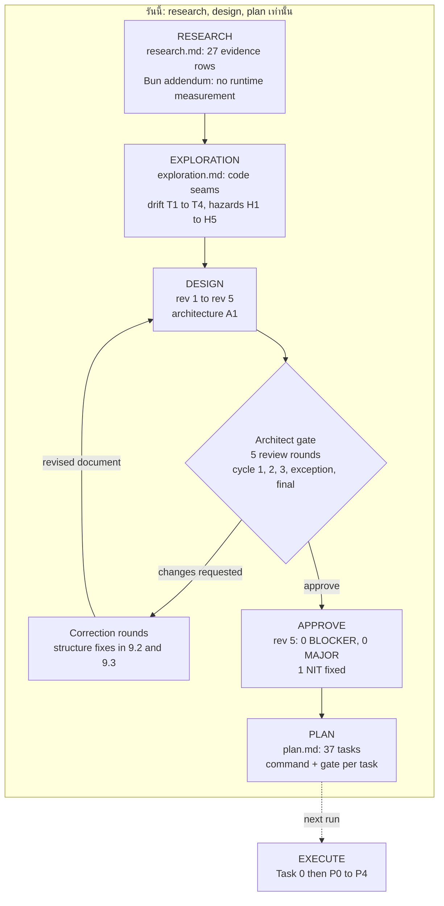
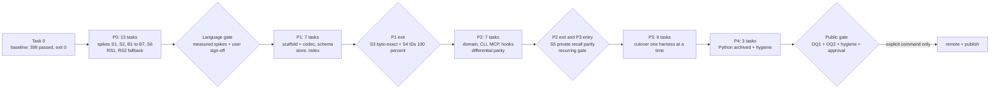

# Diff Summary — my-memory framework migration (research / design / plan)

## TL;DR

รอบนี้ผลิต 5 artifact (research · exploration · Bun addendum · design rev 5 · plan 37 tasks) และ **ไม่มี code, repo ใหม่, remote หรือ push** — ภาษา engine ยังไม่ถูกล็อก แต่ตัดสินได้ที่ P0 language gate จากผลวัดบนดิสก์ (Go นำแบบ conditional · Bun + TypeScript first-class · Rust fallback)
สถาปัตยกรรม A1 (modular monolith binary เดียว + canonical Git working tree + generic Git transport) ผ่าน independent architect gate แบบ **APPROVE** ที่ rev 5 (0 BLOCKER / 0 MAJOR / 1 NIT ที่แก้แล้ว) และถูกแปลงเป็นแผน 37 task ที่มี verification command + gate ต่อ task

**Read order:** เอกสารนี้ (2 นาที) → `plan.md` (จะทำอะไรต่อ) → `design.md` §3/§4/§9 (ทำไม) → `research.md`/`exploration.md` (หลักฐาน)

---

## 1. สิ่งที่รอบนี้ผลิต

| Artifact | บรรทัด | เนื้อหา (หนึ่งบรรทัด) | ฐานหลักฐาน |
|---|---|---|---|
| [`research.md`](research.md) | 269 | เปรียบเทียบภาษา (Go/Rust/TS/Node) + storage/provider architecture + comparable projects (Basic Memory, Letta MemFS, Mem0) | external primary sources ที่ fetch จริง 2026-10-17 · evidence ledger **E1–E27** ติดป้าย OBS/INF/ASM · Jev screen 6 ตัวอย่าง = pass (0.02) |
| [`exploration.md`](exploration.md) | 321 | current-state ของ codebase เดิม: repo map, canonical storage contract, doc-vs-code drift (T1–T4), hazard (H1–H5), port inventory | static read ของ repo จริง (read/glob/grep) — **ไม่ได้รัน test/command ใด ๆ** (ไม่มี shell ใน session นั้น; ระบุใน §6.4) |
| [`research-bun-addendum.md`](research-bun-addendum.md) | 239 | Bun + TypeScript ในฐานะ candidate: compile/distribution, FTS5 ต่อ OS, MCP stdio, dependency/keychain | materialize จาก prior research ในแชท — **ไม่มี fetch ใหม่ ไม่มีการวัด runtime** · ป้าย [DOC]/[ISSUE-REPORT]/[INFERENCE] · **ไม่มี [MEASURED]** |
| [`design.md`](design.md) | 529 | **rev 5** — A1 architecture, component boundaries, language gate, storage semantics, trust boundary 3 ชั้น, migration phases P0–P4, risks, OQ1–OQ7 | สังเคราะห์จาก 3 artifact ข้างบน + ADR (private record) + repo จริง · gate verdict **APPROVE** |
| [`plan.md`](plan.md) | 588 | **37 tasks**: Task 0 baseline + P0 13 + P1 7 + P2 7 + P3 6 + P4 3 — ทุก task มี command, expected exit code, gate ที่ปิด, user decision ที่ต้องรอ | ยึด design rev 5 §9.2 (spikes ก่อน) + §9.3 (phases) · baseline ที่วัดจริงเติมใน Task 0 |
| `log.md` | 33 | timeline ของรัน (authoritative) — รวม review verdicts, commits, budget · **อยู่ที่ private data repo** `~/my-memory/docs/workflow/my-memory-framework-migration/` ไม่ได้อยู่ในโฟลเดอร์ของ spec นี้ | บันทึกต่อ checkpoint |

`learnings.md` (15 บรรทัด) เป็น **seed จากรันก่อน** ไม่ใช่ผลผลิตของรันนี้ — design อ้างว่าตรวจแล้วว่าตรงกับ fallback snapshot ใน brief; ไฟล์นี้ **อยู่ที่ private data repo** `~/my-memory/docs/workflow/my-memory-framework-migration/` เช่นกัน

**Relocation (2026-10-19):** spec ทั้ง 6 ไฟล์ย้ายเข้า engine repo นี้ที่ `docs/spec/` (content คงเดิม ยกเว้น path reference ที่แก้ตามการย้าย) — `log.md` + `learnings.md` คงอยู่ใน private data repo เป็น audit trail

---

## 2. Decision landscape (หนึ่งหน้าจอ)

**Architecture A1 — เลือกแล้วในระดับสถาปัตยกรรม**
- binary เดียวแบบ modular monolith; CLI / MCP stdio / hook เรียก domain layer ชุดเดียว
- storage = **canonical Git working tree** (markdown + YAML frontmatter, หนึ่งไฟล์ต่อ fact) — index เป็น derived, ลบแล้ว rebuild ได้
- sync = **generic Git transport ผ่าน git CLI** (fetch / pull --rebase --autostash / push, never `--force`) → GitHub, Bitbucket, GitLab, self-hosted ใช้แทนกันได้
- A2 (in-process TS library) และ A3 (daemon + cloud) ถูกปฏิเสธพร้อมเหตุผลใน §3.1/§10

**ภาษา — ยังไม่ล็อก, gate อยู่ปลาย P0**

| Stack | สถานะ | เงื่อนไขที่ทำให้ชนะ/แพ้ |
|---|---|---|
| **Go** | leading conditional | ชนะถ้าผ่าน S1 (FTS5 บน `modernc.org/sqlite` ที่จะ pin) + S2 (MCP Go SDK กับ 6 harness) · ตกข้อใด = ออก |
| **Bun + TypeScript** | first-class conditional (ไม่ใช่ตัวสำรองของ Rust) | ชนะถ้า B1–B7 ผ่านครบ **และ** Go ตก S1/S2 · Bun = runtime, TS = ภาษา |
| **Rust** | fallback | เลือกได้หลัง RS1/RS2 ของตัวเองผ่าน และ Go + Bun ตกทั้งคู่ |

- Tie-break เมื่อผ่าน hard gate มากกว่าหนึ่ง stack: solo velocity · supply chain · operational control ของ SQLite (Go pin เดียวทุก OS vs Bun macOS ใช้ Apple system SQLite) · ecosystem alignment — ค่าตั้งต้นเอนไป Go เว้นแต่ผู้ใช้ให้น้ำหนัก TS สูงกว่า (บันทึกเป็น user input ใน ADR)
- หลักฐานฝั่ง Bun ทั้งหมดยังเป็น [DOC]/[ISSUE-REPORT]/[INFERENCE] → **ห้ามเคลมว่าเร็วกว่า/เล็กกว่า/FTS5 ครบ** จนกว่า spike จะวัด

**Gate split — private vs public (จุดที่ review จับ 3 รอบ)**
- **Private บน real clone ของ corpus จริง:** S3 (codec byte-exact, `git diff` ว่าง) + S4 (ID ตรง 100%) = P1 exit · S5 (recall5 ≥ 0.8667, mrr ≥ 0.85 บน 30 คู่) = P2 exit + P3 entry + **recurring gate ทุก engine version/config ที่กระทบ retrieval รวมหลัง P4**
- **Public CI บน synthetic fixtures เท่านั้น:** G1 (eval smoke เทียบ synthetic baseline), G2 (round-trip), G3 (ported suite 3 OS), G4 (`verify` 0 problems), G5 (gitleaks + govulncheck), G6 (hook p50 ≤ 150 ms)
- **G7 = manual per-harness matrix** (ไม่ใช่ CI job) — harness ที่ probe ไม่ผ่านห้าม cutover
- กฎเหล็ก: corpus จริง / prompt logs / record ส่วนตัว **ห้ามเข้า public repo, CI หรือ artifact**

**มติผู้ใช้ที่ resolve แล้ว (ไม่ใช่ open question)**
1. storage selection = **generic Git remote hosts** บน canonical local working tree เดียว — ไม่มี per-provider REST data backend ใน v1 (provider API = metadata-only, เฟส 2)
2. **local-first**: default ไม่มี network/account; sync เป็น opt-in ต่อ memory home; hook ไม่ push เด็ดขาด
3. **ไม่มี public remote / push / publish** ในรันนี้ และจะไม่เกิดจนกว่าจะผ่าน P4 public gate + คำสั่งผู้ใช้ชัด

---

## 3. Pipeline และ phase topology

**Pipeline ของรันนี้ — RESEARCH → DESIGN (5 รอบ gate) → PLAN**

**Phase / gate topology ที่แผนจัดไว้**

OQ2 (repo owner/name) เป็น hard gate คั่นระหว่าง `LG` กับ `P1` — ไม่มีชื่อที่อนุมัติ = ไม่มี scaffold; OQ5 (freeze 9 MCP tools) คั่นก่อน `P2`

---

## 4. Evidence table (ตรวจได้)

| ข้อเท็จจริง | ค่า | ที่มา |
|---|---|---|
| Artifact line counts | research 269 · exploration 321 · addendum 239 · design 529 · plan 588 · log 33 | ไฟล์ใน run folder |
| Review round 1 | REQUEST CHANGES — 2 MAJOR + 6 NIT (public CI ใช้ private baseline; git-absent write contract ขัดกัน) | `log.md:4` |
| Review round 2 | REQUEST CHANGES — MAJOR ใหม่ (187-assertion suite อยู่ผิดฝั่ง) + NIT trigger 400 vs ~3,000 | `log.md:6` |
| Review round 3/3 (cap) | REQUEST CHANGES — MAJOR: S5 (ต้องมี domain) ถูกวางใน P0 | `log.md:7` |
| Exception round (หลัง rev 4) | REQUEST CHANGES — 0 BLOCKER / 2 MAJOR / 4 NIT; prose แก้แต่ structure ไม่ถูกแก้ | `log.md:18` |
| Final gate (rev 5) | **APPROVE** — 0 BLOCKER / 0 MAJOR / 1 NIT (NIT แก้ใน `ad4134c`) | `log.md:27-28` |
| Measured baseline | data repo `main` @ `d0d311d` · 201 records / 173 active / 28 superseded / 92 touched today | `plan.md:77`, `log.md:31` |
| Legacy suite | **399 passed / 0 failed, exit 0** (รันจริง 2 รอบบน `~/my-memory`) | `log.md:32` |
| Recall baseline ที่ต้องรักษา | `recall5 = 0.8667`, `mrr = 0.85`, `n_pairs = 30` | `design.md` §9.2 ข, `plan.md:76` |
| Commits ของรัน | `3968d9c` (design rev 5) · `ad4134c` (NIT batch) · `11062c4` (plan) · checkpoints `36254c3`, `edd1ba8` — **ไม่ push** | `log.md:25,28,31` |
| ภาษา engine | ยังไม่ล็อก — ตัดสินที่ language gate ปลาย P0 | `design.md` §4.1 |

**Open questions ที่ยังเป็นของผู้ใช้ (design §12)**

| # | คำถาม | gate |
|---|---|---|
| OQ1 | License | ก่อน public push (P4) — แนะนำ Apache-2.0 |
| **OQ2** | **repo owner/name** | **ก่อน P1 scaffold — hard gate** (ล็อก module path/package namespace) และยืนยันซ้ำก่อน P4 |
| OQ3 | staged vs one-shot cutover | ก่อน P3 — แนะนำ staged |
| OQ4 | platform/packaging scope | ก่อนล็อก P0 matrix / release — เสนอ 5 targets, Windows codesign deferred |
| OQ5 | freeze 9 MCP tools + additive-only | ก่อน P2 — ถ้าเลือก breaking แผน parity/cutover ทั้งหมดเป็นโมฆะ |
| OQ6 | semantic search ใน MVP | defer ได้ — คง eval trigger เดิม |
| OQ7 | ยอมรับ Bun `setCustomSQLite` trade-off ไหม | เปิดเฉพาะถ้า B1–B3 ตกบน macOS |

---

## 5. สิ่งที่ **ไม่ได้** ทำในรันนี้

- ไม่มี implementation แม้บรรทัดเดียว — ไม่มี engine code, ไม่มี spike ที่รันแล้ว
- ไม่ได้สร้าง repo ใหม่, ไม่ได้สร้าง remote, ไม่ได้ push ที่ไหน (`design.md` §2.2, `plan.md` "Out of scope")
- **ภาษายังไม่ถูกเลือก** — Go/Bun/Rust ทั้งสามยังเป็น candidate; เลือกที่ปลาย P0 จากผลวัดบนดิสก์
- แผนยังไม่ถูก execute — Task 0 ยังไม่มี execution evidence ในรอบ PLAN (ผู้เขียน plan ไม่มี shell; ระบุใน `plan.md` "Under-specified" ข้อ 4)
- ยังไม่มีบันทึก explicit user approval ของ design: `design.md:3` ยังเขียน DRAFT — architect gate APPROVE ≠ user approval; §14 ยังรอ user review
- ไม่ได้แตะ data repo, harness config, หรือ source เดิม; ไม่ได้แก้ cross-run `~/Work/docs/workflow/learnings.md`

---

## 6. Follow-ups (รันถัดไป)

1. **Task 0 — baseline ก่อนทุกอย่าง:** `verify` / `stats` / `eval` / suite บน `~/my-memory`; เทียบกับ 399 passed เป็น drift check ไม่ใช่ hard-coded criterion — ไม่ตรง = หยุด
2. **P0 spikes ตามลำดับความถูก:** S1 (Go FTS5 ~1 ชม.) → S2 (MCP 6 harness) · ฝั่ง Bun เฉพาะเมื่อ Go ตก หรือผู้ใช้อนุมัติ scope ให้วัดคู่ขนาน · ทุกผลลง `WF/spikes/P0/` พร้อม discriminating control
3. **Language gate + user sign-off** ก่อนแตะ scaffold — ไม่มี sign-off = ไม่เริ่ม P1
4. **OQ2 ต้อง settle ก่อน P1 scaffold** (owner/name → module path); OQ5 ก่อน P2; OQ1 + OQ3 + OQ4 ที่ gate ของตัวเอง
5. ถ้า timeline ลื่น: หยุดก่อน P3/P4 ดีกว่าลด criteria — **ห้ามตัด S5** เพื่อรักษาวัน cutover

*หลักฐานทุกบรรทัดในเอกสารนี้มาจากไฟล์ใน run folder หรือ commit/log ของรันนี้ — ไม่มีการประมาณเพิ่ม*
