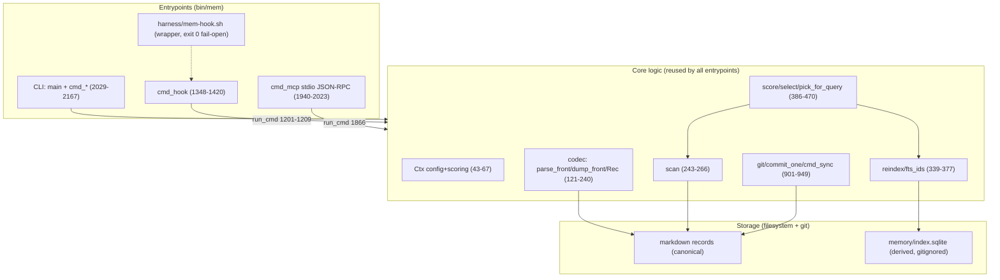

# Exploration: my-memory — current-state และ migration seam (local codebase)

- **Artifact นี้คืออะไร:** local codebase exploration สำหรับงาน **my-memory framework migration** (research/design/plan เท่านั้น — ไม่ตัดสินภาษา/provider ที่นี่; solution-architect ตัดสิน)
- **Observed date ของหลักฐานทั้งหมด:** 2026-10-17
- **Evidence base:** worktree `wf/my-memory-framework-migration` = `$HOME/my-memory-wf-my-memory-framework-migration` (linked worktree — `.git` เป็นไฟล์ชี้ `$HOME/my-memory/.git/worktrees/my-memory-wf-my-memory-framework-migration`)
- **ขอบเขต:** current-state + migration seam เท่านั้น · ไม่แก้ source code / `research.md` / `log.md`
- **สถานะที่ตรวจไม่ได้ในรอบนี้:** harness นี้ไม่มี shell/exec tool (มีแค่ read/glob/grep + MCP) → **ไม่ได้รัน** `tests/test-mem.sh`, `mem verify`, `git status` · ดู §6 สำหรับรายละเอียดข้อจำกัด

---

## 1. Repository map

Repo เป็น **data + engine รวมกัน** ในที่เดียว (engine/data แยกกันได้ด้วย `MEM_HOME` แล้ว — README:180-181) layout ตาม README:639-651

| Path | บทบาท | หลักฐาน |
|---|---|---|
| `bin/mem` | engine ทั้งหมด: CLI + hook + MCP + stats + eval · **ไฟล์เดียว Python 3.9 stdlib** 2,171 บรรทัด | `bin/mem:1-9` (shebang + docstring) · บรรทัดสุดท้าย `bin/mem:2171` |
| `bin/mem-backup` | backup kit (bash): `run`/`drill`/`status`/`setup` · bundle → gpg-symmetric → offsite | `bin/mem-backup:1-8,20-31` · `schema/backup.json` |
| `bin/com.<owner>.mem-backup.plist` | LaunchAgent template (schedule มาจาก schema) | `harness/install.sh:19` · README:471-473 |
| `schema/` | contracts 4 ไฟล์: `record.schema.json`, `taxonomy.json`, `agents.json`, `backup.json` | README:645 |
| `harness/` | `mem-hook.sh` (entry point เดียว), `install.sh` (gated installer), `pre-push.sh` (gitleaks), `opencode/my-memory.js` (plugin), `README.md` | `harness/README.md:1-14` |
| `tests/test-mem.sh` | black-box suite รันบนสำเนา temp · **187 assertion sites** (นับด้วย grep) | `tests/test-mem.sh:1-41` |
| `eval/golden.jsonl` + `eval/baseline.json` | golden corpus 30 คู่ + baseline gate | `eval/golden.jsonl:1-30` · `eval/baseline.json:1-36` |
| `rules/` `projects/` `lessons/` `decisions/` `handoffs/` `knowledge/` | record จริง (canonical) — lessons 127 ไฟล์, rules 6, decisions 13, knowledge 15, handoffs 4, projects 7 | dir listings |
| `ops/` | append-only ledgers: `task-ledger.md`, `backup-ledger.md`, `promotions.md`, `failures/` | `ops/` listing |
| `skills/promote-lessons/` | skill (symlink เข้า `~/.agents/skills/`) | README:615-617 |
| `decisions/2026-10-16-...markdown-frontmatter-ใน-git-rep.md` | ADR หลักของ storage decision | ADR:1-27 |
| `.memory/index.sqlite` | derived index (gitignored — safe to delete) | `.gitignore:1-2` · README:650 |
| `docs/workflow/my-memory-framework-migration/` | run log + pointer ของรอบนี้ (spec ย้ายไป `~/Work/my-memory-engine/docs/spec/` แล้ว 2026-10-19) | dir listing |

### `bin/mem` — command families (ตาม argparse จริง `bin/mem:2029-2167`)

**18 subcommand** (ไม่ได้ 15 ตาม docstring/README — ดู stale facts §3.5):
`context` (2034) · `search` (2043) · `list` (2051) · `show` (2060) · `add` (2065) · `touch` (2086) · `cite` (2090) · `review` (2094) · `supersede` (2099) · `verify` (2105) · `reindex` (2108) · `render` (2111) · `sync` (2117) · `import` (2122) · `hook` (2134) · `stats` (2148) · `eval` (2152) · `mcp` (2160)

Section headers ในไฟล์ (`grep -n '^# ───'`) แบ่งได้เป็น: repo/config (40) · frontmatter (89) · scan/safety (269) · index (336) · scoring (380) · commands (484) · git (898) · render (952) · import (1087) · hook (1212) · stats (1423) · eval (1491) · MCP (1737) · main (2026)

---

## 2. Current canonical storage contract

**Canonical = markdown + YAML frontmatter หนึ่งไฟล์ต่อหนึ่ง fact ใน git repo** (ADR:17,25) · index เป็น derived (ADR:17) · หลักการ: "what you own is the format and the storage, not the tool" (README:15-16)

### 2.1 Record format — บังคับจริงด้วยโค้ด

- **parser:** `parse_front` (`bin/mem:121-155`) เป็น **hand-rolled YAML subset** ไม่ใช่ YAML parser เต็ม — รองรับ flat scalar, inline list `[a, b]`, block list `- x`, boolean; quote handling `_unquote` (92-96), `_parse_inline_list` (99-118)
- **writer:** `dump_front` (167-185) เขียนตาม **`FRONT_ORDER` ตายตัว** (31-34: `id, title, layer, scope, tags, confidence, source, session, evidence, supersedes, superseded_by, created, last_used, uses, expires, status, sensitivity`) แล้วต่อ key แปลกที่เหลือ (180-183) · `LIST_KEYS = {tags, evidence}` (35) · quoting rule `_needs_quote` (158-159)
- **required fields (บังคับจริง):** `REQUIRED = [id, layer, scope, created, status, sensitivity]` (36) ตรวจใน `cmd_verify` (828-830) — **ตรงกับ** `schema/record.schema.json:5`
- **ID:** `make_id` (307-309) = `sha1("{layer}|{scope}|{title}|{body}")[:8]` → `<layer>.<hex8>` · รูปแบบบังคับ `ID_RE` (38) + `record.schema.json:7` (`[0-9a-f]{8,16}`)
  - `title` ถ้าไม่ส่ง `--title` ถูก derive จากบรรทัดแรกของ body (634-635) → **id ขึ้นกับ body ที่ normalize แล้ว** (`body.strip()+"\n"`, 626)
- **scope:** regex `^(global|project:.+|repo:.+/.+|agent:.+)$` (632) — ตรงกับ `record.schema.json:10`
- **status:** `active | superseded | archived` (`record.schema.json:20`) · **sensitivity:** `public | internal | private | quarantine` (`record.schema.json:21`, argparse choices 2080-2081)
- **layer → dir:** `Ctx.dir_for` (66-67) อ่านจาก `schema/taxonomy.json` (46) · layer/dir ไม่ตรง = verify FAIL (836-837)
- **file naming:** lesson/handoff/decision → `<created>-<slug>.md`, อื่น ๆ → `<slug>.md` (712-715) · collision เติม `-2`, `-3` (717-722)
- **scan rule:** ข้าม path component ที่ขึ้นต้น `_` (253) และข้าม layer `file_mode == append-only` (= `ops/`) (246-247)

### 2.2 Lifecycle rules

| Rule | Enforced ที่ | หลักฐาน |
|---|---|---|
| supersede ไม่ลบ: เก่า = `status: superseded` + `superseded_by`, ใหม่ = `supersedes: <id>` | `cmd_add:726-732`, `cmd_supersede:804-818` | README:59-60 · ADR:17 |
| `expires` required สำหรับ `handoff` | `taxonomy.json:31` + `cmd_add:682-683` + `cmd_verify:844-845` | README:114 |
| `expires` normalized เป็น ISO เสมอ (`none`/`YYYY-MM-DD`/`+21d`/`+2w`/`+3m`) | `norm_expires:319-333`, `Rec.expired:224-236` | README:137 |
| quarantine ซ่อนจากทุก injection path + ปลดได้ที่ `mem review` เท่านั้น | `select:428-429`, `cmd_context:510-511`, `render_block:997-998`, `cmd_review:780-801` | README:291-306 |
| `source external:*` ต้องมี `--evidence` (screening) | `cmd_add:637-639` (exit 3) | README:294-298 |
| quarantine record ต้องมี `source: external:*` | `cmd_verify:838-839` | — |
| tag ต้องอยู่ใน `taxonomy.json` (นับเป็น warning) | `cmd_verify:846-848` | — |

### 2.3 Derived index (SQLite FTS5)

- `reindex` (339-362): **DROP + CREATE ใหม่ทุกครั้ง** — `rec` table (344-345) + `CREATE VIRTUAL TABLE fts USING fts5(id UNINDEXED, title, body, tags, tokenize='unicode61')` (347) · ถ้า FTS5 ไม่มี → `have_fts=False` แล้วใช้ substring fallback (348-350, 361)
- query: `fts_ids` (365-377) ใช้ `... MATCH ? ORDER BY bm25(fts)` (374)
- **ไม่บังคับ index:** `cmd_search` rebuild ถ้าไม่มี (575-576) · `cmd_verify` รายงาน index drift ด้วย **row count เท่านั้น** (876-882)
- **ไม่มี `schema_version` ใน index** (ยืนยันด้วย grep: มีแค่ `DROP TABLE`/`CREATE TABLE`) → index สอง implementation เขียนทับกันจะไม่ถูกตรวจจับ (ดู §4 data-loss hazard)

### 2.4 `MEM_HOME` / backup / git sync

- **root resolution:** `find_root` (70-81) → `MEM_HOME` env (71) → walk ขึ้นจาก `__file__`/cwd หา `schema/taxonomy.json` (74-77) → default `~/my-memory` (78) → die (81)
  - wrapper อ่าน `MEM_HOME` **หรือ** `MY_MEMORY_HOME` แล้วส่ง `--home` (harness/mem-hook.sh:10-22) · plugin ใช้ `MY_MEMORY_HOME` (harness/opencode/my-memory.js:31)
- **backup:** `bin/mem-backup` bundle → verify → prune(30) → gitleaks gate → gpg-symmetric encrypt → offsite · exit contract `0/1/2/3/4` (bin/mem-backup:7,20-31) · config ใน `schema/backup.json` (`offsite_encryption: "gpg-symmetric"`, `retention: 30`, **`remotes: []`** คือ seam เพิ่ม remote ที่สอง)
- **git sync:** `git()` = subprocess เท่านั้น ไม่มี library (901-903) · `commit_one` (910-917) **กลืน error** (`except CalledProcessError` → print stderr เท่านั้น) · `cmd_sync` (920-949): commit → fetch → `pull --rebase --autostash` → push, retry 3 ครั้ง, ห้าม force (949)
- **hook ไม่ push เด็ดขาด** (hook stop = commit เท่านั้น, 1374-1417) · push ต้อง explicit ผ่าน `mem sync` / MCP `memory_sync`

### 2.5 ⚠️ Enforced contract vs README/ADR statements (จุดที่เอกสารไม่ตรงกับโค้ด)

| # | เอกสารอ้าง | ความจริงในโค้ด | หลักฐาน |
|---|---|---|---|
| S1 | README:149-151 "`schema/record.schema.json` is the contract … `mem verify` validates every record" | `bin/mem` **ไม่อ่าน `record.schema.json` เลย** (grep: 0 hit) — `mem verify` implement checks เอง (`REQUIRED` 36, `ID_RE` 38) · JSON Schema เป็น **เอกสาร ไม่ใช่ enforcement** | `bin/mem:36,821-891` |
| S2 | `record.schema.json` เป็น contract เต็ม | schema **ตกหล่น field ที่โค้ดเขียนจริง**: `superseded_by` (เขียนที่ 730) และ `uses` (เขียนที่ 766) ไม่อยู่ใน `properties` (มีแค่ `supersedes`, `record.schema.json:16`) — ทั้งคู่อยู่ใน `FRONT_ORDER` (33) | `record.schema.json:6-22` vs `bin/mem:33,730,766` |
| S3 | README:409 "`confidence < 1.0` requires `evidence`" | บังคับเป็น **warning เท่านั้น** (`cmd_verify:849-850`) · `cmd_add` ไม่มี check นี้ | `bin/mem:849-850` |
| S4 | ADR:17 "index เป็น SQLite FTS5 ที่ derived และ gitignore ทิ้งได้" | ✅ ตรง — `.gitignore:1-2` ignore `.memory/` และ `*.sqlite*` | `.gitignore:1-4` |
| S5 | README:226 "Every recall/inject appends a row to `ops/recall-log.jsonl` (gitignored — never committed)" | ✅ ตรง — `log_event:1222-1230` + `.gitignore:8` | — |
| S6 | ตัวเลขที่ยืนยันตรงกัน (enforced == documented): injection budgets rules 5,400 / project 6,000 / lesson 8,000 / handoff 4,000 / decision 3,000 / knowledge 1,200 / total 20,000 | `taxonomy.json:47-55` == README:118-119 | — |
| S7 | scoring default `w_conf=1, w_recency=0, tau_days=14, w_uses=0, threshold_hook=6.0` | `taxonomy.json:56` == `DEFAULT_SCORING` (383) == README:268-270 | — |

### 2.6 Stale facts ที่เจอ (ควรแก้ในรอบ doc-update — **artifact นี้ไม่แก้**)

| # | ที่เขียนไว้ | ค่าจริงใน worktree นี้ | หลักฐาน |
|---|---|---|---|
| T1 | README:189 "one file, 15 subcommands"; docstring:7-8 list 15 | argparse มี **18** (`bin/mem:2034-2162`); README table ลิสต์ 16 แถว (191-208) | grep + `bin/mem:2029-2167` |
| T2 | README:80,313-322 และ harness/README:134 = "**8 tools**" | `MCP_TOOLS` มี **9** (เพิ่ม `memory_cite`, 1780-1784) | `bin/mem:1744-1836` |
| T3 | README:11,649 "**160** black-box tests / 160-check suite" | grep นับ assertion sites ได้ **187** · project brief ระบุ 151→164→167 ตามลำดับเวลา | `tests/test-mem.sh` (grep) · brief:142,158 |
| T4 | brief:51 rules budget ≤ **4,000** chars | `taxonomy.json:48` = **5,400** และ README:118 = 5,400 | `taxonomy.json:48` |
| T5 | README:654 "private repo · no licence yet" | ✅ ถูกต้อง — ไม่มีไฟล์ LICENSE ทั้ง tree (§5) | glob `**/LICENSE*` = 0 |

---

## 3. Current I/O และ module boundaries

ทุกอย่างอยู่ใน `bin/mem` ไฟล์เดียว — **ไม่มี import ระหว่าง module** · boundary ที่มีจริงคือ (ก) `Ctx` (state/config), (ข) `argparse.Namespace` (สัญญาระหว่าง CLI กับ logic), (ค) `run_cmd` (adapter ให้ hook/MCP เรียก `cmd_*` ตัวเดิม), (ง) subprocess `git`

### 3.1 Record codec / parser

- `parse_front` (121-155), `dump_front` (167-185), `Rec` (188-240) พร้อม `id/layer/scope/tags/title/status` properties (195-222), `expired()` (224-236), `rewrite()` (238-240)
- **coupled:** `Rec.__init__` อ่านไฟล์ทันที (192) → object ผูกกับ path + FS · writer (`dump_front`) เป็นตัวกำหนด format ที่ทุกเครื่องต้องตรงกัน byte-level

### 3.2 Domain / lifecycle

- `cmd_add` (622-737) รวม guard + dedup + supersede + write + reindex + commit ไว้ใน function เดียว
- dedup: `core_text` (312-316) ตัด `**Evidence.**`/`**Source.**`/`_[source:` ออก แล้วเทียบ `jaccard` (294-297): block ที่ `>= 0.88` (660-662), เตือน band `0.60–0.88` (658-659, 663-665) และ cross-layer `lesson`→`knowledge` `>= 0.60` (666-677)
- `cmd_cite` (753-777): read-modify-write `uses` + reindex ใต้ `flock` (`.memory/cite.lock`, 757-759) — จุดเดียวในโค้ดที่ใช้ lock
- `cmd_review` (780-801) = ทางออก quarantine เดียว + log `type=review` + commit ทันที (800)

### 3.3 Search / index

- `reindex` (339), `fts_ids` (365) — เรียกจาก 7 จุด: `cmd_add:734`, `cmd_cite:770`, `cmd_review:797`, `cmd_supersede:815`, `cmd_import:1173`, `cmd_hook stop:1379`, `cmd_sync:923`
- `select` (422-447) เรียก `scan` → **re-read ทุก .md จากดิสก์ทุกครั้ง** (424) · `pick_for_query` (450-470) เรียก `select` **3 ครั้ง** (layer lesson/decision/handoff, 454) → 3 full scans + score ซ้ำ · README ยอมรับ trade-off นี้แล้ว (README:625-630) พร้อม trigger "records ≥ 400 หรือ hook p50 > 150 ms"
- scoring: `score` (386-419) = additive formula, `LAYER_WEIGHT` (37), weights จาก `ctx.scoring` (57-64)

### 3.4 Git commit / pull / push

- `git` (901-903) subprocess เท่านั้น · `is_repo` (906-907) เช็ค `.git` exists
- `commit_one` (910-917) กลืน error · `cmd_sync` (920-949) pull --rebase --autostash + push พร้อม retry

### 3.5 MCP stdio / tools

- **ไม่ใช้ official MCP SDK** — hand-written JSON-RPC: `mcp_read_message` (1940-1958) รองรับทั้ง JSON-ต่อ-บรรทัด และ `Content-Length` framing · `mcp_handle` (1961-1998) methods: `initialize`, `ping`, `tools/list`, `tools/call`, `resources/list`/`templates`, `prompts/list` (return ว่าง)
- `MCP_SERVER_NAME="my-memory"`, `MCP_VERSION="1.0.0"`, `MCP_PROTOCOL_DEFAULT="2024-11-05"` (1740-1742) · echo `protocolVersion` ของ client (1973)
- `mcp_tool_call` (1865-1937) แปลง MCP args → `argparse.Namespace` แล้วเรียก `cmd_*` ผ่าน `run_cmd` (1201-1209) → **guards/dedup/commit semantics มาจาก code path เดียวกับ CLI** (boundary ที่ดี)
- handshake ส่ง `instructions` (1847-1862)

### 3.6 Hooks / installers

- `harness/mem-hook.sh` (22 บรรทัด): `MEM_HOME`/`MY_MEMORY_HOME` → `exec python3 "$MEM" --home ... hook ...` · exit 0 เงียบถ้าไม่พบ repo/python3 (13-14)
- `cmd_hook` (1348-1420): events `session-start` (→`cmd_context` budget 2500), `user-prompt` (→`hook_recall` budget 1400, เงียบถ้า content token < 2), `stop` (reindex + local commit, ห่อ `except Exception` fail-open 1415-1416)
- **4 output formats** ใน `hook_emit` (1320-1345): `text` (claude/codex), `json` (`hookSpecificOutput.additionalContext` — gemini), `hermes` (`{"context"}`), `cursor` (`{"additional_context"}` + `continue:true`) — **นี่คือ contract ที่ผูกกับ harness 6 ตัว**
- payload extraction: `hook_payload_query` (1269-1294) + `hook_payload_session` (1233-1266) รองรับ key ต่างกันต่อ harness
- `harness/install.sh`: apply modes gated ด้วย `--yes`/TTY (50-60) · `--backup` refuse linked worktree (24-31) · backup `.bak-<ts>` ทุกไฟล์
- `harness/pre-push.sh`: gitleaks gate fail-closed เมื่อเจอ secret, fail-open เมื่อไม่มี binary/crash (1-32)

**จุดที่ concerns ถูก couple (สำคัญต่อการออกแบบ seam):**
1. `Ctx` รวม config + scoring + paths + session → logic ทุกตัวพึ่ง `Ctx` ก้อนเดียว
2. สัญญา CLI↔logic คือ `argparse.Namespace` → port ต้อง reimplement การประกอบ Namespace หรือ refactor (เช่น `memory_add` MCP ต้องประกอบ 15+ field เอง, 1898-1905)
3. `rewrite()` เขียนไฟล์ตรง + update `self.meta` → ไม่มี transaction/atomic write
4. reindex ถูกเรียกจาก 7 จุดแบบ inline → index coupling กับ write path
5. `select`/`scan` re-read ดิสก์ทุกครั้ง → ยังไม่มี cache layer ให้แยกออก

---

## 4. Migration inventory

### 4.1 น่าจะ portable ได้โดยไม่ต้องแก้ (data + contract)

| สิ่ง | เหตุผล | หลักฐาน |
|---|---|---|
| **markdown + frontmatter records ทั้งหมด** | format invariant C3 · อ่านด้วย `rg`/`git` ได้แม้ทิ้ง CLI | ADR:17 · README:15-16 |
| `schema/taxonomy.json` | data-driven: layers/budgets/scoring/tags/secret_patterns/forbidden paths | `taxonomy.json:1-120` |
| `schema/agents.json` | adapter registry — "เพิ่ม agent ใหม่ = เพิ่ม entry ที่นี่ (ไม่ต้องแก้โค้ด mem)" | `agents.json:3` |
| `schema/backup.json` | config + `remotes` seam | `backup.json:1-8` |
| `eval/golden.jsonl` (30 คู่) + `eval/baseline.json` | **golden corpus = acceptance spec** ของ recall | `golden.jsonl:1-30` · `baseline.json` |
| `tests/test-mem.sh` (187 assertions) | black-box รันกับ CLI จริงบนสำเนา temp → "double as the contract spec for any future rewrite" | README:508-509 |
| MCP tool contracts (ชื่อ/args/behavior) | `MCP_TOOLS` 9 ตัว + handshake instructions | `bin/mem:1744-1862` |
| ops ledgers + `knowledge/`/`rules/`/`decisions/`/`handoffs/` | plain append-only/markdown | dir listings |

### 4.2 ต้อง reimplement (ผูกกับ runtime/ภาษา)

| Component | หลักฐาน | หมายเหตุ |
|---|---|---|
| CLI ทั้งหมด (`argparse`, 18 subcommand) | `bin/mem:2029-2167` | รวม exit-code convention (1/2/3) |
| storage layer: `find_root`/`Ctx`/`Rec`/`parse_front`/`dump_front`/`scan`/`rewrite` | 43-266 | hand-rolled YAML subset ต้อง reproduce ให้ตรง |
| SQLite index (`reindex`/`fts_ids`) | 339-377 | FTS5 + `tokenize='unicode61'` → **ผลพวงจาก research E4/E9/E13** |
| scoring/selection (`score`/`select`/`pick_for_query`/`render_recall_body`) | 386-481 | ต้อง bit-for-bit เทียบ baseline |
| git layer (`git`/`commit_one`/`cmd_sync`) | 901-949 | ใช้ git CLI — research แนะนำเก็บเป็น default [E17][E18] |
| hook adapters 4 formats | 1320-1345 | contract ผูกกับ claude/codex/gemini/hermes/cursor |
| MCP stdio server (hand-written JSON-RPC + 2 framings) | 1940-2023 | research ชี้ official SDK Tier 1 [E1][E2] |
| harness/install.sh + pre-push.sh + opencode plugin | `harness/` | symlink/`.bak`/launchctl/plugin module cache |
| bin/mem-backup + plist | `bin/mem-backup:1-80` | gpg-symmetric + iCloud Drive (macOS-specific) |

### 4.3 Compatibility risks

| # | ความเสี่ยง | หลักฐาน | มาตรการที่หลักฐานชี้ |
|---|---|---|---|
| R1 | **Frontmatter writer ต่างกัน** → ทุกไฟล์ diff ใหม่ทั้ง repo, เกิด conflict ข้ามเครื่อง | `dump_front:167-185` + `FRONT_ORDER:31-34` + `_needs_quote:158-159` | pin byte-exact semantics; smoke: เขียน → `git diff` ต้องว่าง |
| R2 | **ID formula ต่างกัน** → dedup/supersede chain ขาด (`--supersedes` ชี้ id ที่ไม่มี) | `make_id:307-309` (sha1 ของ `layer\|scope\|title\|body`) | ล็อกอัลกอริทึม + ทดสอบ id เดิมผ่าน golden corpus |
| R3 | **Thai tokenization / FTS5 tokenizer** → recall เปลี่ยน, eval gate FAIL | `tokens():290-291` (รวม `ก-๙`), `tokenize='unicode61'` (347), `golden.jsonl` ไทย/อังกฤษ/ผสม | เทียบ `recall@5`/`MRR` กับ `baseline.json` (0.8667 / 0.85) |
| R4 | **MCP tool name/argument เปลี่ยน** → harness config 6 adapters พัง | `agents.json` per-harness `add_cmd`/`config_file` | freeze tool schema; README ยอมรับแล้วว่า CLI+MCP = contract (README:560-562) |
| R5 | **parse subset ไม่ครบ** → record ที่ parse ไม่ได้กลายเป็น "broken" แล้วหายจาก scan | `parse_front:121-155` · `scan:260-263` (ข้ามถ้าไม่มี frontmatter เมื่อไม่ใช่ verify) | ต้อง import/validate ไฟล์เดิม 127 lessons ก่อน cut-over |
| R6 | **`_`-prefix skip rule + append-only skip** ต่างกัน → record โผล่/หาย | `scan:246-253` | ทดสอบ count เท่า `mem stats` ก่อน/หลัง |
| R7 | env name ต่างกัน → hook/MCP ชี้ repo ผิด | `MEM_HOME` (71) + `MY_MEMORY_HOME` (mem-hook.sh:10, plugin:31) | รองรับทั้งสองชื่อ |

### 4.4 Data-loss hazards

| # | Hazard | หลักฐาน | หมายเหตุ |
|---|---|---|---|
| H1 | **Index ไม่มี version stamp** — `reindex` DROP+CREATE `rec`/`fts` ทุกครั้ง; verify เทียบแค่ row count | `bin/mem:342-345,876-882` | dual-run สอง implementation เขียน `.memory/index.sqlite` ร่วมกัน = ทับกันเงียบ ๆ → research แนะนำแยก index ไฟล์ต่อ implementation + rebuild จาก markdown เสมอ (research §6.4) |
| H2 | **Silent commit failure** — `commit_one` กลืน git error → ไฟล์เขียนแล้วไม่ถูก commit | `bin/mem:910-917` · README:495-504 (signing interaction) | port ต้องรักษาหรือทำให้ observable (user rule: no silent failures) |
| H3 | **`rewrite()` ไม่ atomic** — เขียนทับไฟล์ตรง ไม่มี temp+rename | `bin/mem:238-240` | crash กลาง write = record เสียหาย (ไม่มี backup ต่อไฟล์) |
| H4 | **`--force` / `--supersede` เขียนทับของเดิม** | `cmd_add:645-662` | ถ้า id calculation ต่างกัน (R2) อาจ supersede ผิดตัว |
| H5 | **repo นี้เป็น personal memory จริง** — "do not publish it as-is" | README:422 | migration ต้องแยก engine/data ก่อน public (README:604-607) · ต้องไม่ publish `lessons/`/`knowledge/` |
| H6 | **ops ledgers append-only + gitleaks ledger lines** ถูกเขียนจาก hook/worktree | `pre-push.sh:16-19` | ถ้า port ย้ายที่ ledger = ประวัติ backup/audit ขาด |

---

## 5. Existing OSS / release readiness evidence (เท่าที่มีจริง)

### 5.1 มีอยู่

| สิ่ง | หลักฐาน |
|---|---|
| `README.md` 657 บรรทัด ภาษาอังกฤษ framework-grade (TOC 16 หัวข้อ, prior art, benchmark caveat, roadmap) | `README.md:1-657` |
| `harness/README.md` 154 บรรทัด (operational reference) | `harness/README.md:1-154` |
| `tests/test-mem.sh` black-box suite (187 assertions) | `tests/test-mem.sh` |
| `.gitignore` (ignore `.memory/`, `*.sqlite*`, `ops/recall-log.jsonl`) | `.gitignore:1-8` |
| `.gitleaks.toml` (secret-scan config) | root listing |
| `decisions/` ADR 13 ไฟล์ (ใน-repo) | `decisions/` listing |
| `skills/promote-lessons/SKILL.md` | README:615-617 |
| Workflow artifacts ภายใต้ `docs/workflow/` — หลัง 2026-10-19 เหลือ run log + pointer (spec อยู่ที่ `~/Work/my-memory-engine/docs/spec/`) | `docs/` listing |
| Exit-code contracts ที่ประกาศชัด: `mem add` (1/2/3), `mem-backup` (0–4), `mem eval` (0/1) | README:458-459 · `bin/mem-backup:7` |

### 5.2 ❌ ไม่พบ (verified — glob/grep เท่านั้น ไม่ใช่การคาดเดา)

| สิ่งที่ OSS release ต้องมี | สถานะ | วิธีตรวจ |
|---|---|---|
| `LICENSE` / `LICENCE` / `COPYING` | **ไม่มี** (0 match ทั้ง tree) | `glob **/LICENSE*` (hidden) |
| `.github/` (CI workflows, PR template, CODEOWNERS, issue templates) | **ไม่มี** — ไม่มีไฟล์ `*.yml`/`*.yaml` ใด ๆ ใน repo เลย | `glob **/.github/** , **/*.yml , **/*.yaml` |
| `CONTRIBUTING.md` | **ไม่มี** | `glob **/CONTRIBUTING*` |
| packaging/build manifest (`pyproject.toml`, `setup.py`, `Makefile`, `pytest.ini`, `*.cfg`) | **ไม่มี** (ไฟล์เดียวที่ match `*.toml` คือ `.gitleaks.toml`) | `glob` |
| release pipeline / versioning / changelog | **ไม่มี** (ไม่มี `CHANGELOG*`, ไม่มี tag artifact ในงานนี้) | glob |
| install แบบ one-command นอก personal path | **ไม่มี** — `harness/install.sh` ผูกกับ `~/my-memory` + LaunchAgent + plugin symlink | `harness/install.sh:16-19` |
| benchmark/eval ระดับ public (LongMemEval ฯลฯ) | **ไม่มีโดยเจตนา** — README:581-587 ระบุใช้ eval บน record ของตัวเองแทน; ยังไม่วัด F6 recall@5 (brief:168) | README:581-587 |

**สรุป readiness:** เอกสารระดับ framework ดี แต่ **release artifacts ขาดทั้งหมด**: ไม่มี license, ไม่มี CI, ไม่มี contribution/PR template, ไม่มี packaging/build — README:654 ยืนยันเอง "no licence yet (pick one before any public release)" · research Q6 ตั้งคำถาม license ไว้แล้ว (research §7 Q6)

---

## 6. Inspection scope note

### 6.1 อ่านละเอียด (เต็มไฟล์ / เกือบเต็ม)

- `bin/mem` — อ่าน **ทุกบรรทัด 1-2171** (แบ่ง 7 slices) + grep function map (`^(def|class|# ───)` = 92 hit)
- `README.md` (657) · `harness/README.md` (154) · `harness/mem-hook.sh` (22) · `harness/pre-push.sh` (1-40)
- `schema/record.schema.json` · `schema/taxonomy.json` · `schema/agents.json` · `schema/backup.json` (เต็ม)
- `decisions/2026-10-16-ความจำถาวรของ-agent-...md` (27 บรรทัด) · Obsidian brief `Projects/my-memory.md` (174)
- `eval/golden.jsonl` (30 บรรทัด) · `eval/baseline.json` (36)
- `bin/mem-backup` (1-80) · `harness/install.sh` (1-60) · `harness/opencode/my-memory.js` (1-50)
- `tests/test-mem.sh` (1-90) + **grep ทั้งไฟล์** count assertion sites = 187
- `handoffs/2026-10-17-engine-inc1-...md` (อ่านเพื่อ cross-check state)

### 6.2 อ่านแบบ sample / ดูเฉพาะส่วน

- `bin/mem-backup` ส่วนหลัง L80 (phases `drill`/`status`/`setup`) — อ่านแค่ contract/usage
- `harness/install.sh` หลัง L60 — อ่านแค่ gating + worktree refuse logic
- `harness/opencode/my-memory.js` หลัง L50 — อ่านแค่ constants/log layer
- `tests/test-mem.sh` หลัง L90 — อ่านผ่าน grep (ชื่อเคส) ไม่ได้อ่าน body ทุกบรรทัด
- `ops/*.md` ledgers — ดูเฉพาะ listing + format comment
- `.gitleaks.toml` — ยืนยันการมีอยู่ ไม่ได้อ่าน rule ภายใน

### 6.3 ข้าม (และเหตุผล)

- **body ของ lesson/knowledge 127+15 ไฟล์** — ไม่จำเป็นต่อ current-state/migration structure; เป็น content ไม่ใช่ contract (dir listing พอ)
- **git internals ของ parent repo** (`~/my-memory/.git/`) — อ่านได้แค่ worktree gitdir; packed refs/objects ไม่ได้เปิด (นอกขอบเขต + data boundary)
- **research.md §2 evidence ledger เชิงลึก** — อ่านครบแล้วแต่ไม่ทำซ้ำ (เป็น external research ไม่ใช่ local code)

### 6.4 ไม่ได้รันอะไรเลย (ยืนยันตรงไปตรงมา)

- **ไม่ได้รัน:** `tests/test-mem.sh`, `mem verify`, `mem stats`, `mem eval`, `git status`, `git log` — harness นี้ **ไม่มี shell/exec tool** (คาตาล็อกมีแค่ read/glob/grep + MCP: jev/notion/opencode)
- **ตัวเลขทั้งหมดจึงมาจากการอ่านไฟล์** (เช่น "187 assertions" = grep count, "2,171 บรรทัด" = read offset สุดท้าย) ไม่ใช่ผลรัน
- **Cleanliness ของ source worktree:**
  - branch ยืนยันจากดิสก์: worktree gitdir `HEAD` = `ref: refs/heads/wf/my-memory-framework-migration` ✅
  - `ORIG_HEAD` = `fcee510b56941f24d78c4958ecbe2ab598b348db` — **ตรงกับ** ที่ `log.md` บันทึก ("worktree clean @ fcee510") ✅
  - last commit message ใน worktree = `wf(my-memory-framework-migration): UNDERSTAND — isolated run scaffold` (COMMIT_EDITMSG) — สอดคล้องกับ scaffold commit ใน brief
  - ⚠️ **working-tree cleanliness ไม่ได้ re-verify ด้วย `git status`** (ไม่มี shell) — เชื่อตามที่ `log.md` บันทึก · **scaffold commit sha `00a3858` จาก brief ยืนยันไม่ได้** (worktree refs ไม่มีไฟล์ refs ให้อ่าน, refs อยู่ใน parent packed-refs)
  - ✅ **ผู้เขียน artifact นี้ไม่ได้แก้ไฟล์ใด ๆ นอกจาก `exploration.md` ไฟล์เดียวนี้**

### 6.5 หมายเหตุสำหรับ solution-architect

- หลักฐานทั้งหมดชี้ว่า **format + schema + golden corpus + black-box tests 4 อย่างนี้คือ "ของที่ต้องเป็นของเรา"** (portable, format invariant) — ที่เหลือคือ implementation ที่ reimplement ได้
- **จุดวัดความสำเร็จที่มีอยู่แล้วในงานนี้:** `baseline.json` (`recall5=0.8667`, `mrr=0.85`, `n_pairs=30`) + `tests/test-mem.sh` (187 assertions) → ใช้เป็น acceptance spec ของ port ได้ทันทีโดยไม่ต้องสร้างใหม่
- **จุดต้องตัดสินที่ architecture (ไม่ใช่ที่นี่):** index versioning (H1), dual-run policy, license, MCP SDK vs hand-written, git CLI vs library — research ตั้ง Q1–Q11 ไว้แล้ว
