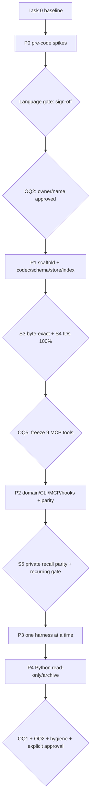

# my-memory Framework Migration — Implementation Plan

> **สำหรับ agent ที่รับช่วง implementation:** ทำตาม task ตามลำดับและ checkpoint ในเอกสารนี้; ทุก task ต้องเขียนผล/หลักฐานลงดิสก์ก่อนเริ่ม task ที่พึ่งพา ห้ามข้าม gate เพื่อให้ดูเหมือนเขียว

**Goal:** ย้าย `my-memory` ไปเป็น open-source, non-Python, local-first framework โดยคง record format/IDs/MCP/hooks เดิม และรองรับ local Git working tree พร้อม generic Git remote แบบ opt-in

**Architecture:** ยึด design rev 5: modular monolith binary เดียว, canonical Markdown + YAML frontmatter, LocalStore เป็น source of truth, derived SQLite FTS5 index และ git CLI สำหรับ generic remote sync เท่านั้น ภาษาเลือกจากผลวัด P0; engine repo แยกจาก private data repo และ cutover ทั้ง 6 harness แบบ staged/rollback-able

**Tech Stack:** ยังไม่ล็อก — Go เป็น leading conditional candidate, Bun + TypeScript เป็น conditional candidate และ Rust เป็น fallback ตาม language gate ใน design §4.2/§9.2 ก

---

## Preamble และขอบเขต

แผนนี้ร่างจาก `design.md` **rev 5** ที่ผ่าน independent architecture gate (0 BLOCKER / 0 MAJOR / 1 NIT; NIT ได้แก้แล้วใน artifact) โดยยึด §9.2 (ก) pre-code spikes ก่อน §9.3 phases เสมอ เอกสารนี้เป็นแผนสำหรับ run ภายหลัง ไม่ได้ execute ในรอบ PLAN นี้

ในรอบนี้ไม่มี implementation, repo ใหม่, remote, push หรือการเปลี่ยน harness config จริง ไฟล์ผลวัดและผล parity ที่มีข้อมูลจริงต้องอยู่ใน private data repo เท่านั้น ห้ามนำ corpus, prompt log, record จริง หรือ output ที่เปิดเผยข้อมูลส่วนตัวไปยัง engine repo/CI/artifacts

### ตัวแปรและหลักฐานที่ต้องคงอยู่บนดิสก์

```sh
REPO="$HOME/my-memory"
WF="$REPO/docs/workflow/my-memory-framework-migration"
ENGINE_DIR="$HOME/Work/my-memory-engine"   # path จริง (name ตัดสิน 2026-10-19); module path / package name ยังรอ P0 language gate
REAL_CLONE="<fresh-independent-clone-under-private-temp-dir>"
```

**ย้ายที่อยู่ (2026-10-19):** แผนนี้ย้ายมาอยู่ใน engine repo ที่ `docs/spec/plan.md` แล้ว · `WF` ยังคงชี้เข้า private data repo เพราะ artifact ที่มีข้อมูล corpus จริง (spike/parity) ห้ามเข้า engine repo · engine repo directory คือ `~/Work/my-memory-engine` (ชื่อตัดสิน 2026-10-19) แต่ **module path / package name ยังรอ P0 language gate** — ตั้ง `ENGINE_DIR` เป็น path จริงได้ แต่ต้องคง caveat "module path pending" ไว้

- `ENGINE_DIR` เป็น local-only repo ใหม่ที่ชื่อ/path/module namespace ตรงกับ OQ2; **ห้ามกำหนด remote** จนผ่าน P4 public gate และผู้ใช้สั่งชัด
- คำสั่งที่ขึ้นต้นด้วย `./tools/...` หรือ `./run-...` ให้รันจากโฟลเดอร์ที่ระบุใน task (โดยทั่วไปคือ `$ENGINE_DIR` หรือ directory ของ spike); คำสั่งที่ไม่มี `cd` แต่ชี้ `$WF/...` ใช้ path เต็มจากตัวแปรนี้
- `WF/baseline.md`, `WF/spikes/P0/`, `WF/parity/` และ phase log อยู่ใน private data repo; resume ได้จาก artifact สถานะ `PASS`/`FAIL`/`BLOCKED` พร้อม command, exit code, version/SHA, วันที่ และผล probe
- ผล spike ต้อง persist ใน artifact ต่อ spike ไม่พอที่จะบอกว่า “เห็นว่าผ่าน” ใน log/แชท; ไม่เก็บ token/secret หรือเนื้อหา memory จริงในรายงาน
- P1 public `testdata/` เป็น synthetic เท่านั้น; S3/S4/S5 ใช้ real clone และเก็บผลส่วนตัวไว้ใต้ `WF/`

### Dependency topology



---

## Task 0 — SCAFFOLD / baseline (บังคับก่อน P0)

**Goal:** เก็บสภาพฐานของ Python engine และยืนยันว่าคำสั่ง/ชุดทดสอบเดิมทำงานก่อนเริ่มพอร์ต

**Files/artifacts:** อ่านเท่านั้น `~/my-memory/bin/mem`, `bin/mem-backup`, `tests/test-mem.sh`, `schema/*.json`, `harness/install.sh`, `eval/baseline.json`; เขียนสรุปที่ `WF/baseline.md` เท่านั้น ห้ามแก้ source/config และห้าม apply installer กับ harness จริง

**Commands (run จาก terminal ของเครื่องเจ้าของข้อมูล):**

```sh
cd "$HOME/my-memory"
git branch --show-current
git rev-parse --short HEAD
python3 --version
git --version
python3 bin/mem verify
python3 bin/mem stats
python3 bin/mem eval
bash harness/install.sh
MEM_TEST_REPO="$HOME/my-memory" bash tests/test-mem.sh
```

**Expected / acceptance:**

- ทุกคำสั่งคืน exit `0`; `verify` แสดง `0 problems` (warnings ถ้ามีต้องบันทึก ไม่ซ่อน); `stats` เก็บ snapshot จำนวน records/source/harness; `eval` ผ่าน baseline 30 คู่ โดย `recall5=0.8667`, `mrr=0.85` ตาม `eval/baseline.json` (วันที่/sha และ metrics อื่นให้บันทึกตามผลจริง)
- **Baseline ที่วัดไว้แล้ว (2026-10-19):** data repo `main` @ `d0d311d`; `stats` = 201 records / 173 active / 28 superseded / 92 touched today; suite = **399 passed, 0 failed**, exit `0`. บันทึกค่าที่ได้จากการรันของผู้รับช่วงและเทียบกับ 399 เป็น drift check ไม่ใช่ hard-coded pass criterion
- `bash harness/install.sh` เป็น **dry-run** เพราะไม่มี apply flag: exit `0`, แสดงรายการสิ่งที่จะทำ และไม่แก้ไฟล์ harness ใด ๆ ตาม header ใน `harness/install.sh:10` ซึ่งระบุว่าไม่ใส่ flag คือ dry-run; ห้ามรัน `--all --yes` ใน Task 0
- suite จบด้วย `N passed, 0 failed`; exit `0`. จำนวน assertion sites ที่สำรวจไว้คือ 187 แต่ไม่ใช่ printed pass count; ต้องบันทึก `N` จากการรันจริงและเทียบกับ 399 (หรือ `N` ที่บันทึกไว้ในรอบนี้) เป็น drift check
- suite copy repo ไป temp sandbox และพิมพ์ path เช่น `temp repo: /var/folders/…/tmp.XXXX/repo`; ตรวจ path ที่พิมพ์ก่อน แล้วลบเฉพาะ sandbox ของการรันนี้หลัง inspect เสร็จ. Sandbox ที่ยังค้างไม่ถือว่าผ่าน และห้ามแตะ temp dir ของ session อื่น; เก็บเฉพาะ summary ใน `WF/baseline.md` และห้ามเก็บ raw test output ที่มีข้อมูลส่วนตัว
- baseline command fail หรือ printed `N != 399` (หรือ `N` ที่บันทึกไว้ในรอบนี้) = **drift → หยุด**; อย่าเริ่ม P0 และอย่าแก้ baseline ให้เขียวเอง ต้อง user review

**Gate:** ปิดเฉพาะ baseline; ไม่ปิด S/RK/G gates
**User decision:** ไม่มี
**Dependency:** ไม่มี — เป็น prerequisite ของทุก phase

---

## P0 — pre-code feasibility spikes และ language gate เท่านั้น

ข้อจำกัด: ยังไม่มี engine implementation/scaffold ระหว่าง P0; spike source, transcript, test output และผลตัดสินอยู่ใน `WF/spikes/P0/` เท่านั้น ทุก probe ต้องมี positive control และ negative/discriminating control ตามที่ระบุ ห้ามนับ cross-compile หรือ vendor docs เป็น runtime pass

### P0.1 — Go S1: FTS5 runtime + semantics

**Goal:** พิสูจน์ `modernc.org/sqlite` เวอร์ชันที่จะ pin ว่ามี FTS5 และให้ behavior ตรงกับ Python `sqlite3` baseline ก่อนเขียน engine code

**Files/artifacts:** `WF/spikes/P0/S1-go-fts5/` (โปรแกรม probe, pinned dependency manifest, native-run transcript แยก OS, `result.md`); ไม่มีการเขียน engine repo

**Probe:** สร้าง FTS5 virtual table; insert deterministic synthetic Thai/English/mixed corpus; ตรวจ `MATCH`, `bm25()`, `unicode61`, UPDATE/DELETE + integrity; เทียบ hit/ranking กับ Python `sqlite3` oracle บน corpus เดียวกันทุก target OS ที่ประกาศ

**Verification:** `cd "$WF/spikes/P0/S1-go-fts5" && go test ./...` → exit `0`, assertions ครบผ่าน; จากนั้น `./run-native-matrix.sh` → exit `0`, รายงาน native runtime PASS ทุก OS/architecture ใน matrix และแสดง SQLite version; `test -s result.md` → exit `0`

**Gate:** **S1 / RK1**. ตก target ใด target หนึ่ง = Go ไม่ผ่าน hard gate; ห้ามใช้ผล cross-compile แทน native runtime
**User decision:** OQ4 ถ้า platform/libc matrix ที่จะประกาศยังไม่ชัด
**Dependency:** Task 0; ระบุ matrix ก่อนรันตามข้อ under-specified ด้านท้าย

### P0.2 — Go S2: MCP SDK กับ harness 6 ตัว

**Goal:** พิสูจน์ Go SDK stdio parity กับ clients จริง โดยยังไม่พอร์ต engine

**Files/artifacts:** `WF/spikes/P0/S2-go-mcp/` (minimal fake server/client runner, per-harness transcript, `result.md`)

**Probe:** server จำลอง 9 tools ตาม frozen schema; ต่อ claude/codex/gemini/opencode/cursor/hermes จริงใน isolated config/sandbox; ต่อ client แล้วตรวจ initialize/protocolVersion/instructions, `tools/list` ครบ 9, และ `tools/call` ที่เขียน synthetic record ลง fixture home ได้จริง; ส่ง framing ที่ SDK รองรับและ framing เดิมที่จำเป็นเพื่อจับ incompatibility

**Verification:** `cd "$WF/spikes/P0/S2-go-mcp" && ./run-all.sh` → exit `0`, ผล `6/6 harness PASS`, tools `9/9`, add marker อ่านกลับได้; `grep -F '6/6' result.md` → exit `0` เป็นเพียงผลประกอบ ไม่ใช้แทนการตรวจ transcript

**Gate:** **S2 / RK3**; ถ้า harness ใดไม่ผ่าน Go ไม่ผ่าน hard gate เว้นแต่มี fallback ราย harness ที่ออกแบบและยอมรับได้ตาม design
**User decision:** ไม่มี
**Dependency:** Task 0; S1 ผ่านก่อนจึงคุ้มค่าจะล็อก Go candidate แต่ S2 probe สามารถทำคู่ขนานกับ S1 ได้เมื่อแยก sandbox

### P0.3 — Bun B1: SQLite provenance + FTS5 module presence

**เงื่อนไข:** ทำเมื่อ Go ตก S1/S2 และกำลังประเมิน Bun; หรือผู้ใช้ขอให้วัด Bun เพื่อเปรียบเทียบก่อน language gate โดยอนุมัติ scope

**Files/artifacts:** `WF/spikes/P0/B1-bun-fts5-presence/` (probe, Bun version, SQLite version/compile options ต่อ target, `result.md`)

**Probe:** รันบน native macOS (รายงาน Apple system SQLite จริง), Linux glibc/musl ตาม matrix, Windows ตาม matrix; สั่ง `CREATE VIRTUAL TABLE ... USING fts5`, insert แล้ว MATCH marker; คุมเงื่อนไขด้วย SQLite build ที่ปิด FTS5 ซึ่งต้องล้ม probe

**Verification:** `cd "$WF/spikes/P0/B1-bun-fts5-presence" && bun test` → exit `0` เฉพาะเมื่อ assertions ผ่านบน target ปัจจุบัน; `./run-native-matrix.sh` → exit `0`, ทุก target มี runtime transcript + SQLite version; เก็บผลใน `result.md`

**Gate:** **B1 / RK1** (ส่วน FTS5 presence)
**User decision:** OQ4 หาก matrix ยังไม่กำหนด
**Dependency:** Task 0 และ platform matrix

### P0.4 — Bun B2: MATCH/bm25/unicode61/Thai parity

**Files/artifacts:** `WF/spikes/P0/B2-bun-fts5-semantics/` (synthetic corpus, Python oracle transcript, Bun transcript, `result.md`)

**Probe:** บนทุก target เดียวกับ B1 รันชุด query คงที่ภาษาไทย/อังกฤษ/ผสม; assert `MATCH` hit-set, `bm25()` ordering และ `unicode61` behavior ตรง Python `sqlite3` oracle ตามเกณฑ์เดิม; negative control ใช้ corpus/query ที่เปลี่ยน expected ranking หนึ่งจุดและต้องทำให้ assertion แดง

**Verification:** `cd "$WF/spikes/P0/B2-bun-fts5-semantics" && bun test` และ `./run-native-matrix.sh` → exit `0`; transcript แสดง parity ทุก target ไม่ใช่แค่ API มีอยู่; result ที่ไม่ตรงแม้ 1 target = FAIL

**Gate:** **B2 / RK1, RK4**
**User decision:** OQ4 หาก matrix ยังไม่กำหนด
**Dependency:** B1

### P0.5 — Bun B3: external-content UPDATE/DELETE correctness

**Files/artifacts:** `WF/spikes/P0/B3-bun-fts5-update-delete/` (probe/test, native logs, `result.md`)

**Probe:** สร้าง external-content FTS5 table + triggers ตามรูปแบบที่พิจารณาใช้; insert → MATCH, update body → old term ต้องหาย/new term ต้องเจอ, delete → record ต้องหาย; รัน `integrity-check`; ทำซ้ำหลายรอบเพื่อจับ corruption ที่เกิดเฉพาะรอบ ไม่ใช้ issue report เป็น verdict

**Verification:** `cd "$WF/spikes/P0/B3-bun-fts5-update-delete" && bun test` และ `./run-native-matrix.sh` → exit `0` ทุก target; old/new/delete assertions และ integrity-check ผ่านทุก iteration; อย่างอื่นเป็น FAIL

**Gate:** **B3 / RK1**
**User decision:** OQ4 หาก matrix ยังไม่กำหนด
**Dependency:** B1; B2 ควรผ่านก่อน แต่แยกผลได้

### P0.6 — Bun B4: compiled MCP stdio purity/parity

**Files/artifacts:** `WF/spikes/P0/B4-bun-mcp-stdio/` (TS minimal MCP server, build logs, stdout/stderr captures, harness matrix, `result.md`)

**Probe:** build ด้วย `bun build --compile`; launch binary แบบ MCP stdio; raw stdout ต้องเป็น JSON-RPC เท่านั้น (stderr แยก), initialize/tools/list และ tool call synthetic add/read ต้องผ่าน; เพิ่ม negative control ที่พิมพ์ banner ลง stdout ซึ่งต้อง fail purity assertion. รอบแรกอย่างน้อย 2 harness; หาก Bun เป็น candidate ที่จะถูก lock ต้องขยายเป็น 6/6 ก่อน language gate

**Verification:** `cd "$WF/spikes/P0/B4-bun-mcp-stdio" && ./run-all.sh --harnesses claude,codex` → exit `0`, 2/2, tools `9/9`, stdout purity PASS; กรณีเลือก Bun ให้รัน `./run-all.sh --harnesses claude,codex,gemini,opencode,cursor,hermes` → exit `0`, 6/6 ก่อน sign-off; capture files ต้องอยู่บนดิสก์

**Gate:** **B4 / RK3**
**User decision:** ไม่มี
**Dependency:** Bun B1–B3 ผ่าน; initial probe ใช้ได้ก่อน B5/B6

### P0.7 — Bun B5: codesign/JIT/notarize จาก clean machine

**Files/artifacts:** `WF/spikes/P0/B5-bun-signing/` (build/signing recipe, notarization result, clean-machine run log, `result.md`); ห้ามเก็บ certificate/private key/credential

**Probe:** build executable, codesign พร้อม JIT entitlement, notarize และดาวน์โหลด/คัดลอกไปเครื่อง clean ที่ไม่มี Bun; เปิดใช้งาน MCP stdio จน handshake สำเร็จ; negative control เอา JIT entitlement ออกและต้อง fail บน clean machine

**Verification:** `./run-clean-machine.sh` จากโฟลเดอร์ spike → exit `0`, clean machine ไม่มี Bun, signature/notarization valid และ handshake สำเร็จ; เก็บผล/OS/version โดยไม่เก็บ secret

**Gate:** **B5**; เอกสารที่บอกว่า “น่าจะ sign ได้” ไม่ผ่าน gate
**User decision:** ถ้าต้องใช้ Apple account/บริการที่ผู้ใช้ยังไม่อนุมัติ ให้ BLOCKED และขออนุมัติก่อน ไม่ใช้ credential แทนผู้ใช้
**Dependency:** B4; ต้องมี clean macOS host และการอนุมัติ signing ที่จำเป็น

### P0.8 — Bun B6: generic git CLI subprocess

**Files/artifacts:** `WF/spikes/P0/B6-bun-git-subprocess/` (probe source, local bare remote setup, logs, `result.md`)

**Probe:** ใช้ temp repo + local bare remote เท่านั้น; exercise status/commit/fetch/pull `--rebase --autostash`/push โดยไม่ใช้ `--force`; ทำให้ git subprocess ล้มเหลวโดยเจตนาและ assert error ปรากฏใน response/log; เรียก hook stop แล้วตรวจ exit `0` และไม่มี push/network

**Verification:** `cd "$WF/spikes/P0/B6-bun-git-subprocess" && ./run-local-bare-e2e.sh` → exit `0`, commit/fetch/rebase/push success; failure control observable; fake remote refs มีผล; hook exit `0`, push count `0`

**Gate:** **B6 / RK7**
**User decision:** ไม่มี; ใช้ local bare repo ห้ามใช้ remote จริง
**Dependency:** Bun compile/runtime probe; ทำขนาน B4 ได้

### P0.9 — Bun B7: `setCustomSQLite` (conditional)

**เงื่อนไข:** เปิดเฉพาะเมื่อ B1–B3 fail บน macOS system SQLite

**Files/artifacts:** `WF/spikes/P0/B7-bun-custom-sqlite/` (smallest runnable prototype, binary/signing artifact inventory, `result.md`)

**Probe:** build same FTS5 test through `setCustomSQLite` with pinned SQLite; assert same B1–B3 parity; inspect resulting executable/dependencies and signing requirements to establish trade-off versus single-file artifact. Do not decide acceptability on behalf of user

**Verification:** `./run-probe.sh` → exit `0` เฉพาะเมื่อ custom-SQLite FTS5 probe passes; `result.md` must include actual artifact/dependency inventory and status `WAITING_FOR_OQ7` until user responds. No user answer means language gate remains blocked, not a pass

**Gate:** **B7** เป็น evidence สำหรับ OQ7 ไม่ใช่ pass/fail user decision
**User decision:** **OQ7** (ยอมรับ `setCustomSQLite`/signing trade-off หรือไม่)
**Dependency:** B1–B3 fail บน macOS

### P0.10 — S6 go-git issue status (optional, non-blocking)

**Files/artifacts:** `WF/spikes/P0/S6-go-git-status.md`

**Probe:** ตรวจ go-git#1381 primary issue state/current maintainer notes; บันทึก URL, fetched date, exact status, and whether partial clone remains relevant; ห้ามใช้ผลเปลี่ยน MVP ที่ยังใช้ git CLI

**Verification:** `test -s "$WF/spikes/P0/S6-go-git-status.md"` → exit `0`; report ระบุ status/provenance; ถ้าตรวจ primary source ไม่ได้ให้ BLOCKED/ไม่ปิด S6 โดยยังเดินต่อได้

**Gate:** **S6**, informational only; ไม่ block P0
**User decision:** ไม่มี
**Dependency:** ไม่มี; ทำคู่ขนานกับ spike อื่นได้

### P0.11 — Rust RS1 FTS5 (fallback เท่านั้น)

**เงื่อนไข:** ทำเฉพาะเมื่อทั้ง Go และ Bun ตก hard gate; ต้องมี artifacts ที่บอกเหตุผลการเปิด fallback

**Files/probe:** `WF/spikes/P0/RS1-rust-fts5/`; `rusqlite --features bundled` สร้าง FTS5 table, MATCH/bm25/Thai, UPDATE/DELETE/integrity เทียบ Python oracle บนทุก target

**RS1 verification:** `cd "$WF/spikes/P0/RS1-rust-fts5" && cargo test` และ `./run-native-matrix.sh` → exit `0`, native PASS ทุก target, transcript และ SQLite version ลง `result.md`; ปิด **RS1 / RK1, RK4**

**User decision:** ไม่มี; หาก Rust FTS5 ไม่ผ่านทุก target ให้หยุด fallback นี้
**Dependency:** Go และ Bun ถูกปฏิเสธด้วยผลวัดบนดิสก์เท่านั้น

### P0.12 — Rust RS2 MCP SDK (ทำต่อเมื่อ RS1 ผ่าน)

**Files/probe:** `WF/spikes/P0/RS2-rust-mcp/`; official Rust SDK minimal server, 9 tools, protocol/instructions, real harness clients; เริ่มอย่างน้อย 2 harness และขยายเป็น 6/6 ก่อน lock

**Verification:** `cd "$WF/spikes/P0/RS2-rust-mcp" && ./run-all.sh --harnesses claude,codex,gemini,opencode,cursor,hermes` → exit `0`, 6/6, 9/9 tools, synthetic add/read; ปิด **RS2 / RK3**
**User decision:** ไม่มีใน spike; ถ้าทั้งสามภาษา fail ให้หยุดและนำหลักฐานกลับมาถามผู้ใช้ตาม design ไม่เลือกภาษาใหม่เอง
**Dependency:** RS1 ผ่าน

### P0.13 — Language gate: decision record + sign-off

**Files/artifacts:** `WF/spikes/P0/language-gate.md`; ADR input ที่ `WF/` ตาม design §13.2; ห้าม scaffold engine repo

**Goal/criterion:** รวมผล S1/S2, B1–B7 (ตาม branch), optional S6, หรือ RS1/RS2; ตัดสินตาม design §4.2 hard gates/tie-break เท่านั้น: Bun เลือกได้เมื่อ B1–B7 ผ่านและ Go ตก S1/S2; Rust เฉพาะเมื่อ Go และ Bun ตกและ Rust RS1/RS2 ผ่าน; ถ้าทุก candidate ตกให้หยุดส่งหลักฐานกลับผู้ใช้

**Verification:** `./verify-language-gate.sh "$WF/spikes/P0"` → exit `0` เฉพาะเมื่อ required artifacts มี, native matrix ครบ, decision สอดคล้องกับผลที่บันทึก และ decision เป็นไปตามเกณฑ์; จากนั้นต้องมีผู้ใช้ sign-off บน `language-gate.md` ก่อน P1

**Gate:** language gate; สรุป **S1/S2, B1–B7, S6, RS1/RS2** ตาม applicability; ไม่รวม S3/S4/S5
**User decision:** sign-off ภาษาและผล trade-off; **OQ4** กำหนด target matrix เมื่อจำเป็น; **OQ7** ถ้า B7 เปิด
**Dependency:** required spikes ใน branch ที่เลือกเสร็จ

---

## P1 — local-only engine scaffold + codec/schema/store/index

**Entry:** Task 0 ผ่าน, language gate ลงนามแล้ว, และ **OQ2 owner/name ตัดสินก่อนสร้าง scaffold**. ชื่อ/owner ที่อนุมัติเป็น Go module path หรือ Bun package namespace/Rust package identity; เปลี่ยนภายหลังต้องหยุดและขอ decision ใหม่ ห้ามเดา

### P1.1 — Scaffold local engine repository

**Files:** ใน `$ENGINE_DIR`: `go.mod` หรือ `package.json` หรือ `Cargo.toml` ตามภาษาที่ล็อก, `cmd/mem/` และ `internal/{codec,schema,domain,store,index,sync,cli,mcp,hook,eval}/` หรือ layout ตาม design §6, `schema/`, `harness/`, `testdata/`, `tests/`, `docs/`, CI workflow skeleton, `.gitignore`, README/CONTRIBUTING/SECURITY/SBOM policy; ไม่คัดลอก `.git`/history/data repo; ไม่สร้าง remote

**Verification:** `git -C "$ENGINE_DIR" status --short` → clean หลัง scaffold commit; `test -z "$(git -C "$ENGINE_DIR" remote)"` → exit `0`; ตรวจด้วย `find "$ENGINE_DIR" -maxdepth 2 -type d` ว่า layout ตาม design และไม่มี `lessons/ knowledge/ ops/ handoffs/ docs/workflow/`; language baseline command: Go `cd "$ENGINE_DIR" && go test ./...`, Bun `cd "$ENGINE_DIR" && bun test`, Rust `cd "$ENGINE_DIR" && cargo test` → exit `0` (เริ่มจาก tests ที่มี ไม่รับ `Ran 0 tests`)

**Gate:** ยังไม่ปิด S3/S4; ตั้งฐานสำหรับ G2–G5
**User decision:** **OQ2** เป็น hard gate ก่อนเริ่ม task นี้
**Dependency:** Language gate

### P1.2 — Codec และ golden vectors

**Files:** `$ENGINE_DIR/internal/codec/`, `$ENGINE_DIR/tests/codec/`, `$ENGINE_DIR/testdata/codec/` (synthetic fixtures พร้อม provenance `synthetic`)

**Goal:** reproduce flat YAML subset, `FRONT_ORDER`, quoting/list semantics, filename/slugs/collision suffix และ `sha1(layer|scope|title|body)[:8]`; ไม่เปลี่ยน format/ID

**Verification:** selected-language unit test command (Go `go test ./internal/codec ./tests/codec`, Bun `bun test tests/codec`, Rust `cargo test codec`) → exit `0`; serialize→parse→serialize byte compare ของ fixtures ต้อง identical; mutate quote/list/order 1 field in test control ต้อง make specific assertion fail; no real corpus in `testdata`

**Gate:** fixture precursor to **S3/S4, G2**
**User decision:** ไม่มี
**Dependency:** P1.1

### P1.3 — Schema loader/enforcement

**Files:** `$ENGINE_DIR/internal/schema/`, `$ENGINE_DIR/schema/{record.schema.json,taxonomy.json,agents.json,backup.json}`, `$ENGINE_DIR/tests/schema/`

**Goal:** runtime enforce schema (รวม `superseded_by`, `uses`), `schema_version`; defaults portable แต่ data repo schema instance override defaults ได้ตาม design

**Verification:** selected-language schema test command → exit `0`; valid synthetic fixture ทุก layer accepted; fixture ที่ผิด field/type/layer/directory/required-field ถูก reject พร้อม error ระบุ field; mutate schema version mismatch ต้อง reject/refuse ไม่เขียนทับ

**Gate:** G2 precursor; แก้ doc-vs-code drift ไม่เปลี่ยน record contract
**User decision:** ไม่มี
**Dependency:** P1.1; codec type contractจาก P1.2

### P1.4 — LocalStore, scan rules, atomic persistence

**Files:** `$ENGINE_DIR/internal/store/`, `$ENGINE_DIR/tests/store/`, synthetic fixture home

**Goal:** resolve `MEM_HOME` + `MY_MEMORY_HOME`, scan skip `_` components/append-only ops, atomic temp+rename write, flock behavior; writes survive missing git but local commit failureต้อง observable; no network

**Verification:** selected-language store test command → exit `0`; fault-injection crash/kill between temp write and rename leaves prior record bytes intact; test no-git write shows persisted record + `committed:false`/reason and runtime log; `verify/stats` record count matches fixture before/after; no-network test passes

**Gate:** G3/G4 precursor, **RK2/RK6/RK7**
**User decision:** ไม่มี
**Dependency:** P1.2, P1.3

### P1.5 — Derived FTS5 index, isolated filename/version

**Files:** `$ENGINE_DIR/internal/index/`, `$ENGINE_DIR/tests/index/`, `$ENGINE_DIR/schema/` as needed for defaults; no writes to Python `.memory/index.sqlite`

**Goal:** FTS5 `unicode61`/bm25, rebuild from canonical Markdown, `schema_version` mismatch refusal, substring fallback when FTS5 unavailable; use engine-specific index filename separate from Python (Go `index-go.sqlite`; other selected engine uses corresponding engine-specific filename, not shared)

**Verification:** selected-language index tests → exit `0`; create/query/rebuild/index corruption/version mismatch tests pass; inject changed indexed record and assert rebuild removes stale term/adds new term; `find "$REPO/.memory" -name 'index*.sqlite*'` before/after shows Python index untouched

**Gate:** **RK5**, G2/G3 precursor; runtime FTS behavior already selected by P0
**User decision:** none; no schema/filename divergence silently allowed
**Dependency:** P1.2–P1.4

### P1.6 — Ported black-box suite on synthetic fixtures + CI gates

**Files:** `$ENGINE_DIR/tests/` (ported `tests/test-mem.sh` behavior; 187 assertion sites acceptance inventory), `$ENGINE_DIR/testdata/` synthetic fixture home only, `$ENGINE_DIR/.github/workflows/`, `$ENGINE_DIR/docs/` command/tool counts generated from code

**Goal:** port behavioral contracts (18 commands, exit codes, guards/dedup/lifecycle/render/MCP/hook formats/installer/backup compatibility as applicable) without importing private records; CI runs macOS/Linux/Windows matrix per approved platform scope. Keep private S5 corpus out of CI. G1 uses independent synthetic baseline

**Verification:** local full suite command, Go `cd "$ENGINE_DIR" && go test ./...`, Bun `cd "$ENGINE_DIR" && bun test`, Rust `cd "$ENGINE_DIR" && cargo test` → exit `0` and `>0` tests; CI required matrix green; synthetic G1 run must detect deliberate expected-result mutation; G2 byte round-trip green; G3 suite green; G4 verify fixture home has `0 problems`; G5 gitleaks/govulncheck green; no-network test green; `testdata` provenance test green (metadata label is not substitute for manual content review)

**Gate:** **G1–G5**, P1 support; G6/G7 later
**User decision:** OQ4 for platform matrix if not already settled in P0
**Dependency:** P1.2–P1.5

### P1.7 — Real-clone S3/S4 private parity gate (P1 exit)

**Files/artifacts:** create/extend private runner `WF/parity/private-parity.sh` and tests under `WF/parity/P1/` (do not copy runner/results into public engine); fresh independent real clone at `$REAL_CLONE`; results `WF/parity/P1/S3.md`, `S4.md`; no Git worktree for discrimination run

**Goal:** round-trip entire real corpus through new codec and recompute all IDs, including title-derived-from-body edge; engine remains non-writer for actual data repo

**Verification:** run private parity runner against a fresh clone: `MEM_HOME="$REAL_CLONE" "$WF/parity/private-parity.sh" --gate S3,S4 --engine "$ENGINE_BIN"`; expected exit `0`, S3 `git diff --exit-code` clean 100%, S4 `matched/total=100%`; discriminating control changes a quote and separately one ID input field in clone copy and must make matching gate return non-zero; record full counts/SHA/result in the corresponding private artifacts. Never use worktree for this test

**Gate:** **S3 + S4 / RK2**, P1 exit. Any diff/ID mismatch blocks P2
**User decision:** No new decision; OQ2 already settled
**Dependency:** P1.2–P1.6

---

## P2 — domain/CLI/MCP/hooks + real-clone differential parity

**Entry:** P1 exit S3/S4 passed. **OQ5** must be answered before P2; entire parity plan assumes freeze of 9 MCP tools and additive-only changes. If OQ5 chooses breaking schema, stop and return to architecture/design for a separate compatibility/config migration design; do not continue this plan.

### P2.1 — Domain lifecycle, scoring, selection, render

**Files:** `$ENGINE_DIR/internal/domain/`, `$ENGINE_DIR/internal/eval/`, `$ENGINE_DIR/tests/domain/`; synthetic fixture oracle only in engine repo

**Goal:** port add guards/dedup thresholds/supersede/cite/review quarantine/verify/expiry/scoring/context selection/render budgets with behavior from Python; preserve output contracts and make write/commit failures observable

**Verification:** selected-language full unit suite → exit `0`, >0 tests; tests assert dedup >=0.88 block, 0.60–0.88 warn, supersede chain, quarantine exclusion/review-only escape, expires, scoring and output budgets; test commit failure preserves record but reports uncommitted; each important guard has a control input that crosses the boundary and fails if threshold/branch is broken

**Gate:** G1/G2/G4 precursor; **RK4/RK7**
**User decision:** OQ5 already approved
**Dependency:** P1.7

### P2.2 — CLI 18 commands + init/doctor + git sync

**Files:** `$ENGINE_DIR/internal/cli/`, `$ENGINE_DIR/cmd/mem/`, `$ENGINE_DIR/internal/sync/`, `$ENGINE_DIR/tests/cli/`, `$ENGINE_DIR/tests/sync/`

**Goal:** expose same 18 command families + `init`, `doctor`; preserve exit codes `1/2/3`; local Git operations and explicit generic remote only; no network in default paths; never force push; no provider REST/credential storage

**Verification:** selected-language integration tests → exit `0`; command manifest proves 18 legacy commands + init/doctor; local bare-repo E2E `./tools/test-sync-local.sh` → exit `0`, pull/rebase/autostash/push success; conflict test exits non-zero and names file; fake git failure yields observable result/log; `git -C "$REAL_CLONE" remote -v` remains unchanged; no-network test fails on injected network call and passes when none exists

**Gate:** G3/G4/G5 precursor, **RK7**
**User decision:** none; actual remote host/config remains opt-in per home
**Dependency:** P2.1

### P2.3 — MCP stdio SDK adapter, 9 frozen tools

**Files:** `$ENGINE_DIR/internal/mcp/`, `$ENGINE_DIR/tests/mcp/`, `schema/agents.json` where contract registry resides

**Goal:** use SDK validated in P0; 9 tool schemas/arguments, instructions and protocol negotiation unchanged; stdio stdout purity

**Verification:** `./tools/test-mcp-contract.sh` → exit `0`; compare emitted `tools/list` schema snapshot with baseline frozen snapshot (9 exact tools); each tool has positive call and relevant malformed-input negative test; stdout capture parses every line as protocol frame with no banner; run approved 6-client compatibility matrix where available

**Gate:** G7 precursor / **RK3**; no tool schema break
**User decision:** OQ5 must be frozen
**Dependency:** P2.1; uses P0-selected SDK

### P2.4 — Hook adapters + harness installer/plugin

**Files:** `$ENGINE_DIR/internal/hook/`, `$ENGINE_DIR/harness/{mem-hook.sh,install.sh,opencode/my-memory.js}`, `$ENGINE_DIR/schema/agents.json`, `$ENGINE_DIR/tests/hook/`, `$ENGINE_DIR/tests/harness/`, `$ENGINE_DIR/tools/cutover-probe.sh`

**Goal:** events session-start/user-prompt/stop; four formats (text/json/hermes/cursor); 2500/1400 budgets; payload extraction per harness; install gating/idempotency/backups; fail-open with observable runtime log; hooks `exit 0` and never push

**Verification:** `./tools/test-hooks.sh` → exit `0`, snapshots for all four formats and six harness entries; gemini JSON parses strictly; inject missing engine/unwritable log/git failure and every hook returns `0` with observable failure where required; fake git records push calls = `0`; installer sandbox dry-run/apply/idempotency/backup checks pass without changing real HOME; `./tools/cutover-probe.sh --harness claude --fixture` → exit `0` without changing real harness config or canonical data (live mode reserved for individually approved P3 task)

**Gate:** G3/G7 precursor / **RK3/RK7**
**User decision:** OQ5; no real harness config mutation until P3 approval
**Dependency:** P2.1–P2.3

### P2.5 — Differential parity runner + command-family results

**Files/artifacts:** private runner `WF/parity/private-parity.sh` (extend only within private workflow data); results at `WF/parity/P2/`; fresh independent real clone(s), never a linked worktree; engine-side test fixtures remain synthetic; one result file per command family: `context-search.md`, `show-list.md`, `write-lifecycle.md`, `verify-stats.md`, `render.md`, `hook.md`, `mcp.md`

**Goal:** compare Python baseline versus new engine on clone for context/search/show/add/verify/stats/render/hook, commit results to disk incrementally per family so restart resumes at the first missing/failed family; synthetic marker writes only in clone. Never point new engine at canonical home for writes

**Verification:** `MEM_HOME="$REAL_CLONE" "$WF/parity/private-parity.sh" --families all --engine "$ENGINE_BIN"` → exit `0`; every family has artifact with Python/new-engine command, exit code, output diff summary, test count, clone SHA; run a negative control by altering one known output/threshold in test copy and require the corresponding family verdict to fail. No raw personal records or full output copied into engine repo/CI

**Gate:** parity harness readiness; supports **S5** but does not replace S5
**User decision:** none beyond OQ5
**Dependency:** P2.1–P2.4

### P2.6 — S5 private recall parity + recurring private gate (P2 exit/P3 entry)

**Files/artifacts:** fresh independent real clone; `WF/parity/P2/S5-initial.md`; recurring history appended as one private artifact per engine version/config change under `WF/parity/recurring/`; real `eval/golden.jsonl` and `eval/baseline.json` stay in private data repo only

**Goal:** run exact 30-pair corpus on real clone and prove recall quality at least baseline; schedule this as mandatory check for every engine version/config change that could alter retrieval, including after P4

**Verification:** `MEM_HOME="$REAL_CLONE" "$ENGINE_BIN" eval --json` (or selected-engine equivalent) → exit `0`; machine-readable metrics satisfy `recall5 >= 0.8667`, `mrr >= 0.85`, `n_pairs=30`; negative control deliberately perturbs one ranking/scoring parameter in a disposable clone and gate must return non-zero when a threshold fails; record actual metrics, versions/SHA, command, clone baseline, counts in private artifact. Do **not** substitute public G1 synthetic eval

**Gate:** **S5 / RK4**, P2 exit and P3 entry; recurring private gate for every retrieval-impacting version/config, including post-P4
**User decision:** OQ5 already frozen
**Dependency:** P2.1–P2.5

### P2.7 — G6 hook latency on synthetic reference corpus

**Files:** `$ENGINE_DIR/tools/benchmark-hook.sh`, `$ENGINE_DIR/testdata/perf/` (synthetic reference corpus only), `$ENGINE_DIR/tests/perf/`; CI config in `$ENGINE_DIR/.github/workflows/`

**Goal:** enforce the design's G6 threshold without using private records or treating it as retrieval parity

**Verification:** `cd "$ENGINE_DIR" && ./tools/benchmark-hook.sh --corpus testdata/perf/reference` → exit `0`, reports p50 `<=150 ms`; use a fixed machine/runtime profile in artifact and deliberately add a blocking delay in the test control to prove the threshold gate exits non-zero. Do not compare against real user corpus in public CI

**Gate:** **G6**
**User decision:** none
**Dependency:** P2.1 and P2.4; can run in parallel with private S5 when fixtures and executable are ready

---

## P3 — staged cutover, one harness per checkpoint

**Entry:** S5 passed and OQ5 freeze retained. Each cutover is a separate user checkpoint: take config backup, change one harness only, run its live probe, then user accepts/rolls back before the next one. No hook pushes. Rollback uses the backed-up Python command/config; do not switch remaining harnesses in parallel

### P3.1–P3.6 — Individual harness cutovers (repeat as separate tasks)

Each task touches only its relevant user configuration plus `$ENGINE_DIR/harness/` if a defect fix is needed; preserve `.bak-<timestamp>`. A rollback restores Python for that harness and leaves other harnesses untouched.

| Task | Harness / files or config surface | Verification command and expected result | Gate / user decision |
|---|---|---|---|
| P3.1 | claude; user Claude MCP/hook config + installer backup | `"$ENGINE_DIR/tools/cutover-probe.sh" --harness claude --live` → exit `0`; `MEM_HOME="$REPO" "$ENGINE_BIN" stats` shows `agent:claude` write count `>0`; MCP/hook probe succeeds; hook exit `0`; no push | **G7**, explicit user approve before change and accept before next |
| P3.2 | codex; user Codex MCP/hook config | `"$ENGINE_DIR/tools/cutover-probe.sh" --harness codex --live` → exit `0`; stats shows `agent:codex` writes `>0`; same no-push/rollback checks | **G7**, per-harness approval |
| P3.3 | gemini; user Gemini MCP/hook config | `"$ENGINE_DIR/tools/cutover-probe.sh" --harness gemini --live` → exit `0`; stats shows `agent:gemini` writes `>0`; emitted JSON parses, no stdout noise; no push | **G7**, per-harness approval |
| P3.4 | opencode; plugin/config symlink or module path + MCP config | `"$ENGINE_DIR/tools/cutover-probe.sh" --harness opencode --live` → exit `0`; stats shows `agent:opencode` writes `>0`; plugin resolves approved engine path; no push | **G7**, per-harness approval |
| P3.5 | cursor; user Cursor MCP/hook config | `"$ENGINE_DIR/tools/cutover-probe.sh" --harness cursor --live` → exit `0`; stats shows `agent:cursor` writes `>0`; cursor JSON schema parses; no push | **G7**, per-harness approval |
| P3.6 | hermes; user Hermes MCP/hook config (manual configuration where installer requires) | `"$ENGINE_DIR/tools/cutover-probe.sh" --harness hermes --live` → exit `0`; stats shows `agent:hermes` writes `>0`; Hermes output schema parses; no push | **G7**, per-harness approval |

**Resumability:** after each task record pass/rollback, config backup path, binary SHA/version, probe result and session marker in `WF/parity/P3/<harness>.md`; if a process stops, resume at the first harness without an accepted PASS. If a task fails, restore that harness immediately and keep others unchanged.

**Dependency/order:** P3.1→P3.6 serial; no parallel cutover because shared user configuration and migration state. A harness-specific implementation fix blocks only that harness, but shared hook/MCP contract failure blocks all subsequent cutovers.

---

## P4 — Python read-only legacy/archive + public approval gate

### P4.1 — Freeze Python writer and retain rollback path

**Files:** private data repo `$REPO/bin/mem`, `$REPO/harness/`, related Python engine code; keep backup utility `bin/mem-backup` and data files; retain compatibility shim/legacy read-only entry as defined by design; no engine repo edits unless a concrete defect

**Goal:** after all 6 harnesses cut over, make Python read-only legacy/archive; no second writer or shared index; archive Python with history intact; leave canonical Markdown data and ops ledgers untouched

**Verification:** `python3 "$REPO/bin/mem" verify` → exit `0`; Python write attempt in disposable clone is refused/read-only, Python read command still works; `git -C "$REPO" status --short` shows no unintended record/index changes; `MEM_TEST_REPO="$REPO" bash "$REPO/tests/test-mem.sh"` reports `N passed, 0 failed` and exit `0` (suite includes backup bundle/drill checks in isolated sandbox)

**Gate:** closes migration writer transition; maintain rollback archive
**User decision:** approve Python retirement only after cutover evidence
**Dependency:** all P3.1–P3.6 accepted

### P4.2 — Public/private hygiene review (no remote/push yet)

**Files:** `$ENGINE_DIR` source/tree/history; private checklist/result `WF/parity/P4/public-hygiene.md`; confirm excluded paths `lessons/`, `knowledge/`, `ops/`, `handoffs/`, workflow docs, private backup config and any real corpus/logs

**Verification:** from engine repo run `gitleaks detect --source "$ENGINE_DIR" --redact -v` → exit `0` and explicit `no leaks found`; `git -C "$ENGINE_DIR" ls-files > "$WF/parity/P4/tracked-paths.txt"` and `! grep -E '(^|/)(lessons|knowledge|ops|handoffs|docs/workflow)(/|$)' "$WF/parity/P4/tracked-paths.txt"` → each exit `0`; `git -C "$ENGINE_DIR" log --all --name-only --format= > "$WF/parity/P4/history-paths.txt"` and same negated `grep` → each exit `0`; inspect current files and all local commit content for absolute user paths/names and manually inspect every `testdata` fixture content/provenance. Any uncertain/possible personal content = FAIL and do not publish

**Gate:** public hygiene §7 / **G5**; no release/push
**User decision:** **OQ1** license; **OQ2** owner/name reconfirmed; explicit public publication approval. OQ2 was already required at P1, but must match public destination
**Dependency:** P4.1 and all local CI gates green

### P4.3 — Final public gate (approval-controlled; no automatic remote creation)

**Files/artifacts:** `$ENGINE_DIR/` only after approvals; private `WF/parity/P4/public-gate.md`; no remote is configured before all approvals. This plan authorizes no actual remote creation/push by itself

**Verification:** `git -C "$ENGINE_DIR" remote -v` → empty before the final user instruction; re-run `gitleaks detect --source "$ENGINE_DIR" --redact -v` → exit `0`, `no leaks found`; rerun selected-language full suite and CI matrix with >0 tests, G1 synthetic, G2, G3, G4, G5, G6 and manual G7 evidence all current; verify OQ1 license file and OQ2 owner/name in writing; user explicitly approves publication. Only after that may a later explicitly authorized run create remote; do not infer consent from this plan or from passing tests

**Gate:** **OQ1/OQ2 + hygiene + explicit user publication approval**; **G1–G7** current
**User decision:** required; if absent, status remains `BLOCKED — public gate pending`, not Done
**Dependency:** P4.2 and all prior gates

---

## Checkpoints / cut points

1. **End P0:** human reviews measured artifacts and signs off the language gate; no source engine code before this. If candidate decision is not justified by on-disk measurements, stop.
2. **Before P1 scaffold:** resolve **OQ2** owner/name/module/package identity. This is a hard gate; no placeholder module path and no later rename assumption.
3. **P1 exit:** human/lead confirms **S3 byte-exact** and **S4 ID 100%** on an independent real clone.
4. **Before P2:** resolve **OQ5**. Freeze 9 MCP tools/additive-only is the compatibility premise; breaking choice invalidates this plan's parity/cutover and returns to design.
5. **P2 exit/P3 entry:** approve **S5** private recall parity `recall5 >= 0.8667`, `mrr >= 0.85`; keep it as recurring private gate after migration.
6. **P3:** approve each of six harness cutovers separately; rollback before moving forward on a failed probe.
7. **P4 public gate:** resolve OQ1/OQ2, pass hygiene, and obtain explicit publication instruction before any remote creation/push.

---

## Risks / riskiest assumption

**Riskiest assumption:** one candidate stack can reproduce Python FTS5 semantics—including Thai query ranking—on every declared target and also provide clean MCP stdio parity with all six actual harnesses. **P0 S1/S2 test Go first; B1–B6 test Bun only under its conditional path; RS1/RS2 are fallback.** No Bun claim is accepted until runtime results exist on disk; no cross-compile result substitutes for runtime evidence.

**Other material risks:** byte drift/ID drift (S3/S4), recall regression hidden by synthetic CI (S5 must stay private and recurring), accidental public data leak (P4 manual/history review), silent write/commit failure (P1/P2 fault injection), and P3 cross-harness config interference (serial cutover + rollback).

---

## Cut line

- **ห้ามตัด:** Task 0 baseline; every required P0 spike for the candidate path and language sign-off; S3/S4; full S5 real-corpus recall gate; six-harness rollback-able cutover checks. ตัดสิ่งเหล่านี้แล้วจะได้ blocked P0 หรือ false-green recall/parity ไม่ใช่ลด scope อย่างปลอดภัย
- **ตัด/เลื่อนได้ก่อน:** optional S6; release packaging fast-follow (GoReleaser/signing/SBOM/Homebrew) ตาม design §8.2; documentation polish ที่ไม่ใช่ install/safety/API contract; OQ6 semantic search remains deferred; provider adapters, backup port, MCP HTTP, daemon, incremental index, vector search, additional package managers
- ถ้า timeline ลื่น ให้หยุดก่อนเริ่ม P3/P4 มากกว่าลด criteria; ห้าม cut S5 เพื่อรักษาวัน cutover

---

## Out of scope

- Implement ในรอบ PLAN นี้; สร้าง engine repo/remote, push หรือ publish ในรอบนี้
- เปลี่ยน record format, ID formula, MCP schema (breaking), hook contracts, หรือเปลี่ยน storage decision
- Provider-specific REST storage/backend, provider metadata adapters, object-store sink, token/keychain ownership
- semantic/vector search, HTTP MCP transport, daemon/service, incremental index, port `mem-backup` ไปภาษาใหม่
- public GoReleaser/notarize/SBOM/package-manager distribution ใน MVP; เป็น fast-follow หลัง personal cutover และ approval gate ตาม design

---

## Open items ที่ยังเป็นของผู้ใช้

| Item | Owner gate | Handling in plan |
|---|---|---|
| OQ1 — License | ก่อน public push ใน P4 | ไม่เลือกแทน; ต้องอนุมัติ license และตรวจ license compatibility ก่อน publication |
| OQ2 — Owner/repo name | **ก่อน P1** และยืนยันก่อน P4 public gate | hard block scaffold; ใช้กำหนด module/package namespace |
| OQ3 — staged vs one-shot cutover | ก่อน P3 | design แนะนำ staged; plan ใช้ staged ทีละ harness; ขอ user confirm ก่อน P3 |
| OQ4 — platform/packaging scope | ก่อนล็อก P0 matrix / release ตาม design | ใช้ recommendation 5 targets เป็นข้อเสนอ ไม่ตีความ Linux libc เอง; ดู under-spec ด้านล่าง |
| OQ5 — freeze 9 MCP tools/additive-only หรือ breaking | **ก่อน P2** | plan assumes freeze; breaking ทำให้ต้องกลับไป design ใหม่ |
| OQ6 — semantic search MVP | defer ได้ | plan ไม่ทำ semantic/vector search |
| OQ7 — accept Bun `setCustomSQLite` trade-off | เฉพาะ B1–B3 fail บน macOS | ต้องมี B7 evidence และ user answer; absent answer blocks Bun language lock |

เงื่อนไข reopen ใน design §11.3 ยังคงมีผล: หากเกิด evidence ใหม่ที่เข้าเงื่อนไข (เช่น MCP SDK support เปลี่ยน, in-process requirement เกิด, หรือ semantic search กลายเป็น MVP) ให้หยุดและขอ design review ก่อนขยายแผน; ห้ามถือว่าเป็น authorization ให้เพิ่ม scopeเอง

---

## Under-specified ใน design และวิธีจัดการ

1. **OQ4 ยังไม่ pin native runtime matrix/libc variant:** design เสนอ 5 targets สำหรับ release แต่ไม่ได้ระบุ Linux glibc หรือ musl ขณะที่ Bun แยก target และ S1/B1–B3 ต้องพิสูจน์ runtime บนทุก target. Plan จึงบังคับให้ปิด matrix ด้วย OQ4 ก่อนนับ native matrix pass; cross-compile อย่างเดียวไม่ปิด FTS5 runtime gate. ไม่มีการเลือก libc เพิ่มเอง
2. **Spike runner/รายงานยังไม่ได้กำหนดชื่อหรือ schema ใน design:** plan ระบุ artifacts ใต้ private `WF/spikes/P0/` และคำสั่ง runner ที่ต้องสร้างใน task นั้น เพื่อให้ทุก spike resumable/discriminating; ไม่มีผลหรือ version ใดถูกอ้างล่วงหน้า
3. **คำสั่ง parity runner และ cutover probe ยังเป็น implementation artifacts:** design กำหนด behavior/gates แต่ไม่กำหนด CLI ของ runner; plan กำหนด private runner สำหรับ S3/S4/S5/P2 parity และ engine-local `tools/cutover-probe.sh` ใน P2 ก่อนเรียกใน P3. Runner ต้องรับ fresh independent clone path อย่างชัดเจน และห้ามเผยข้อมูลจริง
4. **Task 0 ยังไม่มี execution evidence ใน artifact ปัจจุบัน:** commands/expected contract ด้านบน grounded จาก repo files/README และ baseline JSON แต่ผู้เขียน PLAN ไม่มี shell tool ใน session จึงยังไม่ได้ run command เหล่านั้น. Task 0 เป็น mandatory blocked-until-run; อย่าอ้างว่า baseline ผ่านจากแผนนี้
5. **Go/Bun/Rust native multi-OS capacity:** design ระบุ target matrix แต่ไม่ได้ยืนยันว่ามีเครื่อง/CI runner สำหรับทุก OS ใน P0. หากไม่มี native runner ให้บันทึก BLOCKED และกลับมาขอ scope/runner decision; ห้ามอนุมาน pass จาก cross-build หรือเอกสาร vendor

---

## Definition of Done (ทั้ง migration plan)

สถานะ Done ได้เมื่อทุก phase gate มี on-disk evidence และ user sign-offs ตามด้านบน; publication เป็นคนละ approval action และไม่เกิดโดยอัตโนมัติ

```sh
# Baseline Python
cd "$HOME/my-memory" && python3 bin/mem verify && python3 bin/mem eval
# expected: exit 0; verify = 0 problems; eval matches baseline 30 pairs, recall5 0.8667 / mrr 0.85

# Full legacy black-box baseline (N is runtime count, not assumed to equal assertion-site count)
MEM_TEST_REPO="$HOME/my-memory" bash "$HOME/my-memory/tests/test-mem.sh"
# expected: exit 0; terminal summary: "N passed, 0 failed"

# Selected-language full engine suite (run exactly the selected branch)
cd "$ENGINE_DIR" && go test ./...          # Go
cd "$ENGINE_DIR" && bun test               # Bun + TypeScript
cd "$ENGINE_DIR" && cargo test             # Rust fallback
# expected: exit 0 and >0 tests; selected branch only

# P1 private data parity (fresh independent real clone; artifacts stay private)
MEM_HOME="$REAL_CLONE" "$WF/parity/private-parity.sh" --gate S3,S4 --engine "$ENGINE_BIN"
# expected: exit 0; S3 diff empty 100%; S4 id match 100%; mutation controls fail the relevant gate

# P2 private recall parity (never public CI)
MEM_HOME="$REAL_CLONE" "$ENGINE_BIN" eval --json
# expected: exit 0; n_pairs=30; recall5 >= 0.8667; mrr >= 0.85; negative control returns non-zero

# Local-only engine/privacy and public-readiness checks
test -z "$(git -C "$ENGINE_DIR" remote)"
gitleaks detect --source "$ENGINE_DIR" --redact -v
# expected before approval: no remote; gitleaks exit 0 with "no leaks found"; manual history/fixture hygiene PASS
```

นอกจากคำสั่งข้างต้น ต้องมีผล **G1–G6** ใน CI, **G7** manual matrix สำหรับ 6 harness, หลักฐาน per-harness live probe/rollback, Python read-only/archive verification, recurring private S5 rule และ explicit user sign-off ที่ checkpoints ครบ หาก P4 public gate ยังไม่มี user approval ให้ถือว่า migration local-only complete ได้ แต่ publication ยังคง `BLOCKED`, ไม่ใช่ public release Done
