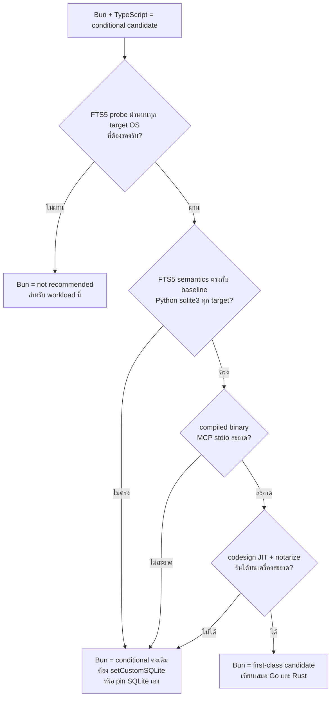

# Research Addendum — Bun + TypeScript ในฐานะ candidate ของ my-memory framework migration

> **Stage:** RESEARCH addendum · **วันที่ของเนื้อหา (observed date):** 2026-10-17 · **วันที่ materialize:** 2026-10-17
> **Run:** worktree `/Users/pisitkoolplukpol/my-memory-wf-my-memory-framework-migration` (branch `wf/my-memory-framework-migration`) — ไฟล์นี้อยู่ **ใน data repo/worktree นี้เท่านั้น** ไม่ใช่ global `~/Work`

## Provenance (อ่านก่อนใช้เอกสารนี้)

| ประเด็น | สถานะจริง |
|---|---|
| ที่มาของเนื้อหา | เนื้อหา Bun evidence ทั้งหมดมาจาก **คำตอบของ research agent รอบก่อนที่รายงานกลับมาในแชทของผู้ว่าจ้าง** (observed date 2026-10-17) — งาน materialize นี้ **เพียงเรียบเรียง/จัดระเบียบ** ไม่ได้สร้างหลักฐานใหม่ |
| การ fetch | **ไม่มี** — ไม่มีการเปิด URL ใดในงานนี้ · ตัวเลข/ข้อความจากเอกสารผู้ขายคือ **สิ่งที่ prior agent อ่านและรายงานในแชท** ไม่ใช่สิ่งที่งานนี้ดึงมาใหม่ |
| การรัน/วัด | **ไม่มี** — ไม่มี build, ไม่มีรัน `bun`, ไม่มี FTS5 probe, ไม่มี MCP stdio test, ไม่มี codesign/notarize, ไม่มี measurement ขนาด binary หรือ cold start, ไม่แตะ remote ใด ๆ |
| Jev screening | prior agent รายงานว่า screen 2 ครั้ง (injection ≤ 0.04 → pass) — **งาน materialize นี้ไม่ได้รัน Jev และไม่มี artifact ของผลนั้นบนดิสก์** → ถือเป็น unverified claim (ดู §7 "หลักฐานที่ยังไม่ verify") |
| การ align กับ run artifacts | งานนี้ **อ่าน `research.md` และ `design.md` จริงจาก worktree นี้** (รวม `log.md`, `learnings.md`) เพื่อ align การเปรียบเทียบกับหลักฐาน/เกณฑ์ที่มีอยู่แล้วใน run — ดู §8 |
| ไฟล์ที่ไม่ได้แก้ | `research.md`, `design.md`, `exploration.md`, `log.md`, `learnings.md`, source code — addendum นี้เป็น **ไฟล์ใหม่ไฟล์เดียว** ของงานนี้ |

### สาเหตุของ artifact ที่วางผิดที่ (แก้ข้ออ้างเดิม)

งาน materialize รอบก่อนเขียนไฟล์นี้ไปที่ **global path** `~/Work/docs/workflow/my-memory-framework-migration/research-bun-addendum.md` และระบุในหัวเอกสารว่า *prior artifacts ไม่มีอยู่บนดิสก์* (ค้น `~/Work` ทั้ง tree, `~/my-memory`, worktrees อื่น ฯลฯ) → **ข้ออ้างนั้นไม่ถูกต้อง**: artifact ของ run นี้อยู่ครบใน **git worktree** `/Users/pisitkoolplukpol/my-memory-wf-my-memory-framework-migration/docs/workflow/my-memory-framework-migration/` (`research.md`, `design.md`, `exploration.md`, `log.md`, `learnings.md`) — การค้นเดิมยึด default cwd (`~/Work`) แทน absolute path ของ worktree จึงไม่พบ

**สิ่งที่แก้ในไฟล์นี้:** (1) provenance ที่ถูกต้อง (เนื้อหามาจาก chat response ของ prior agent + อ่าน `research.md`/`design.md` ของ worktree จริง), (2) การ align กับ evidence IDs และเกณฑ์ใน `research.md`/`design.md` แทนการอ้าง "สิ่งที่ผู้ว่าจ้างแจ้งมา" แบบลอย ๆ, (3) เก็บ Bun evidence/source URLs/uncertainty labels ไว้ทั้งหมด

**ที่อยู่ปัจจุบัน (2026-10-19):** ไฟล์นี้อยู่ที่ `~/Work/my-memory-engine/docs/spec/research-bun-addendum.md` (ย้ายจาก worktree ของ private data repo พร้อม spec อื่นอีก 5 ไฟล์) — note ด้านบนเก็บไว้เป็นประวัติของการวางผิดที่รอบก่อน

**หลักฐาน:** `log.md` บรรทัด 10 — ผู้ใช้อนุญาต bounded exception รอบเดียวเพื่อ research Bun/TypeScript เป็น first-class candidate (runtime, compile/distribution, FTS5, MCP) จาก primary sources

---

## 1. ขอบเขต + ป้ายสถานะหลักฐาน

### 1.1 ป้ายที่ใช้

- **[DOC]** — เอกสารผู้ขาย (Bun / SQLite / MCP) แล้ว **prior agent เป็นผู้อ่าน** · เป็น primary source แต่ **ไม่ใช่ independent verification** และงาน materialize นี้ไม่ได้ re-fetch
- **[ISSUE-REPORT]** — bug report/repro ของบุคคลที่สามที่ prior agent รายงาน · แยกเป็น *official issue ที่ปิดแล้ว* กับ *unverified user report*
- **[INFERENCE]** — การอนุมานของ addendum นี้เอง · ยังไม่ผ่าน test · **ห้ามใช้เป็นเหตุผลเดียวในการตัดสินใจ**
- **[MEASURED]** — **ไม่มีเลยในเอกสารนี้**
- **[OBS-RUN]** — ข้อเท็จจริงที่มีอยู่ใน worktree artifacts ของ run นี้ (อ้าง E-nummer ของ `research.md` / section ของ `design.md`) — **อ่านจากดิสก์ในงานนี้**

> **กฎการใช้:** ข้อสรุปใน §4–§5 ตั้งอยู่บน *ช่องว่างของหลักฐาน* ไม่ใช่บนข้อเท็จจริงที่วัดแล้ว — ถ้าจะยกระดับ Bun ต้องปิด gate ใน §5 ก่อน

### 1.2 คำถามของ addendum นี้

จาก bounded exception (`log.md:10`): Bun/TypeScript ควรถูกมองเป็น first-class candidate เทียบเท่า Go/Rust หรือไม่ — วัดจาก criterion ที่ `research.md §1` (C1 distribution, C5 FTS5, C6 MCP SDK, C10 supply chain, C9 solo velocity) และเกณฑ์ gate ที่ `design.md §9.2` ใช้อยู่

---

## 2. Bun + TypeScript matrix

### 2.1 Compile / distribution (เทียบ C1)

| ประเด็น | สิ่งที่หลักฐานบอก | สถานะ |
|---|---|---|
| `bun build --compile` | embed bundled code **+ Bun runtime** เป็น standalone executable | **[DOC]** |
| Target | 8 targets: darwin x64/arm64, Linux glibc x64/arm64, Linux musl x64/arm64, Windows x64/arm64 | **[DOC]** |
| จำนวนไฟล์ | **หนึ่งไฟล์ต่อหนึ่ง target — ไม่มี universal/fat binary เดียว** | **[DOC]** |
| Cross-compile | ใช้ `--target` build ข้าม target | **[DOC]** |
| Pre-seed runtime | `executablePath` ให้ pre-seed Bun binary ของ target | **[DOC]** |
| macOS signing | ผู้ใช้ต้อง codesign เอง + **ต้องมี JIT entitlements** | **[DOC]** |
| Notarization | **เอกสารไม่ระบุว่า Bun automate notarization ให้** | **[DOC] (ช่องว่าง)** |
| ขนาด / cold start | **ไม่มีตัวเลขให้** — ยังไม่ถูกวัด | **[MEASURED] = ไม่มี** |

**[INFERENCE]** `--compile` ตอบข้อโต้แย้ง C1 ที่ `research.md` ใช้กด TS ไว้ (E15: SEA Stability 1.1 + CI ไม่ครอบทุกแพลตฟอร์ม + native addon โหลดจาก VFS ไม่ได้) ได้ **บางส่วน**: ไม่ต้องให้ผู้ใช้ติดตั้ง Node runtime เอง และไม่ต้องพึ่ง native addon สำหรับ SQLite (มี `bun:sqlite` built-in) · แต่ต้นทุนใหม่ที่ Go/Rust ไม่มีคือ artifact ฝัง JS runtime ที่ใช้ JIT → macOS ต้องจัดการ hardened runtime + JIT entitlement + notarization workflow เอง (ตัวเลขจริงยังไม่ยืนยัน)

**[INFERENCE] จุด align กับ `design.md §12 OQ4`:** v1 platform scope ที่ design เสนอคือ binary 5 targets (macOS arm64/x64, Linux amd64/arm64, Windows amd64) · Bun ประกาศ 8 targets ซึ่ง **ครอบ 5 target นั้น** แต่ design ไม่ได้แยก **glibc vs musl** ขณะที่ Bun แยกเป็น build target คนละอัน — ถ้าจะเทียบให้ตรง ต้องระบุ libc variant ให้ชัดทั้งสองฝั่ง (เป็น nit ของผู้ดูแล design ไม่ใช่ข้อสรุป)

### 2.2 SQLite / FTS5 — per OS (แกนสำคัญที่สุด · เทียบ C5)

| OS target | SQLite ที่ Bun ใช้ | หลักฐาน | สถานะ |
|---|---|---|---|
| **macOS** (darwin x64/arm64) | **Apple system SQLite** — เอกสาร Bun ระบุเอง, มีข้อจำกัดเรื่อง **extension loading**, มีทางเลือก `setCustomSQLite` | Bun SQLite docs | **[DOC]** (ตรงกับ **[OBS-RUN] E13** ใน `research.md`) |
| **macOS — version drift** | Reporter เจอ **SQLite 3.37.0** บน macOS 12 กับ Bun 1.3.3 ขณะที่ release notes อ้าง bundled SQLite ใหม่กว่า | oven-sh/bun#24957 | **[ISSUE-REPORT]** (reported evidence ไม่ใช่การรับประกันทุก release) |
| **macOS — bundled version ไม่ใช้** | release note v1.3.14 บอก built-in SQLite อัปเดตเป็น **3.53.0** แต่ **บน macOS ใช้ system SQLite** → เลขนี้ไม่ใช่สิ่งที่รันบนเครื่อง macOS | Bun v1.3.14 release note | **[DOC]** (ต้องอธิบายคู่กับข้อบนเสมอ ไม่งั้นเข้าใจผิด) |
| **Linux glibc / musl, Windows** | statically link **Bun SQLite** → version ผูกกับ Bun (3.53.0 ตาม release note) | Bun SQLite docs + release note | **[DOC]** + **[INFERENCE]** ว่า version ที่ผูกคือสิ่งที่รันจริงบน target เหล่านี้ |
| **FTS5 เปิดอยู่ไหม** | เอกสาร Bun **ไม่สัญญาชัดเจน** ว่า FTS5 `MATCH` / `bm25` / `unicode61` ใช้ได้ครบทุก OS · **ห้ามสับสนระหว่าง "ข้อจำกัด extension loading" กับ "FTS5 ถูก compile เข้าไปหรือไม่"** — คนละเรื่อง | Bun SQLite docs | **[DOC] (ช่องว่าง)** (ตรงกับ **[OBS-RUN] E13** ซึ่งระบุว่าเอกสาร Bun ไม่ได้ระบุ FTS5 ตรง ๆ) |
| **FTS5 มีอยู่จริงบน macOS (environ เดียว)** | official issue ที่มี repro `CREATE VIRTUAL TABLE ... USING fts5` + insert + `MATCH` บน macOS · **closed as completed 2026-08-06** · มี regression/fix canary → **อย่าเล่าว่าเป็น known bug ที่ยัง active** | oven-sh/bun#37044 | **[ISSUE-REPORT]** — สนับสนุนแค่ว่า *FTS5 module มีบน environment ที่รายงาน* ไม่ใช่ correctness ครบหรือ parity ข้าม OS |
| **FTS5 external-content UPDATE/DELETE** | Reporter อ้างว่า FTS5 external-content UPDATE/DELETE บน macOS SQLite 3.43.2 คืน `SQLITE_CORRUPT_VTAB (267)` · **closed as duplicate 2026-08-15** · ไม่พบ maintainer ยืนยันในรายงานของ prior agent | oven-sh/bun#31247 | **[ISSUE-REPORT] — unverified user report, ห้ามยกเป็นข้อเท็จจริง** |
| **FTS5 ตาม SQLite เอง** | FTS5 เป็นส่วนของ SQLite amalgamation และ **เปิดโดย default จาก configure script ของ amalgamation** | sqlite.org/fts5.html | **[DOC]** — **แต่ไม่พิสูจน์ว่า Bun build ตัวใดตัวหนึ่งใช้ config นั้น** (เทียบ **[OBS-RUN] E9** ที่ใช้ inference เดียวกันกับ `rusqlite`) |

**[INFERENCE] ผลรวมของ §2.2 (ยังไม่ยืนยัน):** Bun เป็นตัวเลือกเดียวในสามตัวที่ **provenance ของ SQLite เปลี่ยนตาม OS** — macOS inherit SQLite ของ Apple (ผันตาม OS update ของผู้ใช้) ส่วน Linux/Windows ใช้ตัวที่ statically link มากับ Bun → คุณสมบัติที่ my-memory ต้อง deterministic (FTS5 module present, `bm25` ranking, tokenizer, external-content semantics, Thai tokenization ตาม `design.md §6.1` index row / R3) **มีความเสี่ยง diverge ข้าม OS และข้าม macOS release** มากกว่าตัวเลือกที่คุม SQLite build เอง
· ทางหนีที่เป็นไปได้คือ `setCustomSQLite` (ship SQLite เอง) — **[INFERENCE]** ยังไม่ทดสอบ และจะกระทบคำสัญญา "single executable file" + signing surface

### 2.3 MCP stdio (เทียบ C6)

| ประเด็น | สิ่งที่หลักฐานบอก | สถานะ |
|---|---|---|
| Official MCP TypeScript SDK | README ระบุรองรับ **Node.js, Bun, Deno** และมี `serveStdio` (MCP TS SDK = Tier 1 ตาม **[OBS-RUN] E1**) | **[DOC]** (prior agent อ่าน README) |
| ข้อขัดแย้งในไฟล์เดียวกัน | `package.json` ยังประกาศ **`engines.node >= 20`** → explicit docs support ≠ production-parity evidence | **[DOC]** |
| Compiled binary stdio | **ยังไม่ยืนยัน**: ไม่มีหลักฐานว่า compiled binary คุย MCP JSON-RPC ทาง stdio ได้สะอาด | **[MEASURED] = ไม่มี** |

**[INFERENCE]** ความเสี่ยงที่ต้องปิดคือ **stdout purity**: stdio server ต้องส่ง JSON-RPC ล้วนออก stdout — runtime banner/warning ปนเมื่อไหร่ก็พังทั้ง harness (repo นี้เจอปัญหาคลาสเดียวกันกับ hook stdout ที่ต้องเป็น JSON บริสุทธิ์ และ `design.md` กำหนดว่า gemini ต้องได้ JSON บริสุทธิ์) · ต้องทดสอบทั้ง compiled binary และ `bun run` เพื่อเทียบ

### 2.4 Subprocess / dependency / keychain

| ประเด็น | สิ่งที่หลักฐานบอก | สถานะ |
|---|---|---|
| `node:fs` | mostly compatible | **[DOC]** (Bun Node API compat) |
| `node:child_process` | **มีข้อจำกัด** — โดยเฉพาะการ relay stdout/stderr ของ child หนึ่งไปเป็น stdio ของอีก child หนึ่ง | **[DOC]** |
| เรียก `git` ตรง ๆ | **[INFERENCE]** plausible เพราะ spawn + pipe ปกติไม่ใช่รูปแบบ relay ที่มีปัญหา — **แต่ยังไม่ทดสอบ** | **[INFERENCE] / untested** |
| `Bun.secrets` | **experimental ชัดเจน** · backend ที่เอกสารระบุ: macOS Keychain, Linux libsecret, Windows Credential Manager | **[DOC]** |
| ทางเลี่ยง secrets | **[INFERENCE]** เลี่ยงได้ในเฟสแรกด้วยการพึ่ง **Git credential helpers** — ตรงกับทางที่ `design.md §5.5` เลือกอยู่แล้ว (MVP ไม่ถือ credential เอง) | **[INFERENCE]** + **[OBS-RUN]** |

---

## 3. Bun เป็น runtime ไม่ใช่ภาษา — เทียบแบบยุติธรรม

Bun = runtime (JavaScriptCore) + bundler + package manager + TS transpiler ในตัว · **TypeScript คือภาษา, Bun คือ runtime/toolchain** → การเทียบที่ถูกคือ **"Bun + TypeScript"** เทียบกับ **"Go + stdlib/toolchain"** และ **"Rust + rusqlite/cargo"**

ผลเชิงโครงสร้าง: Go/Rust compile เป็น native code **ไม่มี VM ฝังในตัว** · Bun compiled executable **ฝัง runtime ที่ใช้ JIT** → ต่างกันที่ (ก) ขนาด/startup (**[MEASURED] = ไม่มีตัวเลขทั้งสองฝั่ง**) และ (ข) **ภาระ entitlement/signing บน macOS**

| เกณฑ์ | Go | Rust | Bun + TypeScript |
|---|---|---|---|
| รูปแบบ artifact | native binary, `CGO_ENABLED=0` cross-compile **[OBS-RUN] E3/E16** | native binary + SQLite C compile เข้าไป **[OBS-RUN] E8** | standalone executable ฝัง Bun runtime · 1 ไฟล์ต่อ target · ไม่มี universal |
| macOS entitlement | ไม่ต้อง JIT entitlement **[INFERENCE]** | ไม่ต้อง JIT entitlement **[INFERENCE]** | ต้อง codesign + **JIT entitlement** [DOC] · notarization ไม่ถูก automate [DOC] |
| SQLite provenance | modernc (cgo-free), SQLite 3.53.4 — **FTS5 runtime ยังไม่ยืนยัน [OBS-RUN] E4 = INF** | `rusqlite` bundled, compile SQLite เอง (3.53.2 / 0.40.1) — **FTS5 ยังต้อง runtime check [OBS-RUN] E9 = INF** | macOS = system SQLite ของ Apple · Linux/Windows = static ของ Bun (**เอกสารไม่รับประกัน FTS5**) |
| Deterministic FTS5 ข้าม OS | ต้องพิสูจน์ (`design.md §9.2` **S1**, block ภาษา) | แนวโน้มคุมได้มากสุดเพราะ compile SQLite เอง **[INFERENCE]** | เสี่ยงสุด: provenance ต่างกันตาม OS และผันตาม macOS update |
| MCP stdio | official Go SDK Tier 1 + conformance CI **[OBS-RUN] E1/E2** → ยังต้อง parity probe (S2) | official Rust SDK Tier 1 **[OBS-RUN] E1/E22** → ยังต้อง probe | official **TypeScript SDK** (Tier 1 [OBS-RUN] E1) ระบุรองรับ Bun + `serveStdio` [DOC] แต่ **compiled-binary behavior ยังไม่ยืนยัน** |
| Subprocess/git | git CLI subprocess ตรงไปตรงมา **[OBS-RUN]** | เหมือน Go **[INFERENCE]** | `node:child_process` มีข้อจำกัด documented (relay stdio) [DOC] · spawn+pipe น่าจะพอ **[INFERENCE/untested]** |
| Secrets | `zalando/go-keyring` ออกแบบเพื่อ static binary **[OBS-RUN] E23** (MVP ไม่ใช้) | `keyring-rs` หลาย store **[OBS-RUN] E24** | `Bun.secrets` **experimental** [DOC] — เลี่ยงได้ด้วย git credential helper |
| Supply chain | เล็ก, pin ได้ **[OBS-RUN] E6** | เล็ก แต่ compile SQLite ทุก build **[OBS-RUN] E8** | npm transitive graph ใหญ่สุด **[OBS-RUN] C10/E15** |
| ต้นทุน language/toolchain ต่อคนเดียว | ภาษาเดียว, toolchain นิ่ง | compile หนักกว่า | **แชร์ภาษา/ecosystem กับ plugin ของ harness ได้** (opencode plugin เป็น JS อยู่แล้ว) + MCP SDK ทางการ → ข้อได้เปรียบจริงของ Bun |

**ข้อควรระวังในการอ่านตาราง**

1. **ความยุติธรรม:** ทั้งสามตัวยังมี "FTS5 ต้อง runtime check" เหมือนกัน → Bun **ไม่ได้แย่กว่าเพราะเรื่องนี้** (`design.md §11.2` ติดป้าย FTS5 ของ modernc / rusqlite-bundled / **bun** เป็น INF ทั้งสาม: E4/E9/E13 — ตรงกัน)
2. Bun **มีเพิ่ม** ให้ต้องเช็ค: per-OS SQLite provenance (macOS system SQLite) + JIT entitlement/notarization + compiled-binary MCP stdio
3. Bun **ดีกว่า** ชัดเจน: official MCP TypeScript SDK, ภาษาเดียวกับ ecosystem ของ harness/plugin, ไม่ต้องมี C toolchain
4. ข้อ 2 และ 3 ไม่ได้หักล้างกัน — เป็น "profile ของความเสี่ยง" คนละแบบ ไม่ใช่ "ดีกว่า/แย่กว่า" แบบรวม

---

## 4. คำตอบคำถามเปรียบเทียบ (ตรง ๆ)

**คำถาม:** Bun เป็น runtime ของ TypeScript — viable สำหรับ my-memory หรือไม่ เมื่อเทียบ Go/Rust?

**คำตอบ:**

1. **Viable — ใช่ ในเชิงหลักฐานที่มี.** Bun ปิดข้อโต้แย้ง distribution ที่ `research.md` ใช้กด TS (E15 SEA) ได้บางส่วนผ่าน `bun build --compile` (ไม่ต้องให้ผู้ใช้ลง Node), มี `bun:sqlite` built-in (ไม่ต้องพึ่ง native addon แบบ `better-sqlite3` [E12]), และได้ official MCP TypeScript SDK (Tier 1 [E1]) ที่ระบุรองรับ Bun + `serveStdio` — เทียบกับ Go/Rust แล้ว Bun ไม่ได้ตกเกณฑ์ข้อใดอย่างชัดเจน และได้เปรียบเรื่องภาษาเดียวกับ ecosystem ของ harness
2. **แต่ยังไม่ใช่ first-class จนกว่าจะปิด 2 gate ที่เป็นเงื่อนไขของ workload นี้โดยตรง:**
   - **gate ที่ 1 — per-OS SQLite/FTS5 determinism.** Bun บน macOS ใช้ SQLite ของ Apple (version ผันตาม OS update, เอกสารไม่สัญญา FTS5 ครบ) บน Linux/Windows ใช้ตัว static ของ Bun → ยังไม่มีหลักฐาน runtime ว่า `MATCH` / `bm25` / `unicode61` / external-content UPDATE-DELETE ให้ผลเหมือนกันทุก target (`design.md §6.1` index row + `design.md §11.1 RK4` Thai tokenization เป็น invariant ของ product นี้)
   - **gate ที่ 2 — `--compile` + MCP stdio.** ยังไม่มีหลักฐานว่า compiled binary เป็น stdio server ที่ส่ง JSON-RPC ล้วนและเทียบเท่า `mem mcp` ปัจจุบัน (stdout purity, tool list parity, hook `exit 0` ยังจริง)
3. **Go/Rust ยังมี runtime uncertainty ของตัวเอง** — FTS5 บน `modernc.org/sqlite` เป็น INF (E4 → ต้องมี spike **S1** ก่อนเขียนโค้ด ตาม `design.md §9.2/§4.1`) และ FTS5 บน `rusqlite --features bundled` ก็เป็น INF (E9) เช่นกัน · Bun **ไม่ได้ช้ากว่า** ในข้อนี้ แต่ **มีจำนวน gate มากกว่า** (2 gate ของตัวเอง + gate กลาง) และ gate หนึ่งของ Bun (SQLite provenance บน macOS) **อยู่นอกการควบคุมของ repository** — ขึ้นกับ OS ของผู้ใช้ (ยังต้อง `setCustomSQLite` หรือยอมรับ drift)
4. **ไม่ overclaim ทั้งสองทาง:** ไม่ได้แปลว่า Bun ดีกว่า Go/Rust (Go ยังเป็น conditional recommendation ของ `design.md` จนกว่า S1 จะผ่าน) และไม่ได้แปลว่า Bun ใช้ไม่ได้ (หลักฐานยังไม่พอจะปฏิเสธแบบที่ `design.md §10` ปฏิเสธ "TypeScript core" ด้วยเหตุผล SEA/`node:sqlite` ซึ่งเป็นข้อจำกัดของ **Node path ที่ยังไม่รวม Bun**)

### 4.1 ตรรกะการตัดสิน

ตัวชี้ขาดไม่ใช่ "Go vs Rust vs Bun" ในเชิงภาษา แต่คือ **สแตกไหนพิสูจน์ได้ว่าให้ FTS5 semantics ตรงกับ baseline Python `sqlite3` แบบเดียวกันทุกที่ที่รัน** + **เป็น MCP stdio server ที่สะอาดเท่าเดิม** — ทั้งสามตัวยังตอบสองข้อนี้ไม่ได้จากเอกสาร

**หมายเหตุ:** "first-class candidate" แปลว่า *มีสิทธิ์ถูกเลือกหลังปิด gate ครบ* ไม่ได้แปลว่าแนะนำให้เลือกทันที — การเลือกสุดท้ายยังต้องเทียบกับผล FTS5 spike ของ Go (**S1**) และผลของ Rust ถ้า S1 fail (`design.md §9.2`)

---

## 5. Recommended bounded spike checklist (ยังไม่รัน — เป็นแผนเท่านั้น)

กรอบเวลาโดยประมาณ: **~2–4 ชั่วโมง** สำหรับ S1–S3 บน macOS · **~ครึ่งวัน** ถ้ารวม S4–S6 (codesign + เครื่องสะอาด + Linux target + รันใต้ harness จริง) · **เพดานรวม ≤ 1 วัน** เกินกว่านี้ให้หยุดและคงสถานะ conditional

| # | สิ่งที่ต้องพิสูจน์ | ต้องเก็บอะไรเป็นหลักฐาน | เสร็จเมื่อ |
|---|---|---|---|
| S1 | Bun บน macOS ใช้ SQLite version ใด และ FTS5 module present | `sqlite_version`, compile options, ผล `CREATE VIRTUAL TABLE ... USING fts5` + insert + `MATCH` | มี transcript + version จริง ไม่ใช่การอ้างเอกสาร |
| S2 | `bm25()` ranking และ `unicode61` tokenization ทำงาน และ **ข้อความไทย** ให้ผลที่ยอมรับได้ | ชุด query/corpus คงที่ + คะแนน ranking ที่ได้ | ranking ตรงกับ Python `sqlite3` baseline บน corpus เดียวกัน |
| S3 | external-content UPDATE/DELETE ไม่คืน `SQLITE_CORRUPT_VTAB` (ปิดข้อสงสัย #31247) | แก้/ลบ record แล้ว index ยังถูก + `integrity-check` | ผล deterministic ไม่ใช่ pass ครั้งเดียว |
| S4 | Compiled binary เป็น MCP stdio server ที่ **stdout สะอาด** | เทียบ tool list กับ `mem mcp` ปัจจุบัน + ยืนยันไม่มี banner/warning ปน + hook `exit 0` ยังจริง | รันใต้ 2 harness ผ่าน |
| S5 | codesign + JIT entitlement + notarization บนเครื่องที่ **ไม่ได้ติดตั้ง Bun** | ขั้นตอน signing จริง + ผลรันบนเครื่องสะอาด | binary รันได้โดยไม่มี Bun ในเครื่อง |
| S6 | `git` subprocess (spawn + pipe) พอสำหรับ optional generic remote | ทดสอบ status/log/commit + ตรวจข้อจำกัด relay stdio ของ `node:child_process` ว่าไม่กระทบ | ไม่มี silent failure, hook ไม่ push |
| S7 | ทางเลือก pin SQLite (`setCustomSQLite`) ถ้า S1–S3 fail บน macOS system SQLite | ระบุผลกระทบต่อ single-binary story + signing surface | มีข้อสรุปชัดว่า pin ได้หรือยอมรับ drift |

**ความสัมพันธ์กับ `design.md §9.2`:** S1 ของ addendum นี้ = ข้อเดียวกับ "FTS5 บน `bun:sqlite` (macOS vs Linux)" ที่ `research.md Q10` ค้างไว้ · **ไม่ทับ** S1/S2 ของ design (ซึ่งเป็น Go: `modernc` FTS5 และ MCP Go SDK 6 harness) · gate กลางที่ทั้งสองฝั่งต้องผ่านเหมือนกันคือ **FTS5 semantics เทียบ baseline Python `sqlite3`** และ **MCP stdio parity**

---

## 6. Open questions (ต้องให้ผู้ใช้ตัดสิน — agent เดาเองไม่ได้)

1. **Target OS ที่ต้องรองรับจริงคืออะไร** — macOS arm64 อย่างเดียว หรือรวม Linux/Windows? (เทียบ `design.md §12 OQ4` ที่เสนอ 5 targets) ถ้าใช้จริง OS เดียว น้ำหนักความเสี่ยง per-OS provenance ของ Bun ลดลง *(แต่ macOS system SQLite ที่ผันตาม OS update ยังไม่หายไป — ยังต้อง pin หรือยอมรับ drift)*
2. **ยอมรับการ ship SQLite ของตัวเอง (`setCustomSQLite`) ไหม** — แลกกับคำสัญญา "ไฟล์ executable เดียว"
3. **ยอมรับได้ไหม** ถ้า derived index behavior เปลี่ยนเมื่อผู้ใช้ upgrade macOS
4. **ต้องมี keychain-backed secret จริงหรือไม่** — ถ้าไม่ `Bun.secrets` (experimental) หลบได้ทั้งหมดด้วย git credential helper (ตรงกับ `design.md §5.5` ที่เลื่อน keychain ไปเฟส 2 อยู่แล้ว)

---

## 7. Evidence ledger

Observed date ของทุกแหล่ง: **2026-10-17** (วันที่ prior research agent รายงาน) · **งาน materialize นี้ไม่ได้ fetch ซ้ำ** — "อ่านโดย" = prior agent (ยกเว้นแถว [OBS-RUN] ที่อ่านจากดิสก์ในงานนี้)

| # | Source | สนับสนุนประเด็น | สถานะ | อ่านโดย |
|---|---|---|---|---|
| 1 | https://bun.com/docs/bundler/executables | `--compile` ฝัง code + runtime · 8 targets · 1 ไฟล์ต่อ target ไม่มี universal · `--target` · `executablePath` · macOS ต้อง codesign + JIT entitlement · ไม่ยืนยัน notarization automation · ไม่มีตัวเลขขนาด/cold start | **[DOC]** (ผู้ขาย ไม่ใช่ independent) | prior agent |
| 2 | https://bun.com/docs/runtime/sqlite | `bun:sqlite` built-in · macOS ใช้ Apple system SQLite + ข้อจำกัด extension loading + `setCustomSQLite` · Linux/Windows statically link Bun SQLite · ไม่สัญญา FTS5 ครบทุก OS | **[DOC]** | prior agent |
| 3 | https://github.com/oven-sh/bun/issues/37044 | FTS5 repro (`fts5` + insert + `MATCH`) บน macOS · **closed as completed 2026-08-06** · มี canary regression/fix → **ไม่ใช่ active known bug** · สนับสนุนแค่ module presence บน environment ที่รายงาน | **[ISSUE-REPORT]** (official issue, ปิดแล้ว) | prior agent |
| 4 | https://github.com/oven-sh/bun/issues/31247 | อ้าง `SQLITE_CORRUPT_VTAB (267)` กับ FTS5 external-content UPDATE/DELETE บน macOS SQLite 3.43.2 · **closed as duplicate 2026-08-15** · ไม่เห็น maintainer ยืนยัน | **[ISSUE-REPORT] — unverified, ห้ามใช้เป็นข้อเท็จจริง** | prior agent |
| 5 | https://github.com/oven-sh/bun/issues/24957 | Reporter เจอ SQLite 3.37.0 บน macOS 12 กับ Bun 1.3.3 ขณะ release note อ้างตัวใหม่กว่า → macOS ใช้ system SQLite | **[ISSUE-REPORT]** (reported evidence ไม่ใช่การรับประกันทุก release) | prior agent |
| 6 | https://bun.com/blog/bun-v1.3.14 | built-in SQLite อัปเดตเป็น 3.53.0 **แต่บน macOS ใช้ system SQLite** → ตัวเลขนี้ไม่ใช่สิ่งที่รันบน macOS | **[DOC]** | prior agent |
| 7 | https://sqlite.org/fts5.html | FTS5 อยู่ใน amalgamation และเปิด default โดย configure script · **ไม่พิสูจน์ว่า Bun build ไหนใช้ config นั้น** | **[DOC]** | prior agent |
| 8 | https://github.com/modelcontextprotocol/typescript-sdk | README ระบุรองรับ Node.js / Bun / Deno + `serveStdio` · `package.json` ยังระบุ `engines.node >= 20` | **[DOC]** (explicit support ≠ production parity) | prior agent |
| 9 | https://ts.sdk.modelcontextprotocol.io/v2/ | v2 docs ของ official MCP TypeScript SDK | **[DOC]** | prior agent |
| 10 | https://bun.com/docs/runtime/nodejs-apis | `node:fs` mostly compatible · `node:child_process` มีข้อจำกัด (relay stdout/stderr ของ child) | **[DOC]** | prior agent |
| 11 | https://bun.com/docs/runtime/secrets | `Bun.secrets` **experimental** · backends: macOS Keychain, Linux libsecret, Windows Credential Manager | **[DOC]** | prior agent |
| 12 | `research.md` (worktree, E3/E4/E7/E16 + Q10) | Go: modernc cgo-free + FTS5 runtime ยังไม่ยืนยัน (E4 INF); mattn = CGO + `sqlite_fts5` (E7); GoReleaser cross-compile (E16); Q10 ค้าง test FTS5 บน `bun:sqlite` (macOS vs Linux) | **[OBS-RUN]** | งานนี้ (อ่านจากดิสก์) |
| 13 | `research.md` (worktree, E8/E9/E18) | Rust: `rusqlite bundled` = amalgamation 3.53.2, FTS5 เป็น INF 2 ต่อ (E9); `gix` ยังไม่ production-grade (E18) | **[OBS-RUN]** | งานนี้ (อ่านจากดิสก์) |
| 14 | `research.md` (worktree, E10/E11/E12/E13/E14/E15/E1) | `node:sqlite` ไม่มี FTS5 (E10/E11); `better-sqlite3` มี `SQLITE_ENABLE_FTS5` (E12); `bun:sqlite` macOS = system SQLite + WAL ต่างตาม OS, docs ไม่ระบุ FTS5 (E13); Bun SQLite เร็วกว่า better-sqlite3 3–6x (E14, vendor benchmark); SEA 1.1 + platform matrix (E15); MCP TS SDK = Tier 1 (E1) | **[OBS-RUN]** | งานนี้ (อ่านจากดิสก์) |
| 15 | `design.md` (worktree, §4.1/§4.2/§9.2 S1+S2/§10/§11.2/§12 OQ4) | Go เป็น **conditional recommendation** จนกว่า S1 (FTS5 บน modernc ~1 ชม.) ผ่าน; S2 = MCP Go SDK 6 harness ~ครึ่งวัน; FTS5 INF ทั้งสามตัว (modernc/rusqlite/bun); TS core ถูกปฏิเสธด้วยเหตุ SEA/`node:sqlite`; OQ4 = 5 targets | **[OBS-RUN]** | งานนี้ (อ่านจากดิสก์) |

### หลักฐานที่ยังไม่ verify (ระบุตรง ๆ)

- **Jev screening ของ prior agent** (2 ครั้ง, injection ≤ 0.04 → pass) — ไม่มี artifact บนดิสก์ และงานนี้ไม่ได้รัน Jev · Jev เป็น advisory เท่านั้น ไม่แทนการอ่านเอกสารหรือ test

### ช่องว่างหลักฐานที่ยังค้าง (สรุป)

1. FTS5 runtime behavior ของ Bun จริงบน macOS / Linux / Windows — **[MEASURED] ไม่มี**
2. FTS5 runtime behavior ของ Go (modernc) และ Rust (`rusqlite` bundled) — **ยังไม่ re-run ในรอบนี้** → ตัวเปรียบเทียบยังไม่ปิดเช่นกัน (Go ฝั่งนี้มี gate S1/S2 ของ `design.md §9.2` รองรับอยู่แล้ว)
3. Compiled binary ของ Bun ในฐานะ MCP stdio server — **[MEASURED] ไม่มี**
4. ขนาด artifact, cold start, notarization workflow จริง — **[MEASURED] ไม่มี**
5. `git` subprocess ผ่าน Bun — **[INFERENCE] / untested**
6. `setCustomSQLite` แลกมากับอะไร (single-binary story, signing surface) — **[INFERENCE] / untested**
7. Bun performance claim [E14] — `research.md` ติดป้าย OBS แต่เป็น **vendor benchmark (ผู้พัฒนา Bun รายงานเอง)** และ `design.md §4.2` ระบุว่าจะไม่ถูกอ้างเป็น fact → **ห้ามใช้เป็นเหตุผลเลือกภาษา**

---

## 8. Alignment กับ worktree artifacts + follow-ups (ไม่ใช่การแก้เอกสารอื่น)

**สิ่งที่ตรงกันแล้วโดยไม่ต้องแก้:** `research.md §7` บันทึกข้อขัดแย้ง "Bun FTS5" ไว้เป็น INF (E13/Q10) และ `design.md §11.2` ติดป้าย FTS5 ของ `modernc` / `rusqlite-bundled` / `bun` เป็น INF ทั้งสาม — addendum นี้สอดคล้อง ไม่ได้เลื่อนสถานะหลักฐานของใครขึ้น

**ช่องที่ผู้ดูแล design ต้องพิจารณาในรอบแก้ไขที่ผู้ใช้อนุญาต (ไม่ใช่การแก้ไขของงานนี้):**

1. `design.md §10` ปฏิเสธ "TypeScript core" ด้วยเหตุผล SEA 1.1 + `node:sqlite` ไม่มี FTS5 + npm graph — เหตุผลเหล่านี้ **ไม่ครอบเส้นทาง Bun** (`--compile` + `bun:sqlite`) → ถ้าผู้ใช้ต้องการให้ Bun เป็น first-class candidate จริง ตาราง rejected alternative/§4.2/language table ต้องมีแถว/บรรทัดที่พูดถึง Bun โดยตรง มิฉะนั้นการตัดสินใจรอบสุดท้ายจะอ้างหลักฐานไม่ครบ
2. `design.md §11.3` reopen condition ของ TS ผูกกับ "`node:sqlite` เปิด FTS5 **และ** Node SEA GA" — **ไม่มีเงื่อนไขที่พูดถึง Bun** → ควรมี reopen/Bun gate (หรือระบุเหตุผลว่าตัด Bun ออกเพราะอะไร) เพื่อไม่ให้ decision tree ตกหล่น
3. `design.md §12 OQ4` (platform scope) ไม่แยก glibc/musl ขณะที่ Bun แยก build target — ถ้า Bun อยู่ใน consideration ต้องระบุ libc variant ให้ตรงกันทั้งสองฝั่ง
4. `design.md §9.2` **S1** เป็น Go-only (modernc) — ถ้ารวม Bun ต้องมี spike คู่ขนานตาม §5 ของเอกสารนี้ และต้อง time-box (≤ 1 วัน) ไม่ให้กลายเป็นงานวิจัยเปิด

**ไฟล์นี้ไม่แก้** `design.md`, `research.md`, `exploration.md`, `log.md`, `learnings.md` หรือ source ใด ๆ — ข้อ 1–4 เป็น pointer สำหรับเจ้าของ design
