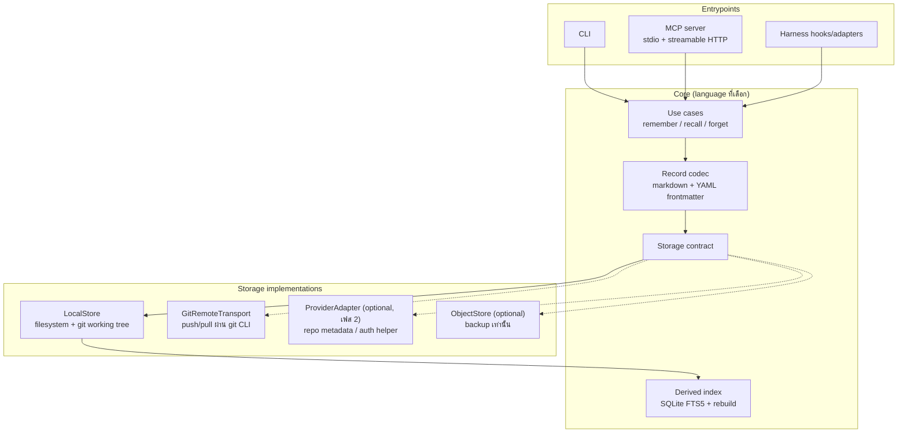

# Research: my-memory framework migration — ภาษาและสถาปัตยกรรม storage

- **Observed date ของหลักฐานทั้งหมดในเอกสารนี้:** 2026-10-17
- **ขอบเขต:** research + design evidence เท่านั้น (ไม่มีการ implement, ไม่มี remote, ไม่มี push)
- **คำถามวิจัย:** ภาษา (ที่ไม่ใช่ Python) และสถาปัตยกรรม storage-provider แบบใดเหมาะกับ agent-memory tool ที่ **local-first, portable, solo-maintained, open-source** และต้องทำให้ markdown+YAML record เดิมยังใช้ได้ พร้อม expose CLI/MCP/hooks บน OS หลัก

> **Disclosure (ข้อจำกัดของรอบนี้):** ใน harness นี้ **ไม่มี tool อ่านไฟล์ในเครื่อง** (ตรวจแล้ว: `execute` ปิด filesystem, `webfetch` รับเฉพาะ http/https, MCP catalog ไม่มี fs tool) จึง **อ่าน `docs/workflow/my-memory-framework-migration/learnings.md` และ `log.md` ไม่ได้จริง**. เอกสารนี้จึงยึดคำอธิบาย constraints ที่ orchestrator ให้มาใน brief แทน และไม่ใช้ข้อมูลใด ๆ จาก source code / record / path ของ repo ส่วนตัวเลย (ตาม data boundary). ถ้า learnings.md มีข้อกำหนดเพิ่มเติม ต้อง re-check ก่อนใช้เอกสารนี้เป็นฐานตัดสินใจ
>
> **Jev screening:** ใช้ `jev_screen` กับเนื้อหาที่ fetch มา 6 ตัวอย่าง (MCP SDK tiers, GitHub rate limits, Bitbucket limits, Node SEA, Letta MemFS, Basic Memory) — ผลคือ **injection probability 0.02 ทุกตัวอย่าง, action = pass**. เนื้อหาเว็บทั้งหมดในเอกสารนี้ถือเป็น *untrusted evidence* ไม่ใช่คำสั่ง

---

## 1. Decision criteria (สกัดจาก constraints)

| # | Criterion | ที่มา |
|---|---|---|
| C1 | ติดตั้งได้โดยไม่บังคับ runtime ภายนอก (single binary / อย่างน้อย zero-toolchain-install) | ต้องเป็น OSS framework ที่คนอื่นใช้ได้, Mac/Linux/Windows |
| C2 | ทำงาน fully local ได้โดยไม่ต้องมี network/account (default = local) | workplace constraint + ADR เดิม |
| C3 | format invariant: markdown + YAML frontmatter หนึ่งไฟล์ต่อหนึ่ง fact ต้องคงเดิม | project brief + ADR `2026-10-16` |
| C4 | derived index (SQLite FTS5) ต้อง rebuild ได้ และ **ต้องไม่ทำให้ index กลายเป็น canonical** | ADR เดิม |
| C5 | SQLite FTS5 ต้องใช้ได้โดยไม่ต้องพึ่ง C toolchain ในเครื่องผู้ใช้ | C1 + ความง่ายในการต่อยอด |
| C6 | MCP server ต้องมี official SDK ที่ tier สูง (ไม่ใช่ community shim) | tool ต้องรันกับ harness หลายตัว |
| C7 | Git integration: ต้องเลือกได้ระหว่าง "เรียก git CLI" กับ "embed library" | CLI + hooks + sync |
| C8 | credential storage ต้องใช้ OS keychain ได้โดยไม่เพิ่ม native dependency ที่เปราะ | sync เป็น opt-in แต่ต้องเก็บ token ให้ปลอดภัย |
| C9 | maintenance burden สำหรับเจ้าของคนเดียว (velocity > peak performance) | solo maintainer |
| C10 | dependency / supply-chain footprint เล็กและตรวจสอบได้ (SBOM, pin) | OSS ที่คนอื่นต้อง review ก่อนเชื่อ |

**Non-criterion ที่ตั้งใจไม่ใช้:** GitHub stars, popularity, "ภาษาไหนกำลังมาแรง"

---

## 2. Evidence ledger

สถานะ: **OBS** = observed จาก primary source ที่ fetch/screen ในรอบนี้ · **INF** = inferred จาก OBS หลายชิ้น · **ASM** = assumption ที่ยังไม่มีหลักฐาน

| # | Claim | Primary source | Observed | Supports | Limits / ข้อควรระวัง |
|---|---|---|---|---|---|
| E1 | MCP official SDK tiers (listing `2026-07-28`): TypeScript, Python, C#, Go, Rust, Ruby = Tier 1; Java = Tier 2; Swift, PHP, Kotlin = Tier 3 | [SDKs — Model Context Protocol](https://modelcontextprotocol.io/docs/2026-07-28/sdk) | OBS | Go/Rust/TS มี Tier 1 ครบ; Kotlin เป็น Tier 3 → ตัด Kotlin/JVM ออกจาก shortlist | มี secondary blog อ้างว่า Ruby = Tier 2 (ขัดกับ primary) — ไม่กระทบ decision; ดู §7 |
| E2 | Go SDK "maintained in collaboration with Google", มี `mcp`/`jsonrpc`/`auth`/`oauthex`; มี conformance test suite ใน CI | [modelcontextprotocol/go-sdk](https://github.com/modelcontextprotocol/go-sdk) | OBS | C6 สำหรับ Go | ไม่ได้วัด quality เอง — อ้างจาก repo/CI เท่านั้น |
| E3 | `modernc.org/sqlite` เป็น **cgo-free port ของ SQLite**, รองรับ darwin/linux/*bsd/windows บน amd64/arm64 (+386 บาง OS), SQLite 3.53.4, สัญญาอนุญาต BSD-3-Clause | [pkg.go.dev/modernc.org/sqlite](https://pkg.go.dev/modernc.org/sqlite) | OBS | C1, C5, C9: single binary + cross-compile โดยไม่ต้องมี gcc | ไม่มีบรรทัดที่เขียนว่า "FTS5 enabled" ตรง ๆ → ดู E4 |
| E4 | เอกสารของ driver อ้างถึง **FTS5 shadow tables** (`fts5`'s `_data`, `_idx`) และ virtual-table (`vtab`) API, และมี `sqlite-vec` อยู่ในโมดูล | [pkg.go.dev/modernc.org/sqlite](https://pkg.go.dev/modernc.org/sqlite) | OBS (แต่ข้อสรุป = INF) | C5: แนวโน้มสูงว่า FTS5 ใช้ได้ | **ยังไม่ยืนยันตรง ๆ ว่า FTS5 module ถูก compile เข้าไป** — ต้องทดสอบ runtime (`CREATE VIRTUAL TABLE ... USING fts5(...)`) ก่อนล็อก decision |
| E5 | ประสิทธิภาพ: transpiled SQLite ช้ากว่า C ประมาณ **1.3x–2.0x CPU time** ในงาน CPU-bound (ORDER BY, GROUP BY, correlated subquery ตามที่ระบุ) บน linux/amd64, Go 1.27, ก.ย. 2026 | [pkg.go.dev/modernc.org/sqlite](https://pkg.go.dev/modernc.org/sqlite) | OBS | C9: ยอมรับได้กับ workload ส่วนตัว | เป็น benchmark ของผู้พัฒนาเอง; I/O-bound ไม่ต่าง |
| E6 | ข้อควรระวังระบุชัด: **"Fragile modernc.org/libc dependency"** — ต้อง pin `modernc.org/libc` ให้ตรงกับ go.mod ของ repo | [pkg.go.dev/modernc.org/sqlite](https://pkg.go.dev/modernc.org/sqlite) | OBS | C10: ต้องมี dependency policy | เป็นภาระ maintenance ที่ต้องจัดการ (Dependabot rule / pin) |
| E7 | `github.com/mattn/go-sqlite3` เป็น **CGO package**, ต้องมี gcc, และ FTS5 ต้องเปิดด้วย build tag `sqlite_fts5` | [mattn/go-sqlite3 README](https://github.com/mattn/go-sqlite3) | OBS | ตัด mattn ออกจาก default path (C1) | ถ้าจำเป็นต้องใช้ CGO จริง จะต้องมี cross-compile matrix (goreleaser-cross) |
| E8 | `rusqlite` feature `bundled` compile SQLite จาก source ในตัว (amalgamation) — ระบุ SQLite **3.53.2** ณ `rusqlite` 0.40.1 / `libsqlite3-sys` 0.38.1; feature list ไม่มี flag ชื่อ `fts5` | [rusqlite](https://github.com/rusqlite/rusqlite) · [docs.rs feature flags](https://docs.rs/crate/rusqlite/latest/features) | OBS | C5 สำหรับ Rust | ยังไม่เห็นบรรทัดยืนยัน FTS5 → ดู E9 |
| E9 | FTS5 ถูกใส่ใน **amalgamation** ตั้งแต่ SQLite 3.9.0 (2015) และ amalgamation configure script **เปิด FTS5 เป็น default** | [SQLite FTS5 Extension](https://sqlite.org/fts5.html) | OBS | INF: `rusqlite` bundled → FTS5 ใช้ได้ (เพราะสร้างจาก amalgamation) | เป็น inference 2 ต่อ — ควรทดสอบ 1 ครั้งเช่นกัน |
| E10 | `node:sqlite` (Node ล่าสุด 26.x) เป็น Stability 1.2 (release candidate) และรายการ API **ไม่มี FTS5**; `loadExtension()` ทำได้แต่ต้องมีไฟล์ extension ต่อ OS | [Node.js SQLite docs](https://nodejs.org/api/sqlite.html) | OBS | ถ้าจะใช้ Node ต้องเลี่ยง built-in sqlite | — |
| E11 | มี feature request "Add SQLite FTS5 Extension" ถูก **ปิดเป็น duplicate ของ #56476** (Feb 2025) — คือ *ยังไม่ได้* เปิด FTS5 ใน `node:sqlite` | [nodejs/node#56951](https://github.com/nodejs/node/issues/56951) | OBS | TS ต้องพึ่ง third-party driver (หรือ Bun) | สถานะ #56476 วันนี้ยังไม่ตรวจ → อาจเปลี่ยนได้ (ดู §7) |
| E12 | `better-sqlite3` bundled config: SQLite **3.53.4** พร้อม `SQLITE_ENABLE_FTS5`, `FTS3/4`, `JSON1`, `RTREE`, `GEOPOLY` ฯลฯ (ระบุชัดในเอกสาร) | [better-sqlite3 compilation.md](https://github.com/WiseLibs/better-sqlite3/blob/master/docs/compilation.md) | OBS | TS path ทำ FTS5 ได้ — แต่ผ่าน native module (prebuilt binaries per platform) | ต้องพึ่ง prebuild/preinstall; SEA + native addon ต้องเขียนลง temp file ก่อน dlopen (ดู E15) |
| E13 | `bun:sqlite` เป็น built-in; บน **macOS ใช้ system SQLite ของ Apple ซึ่ง "doesn't support extensions"**, Linux/Windows statically link SQLite ของตัวเอง; WAL sidecar พฤติกรรมต่างกันตาม OS | [Bun SQLite docs](https://bun.com/docs/runtime/sqlite) | OBS | เตือนเรื่อง cross-OS drift ของ TS path | เอกสาร Bun **ไม่ได้ระบุ** FTS5 ตรง ๆ (มีแค่การอ้างถึง FTS5 virtual table ในหัวข้อ update hooks) → INF เท่านั้น ต้องทดสอบ |
| E14 | Bun SQLite เร็วกว่า `better-sqlite3` ประมาณ 3–6x (read queries, Northwind, macOS M1) | [Bun SQLite docs](https://bun.com/docs/runtime/sqlite) | OBS | ถ้าเลือก TS, Bun น่าสนใจกว่า | benchmark ของผู้พัฒนาเอง |
| E15 | Node SEA: Stability **1.1 Active development**; CI test เฉพาะ **Windows, macOS (arm64 เท่านั้น, x64 ถูก skip), Linux (ยกเว้น Alpine, ยกเว้น s390x)**; native addon โหลดจาก VFS ไม่ได้; VFS ใช้ร่วมกับ snapshot/code cache ไม่ได้; ต้อง codesign บน macOS | [Node.js Single executable applications](https://nodejs.org/api/single-executable-applications.html) | OBS | C1: TS **เสียเปรียบชัด** เรื่อง single-binary | เป็นข้อจำกัดที่ออกแบบ/ตัดสินใจได้ |
| E16 | GoReleaser ทำ cross-platform release ให้ **Go, Rust, TypeScript, Python, Zig** และ publish ไป Homebrew/Scoop/Winget/AUR/Nix; CGO cross-compile ต้องใช้ workaround (Docker toolchain / Zig / split-merge) | [GoReleaser](https://goreleaser.com) · [GoReleaser CGO limitations](https://goreleaser.com/resources/limitations/cgo) | OBS | C1 ทั้ง Go และ Rust; ถ้าเลี่ยง CGO จะไม่มีข้อจำกัดนี้ | ไม่ได้ยืนยัน feature parity ข้ามภาษาแบบละเอียด |
| E17 | `go-git` เป็น pure Go; **partial clone ยังเป็นงานค้าง** — issue #1381 เปิดอยู่ และมี commit ที่อ้างถึงเมื่อ 2026-04 (`promisor` support) | [go-git#1381](https://github.com/go-git/go-git/issues/1381) (จากผลค้นหา) · [go-git repo](https://github.com/go-git/go-git) | OBS (issue จาก search result, ไม่ได้ fetch หน้าเต็ม) | C7: วางแผนใช้ git CLI เป็น default, library เป็น optional | **confidence กลาง** — ควรเปิด issue ยืนยันสถานะปิด/เปิดก่อน commit |
| E18 | gitoxide status: มีแค่ `gix-lock` (Tier 1) และ `gix-tempfile` (Tier 2) ที่ production grade; `gix` entrypoint อยู่ในกลุ่ม "stabilization candidates … usable (with rough but complete docs, possibly incomplete functionality)" | [GitoxideLabs/gitoxide](https://github.com/gitoxidelabs/gitoxide) | OBS | C7: Rust ยังไม่ควรพึ่ง gix สำหรับ porcelain ทั้งหมด | ไม่ได้แปลว่าใช้ไม่ได้ — แค่ยังไม่ 1.0 |
| E19 | GitHub REST primary rate limits: **60 req/h unauthenticated**, **5,000 req/h authenticated**, GitHub App installation ≥5,000 (สูงสุด 12,500; 15,000 บน GHEC); secondary limits: ≤100 concurrent, ≤900 points/min (REST), content creation ≤80/min และ ≤500/h; Git LFS เป็น bucket แยก | [GitHub Docs — Rate limits for the REST API](https://docs.github.com/en/rest/using-the-rest-api/rate-limits-for-the-rest-api) | OBS | ใช้ประเมินต้นทุนของ provider-specific API adapters | หน้าไม่มีวันที่กำกับ; GitHub ระบุว่า secondary limits "subject to change without notice" |
| E20 | Bitbucket Cloud: anonymous **60 req/h**; **Git Operations 60,000 req/h**; Access to repository data (`/2.0/repositories/*`) **1,000–10,000 req/h** (scaled ต้อง Standard/Premium + ≥100 paid users + access token/Forge); raw files 5,000 req/h; window = 1 ชั่วโมงแบบ rolling; rate limits "are not considered part of the API and are subject to change" | [Atlassian — API request limits](https://support.atlassian.com/bitbucket-cloud/docs/api-request-limits/) | OBS | Git transport มี budget สูงกว่า REST มาก (60k vs 1k–10k) | หน้าไม่มีวันที่กำกับ |
| E21 | GitHub รองรับ **OAuth 2.0 Device Authorization Grant** สำหรับ headless/CLI และ device flow ใช้แค่ `client_id` (ไม่ต้องมี `client_secret`) | [GitHub Docs — Authorizing OAuth apps](https://docs.github.com/en/apps/oauth-apps/building-oauth-apps/authorizing-oauth-apps) | OBS | provider adapter ที่ทำได้จริงแบบ local-first (ไม่ต้องมี backend) | ยังต้องมี OAuth app registration → vendor coupling ระดับหนึ่ง |
| E22 | `modelcontextprotocol/rust-sdk` เป็น official Rust SDK ภายใต้ org เดียวกับ spec (Tier 1 ตาม E1) | [modelcontextprotocol org](https://github.com/modelcontextprotocol) · [SDKs page](https://modelcontextprotocol.io/docs/2026-07-28/sdk) | OBS | C6 สำหรับ Rust | ยังไม่ตรวจ maturity/API ของ SDK เอง (ไม่ได้ fetch README ฉบับเต็ม) |
| E23 | `zalando/go-keyring` เป็น OS-agnostic (macOS/Linux-BSD dbus/Windows) และ **ตั้งใจออกแบบให้ทำงานกับ statically linked binary ได้** (เลี่ยง C binding) | [zalando/go-keyring](https://github.com/zalando/go-keyring) | OBS | C1 + C8 สำหรับ Go | บน macOS ใช้คำสั่ง `security` (per secondary source) → ผู้ใช้ต้องเปิด popup/approve; secret ที่ keychain อาจถูกอ่านได้โดย process อื่นที่รันในนาม user เดียวกัน (**secondary source**) |
| E24 | `keyring-rs` ให้ API เดียวข้าม macOS Keychain / Windows Credential Manager / Linux Secret Service / keyutils และมี `keyring-core` + credential-store features ให้เลือกเจาะจง | [docs.rs/keyring](https://docs.rs/keyring) · [open-source-cooperative/keyring-rs](https://github.com/open-source-cooperative/keyring-rs) | OBS | C8 สำหรับ Rust | ecosystem กำลังแยก core/store (API churn) |
| E25 | Basic Memory: markdown + **local SQLite index**, "Just files plus a local SQLite index. No servers required", local install ต้องมี **Python 3.12+ ผ่าน `uv`** และ 0.23 ต้องพึ่ง FastMCP 4 **pre-release** (`--prerelease=allow`); Cloud เป็น optional, มี per-project routing (`project set-cloud`/`set-local`); license **AGPL-3.0** | [basicmachines-co/basic-memory](https://github.com/basicmachines-co/basic-memory) | OBS | pattern ที่โอนมาใช้ได้ + หลักฐานว่า Python runtime เป็น friction จริง | ราคา Cloud ที่ README ระบุ ($15/mo) เป็นข้อมูล ณ วันที่ fetch — **ไม่ควรอ้างเป็นข้อเท็จจริงถาวร** |
| E26 | Letta **MemFS** = memory เป็น **git repository ที่เป็นของ agent**; project ลงเครื่องเป็น checkout จริง; ทุก memory (ยกเว้น `MEMORY.md` index) เป็น **Markdown + YAML frontmatter**; ไฟล์ระดับ root ถูกโหลดเข้า system prompt ทุก turn; directory ที่มี `MEMORY.md` ของตัวเองไม่อยู่ใน context; **ไม่ semantic/vector index โดย default**; subagent ใช้ **git worktree** เพื่อแก้ memory พร้อมกัน; cloud agent push กลับ repo ที่ Letta host | [Letta Docs — MemFS](https://docs.letta.com/concepts/memfs) | OBS | ยืนยันว่า pattern "git-backed markdown + frontmatter + index file" เป็นที่ยอมรับใน level product | memory block เดิมถูกถอด (`Legacy server memory tools … will be removed`) → API churn สูง |
| E27 | Mem0 OSS: default library = LLM OpenAI `gpt-5-mini` + embeddings OpenAI + vector store local Qdrant ที่ `/tmp/qdrant` + history SQLite; self-hosted server default = Postgres + pgvector, bundled providers openai/anthropic/gemini | [Mem0 — Open Source Overview](https://docs.mem0.ai/open-source/overview) | OBS | ตัวอย่างของ **provider coupling ใน default path** ที่เราต้องเลี่ยง | เอกสารไม่ยืนยัน behavior offline ทั้งหมด; license core = Apache-2.0 (ตามเอกสาร repo) |

---

## 3. เปรียบเทียบภาษา

น้ำหนักตาม criterion §1 (ไม่ใช่ popularity) · dependency ที่จะ **หลีกเลี่ยง** ระบุไว้ชัด

| มิติ | **Go** | **Rust** | **TypeScript / Node** | **Kotlin / JVM** (อ้างอิงเท่านั้น) |
|---|---|---|---|---|
| Distribution (C1) | ดีที่สุด: static binary, `CGO_ENABLED=0` cross-compile ตรง ๆ; GoReleaser + Homebrew/Scoop/Winget/AUR/Nix [E16] | ดีมาก: static binary ผ่าน cargo build; GoReleaser รองรับ [E16] | **อ่อนสุด**: SEA เป็น Stability 1.1, CI เฉพาะ Windows/macOS-arm64/Linux(ไม่รวม Alpine) [E15]; ทางเลือกคือ SEA + better-sqlite3 (native addon ต้องเขียน temp file ก่อน dlopen) [E12][E15] หรือบังคับผู้ใช้ลง Node | ต้องมี JVM (หรือ GraalVM native-image) — ต้นทุนสูงสุด |
| SQLite FTS5 (C5) | `modernc.org/sqlite` cgo-free, SQLite 3.53.4, อ้างถึง FTS5 shadow tables + `vtab` [E3][E4] — **ต้องยืนยัน FTS5 runtime 1 ครั้ง** | `rusqlite` + `bundled` → amalgamation ที่เปิด FTS5 โดย default [E8][E9] | `node:sqlite` **ไม่มี FTS5** [E10][E11]; `better-sqlite3` มี `SQLITE_ENABLE_FTS5` ชัดเจน [E12]; Bun ไม่ระบุชัด + macOS ใช้ system SQLite [E13] | ต้อง JDBC driver + native lib ต่อ OS |
| MCP SDK (C6) | Tier 1, ร่วมกับ Google, มี conformance CI [E1][E2] | Tier 1 (`modelcontextprotocol/rust-sdk`) [E1] | Tier 1 (`typescript-sdk`) [E1] | **Tier 3** [E1] → ข้อเสีย decisive |
| Git integration (C7) | git CLI เป็นหลัก; `go-git` pure Go สำหรับ embed (partial clone ยังค้าง) [E17] | git CLI เป็นหลัก; `gix` ยังไม่ 1.0 สำหรับ porcelain [E18]; `git2` = libgit2 (native) | git CLI; `isomorphic-git` (pure JS, ช้า) หรือ wrapper CLI | git CLI |
| Credential (C8) | `zalando/go-keyring`, เลี่ยง C binding [E23] | `keyring-rs` หลาย store, กำลังแยก core [E24] | ต้อง native module (เช่น `@napi-rs/keyring`) → ขัด SEA | JVM keystore หรือ OS API |
| Supply chain (C10) | เล็ก, pin ได้, มี SBOM ของ dependency เอง [E6] | เล็กแต่ compile SQLite จาก source ทุก build (เวลา CI) [E8] | **ใหญ่สุด** (npm transitive graph) | ใหญ่ (JVM + JDBC) |
| Solo velocity (C9) | compile เร็ว, error handling ชัด, JSON/YAML handling พอเพียง | type system แข็งแรง แต่ compile ช้า + borrow/async learning cost | เร็วที่สุดในการเขียน YAML/frontmatter/JSON, contributor pool ใหญ่สุด | ช้า (build, boilerplate) |
| Failure condition (เงื่อนไขที่จะทำให้ภาษานี้ **ผิด**) | ถ้าต้องใช้ `mattn/go-sqlite3` + CGO บนทุก OS [E7] หรือ FTS5 tokenizer ที่ต้องการ (เช่น ICU/trigram) เกินที่ `modernc` ให้ → ข้อได้เปรียบ single binary หายทันที | ถ้าต้อง embed git semantics ลึก (merge/partial clone/attributes/worktree จัดการใน-library) เพราะ `gix` ยังไม่ 1.0 [E18] → ต้อง shell out อยู่ดี | ถ้าผู้ใช้ต้อง `npm install` / ติดตั้ง Node เอง (SEA ยังไม่ GA ทุกแพลตฟอร์ม) [E15] → ขัด C1 โดยตรง | ถ้าต้องการ contributor หรือ ecosystem ของ MCP/harness — Tier 3 + JVM distribution ทำให้เสียเปรียบทั้งสองด้าน |

**หมายเหตุ Kotlin:** ไม่ได้ใส่ใน shortlist สุดท้าย เพราะเมื่อเทียบตาม criterion แล้ว **ไม่ได้ให้ข้อมูลใหม่เชิงการตัดสินใจ** (Tier 3 + distribution หนักกว่า + ไม่มีข้อได้เปรียบเฉพาะ) — ตรงตามเงื่อนไข "only if it materially clarifies" ใน brief และผลคือ **ไม่ clarify** จึงตัดออก

---

## 4. Storage / provider architecture

### 4.1 สามแบบที่โจทย์กำหนด

| # | แบบ | ข้อดี | ข้อเสีย / ความเสี่ยง | สถานะ |
|---|---|---|---|---|
| D1 | **Local filesystem + derived index** | ตรงกับ ADR เดิม (canonical = markdown, index = disposable) [C3][C4]; offline 100%; ไม่มี auth; delete/rebuild ง่าย | ไม่มี sync; multi-machine ต้องพึ่ง Git/Syncthing เอง (Basic Memory ระบุ "Manual (Git, Syncthing, etc.)" [E25]) | **เก็บไว้เป็นฐาน** |
| D2a | **Generic Git remote transport** (GitHub/Bitbucket/GitLab/Codeberg/self-host) | provider-agnostic: URL + credential ของ git เอง; **ใช้ budget ของ git operations ไม่ใช่ REST** (Bitbucket: 60,000 git ops/h vs 1,000–10,000 repository-data/h) [E20]; ได้ history/conflict model ฟรี; พิสูจน์แล้วว่า pattern นี้ใช้ได้ในระดับ product (Letta MemFS) [E26] | ต้องพึ่ง git CLI ที่ผู้ใช้ติดตั้ง (หรือ embed library ที่ยังไม่ครบ — E17/E18); conflict ต้องแก้แบบ git (ไม่ auto-merge YAML); partial clone/credential helper ต้องมี fallback | **แนะนำ** |
| D2b | **Provider-specific APIs** (GitHub REST/GraphQL, Bitbucket REST) | เข้าถึง metadata ที่ git ไม่มี (create repo, PR, issues, checks); rate-limit header มาตรฐาน (`x-ratelimit-*` [E19], `X-RateLimit-*` [E20]) | ต้องมี auth flow ต่อ provider (device flow/PAT/access token) [E21]; limits เข้มกว่ามาก [E19][E20]; ต้อง maintain adapter N ตัว + จัดการ API change | **defer** |
| D3 | **Optional provider adapters รอบ storage contract กลาง** | core ยัง local-only; adapter เป็น layer เสริมที่ปิดได้; เลือก storage ได้ตามที่ผู้ใช้ขอ | ต้องออกแบบ contract ให้พอ (put/get/list/commit/push/pull) ไม่รั่ว semantics ของ provider เข้า core | **แนะนำเป็นเฟส 2** |
| D4 | S3 / object store | durable, cheap, versioning built-in | ไม่ใช่ git: ไม่มี merge/conflict model, ต้องมี credentials + network ตลอด, ไม่ได้ให้ history แบบ diffable; ไม่ตรง C2/C3 | **ไม่ใช่ default** — พิจารณาเป็น adapter ชนิดหนึ่งในอนาคต (กรณีผู้ใช้ต้องการ backup เท่านั้น) |

### 4.2 สถาปัตยกรรมที่แนะนำ (storage contract กลาง)

**หลักการที่ทำให้ local-first ไม่รั่ว:**
1. `LocalStore` เป็น implementation เดียวที่ default และ **ไม่มี network call** — provider sync ต้องถูกเปิดด้วย config ต่อ repo เท่านั้น
2. `GitRemoteTransport` รับ URL อะไรก็ได้ + พึ่ง credential ของ git เอง → ไม่ต้องมี token ใน OCR/config ของเราโดยค่าเริ่มต้น
3. `ProviderAdapter` **ห้าม** ถือ record data — แตะแค่ metadata/auth (เช่น สร้าง repo, ตรวจสิทธิ์) → ลดความเสี่ยง data ออกนอกเครื่อง
4. index เป็น derived เสมอ: มี `schema_version` + `rebuild` command; ถ้า rebuild ไม่ผ่าน ระบบยังใช้ markdown อ่านตรงได้ (C4)

### 4.3 Provider-specific constraints (ที่ material)

| ประเด็น | GitHub | Bitbucket Cloud |
|---|---|---|
| Anonymous limit | 60 req/h (per IP) [E19] | 60 req/h (per IP) [E20] |
| Authenticated limit | 5,000 req/h (per user); App installation ≥5,000, cap 12,500; GHEC 15,000 [E19] | repository data 1,000–10,000 req/h; **Git Operations 60,000 req/h**; raw files 5,000 req/h [E20] |
| Concurrency/other | ≤100 concurrent; ≤900 points/min REST; content creation ≤80/min, ≤500/h [E19] | scaled limits ต้อง Standard/Premium + ≥100 paid users [E20] |
| CLI auth | OAuth device flow (ใช้แค่ `client_id`) [E21] | workspace/repository/project access tokens + API tokens (แบบ API token ใหม่แทน app password) [E20] |
| นัยต่อดีไซน์ | provider API **ไม่จำเป็น**: git push/pull ของผู้ใช้ส่วนตัวอยู่ใน budget ง่ายกว่ามาก และไม่ต้องมี OAuth app | เหมือนกัน — git ops budget สูงกว่า REST ~6–60 เท่า |

**ข้อสรุปที่ต้องยอมรับ:** provider API ให้มูลค่าเพิ่มเฉพาะ **metadata operations** (สร้าง repo, PR, checks) ไม่ใช่ data transport → จึง **defer ได้** โดยไม่เสีย core value ตามที่โจทย์สงสัยไว้

---

## 5. Comparable projects — โอนอะไรได้ / ไม่ควรคัดลอก

| โครงการ | สิ่งที่ **โอนมาใช้ได้** | สิ่งที่ **ไม่ควรคัดลอก** | หลักฐาน |
|---|---|---|---|
| **Basic Memory** (Python, AGPL-3.0) | markdown+frontmatter เป็น canonical + **local SQLite index**; "no servers required"; per-project routing (local/cloud ต่อ project); `doctor` สำหรับ file↔DB consistency; MCP tool annotations (readOnly/destructive/idempotent) เพื่อประหยัด context | การพึ่ง **Python 3.12+ / `uv`** และพึ่ง **FastMCP 4 pre-release** (“`--prerelease=allow` is required”) = friction ตรงกับ C1; Cloud tier coupling; AGPL เป็น decision ของเจ้าของ ไม่ใช่ค่าตั้งต้นที่ต้องตาม | [E25] |
| **Letta MemFS** (git-backed, vendor-hosted option) | **git-backed markdown + YAML frontmatter หนึ่งไฟล์ต่อหนึ่ง memory**; index file (`MEMORY.md`) แยก "โหลดเข้า context เสมอ" ออกจาก "อ่านเมื่อต้องใช้"; commit ทุก edit; **git worktree** สำหรับ concurrent writer; **ไม่ทำ vector index โดย default** | repo ที่ **vendor host** (cloud agent push กลับ Letta) — ขัด local-first ของเรา; legacy memory-block API ถูกถอด = churn สูง; ให้ agent ใช้ bash/file tools ตรง ๆ ต้องมี sandbox/permission model ที่เรายังไม่มี | [E26] |
| **Mem0** (library/self-hosted/cloud) | แนวคิดแยก **vector store / history store (SQLite)** ออกจาก API; มีหลาย backend ผ่าน config | default path ผูก **OpenAI LLM + OpenAI embeddings** และ Qdrant/Postgres+pgvector [E27] → ถ้าเป็น default จะขัด "no user data leaves the machine without explicit selection"; production self-host ต้องมี ≥3 containers | [E27] |

**สรุปที่โอนได้ทั้งสาม:** local markdown เป็น canonical + index เป็น derived + มี index/manifest file เพื่อคุม context + provider เป็น opt-in layer
**สรุปที่ไม่ควรคัดลอก:** runtime dependency หนัก (Python/Node หรือ container stack), cloud-first default, semantic/vector search เป็น default

---

## 6. Recommendation

### 6.1 แนะนำ: **Go** เป็นภาษาหลักของ core

เหตุผลเรียงตาม criterion (ทุกข้ออ้างหลักฐาน OBS):
1. **C1** — เป็นภาษาเดียวใน shortlist ที่ได้ single static binary ทุกแพลตฟอร์มโดยไม่ต้องมี C toolchain และไม่ต้องพึ่ง runtime ที่ผู้ใช้ต้องติดตั้งเอง ([E3][E7][E16])
2. **C5** — `modernc.org/sqlite` (cgo-free) ให้ SQLite 3.53.4 + FTS5 shadow tables + `vtab` API และแนบ `sqlite-vec` มาให้ด้วย → ต่อยอด semantic search ในอนาคตได้โดยไม่เปลี่ยนภาษา ([E3][E4])
3. **C6** — Go MCP SDK เป็น Tier 1 และดูแลร่วมกับ Google, มี conformance suite ใน CI ([E1][E2])
4. **C8** — `zalando/go-keyring` ออกแบบมาเพื่อ static binary อยู่แล้ว ([E23])
5. **C9** — compile time เร็ว, error handling ชัด → เหมาะกับ solo maintainer ที่ต้อง iterate หลาย harness
6. **C7** — ใช้ git CLI เป็น transport (ไม่ต้อง embed) และเก็บ `go-git` เป็น optional สำหรับอนาคต ([E17])

**สิ่งที่ต้องยอมรับ (ราคาของการเลือก Go):**
- throughput ต่อ query ต่ำกว่า C SQLite 1.3–2.0x ในงาน CPU-bound — ยอมรับได้กับ memory ส่วนตัวระดับหมื่น record ([E5])
- ต้องมี dependency policy pin `modernc.org/libc` ให้ตรง version ([E6])
- **ต้องทำ verification step** ว่า FTS5 ใช้ได้จริงในเวอร์ชันที่ pin ก่อนล็อก decision (ดู §7 Q9)

### 6.2 ทางเลือกอันดับสอง: **Rust**

เหมาะกว่า Go เฉพาะเมื่อ: ผู้ดูแลยอมรับ compile time/learning cost, ต้องการ type safety ระดับสูง, และงาน heavy อยู่ที่ parsing/serialization ของ record จำนวนมาก
ข้อจำกัดที่ต้องยอมรับ: `gix` ยังไม่ 1.0 → git ผ่าน CLI อยู่ดี ([E18]); `rusqlite` bundled compile SQLite จาก source ทุก build ([E8]); FTS5 ยังเป็น inference ([E9])

### 6.3 TypeScript — **ไม่แนะนำเป็นภาษาหลัก** แต่มี use case แคบ
- ถ้าต้องการ contributor pool ใหญ่สุด + รัน in-process กับ harness ที่เป็น Node → ใช้ได้ แต่ต้องยอมรับ: SEA ยัง 1.1 และไม่ครอบทุกแพลตฟอร์ม ([E15]), `node:sqlite` ไม่มี FTS5 ([E10][E11]) → ต้องพึ่ง `better-sqlite3` (native addon) หรือ Bun ที่ behavior ต่างกันตาม OS ([E12][E13])
- แนะนำให้ใช้ TS **เฉพาะ** ถ้าเลือกเส้นทาง "harness-native extension" ที่ไม่ต้องแจก binary เอง

### 6.4 Transition risk (จาก Python ปัจจุบัน → Go)

| ความเสี่ยง | ผลกระทบ | มาตรการลด |
|---|---|---|
| **Parity bug** ในการ re-implement FTS5 query syntax, frontmatter edge cases, MCP tool surface | สูง — ผู้ใช้ต้องเชื่อ memory | ล็อก **golden corpus** ของ record ตัวอย่าง (สังเคราะห์ ไม่ใช่ของจริง) + snapshot test ของ MCP tool input/output; ห้ามแก้ format |
| **MCP tool name/argument เปลี่ยน** | harness config (6 adapters) พัง | freeze tool schema เป็น contract + version negotiation |
| **index format** (SQLite schema) ต่างกันระหว่าง Python/Go | index พัง/ชนกัน | แยกไฟล์ index ของแต่ละ implementation + `rebuild` จาก markdown เสมอ (C4) |
| **Binary signing/notarization** (macOS codesign/notarize, Windows signing) ใหม่ทั้งหมด | ผู้ใช้ติดตั้งไม่ได้ | ใส่ใน release pipeline ตั้งแต่เริ่ม (GoReleaser) [E16] |
| **Supply chain policy** ใหม่ (Go module graph) | OSS ผู้ใช้ต้อง review | SBOM + pin + `govulncheck` (แนวเดียวกับที่ `modernc` ทำเอง) [E3] |
| **Dual-run** ระหว่าง transition | สอง implementation เขียนทับกัน | ให้ Python เป็น read-only/legacy หลัง cut-over และห้ามเขียน index ร่วมกัน |

### 6.5 หลักฐานใหม่ที่จะ **เปลี่ยน** recommendation

| ถ้าเกิดสิ่งนี้ | ผล |
|---|---|
| `node:sqlite` เปิด FTS5 (issue #56476 merged) **และ** SEA ขึ้นเป็น GA/ครอบทุกแพลตฟอร์ม | TS จะกลายเป็นตัวเลือกที่แข็งแรงมาก (single binary + ecosystem ใหญ่สุด) → กลับมาพิจารณาเป็นอันดับ 1 |
| `modernc.org/sqlite` ยืนยันไม่ได้ว่า FTS5 ใช้ได้ หรือต้องใช้ ICU/trigram tokenizer | Go เสียข้อได้เปรียบ → ต้องใช้ `mattn` + CGO หรือย้ายไป Rust |
| `gix` ถึง 1.0 + porcelain ครบ | Rust จะได้เปรียบ Go ในงาน git ภายใน-library → ถ้าอยากฝัง git ลึก ๆ ให้เลือก Rust |
| MCP Go SDK ถูกลด tier / หยุดดูแล | C6 พัง → พิจารณา Rust หรือ TS |
| ต้อง embed core เข้าไปใน process ของ harness (library ไม่ใช่ process) | ภาษาของ host (TS) ได้เปรียบเชิงโครงสร้าง |
| ผู้ใช้ตัดสินว่าต้องมี semantic/vector search ตั้งแต่ MVP | ต้องประเมิน `sqlite-vec` ของ Go เทียบกับ vector store อื่นใหม่ทั้งหมด (ยังไม่ research รอบนี้) |

---

## 7. Open questions (เฉพาะ decision จริง)

**คำถามที่ต้องให้ solution architect / ผู้ใช้ตัดสิน**

- **Q1** — ต้องการ **dual-language** (core Go + คง Python adapter ชั่วคราว) หรือ **cut-over** เดียว?
- **Q2** — ต้องคง **ชื่อและ argument ของ MCP tool ทั้งหมด** แบบ backward-compatible กับ 6 harness adapters หรือแก้พร้อมประกาศ breaking version?
- **Q3** — ยอมรับ distribution ที่ **ไม่ครบทุกแพลตฟอร์ม** (เช่น Windows/macOS/Linux เท่านั้น, ไม่รวม Alpine/s390x) หรือต้องมี package manager ทุกตัว (Homebrew/Scoop/Winget/AUR/Nix)?
- **Q4** — MVP ต้องมี **semantic/vector search** ไหม (ถ้าใช่ ต้อง research `sqlite-vec` และ embedding model ที่รันในเครื่องเพิ่ม)
- **Q5** — Git integration: พึ่ง **credential helper ของผู้ใช้** (ง่ายสุด, แต่ต้องมี git CLI) หรือ implement token storage ในตัวผ่าน keychain?
- **Q6** — **License** ของ framework (ปัจจุบันระบุใน repo ส่วนตัว — ไม่อยู่ในขอบเขตการวิจัยนี้) — MIT/Apache-2.0 vs copyleft กระทบการรับ contributor และการอ้างอิงโค้ดจาก comparable projects
- **Q7** — ถ้าเลือก Go: ยอมรับ **dependency policy ที่ต้อง pin `modernc.org/libc` ตรง version** ไหม ([E6])
- **Q8** — Corporate/offline environment: ต้องมี "air-gapped mode" ที่ปิด telemetry และ update check โดยสมบูรณ์หรือไม่ (Basic Memory มี telemetry แบบ opt-out [E25] — เราควรเป็น opt-in)

**คำถาม/งานตรวจสอบที่ยังต้องปิดก่อนล็อก decision (verification, ไม่ใช่ decision)**

- **Q9** — ทดสอบ runtime: `CREATE VIRTUAL TABLE t USING fts5(x)` บน `modernc.org/sqlite` เวอร์ชันที่จะ pin (ปิดข้อจำกัดของ E4)
- **Q10** — ทดสอบ runtime: FTS5 บน `rusqlite --features bundled` และบน `bun:sqlite` (macOS vs Linux) (ปิดข้อจำกัดของ E9/E13)
- **Q11** — เปิด [go-git#1381](https://github.com/go-git/go-git/issues/1381) ยืนยันสถานะปัจจุบันของ partial clone (ยกระดับ confidence ของ E17)

**ข้อขัดแย้งระหว่างแหล่งที่พบ (บันทึกไว้ ไม่เลือกข้างเงียบ ๆ)**

- **MCP tier ของ Ruby**: primary listing (2026-07-28) ระบุ **Tier 1** [E1] แต่ blog ที่อ้างว่า track PR #3287 ระบุ **Tier 2** — ไม่กระทบ decision (Ruby ไม่อยู่ใน shortlist) แต่แสดงว่า listing อาจขยับได้ → ก่อนล็อก ให้ re-check primary listing อีกครั้ง
- **Bun FTS5**: เอกสาร Bun อ้างถึง FTS5 virtual table แต่ระบุชัดว่า macOS ใช้ system SQLite ของ Apple → สรุปไม่ได้ว่า FTS5 ทำงานเหมือนกันทุก OS (INF เท่านั้น)

---

## 8. Sources

- [SDKs — Model Context Protocol](https://modelcontextprotocol.io/docs/2026-07-28/sdk) — ตาราง official SDK tiers (2026-07-28) ใช้ตัดสิน C6 และตัด Kotlin
- [modelcontextprotocol/go-sdk](https://github.com/modelcontextprotocol/go-sdk) — ยืนยัน Go SDK เป็นทางการ + แพ็กเกจ mcp/jsonrpc/auth/oauthex
- [pkg.go.dev/modernc.org/sqlite](https://pkg.go.dev/modernc.org/sqlite) — pure-Go SQLite, platform matrix, perf ratio, FTS5 shadow tables, vtab API, fragile libc pin
- [mattn/go-sqlite3](https://github.com/mattn/go-sqlite3) — CGO requirement + build tag `sqlite_fts5`
- [rusqlite](https://github.com/rusqlite/rusqlite) — `bundled` = SQLite amalgamation 3.53.2 (0.40.1)
- [docs.rs — rusqlite feature flags](https://docs.rs/crate/rusqlite/latest/features) — ยืนยันว่าไม่มี flag ชื่อ fts5
- [SQLite FTS5 Extension](https://sqlite.org/fts5.html) — FTS5 อยู่ใน amalgamation และเปิด default ใน configure ของ amalgamation
- [Node.js — SQLite (node:sqlite)](https://nodejs.org/api/sqlite.html) — API surface, stability 1.2 RC, ไม่มี FTS5
- [nodejs/node#56951](https://github.com/nodejs/node/issues/56951) — FTS5 request ปิดเป็น duplicate ของ #56476
- [better-sqlite3 — compilation.md](https://github.com/WiseLibs/better-sqlite3/blob/master/docs/compilation.md) — bundled compile options รวม `SQLITE_ENABLE_FTS5` และ SQLite 3.53.4
- [Bun — SQLite](https://bun.com/docs/runtime/sqlite) — bun:sqlite, macOS ใช้ system SQLite (ไม่รองรับ extension), WAL sidecar ต่างตาม OS, benchmark
- [Node.js — Single executable applications](https://nodejs.org/api/single-executable-applications.html) — SEA stability 1.1 + platform support matrix + native addon limits
- [GoReleaser](https://goreleaser.com) — release pipeline รองรับ Go/Rust/TypeScript/Python/Zig + package managers
- [GoReleaser — CGO limitations](https://goreleaser.com/resources/limitations/cgo) — ข้อจำกัด cross-compile เมื่อใช้ CGO
- [go-git/go-git#1381](https://github.com/go-git/go-git/issues/1381) — partial clone ยังเป็นงานค้าง
- [GitoxideLabs/gitoxide](https://github.com/gitoxidelabs/gitoxide) — stability tiers ของ crate (gix ยังไม่ production grade)
- [GitHub Docs — Rate limits for the REST API](https://docs.github.com/en/rest/using-the-rest-api/rate-limits-for-the-rest-api) — primary/secondary limits ของ GitHub
- [Atlassian — Bitbucket API request limits](https://support.atlassian.com/bitbucket-cloud/docs/api-request-limits/) — Git Operations vs repository-data limits
- [GitHub Docs — Authorizing OAuth apps](https://docs.github.com/en/apps/oauth-apps/building-oauth-apps/authorizing-oauth-apps) — device flow สำหรับ CLI, ใช้แค่ client_id
- [zalando/go-keyring](https://github.com/zalando/go-keyring) — OS-agnostic keyring ที่ออกแบบเพื่อ static binary
- [docs.rs — keyring](https://docs.rs/keyring) · [keyring-rs](https://github.com/open-source-cooperative/keyring-rs) — keyring สำหรับ Rust และ credential-store features
- [basicmachines-co/basic-memory](https://github.com/basicmachines-co/basic-memory) — comparable project 1 (markdown+SQLite index, uv/Python friction, per-project routing)
- [Letta Docs — MemFS](https://docs.letta.com/concepts/memfs) — comparable project 2 (git-backed markdown+YAML frontmatter, MEMORY.md index, worktrees, no vector index by default)
- [Mem0 — Open Source Overview](https://docs.mem0.ai/open-source/overview) — comparable project 3 (provider coupling ใน default path)

**แหล่งที่ fetch ไม่สำเร็จ (บันทึกไว้ ไม่ได้ใช้เป็นหลักฐาน):**
- `https://bun.com/docs/api/sqlite` → 404 (ใช้ `https://bun.com/docs/runtime/sqlite` แทนได้)
- `https://bun.sh/docs/api/sqlite` → 404
