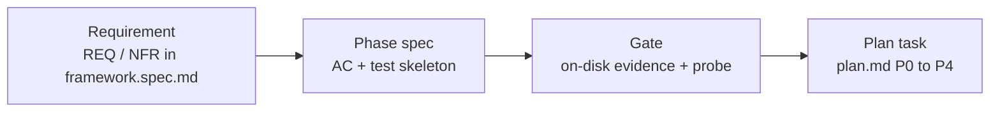

# specs/ — spec set ของ my-memory engine framework

Index ของชุดสเปก **spec-driven development** สำหรับ engine repo นี้ — สเปกบอกว่า "ระบบต้องทำอะไร และรู้ได้อย่างไรว่าเสร็จ"; design/plan บอกว่า "ทำไม" และ "ทำอย่างไร/ลำดับใด"

## Chain of record (หนึ่งบรรทัด)

`requirement → phase spec → acceptance criterion → test skeleton → gate → plan task`

ทุก requirement ต้องเดินครบ chain ก่อนถือว่า done; gate ที่ไม่มี evidence บนดิสก์ = ยังไม่ผ่าน (AGENTS.md)

## ไฟล์ในชุดนี้

| File | คืออะไร | สถานะ |
|---|---|---|
| [`framework.spec.md`](framework.spec.md) | **Product-level spec** — problem, actors, capability map, 25 functional + 12 non-functional requirement (EARS + traceability + verification hint), global out-of-scope, trust & data boundary, cross-cutting AC (8), glossary + id conventions, OQ1–OQ7 + GAP-1…GAP-7, approval block | **มีแล้ว — DRAFT** (awaiting owner approval) |
| [`phases/p0-language-gate.spec.md`](phases/p0-language-gate.spec.md) | **Phase spec P0** — pre-code feasibility spikes (S1 · S2 · B1–B7 · S6 · RS1/RS2) + language gate: entry/exit criteria, spike-probe tables, 12 AC (`AC-P0-01`…`AC-P0-12`), language-gate decision procedure, 12 language-neutral test skeletons, evidence requirements, DoD + negative controls | **มีแล้ว — DRAFT** (awaiting owner approval) |
| [`phases/p1-engine-scaffold.spec.md`](phases/p1-engine-scaffold.spec.md) | **Phase spec P1** — local-only scaffold + codec/schema/store/index: OQ2 blocking checkpoint, 14 AC (`AC-P1-01`…`AC-P1-14`), P1-exit gates S3 + S4, 14 language-neutral test skeletons, evidence ใต้ `$WF/parity/P1/`, DoD + negative controls | **มีแล้ว — DRAFT** (awaiting owner approval) |
| [`phases/p2-engine-parity.spec.md`](phases/p2-engine-parity.spec.md) | **Phase spec P2** — domain / CLI / MCP / hooks + differential parity บน real clone: OQ5 blocking checkpoint, compatibility surface ที่ freeze (9 MCP tools · 4 hook formats × 3 events · 20 commands · exit codes · `--json`), parity 7 family + resumability, 19 AC (`AC-P2-01`…`AC-P2-19`), S5 (`n_pairs = 30`, `recall5 ≥ 0.8667`, `mrr ≥ 0.85`) + recurring private gate, 19 language-neutral test skeletons, evidence ใต้ `$WF/parity/P2/`, DoD + negative controls | **มีแล้ว — DRAFT** (awaiting owner approval) |
| [`phases/p3-cutover.spec.md`](phases/p3-cutover.spec.md) | **Phase spec P3** — staged cutover 6 harness แบบ serial: OQ3 blocking checkpoint, cutover protocol + rollback ที่พิสูจน์ได้, live probe (`agent:<name>` writes > 0 · hook exit `0` · no push · no network เกิน), GAP-6 disposition (`kirocrew`), 11 AC (`AC-P3-01`…`AC-P3-11`), 11 language-neutral test skeletons, evidence ใต้ `$WF/parity/P3/`, DoD + negative controls | **มีแล้ว — DRAFT** (awaiting owner approval) |
| [`phases/p4-public-release.spec.md`](phases/p4-public-release.spec.md) | **Phase spec P4** — Python read-only legacy/archive + public approval gate: gate 4 องค์ประกอบ (OQ1 + OQ2 + hygiene + explicit approval), scrub absolute path/ข้อมูลส่วนตัวในเอกสาร, manual fixture review, สถานะ `BLOCKED — public gate pending` / `READY` / `APPROVED`, 13 AC (`AC-P4-01`…`AC-P4-13`), 13 language-neutral test skeletons, evidence ใต้ `$WF/parity/P4/`, DoD + negative controls; packaging/distribution = fast-follow (นอก MVP) | **มีแล้ว — DRAFT** (awaiting owner approval) |
| `traceability.matrix.md` (ชื่อ provisional) | **Traceability matrix** — ตาราง `REQ/NFR ↔ phase spec ↔ AC ↔ test ↔ gate ↔ plan task` + สถานะความครอบคลุม | **ยังไม่มี** — เขียนใน follow-up dispatch |

ชื่อไฟล์ของ P2–P4 (`phases/p2-engine-parity.spec.md`, `phases/p3-cutover.spec.md`, `phases/p4-public-release.spec.md`) ถูกยืนยันแล้วใน follow-up dispatch นี้; ชื่อของ P0/P1 และ P2–P4 ถือเป็น final; id ของ requirement ใน `framework.spec.md` ถือเป็น final และห้าม renumber · traceability matrix ยังเป็น **provisional** ทั้งชื่อและกำหนดการ

## อ่านอย่างไร

1. `framework.spec.md` §TL;DR → §1–§3 (problem, actors, scope) — 2 นาที
2. §4 capability map + §4.2 metric note — ตรวจว่า count ที่อ้างตรงกับโค้ดจริง และเข้าใจว่า **187 (assertion sites) ≠ 399 (runtime pass count)**
3. §5/§6 เลือกอ่านตาม area (`REQ-REC-*` = record contract, `REQ-STORE-*`/`REQ-IDX-*` = persistence, `REQ-*` ของ CLI/MCP/HOOK = harness contract)
4. §7–§8 ก่อนแตะอะไรที่เกี่ยวกับข้อมูลหรือ network
5. §11 open questions + gaps — **ห้ามเดาคำตอบ**; ถ้างานที่ทำต้องใช้คำตอบ ให้หยุดและถาม owner
6. `docs/spec/design.md` (rev 5) + `docs/spec/plan.md` (37 tasks) คือ contract ต้นทาง — สเปกนี้ไม่เขียนทับ

## Id conventions (สรุป)

- `REQ-<AREA>-NN` — functional requirement; area ∈ `REC, DOM, CLI, MCP, HOOK, INST, STORE, IDX, SYNC, EVAL, COMPAT, CUTOVER`
- `NFR-<AREA>-NN` — non-functional; area ∈ `LANG, PERF, NET, SEC, PRIV, OPS, QUAL, PORT, COMPAT, RELEASE`
- `AC-<n>` — cross-cutting AC ใน `framework.spec.md`; AC ระดับ requirement ใช้ `AC-<REQ-ID>-NN` ใน phase spec
- `TB-<n>` — trust boundary requirement (§8)
- `OQ<n>` — design-owned open question (ห้ามสร้างใหม่/renumber ที่นี่)
- `GAP-<n>` — ช่องว่างที่บันทึกไว้ รอเจ้าของตัดสิน
- `Rn / Hn / Gn / Tn / Sn / En` — อ้างตารางใน `exploration.md` / `design.md` / `research.md` ตามความหมายเดิม

## กติกาของชุดสเปกนี้

- **ห้ามเริ่ม implementation ก่อน owner เปลี่ยนสถานะเป็น APPROVED** (ดู `.claude/active-spec.md`)
- **ห้าม renumber / reuse id** — แก้ถ้อยคำได้ แต่ id เดิมต้องอ้างถึง requirement เดิมเสมอ
- **ห้าม invent source** — requirement ที่ไม่มี design section + plan task ต้องไปอยู่ใน gaps ไม่ใช่แต่ง traceability
- **ห้ามเขียน corpus จริง, prompt log, personal record หรือ secret ลงในไฟล์ชุดนี้** — ตัวอย่าง/ตัวเลขที่ยกมาต้องมาจาก design/plan/exploration หรือการนับบนโค้ดที่เปิดเผยได้ (NFR-PRIV-01/02)
- ตัวเลขทุกตัวต้องมีที่มา + วันที่; claim ที่ยังไม่วัดต้องติดป้ายเป็น inference (AGENTS.md)

## สถานะปัจจุบัน (2026-10-19)

| เรื่อง | สถานะ |
|---|---|
| spec set | `framework.spec.md` เขียนแล้ว (DRAFT) · phase specs `P0`–`P4` เขียนแล้วทั้ง 5 เฟส (DRAFT) · `traceability.matrix.md` ยังไม่เขียน |
| implementation | **0 บรรทัดโค้ด** — repo นี้มีแต่ spec |
| remote / push / publication | ไม่มี remote, ไม่มีอะไรถูก push (NFR-RELEASE-01) |
| language | ยังไม่ล็อก — ตัดสินที่ P0 language gate จากผลวัดบนดิสก์ (NFR-LANG-01) |
| owner decisions ที่ค้าง | OQ1 license · OQ2 namespace · OQ3 cutover · OQ4 platform matrix · OQ5 MCP schema freeze · OQ6 semantic search · OQ7 Bun `setCustomSQLite` |
