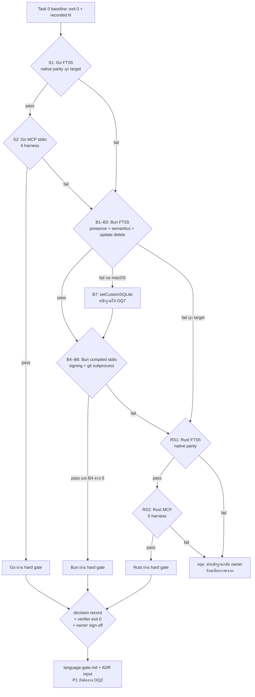

# Spec: P0 — pre-code feasibility spikes + language gate

## TL;DR

P0 เสร็จเมื่อ **spike ที่จำเป็นของ branch ที่รันจริงถูกวัดบน native target ครบ, artifact อยู่บนดิสก์, และ `language-gate.md` มีคำตัดสินที่สอดคล้องกับผลวัดพร้อม owner sign-off** — ไม่ใช่เมื่อ "เห็นว่าผ่าน" ในแชท
สเปกนี้**ไม่เลือกภาษา** และคงความเป็นกลางทางภาษา: มันกำหนดเฉพาะ acceptance surface ของ P0 (probe, pass criterion, negative control, evidence) ให้ tasks `plan.md` P0.1–P0.13 ต้อง satisfy และ bind กลับไปที่ `REQ-*`/`NFR-*` ใน `specs/framework.spec.md`
S3/S4/S5 ไม่อยู่ใน P0 (design §9.2 ข) · ยังไม่มี engine code/scaffold · ไม่มี real corpus ใน repo นี้ · ไม่มี remote และไม่มีอะไรถูก push

---

## 1. Phase goal

พิสูจน์หรือหักล้าง **riskiest assumption ของทั้ง migration** ด้วยการวัดจริงก่อนเขียน engine code หนึ่งบรรทัด: candidate stack ใดสามารถ reproduce FTS5 semantics ของ Python baseline (รวมข้อความไทย/bm25/`unicode61`) บน **ทุก** target ที่จะประกาศ, เป็น MCP stdio server ที่สะอาดกับ harness จริงทั้ง 6 ตัว, และแจกเป็น artifact ที่ผู้ใช้ไม่ต้องลง runtime — แล้วใช้ผลเหล่านั้นปิด **language gate** ให้เหลือ stack เดียวที่ P1 จะ scaffold ต่อ (design §4.2, §9.2 ก; plan P0)

## 2. Entry criteria

ต้องครบทุกข้อก่อนเริ่ม task แรกของ P0:

| # | เงื่อนไข | หลักฐานที่ต้องมีก่อนเริ่ม |
|---|---|---|
| E1 | Task 0 baseline ผ่าน | `WF/baseline.md` มีผล `python3 bin/mem verify` = `0 problems`, `stats` snapshot, `eval` 30 คู่ (`recall5=0.8667`, `mrr=0.85`) และ suite `N passed, 0 failed` ด้วย exit `0` โดย `N` ตรงกับค่าที่บันทึกไว้ (`399` ณ `d0d311d` ตาม plan Task 0) — **`N` ไม่ตรง = drift → หยุด ไม่ใช่แก้ baseline ให้เขียว** |
| E2 | installer ยังเป็น dry-run | `bash harness/install.sh` exit `0` และไม่มีไฟล์ harness ถูกแก้ (plan Task 0) |
| E3 | native target matrix ถูกประกาศ | คำตอบ **OQ4** (targets + Linux libc variant) หรือบันทึก `BLOCKED` — ห้ามเริ่มนับ native pass ก่อนมี matrix |
| E4 | มี native runner ต่อ target | หลักฐานว่าเข้าถึงเครื่อง/runner ของแต่ละ OS ได้ (**GAP-3**) — ไม่มี runner = `BLOCKED` ไม่ใช่ pass |
| E5 | spike artifact มี field ขั้นต่ำตรงกัน | 5 ฟิลด์ของ **NFR-OPS-02** (command · real exit code · version/SHA · date · probe result) + สถานะ `PASS`/`FAIL`/`BLOCKED` — **GAP-1** ยังเปิดเรื่อง schema กลาง |
| E6 | data repo working tree สะอาด | `git -C "$REPO" status --short` ว่าง (design §11.2 ข้อ 5 / §14 ข้อ 3) |
| E7 | เข้าใจ evidence tag ปัจจุบัน | ฝั่ง Bun **ไม่มี `[MEASURED]` เลย** — `[DOC]`/`[ISSUE-REPORT]`/`[INFERENCE]` คงป้ายเดิมจนกว่าจะมี artifact จากการวัด (AGENTS.md) |

## 3. Exit criteria

P0 ปิดได้เมื่อ **branch ที่รันจริง** มีผลครบและ gate ถัดไปเปิดได้:

| Gate | ต้องได้อะไร | สถานะที่ยอมรับ |
|---|---|---|
| **S1** (Go, FTS5) | native PASS ทุก target ที่ประกาศ + SQLite version บนดิสก์ | `PASS` / `FAIL` (ตก target ใดก็ตกทั้ง stack) |
| **S2** (Go, MCP stdio) | 6/6 harness connect + `tools/call` สำเร็จ + 9/9 tools | `PASS` / `FAIL` |
| **B1–B3** (Bun, FTS5 presence/semantics/update-delete) | parity ทุก target + `sqlite_version` ต่อ target | `PASS` / `FAIL` — เปิดเฉพาะเมื่อ Go ตก S1/S2 หรือ owner อนุมัติ scope วัด Bun |
| **B4–B6** (Bun, compiled stdio + signing + git) | B4 purity + 9/9 (และ **6/6 ก่อนล็อก**), B5 clean-machine pass, B6 ไม่มี silent failure | `PASS` / `FAIL` / `BLOCKED` (B5 ถ้าไม่มี signing approval) |
| **B7** (Bun, conditional) | evidence ของ `setCustomSQLite` + สถานะ `WAITING_FOR_OQ7` | ไม่ใช่ pass/fail — เป็นหลักฐานให้ owner |
| **S6** (optional) | บันทึกสถานะ go-git#1381 พร้อม URL/วันที่ | `PASS`/`BLOCKED` — **ไม่ block P0** |
| **RS1/RS2** (Rust fallback) | FTS5 parity ทุก target + MCP 6/6 | เปิดเฉพาะเมื่อ **ทั้ง Go และ Bun ตก hard gate** |
| **language gate** | `language-gate.md` คำตัดสินตรงกับผลที่บันทึก + `verify-language-gate.sh` exit `0` + **owner sign-off** | เงื่อนไขเข้า P1 |

เงื่อนไขเพิ่มเติมของ exit: **P0 ต้องไม่ผลิต engine code/scaffold** และ **S3/S4/S5 ต้องไม่ถูกอ้างว่าปิดใน P0** (design §9.2 ข, §9.3)

## 4. Scope in / out

### 4.1 In scope

- spike ตาม `plan.md` P0.1–P0.12 ตาม branch ที่ applicable: S1 · S2 · B1–B3 · B4–B6 · B7 (conditional) · S6 (optional) · RS1/RS2 (fallback)
- probe sources, transcripts, `result.md` และ negative-control record ใต้ `$WF/spikes/P0/` (private data repo)
- `language-gate.md` + ADR input (design §13.2 ข้อ 1) ใต้ `$WF/`
- `verify-language-gate.sh` ซึ่งตรวจความครบ/ความสอดคล้องของ artifact (behavior ตาม AC-P0-11)

### 4.2 Out of scope (ตรงกับ design §2.2 / §6.1 later column / §9.3)

| ไม่อยู่ใน P0 | เหตุผล | ไปอยู่ที่ |
|---|---|---|
| S3 byte-exact · S4 id 100% · S5 recall parity | parity gate ต้องมี codec/domain ที่ port แล้ว (design §9.2 ข) | S3/S4 = P1 exit · S5 = P2 exit |
| engine scaffold / implementation ใด ๆ | P0 คือ pre-code spike เท่านั้น (plan P0 preamble) | P1 |
| การเลือกภาษา **ในสเปกนี้** | คำตัดสินเป็นของ language gate + owner sign-off ไม่ใช่ของ spec | P0.13 → P1 |
| การตัดสิน OQ7 แทน owner | B7 เป็น evidence ไม่ใช่ verdict (design §12) | owner |
| real corpus / prompt log / record จริงใน repo นี้ | NFR-PRIV-01/02, AGENTS.md | `$WF` เท่านั้น |
| remote / push / publication / LICENSE | NFR-RELEASE-01, OQ1 | P4 |
| provider REST adapter, object store, MCP HTTP, daemon, incremental index, semantic search | design §2.2, §6.1 | นอก MVP (reopen trigger §11.3) |
| public packaging (GoReleaser/notarize/SBOM/Homebrew) | design §8.2 — fast-follow หลัง P3 | post-P3 |

## 5. Requirements covered

เฉพาะ requirement ที่ P0 ส่งมอบจริง (หรือส่งมอบ **precondition slice** ซึ่งระบุไว้ชัด):

| Requirement | P0 ต้องส่งมอบอะไร | AC ที่พิสูจน์ |
|---|---|---|
| **NFR-LANG-01** | คำตัดสินภาษาที่มาจาก measurement บนดิสก์เท่านั้น; ไม่มี Bun claim ใดถูกยกระดับเป็น measured fact โดยไม่มี artifact | AC-P0-01 … AC-P0-11 (ตัวคำตัดสิน), AC-P0-12 (วินัยหลักฐาน) |
| **NFR-OPS-02** | ทุก spike artifact มี command · real exit code · version/SHA · date · probe result และสถานะ `PASS`/`FAIL`/`BLOCKED` เพื่อ resume จาก step แรกที่ขาด | AC-P0-01 … AC-P0-12 (evidence clause) — เข้มข้นสุดที่ AC-P0-12 |
| **NFR-PORT-01** | native runtime evidence ต่อ target; cross-compile ไม่นับแทน; ไม่มี runner = `BLOCKED` | AC-P0-01, AC-P0-03, AC-P0-09 |
| **NFR-PRIV-02 / TB-4** | spike/parity artifact ทั้งหมดอยู่ใต้ `$WF`; engine tree ไม่มี artifact ที่ derive จาก corpus จริง | AC-P0-12 |
| **REQ-IDX-01** (*precondition slice*) | FTS5 runtime + semantics parity ถูกพิสูจน์ก่อนเขียน index จริง — **ตัว index เองเป็นงาน P1.5** | AC-P0-01, AC-P0-03, AC-P0-09 |
| **REQ-MCP-01** (*precondition slice*) | stdio handshake / `tools/list` 9 tools / stdout purity ถูกพิสูจน์ที่ระดับ probe — **ตัว contract และ schema freeze เป็นงาน P2.3 (ต้องมี OQ5 ก่อน P2)** | AC-P0-02, AC-P0-04, AC-P0-10 |

### 5.1 Not in this phase (พร้อมเหตุผลและ gate ที่จะปิด)

| Requirement | ทำไมไม่ใช่ P0 | phase / gate |
|---|---|---|
| REQ-REC-01 … REQ-REC-08 (ทั้ง 8 ข้อ) | ต้องมี codec/schema/domain ที่ port แล้ว | P1.2–P1.4 (REC-01…04) · P2.1 (REC-05…08) |
| REQ-DOM-01 | domain/scoring | P2.1 · S5 = P2 exit |
| REQ-CLI-01, REQ-CLI-02 | command surface ยังไม่มี | P2.2 |
| REQ-HOOK-01, REQ-HOOK-02, REQ-INST-01 | hook/installer ยังไม่มี; P0 แตะเฉพาะ git subprocess ใน B6 | P2.4 |
| REQ-STORE-01 … REQ-STORE-03 | store ยังไม่มี | P1.4 |
| REQ-IDX-01/02 (delivery) | P0 พิสูจน์เฉพาะ FTS5 runtime | P1.5 |
| REQ-SYNC-01/02 | sync transport | P2.2 |
| REQ-EVAL-01 | ต้องมี eval runner + domain | P2.6 · S5 = P2 exit |
| REQ-COMPAT-01 | ต้องมี byte/id + MCP/hook contract จริง | S3/S4 = P1 · MCP/hook = P2.3/P2.4 |
| REQ-CUTOVER-01 | cutover | P3 |
| NFR-PERF-01 | ต้องมี hook จริง | P2.7 (G6) |
| NFR-NET-01 | default-path offline เป็น invariant ของ engine ที่ยังไม่มี; B6 แตะเฉพาะ git subprocess ของ spike | P1.4/P2.2 |
| NFR-SEC-01 | ยังไม่มี config/credential surface | P2.2, P4.2 |
| NFR-PRIV-01 | hygiene ของ public repo | P4.2 |
| NFR-QUAL-01 | ต้องมี public CI + synthetic eval | P1.6, P2.6 |
| NFR-COMPAT-01 | ยังไม่มี command/tool ให้ generate count | P2.2/P2.3 (design §9.5) |
| NFR-RELEASE-01 | ไม่มี remote/publication ใน P0 | P4.3 |

## 6. Spike groups — สิ่งที่แต่ละ probe ต้องพิสูจน์

ทุกแถวผูกกับ design §9.2 ก โดยตรง; ห้ามแก้ pass criterion ให้หลวมกว่า design และห้ามใช้เอกสาร vendor แทน runtime result (plan P0 preamble, NFR-PORT-01)

### 6.1 S1 — Go: FTS5 runtime + semantics

| หัวข้อ | เนื้อหา |
|---|---|
| Spike id | **S1** (plan P0.1) |
| ต้องพิสูจน์ | `modernc.org/sqlite` เวอร์ชันที่จะ pin มี FTS5 จริงและ semantics (`MATCH`, `bm25()`, `unicode61`, UPDATE/DELETE, integrity) ตรง Python `sqlite3` baseline — ปิด E4 ที่ยังเป็น `INF` |
| Target platforms | ทุก OS/arch ใน matrix ที่ OQ4 ประกาศ (design เสนอ macOS arm64/x64, Linux amd64/arm64, Windows amd64) — **native เท่านั้น** |
| Exact probe | สร้าง FTS5 virtual table; insert synthetic corpus ไทย/อังกฤษ/ผสม ที่ deterministic; รัน `MATCH`/`bm25`/`unicode61`; UPDATE/DELETE + integrity; เทียบ hit-set และ ranking กับ Python `sqlite3` oracle บน corpus เดียวกัน |
| Pass criterion | `go test ./...` exit `0`; `./run-native-matrix.sh` exit `0` พร้อม native PASS **ทุก** target + SQLite version ที่ใช้จริงต่อ target |
| Discriminating negative control | query/corpus ที่ perturb expected ranking หนึ่งตำแหน่ง → assertion ต้องแดง; และผล cross-compile ต้องไม่ถูกนับเป็น native pass |
| Persisted at | `$WF/spikes/P0/S1-go-fts5/` — probe source, pinned dependency manifest, per-OS transcript, `result.md` |

### 6.2 S2 — Go: MCP stdio กับ 6 harness

| หัวข้อ | เนื้อหา |
|---|---|
| Spike id | **S2** (plan P0.2) |
| ต้องพิสูจน์ | Go MCP SDK (stdio) ให้ parity กับ hand-written server เดิมในเรื่อง framing, protocolVersion negotiation, `instructions`, `tools/list` 9 tools และ `tools/call` ที่เขียน synthetic record ได้จริง กับ client จริงทั้ง 6 |
| Target platforms | 6 harness clients: claude, codex, gemini, opencode, cursor, hermes — แต่ละตัวใน isolated config/sandbox |
| Exact probe | minimal fake server จำลอง 9 tools ตาม frozen schema; ต่อ harness จริง; ตรวจ initialize/protocolVersion/instructions, tools 9/9, tool call เขียน marker ลง fixture home แล้วอ่านกลับ; ส่ง framing ที่ SDK รองรับและ framing เดิมที่จำเป็นเพื่อจับ incompatibility |
| Pass criterion | `./run-all.sh` exit `0`; `6/6 harness PASS`; tools `9/9`; marker อ่านกลับได้; transcript ต่อ harness อยู่บนดิสก์ |
| Discriminating negative control | ตัด tool หนึ่งตัวออกจาก `tools/list` → assertion ต้องแดง; `grep -F '6/6' result.md` เป็นเพียงผลประกอบ **ห้ามใช้แทนการตรวจ transcript** |
| Persisted at | `$WF/spikes/P0/S2-go-mcp/` — server/client runner, per-harness transcript, `result.md` |

### 6.3 B1–B3 — Bun: FTS5 presence · semantics · external-content update/delete

| Spike | ต้องพิสูจน์ | Target platforms | Exact probe | Pass criterion | Negative control | Persisted at |
|---|---|---|---|---|---|---|
| **B1** (P0.3) | FTS5 module มีจริงบน target นั้น และบันทึก SQLite provenance (macOS = Apple system SQLite, Linux glibc/musl, Windows = Bun static) | ทุก target ที่ประกาศ | `CREATE VIRTUAL TABLE ... USING fts5` + insert + `MATCH` marker | `bun test` exit `0`; `./run-native-matrix.sh` exit `0` + transcript และ version ต่อ target | SQLite build ที่ปิด FTS5 ต้องทำให้ probe ล้ม | `$WF/spikes/P0/B1-bun-fts5-presence/` |
| **B2** (P0.4) | `MATCH` hit-set, `bm25()` ordering, `unicode61` และข้อความไทยตรง Python oracle | ทุก target เดียวกับ B1 | ชุด query คงที่ ไทย/อังกฤษ/ผสม เทียบ oracle | `bun test` + `./run-native-matrix.sh` exit `0`; transcript แสดง parity ทุก target **ไม่ใช่แค่ API มีอยู่** | เปลี่ยน corpus/query หนึ่งจุดจน expected ranking ต่าง → assertion ต้องแดง | `$WF/spikes/P0/B2-bun-fts5-semantics/` |
| **B3** (P0.5) | external-content FTS5 + triggers: insert→MATCH, update body → old term หาย/new term เจอ, delete → หาย, `integrity-check` ผ่าน | ทุก target | probe + test ตามลำดับข้างต้น ทำซ้ำหลายรอบเพื่อจับ corruption เป็นรอบ ๆ | `bun test` + `./run-native-matrix.sh` exit `0` ทุก iteration | **ห้ามใช้** `oven-sh/bun#31247` (unverified user report) ตัดสินทั้งสองทิศ — verdict มาจากผลวัดเท่านั้น | `$WF/spikes/P0/B3-bun-fts5-update-delete/` |

ผลที่ไม่ตรงแม้ **หนึ่ง** target = `FAIL` ของ Bun branch ทั้งหมด (design §9.2 ก "ผ่านทุก target ที่ประกาศ")

### 6.4 B4–B6 — Bun: compiled stdio · signing · git subprocess

| Spike | ต้องพิสูจน์ | Target platforms | Exact probe | Pass criterion | Negative control | Persisted at |
|---|---|---|---|---|---|---|
| **B4** (P0.6) | executable ที่ compile แล้วเป็น MCP stdio server ที่ stdout สะอาดและ tool list ตรง | ≥2 harness รอบแรก; **6/6 ก่อน lock** ถ้า Bun จะถูกเลือก | `bun build --compile` → launch เป็น stdio server → capture raw stdout/stderr → initialize/tools/list/tool call (synthetic add + read) | `./run-all.sh --harnesses claude,codex` exit `0`, 2/2, tools 9/9, purity PASS; กรณีเลือก Bun รัน 6 harness → exit `0` 6/6 | control build ที่พิมพ์ banner ลง stdout ต้อง fail purity assertion | `$WF/spikes/P0/B4-bun-mcp-stdio/` |
| **B5** (P0.7) | แจก artifact ได้จริงบนเครื่องสะอาด: codesign + JIT entitlement + notarize แล้ว handshake สำเร็จ | clean macOS host ที่ **ไม่มี Bun** | build → codesign (JIT entitlement) → notarize → คัดลอกไป clean host → เปิด MCP stdio จน handshake สำเร็จ | `./run-clean-machine.sh` exit `0`; signature/notarization valid; handshake ok; OS/version บันทึก (ไม่เก็บ secret) | ถอด JIT entitlement ออก → ต้อง fail บน clean machine | `$WF/spikes/P0/B5-bun-signing/` (**ห้ามเก็บ certificate/private key/credential**) |
| **B6** (P0.8) | git CLI subprocess ครบ sync path โดยไม่มี silent failure | macOS host + temp repo + **local bare remote เท่านั้น** | status/commit/fetch/pull `--rebase --autostash`/push (ไม่ใช้ `--force`); ทำให้ subprocess ล้มโดยเจตนา; เรียก hook stop | `./run-local-bare-e2e.sh` exit `0`; failure observable; fake remote refs เปลี่ยน; hook exit `0` และ push count `0` | ทำให้ git ล้มแล้วต้องเห็น error ใน response/log — ถ้าเงียบ = `FAIL` | `$WF/spikes/P0/B6-bun-git-subprocess/` |

### 6.5 B7 — Bun `setCustomSQLite` (conditional)

| หัวข้อ | เนื้อหา |
|---|---|
| Spike id | **B7** (plan P0.9) — เปิดเฉพาะเมื่อ B1–B3 fail บน macOS system SQLite |
| ต้องพิสูจน์ | ถ้า pin SQLite เองด้วย `setCustomSQLite` จะได้ parity เดิม และราคาที่จ่ายคืออะไร (ไม่ใช่ single executable file + signing surface เปลี่ยน — `[INFERENCE]`) |
| Target platforms | macOS (target ที่ตก) เป็นหลัก; ระบุ target อื่นที่กระทบ |
| Exact probe | build ชุดทดสอบ FTS5 เดียวกันผ่าน `setCustomSQLite` ด้วย SQLite ที่ pin; assert parity เท่า B1–B3; inventory executable/dependency และ signing requirement จริง |
| Pass criterion | `./run-probe.sh` exit `0` เฉพาะเมื่อ custom-SQLite probe ผ่าน; `result.md` มี inventory จริงและสถานะ `WAITING_FOR_OQ7` |
| Discriminating negative control | ไม่ใช่ pass/fail — **ห้ามตัดสิน acceptability แทน owner**; ไม่มีคำตอบ OQ7 = language gate ค้าง (ไม่ใช่ pass) |
| Persisted at | `$WF/spikes/P0/B7-bun-custom-sqlite/` |

### 6.6 S6 — go-git issue status (optional, non-blocking)

| หัวข้อ | เนื้อหา |
|---|---|
| Spike id | **S6** (plan P0.10) |
| ต้องพิสูจน์ | สถานะปัจจุบันของ go-git#1381 (partial clone) — ยกระดับ E17 ที่ confidence กลาง |
| Target platforms | ไม่เกี่ยว (primary source บนเว็บ) |
| Exact probe | เปิด primary issue ดู state/notes; บันทึก URL, วันที่ fetch, สถานะจริง และว่า partial clone ยัง relevant ไหม |
| Pass criterion | `test -s "$WF/spikes/P0/S6-go-git-status.md"` exit `0` และระบุ status/provenance |
| Discriminating negative control | ถ้าเปิด primary source ไม่ได้ → `BLOCKED` และ **ไม่ปิด S6** แต่เดินต่อได้ |
| Persisted at | `$WF/spikes/P0/S6-go-git-status.md` — ห้ามใช้ผลเปลี่ยน MVP (ยังใช้ git CLI) |

### 6.7 RS1 — Rust: FTS5 (fallback เท่านั้น)

| หัวข้อ | เนื้อหา |
|---|---|
| Spike id | **RS1** (plan P0.11) |
| ต้องพิสูจน์ | `rusqlite --features bundled` มี FTS5 + `bm25` + ข้อความไทย ตรง baseline (E9 ยังเป็น `INF` — ห้ามเลือก Rust โดยไม่ผ่าน RS1) |
| Target platforms | ทุก target ที่ประกาศ (native) |
| Exact probe | FTS5 table + `MATCH`/`bm25`/ไทย + UPDATE/DELETE/integrity เทียบ Python oracle บน corpus เดียวกัน |
| Pass criterion | `cargo test` exit `0`; `./run-native-matrix.sh` exit `0` พร้อม native PASS ทุก target + SQLite version ใน `result.md` |
| Discriminating negative control | perturbed ranking ต้องแดง; และการรัน RS1 โดยไม่มี artifact ที่แสดงว่า Go และ Bun ตก = procedure violation ที่ `verify-language-gate.sh` ต้องจับได้ |
| Persisted at | `$WF/spikes/P0/RS1-rust-fts5/` |

### 6.8 RS2 — Rust: MCP stdio (ทำต่อเมื่อ RS1 ผ่าน)

| หัวข้อ | เนื้อหา |
|---|---|
| Spike id | **RS2** (plan P0.12) |
| ต้องพิสูจน์ | Rust SDK stdio parity กับ client จริง — เริ่ม ≥2 harness และ **6/6 ก่อน lock** |
| Target platforms | harness clients 6 ตัว (claude, codex, gemini, opencode, cursor, hermes) |
| Exact probe | minimal server 9 tools, protocol/instructions, synthetic add/read |
| Pass criterion | `./run-all.sh --harnesses claude,codex,gemini,opencode,cursor,hermes` exit `0`, 6/6, 9/9 tools |
| Discriminating negative control | ตัด tool หนึ่งตัวออกจาก `tools/list` → assertion แดง; ต่ำกว่า 6/6 ล็อก Rust ไม่ได้ |
| Persisted at | `$WF/spikes/P0/RS2-rust-mcp/` |

## 7. Acceptance criteria

### AC-P0-01 · S1 — FTS5 parity บนทุก native target

**Proves:** NFR-LANG-01 · NFR-PORT-01 · REQ-IDX-01 (precondition slice)
**Plan task:** `plan.md` P0.1 · **Gate:** **S1 / RK1**

```gherkin
Given a pinned modernc.org/sqlite version, a deterministic synthetic Thai/English/mixed corpus
  And the Python sqlite3 oracle output for that same corpus
When the Go probe creates an FTS5 virtual table, inserts the corpus, runs MATCH/bm25/unicode61,
     UPDATE/DELETE and integrity-check natively on each declared target
Then `go test ./...` exits 0
  And `./run-native-matrix.sh` exits 0 with a native PASS row and the real SQLite version per target
  And `result.md` is non-empty and carries command, exit code, version/SHA, date, per-target verdict
But no cross-compiled result is accepted in place of a native run
```

**Command + expected:** `cd "$WF/spikes/P0/S1-go-fts5" && go test ./...` → exit `0`; `./run-native-matrix.sh` → exit `0`; `test -s result.md` → exit `0`
**Discriminating control:** perturb expected ranking 1 ตำแหน่ง → `go test` ต้อง exit ไม่ใช่ `0` (บันทึกใน `result.md`)

### AC-P0-02 · S2 — MCP stdio parity 6/6

**Proves:** NFR-LANG-01 · REQ-MCP-01 (precondition slice)
**Plan task:** `plan.md` P0.2 · **Gate:** **S2 / RK3**

```gherkin
Given a minimal SDK server exposing exactly the 9 frozen tool names over stdio
  And six harness clients in isolated sandboxes
When each harness connects, negotiates protocolVersion, reads the existing instructions,
     lists tools and calls a tool that writes a synthetic record into a fixture home
Then `./run-all.sh` exits 0 with 6/6 harness PASS, 9/9 tools, and the marker readable back
  And one transcript per harness is on disk
But a harness that fails is recorded as FAIL for that harness, not averaged into a pass
```

**Command + expected:** `cd "$WF/spikes/P0/S2-go-mcp" && ./run-all.sh` → exit `0`; `grep -F '6/6' result.md` → exit `0` (ผลประกอบเท่านั้น)
**Discriminating control:** drop one tool from `tools/list` → tools-count assertion ต้องแดง

### AC-P0-03 · B1–B3 — Bun FTS5 presence, semantics และ external-content update/delete

**Proves:** NFR-LANG-01 · NFR-PORT-01 · REQ-IDX-01 (precondition slice)
**Plan task:** `plan.md` P0.3, P0.4, P0.5 · **Gate:** **B1 / B2 / B3 · RK1 / RK4**

```gherkin
Given Bun on each declared target, with the real SQLite version and provenance recorded per target
When the presence probe, the MATCH/bm25/unicode61/Thai parity probe and the
     external-content insert→update→delete probe (with integrity-check over repeated iterations) run
Then `bun test` exits 0 and `./run-native-matrix.sh` exits 0 for every target
  And the transcripts show parity with the Python oracle, not merely that the API exists
  And `result.md` records sqlite_version per target
But a mismatch on any single declared target marks the whole Bun branch FAIL
```

**Command + expected:** per spike dir `bun test` → exit `0`; `./run-native-matrix.sh` → exit `0`
**Discriminating control:** B1 — SQLite build without FTS5 must fail the probe; B2 — perturbed ranking must fail; B3 — no issue report is used as a verdict

### AC-P0-04 · B4 — compiled binary stdout purity + 9-tool parity

**Proves:** NFR-LANG-01 · REQ-MCP-01 (precondition slice)
**Plan task:** `plan.md` P0.6 · **Gate:** **B4 / RK3**

```gherkin
Given a `bun build --compile` executable launched as an MCP stdio server
When raw stdout and stderr are captured across initialize, tools/list and a tool call
Then every stdout line parses as a protocol frame with no banner, warning or log line
  And tools/list yields 9/9
  And `./run-all.sh --harnesses claude,codex` exits 0 with 2/2
  And if Bun is the candidate to be locked, the same run with all six harnesses exits 0 with 6/6
But a control build that prints a banner to stdout must fail the purity assertion
```

**Command + expected:** `./run-all.sh --harnesses claude,codex` → exit `0`; （กรณี lock Bun）`./run-all.sh --harnesses claude,codex,gemini,opencode,cursor,hermes` → exit `0` และ `6/6`
**Discriminating control:** banner build → purity assertion ต้องแดง

### AC-P0-05 · B5 — codesign / JIT / notarize บนเครื่องสะอาด

**Proves:** NFR-LANG-01 · NFR-PORT-01
**Plan task:** `plan.md` P0.7 · **Gate:** **B5**

```gherkin
Given a compiled executable signed with the JIT entitlement and notarized
When it is copied to a clean macOS host that has no Bun installed and performs an MCP handshake
Then `./run-clean-machine.sh` exits 0
  And signature and notarization are valid, and the handshake succeeds
  And no certificate, private key or credential is stored in the artifact directory
But removing the JIT entitlement makes the same run fail
```

**Command + expected:** `./run-clean-machine.sh` → exit `0`; ถ้าไม่มี Apple account/signing approval → `BLOCKED` (ห้ามใช้ credential แทน owner)
**Discriminating control:** no-JIT build → ต้อง fail บน clean machine

### AC-P0-06 · B6 — git subprocess ครบ sync path โดยไม่มี silent failure

**Proves:** NFR-LANG-01 · NFR-OPS-01 (slice: failure observable)
**Plan task:** `plan.md` P0.8 · **Gate:** **B6 / RK7**

```gherkin
Given a temp repo and a local bare remote only
When status/commit/fetch/pull --rebase --autostash/push run without --force
  And a git subprocess is deliberately broken
  And the hook stop path is invoked
Then `./run-local-bare-e2e.sh` exits 0 with commit/fetch/rebase/push success
  And the induced failure is observable in the response and the log
  And the fake remote refs reflect the push
  And the hook exits 0 with push count 0
But a silent success on the broken path is FAIL
```

**Command + expected:** `./run-local-bare-e2e.sh` → exit `0`
**Discriminating control:** induced git failure ต้อง observable — ไม่มีร่องรอย = `FAIL`

### AC-P0-07 · B7 — `setCustomSQLite` evidence และ OQ7 ยังเปิด

**Proves:** NFR-LANG-01 (เฉพาะ branch ที่ B7 เปิด)
**Plan task:** `plan.md` P0.9 · **Gate:** **B7** (evidence สำหรับ OQ7 ไม่ใช่ verdict)

```gherkin
Given B1–B3 failed on macOS system SQLite
When the same FTS5 probe runs through setCustomSQLite with a pinned SQLite
  And the resulting executable and dependency inventory is recorded
Then `./run-probe.sh` exits 0 only if the custom-SQLite probe passes
  And `result.md` carries the actual inventory and status WAITING_FOR_OQ7
But this spec does not accept the trade-off: without an owner answer the language gate stays blocked
```

**Command + expected:** `./run-probe.sh` → exit `0`; `grep -F 'WAITING_FOR_OQ7' result.md` → exit `0`
**Discriminating control:** ไม่มีคำตอบ OQ7 → ห้ามบันทึก Bun เป็น pass

### AC-P0-08 · S6 — optional status record (non-blocking)

**Proves:** ไม่ปิด requirement ใด — optional ตาม design §9.2 ก
**Plan task:** `plan.md` P0.10 · **Gate:** **S6** (informational)

```gherkin
Given access to the primary issue tracker
When go-git#1381 state and maintainer notes are read
Then the record states URL, fetched date, exact status and whether partial clone is still relevant
  And it does not change the MVP decision (git CLI stays)
But if the primary source cannot be reached the status is BLOCKED and P0 continues
```

**Command + expected:** `test -s "$WF/spikes/P0/S6-go-git-status.md"` → exit `0`
**Discriminating control:** ไม่มี primary source → `BLOCKED` ไม่ใช่ pass

### AC-P0-09 · RS1 — Rust FTS5 เฉพาะเมื่อ Go และ Bun ตก

**Proves:** NFR-LANG-01 · NFR-PORT-01 · REQ-IDX-01 (precondition slice)
**Plan task:** `plan.md` P0.11 · **Gate:** **RS1 / RK1 / RK4**

```gherkin
Given on-disk artifacts showing Go failed S1 or S2 and Bun failed B1–B7
When `rusqlite --features bundled` runs the FTS5/MATCH/bm25/Thai/UPDATE-DELETE parity probe natively
Then `cargo test` and `./run-native-matrix.sh` exit 0 with native PASS on every declared target
  And the SQLite version is recorded in result.md
But running RS1 without those two failure artifact sets is a procedure violation and must be caught by the gate verifier
```

**Command + expected:** `cd "$WF/spikes/P0/RS1-rust-fts5" && cargo test` → exit `0`; `./run-native-matrix.sh` → exit `0`
**Discriminating control:** perturbed ranking → แดง; ไม่มี failure artifact ของ Go/Bun → `verify-language-gate.sh` ต้อง non-zero

### AC-P0-10 · RS2 — Rust MCP parity 6/6

**Proves:** NFR-LANG-01 · REQ-MCP-01 (precondition slice)
**Plan task:** `plan.md` P0.12 · **Gate:** **RS2 / RK3**

```gherkin
Given RS1 passed
When the Rust SDK minimal server (9 tools, instructions, protocol negotiation) is driven by all six harness clients
Then `./run-all.sh` with the six harnesses exits 0 with 6/6, 9/9 tools and a synthetic add/read round trip
But fewer than 6/6 cannot lock Rust
```

**Command + expected:** `./run-all.sh --harnesses claude,codex,gemini,opencode,cursor,hermes` → exit `0`
**Discriminating control:** drop one tool → assertion แดง

### AC-P0-11 · Language gate — คำตัดสินตรงกับผลวัด + sign-off

**Proves:** NFR-LANG-01 · NFR-OPS-02
**Plan task:** `plan.md` P0.13 · **Gate:** **language gate**

```gherkin
Given all required spike artifacts for the branch actually run
When `verify-language-gate.sh` aggregates them
Then it exits 0 only when required artifacts exist, the native matrix is complete,
     the recorded decision matches the recorded results, and the decision follows the design §4.2 criteria
  And `language-gate.md` carries the owner sign-off line with a date
But flipping one recorded verdict (for example marking a FAIL target as PASS) in a copy makes the verifier exit non-zero
  And a Bun lock without B1–B7 PASS plus a Go S1/S2 failure is rejected
  And a Rust lock without both Go and Bun failing is rejected
```

**Command + expected:** `./verify-language-gate.sh "$WF/spikes/P0"` → exit `0`; หลัง owner sign-off เท่านั้นที่ P1 เริ่มได้
**Discriminating control:** flipped verdict → non-zero; missing artifact → non-zero

### AC-P0-12 · Evidence completeness และ private location

**Proves:** NFR-OPS-02 · NFR-PRIV-02 · TB-4 · NFR-LANG-01 (วินัยหลักฐาน)
**Plan task:** `plan.md` P0.1–P0.13 (evidence clause) · **Gate:** ทุก gate ของ P0

```gherkin
Given the spike artifacts on disk
When each result.md is inspected against NFR-OPS-02
Then every artifact carries command, real exit code, version/SHA, date, probe result and a PASS/FAIL/BLOCKED status
  And every [MEASURED] claim resolves to an artifact path
  And every Bun claim without an artifact keeps its [DOC]/[ISSUE-REPORT]/[INFERENCE] tag
  And no spike or parity artifact containing real corpus data exists in the engine repo
But removing the exit-code line from one result.md copy makes the gate verifier exit non-zero
```

**Command + expected:**
`test -z "$(git -C "$ENGINE_DIR" ls-files | grep -E '(^|/)(spikes|parity)/')"` → exit `0`
`./verify-language-gate.sh "$WF/spikes/P0"` → exit `0` (ตรวจ field ขั้นต่ำ)
**Discriminating control:** ลบ `exit code` line ในสำเนา → verifier ต้อง non-zero

## 8. Language-gate decision procedure

**ภาษายังไม่ถูกเลือกในสเปกนี้** และสเปกนี้คงความเป็นกลางทางภาษา (language-neutral) — ลำดับและเกณฑ์ข้างล่างคือกระบวนการของ P0.13 ซึ่งอ้าง design §4.2 โดยตรง ไม่ใช่การตัดสินใหม่

### 8.1 ลำดับการรัน (ordered, bounded)

1. **FTS5 ก่อน** เพราะถูกที่สุดและชี้ขาดที่สุด: **S1** (Go, ~1 ชม.) → ถ้าตก ให้หยุด Go path
2. **B1–B3** (Bun, ~2–4 ชม.) เมื่อ Go ตก S1/S2 หรือ owner อนุมัติ scope วัด Bun เพื่อเทียบ — บันทึก `sqlite_version` จริงต่อ target (macOS = Apple system, Linux glibc/musl, Windows = Bun static)
3. **MCP stdio + platform:** **S2** (Go, ~ครึ่งวัน, 6/6) และ **B4–B6** (Bun, ~ครึ่งวัน; B4 เริ่ม ≥2 harness) — S2 วัด 6/6; **B4 ต้องขยายเป็น 6/6 ก่อนล็อก Bun**
4. **B7 (conditional)** เปิดเฉพาะเมื่อ B1–B3 ตกบน macOS system SQLite → `WAITING_FOR_OQ7`
5. **S6 (optional, ~15 นาที)** — ไม่ block
6. **RS1 → RS2** เฉพาะเมื่อ **ทั้ง Go และ Bun ตก hard gate** (พร้อม artifact ที่แสดงเหตุ)

Cross-compile ไม่นับเป็น native pass ในทุกขั้น (NFR-PORT-01)

### 8.2 Flow



### 8.3 Hard gates (ตกข้อเดียว = stack นั้นออก)

- FTS5 ตรง baseline **ทุก** target ที่ประกาศ
- MCP stdio parity **6/6 harness** (หรือ fallback ราย harness ที่ออกแบบและยอมรับได้)
- แจก artifact ได้โดยไม่บังคับผู้ใช้ลง runtime (Go: static binary · Bun: B5 ผ่านบนเครื่องสะอาด)
- git CLI subprocess ครบ sync path โดยไม่มี silent failure (B6 สำหรับ Bun)

### 8.4 Tie-break (เมื่อผ่าน hard gate มากกว่าหนึ่ง stack)

ใช้เกณฑ์ design §4.2 ตามลำดับ: **C9 solo velocity** → **C10 supply chain** (Go: `modernc.org/libc` pin fragility vs Bun: npm transitive graph ใหญ่สุด) → **operational control ของ SQLite** (Go pin เวอร์ชันเดียวทุก OS vs Bun macOS inherit Apple system → drift + S5 recurring) → **ecosystem alignment** (Bun/TS แชร์ภาษากับ plugin/harness ecosystem + official TS SDK ระบุ Bun `[DOC]`) — **ค่าตั้งต้นยังเอนไป Go เว้นแต่ owner ให้น้ำหนัก TS ecosystem สูงกว่า และต้องบันทึกเป็น user input ใน ADR ไม่ใช่ตัดสินเงียบ ๆ**

### 8.5 กฎการเลือกแต่ละ stack

| ผลลัพธ์ | คำตัดสินที่อนุญาต |
|---|---|
| Go ผ่าน S1+S2 | Go เป็น candidate (tie-break ถ้า Bun ผ่านด้วย) |
| Go ตก S1 หรือ S2 **และ** Bun ผ่าน B1–B7 ครบ (B4 6/6, B5, B6) | **Bun เลือกได้** — Bun ไม่ใช่ตัวสำรองของ Rust |
| Go ตก **และ** Bun ตก **และ** RS1+RS2 ผ่าน | Rust |
| ทั้งสามตก | **หยุด** ส่งหลักฐานกลับ owner — ห้ามเลือกภาษาใหม่เอง; ทาง `Go + CGO mattn` ที่ design กล่าวถึงเป็นทางสุดท้ายที่ **ต้องมี user decision + design review ใหม่** ไม่ได้ authorize โดยสเปกนี้ |

### 8.6 วินัยหลักฐาน (บังคับใช้กับทุก claim)

- ทุก claim ต้องมาจาก **measurement บนดิสก์** — ไม่มี artifact = ไม่ใช่ผลวัด
- **Bun evidence set ปัจจุบันไม่มี `[MEASURED]` เลย** — `[DOC]`/`[ISSUE-REPORT]`/`[INFERENCE]` คงป้ายเดิม; จะกลายเป็น `[MEASURED]` ได้ก็ต่อเมื่อ spike รันจริงและ artifact อยู่บนดิสก์
- เอกสาร vendor, vendor benchmark และ issue report **ห้าม** ใช้เป็นเหตุผลเลือกภาษา (design §4.1: E14 ห้ามใช้; `oven-sh/bun#31247` เป็น unverified user report)
- `language-gate.md` ต้องมีตารางผลต่อ candidate → target → gate → verdict → artifact path และระบุ branch ที่ไม่ได้รันพร้อมเหตุผล

## 9. Test skeletons

**LANGUAGE-NEUTRAL SKELETONS.** ทุก skeleton ในไฟล์นี้เป็น pseudocode ที่ไม่ผูกภาษา เพราะภาษาจะถูกล็อกที่ language gate (P0.13) เท่านั้น — **กฎ: skeleton เหล่านี้ต้องถูก transliterate เป็นภาษาที่ gate เลือกทันทีที่ gate ปิด (ก่อน P1.1) และห้าม commit เป็น code ที่รันได้ในภาษาหนึ่งภาษาก่อนถึงตอนนั้น** — P0 skeleton ถูก implement ใน `$WF/spikes/P0/<spike>/` (ไม่ใช่ใน engine repo)

```text
// ===========================================================================
// AC-P0-01 · S1 — FTS5 parity on every native target
// LANGUAGE-NEUTRAL SKELETON — transliterate to the language chosen at the P0
// language gate once that gate closes; never commit as runnable code before then.
// ===========================================================================
test "P0/S1 fts5 parity per native target" {
    // Given: pinned modernc.org/sqlite version, deterministic synthetic Thai/English/mixed corpus,
    //        Python sqlite3 oracle output for the same corpus
    // When:  create FTS5 vtable, insert corpus, MATCH/bm25/unicode61, UPDATE/DELETE, integrity-check
    // Then:  hit set and ranking equal the oracle on this target; SQLite version recorded
    //        (assertion — to be implemented)
    // And (negative control): a query whose expected ranking is perturbed one position
    //        must make this assertion fail
    //        (assertion — to be implemented)
}
```

```text
// ===========================================================================
// AC-P0-02 · S2 — MCP stdio parity across six harnesses
// LANGUAGE-NEUTRAL SKELETON — transliterate after the language gate closes.
// ===========================================================================
test "P0/S2 six harness connect, list 9 tools, call a tool" {
    // Given: minimal SDK server exposing exactly 9 frozen tool names; six harness clients in sandboxes
    // When:  each harness connects, negotiates protocolVersion, reads instructions, lists and calls a tool
    // Then:  6/6 PASS, 9/9 tools, synthetic marker readable back, one transcript per harness
    //        (assertion — to be implemented)
    // And (negative control): removing one tool from tools/list must fail the tools-count assertion
    //        (assertion — to be implemented)
}
```

```text
// ===========================================================================
// AC-P0-03 · B1–B3 — Bun FTS5 presence, semantics, external-content update/delete
// LANGUAGE-NEUTRAL SKELETON — transliterate after the language gate closes.
// ===========================================================================
test "P0/B1–B3 fts5 presence, parity and update-delete per target" {
    // Given: Bun on each declared target; Python oracle for the same corpus
    // When:  presence probe, MATCH/bm25/unicode61/Thai parity probe, external-content
    //        insert→update→delete with integrity-check over repeated iterations
    // Then:  parity on every target; sqlite_version per target recorded; single-target mismatch = FAIL
    //        (assertion — to be implemented)
    // And (negative control): an SQLite build without FTS5 fails, and a perturbed ranking fails
    //        (assertion — to be implemented)
}
```

```text
// ===========================================================================
// AC-P0-04 · B4 — compiled binary stdout purity and tool parity
// LANGUAGE-NEUTRAL SKELETON — transliterate after the language gate closes.
// ===========================================================================
test "P0/B4 compiled MCP stdio stdout is protocol-pure" {
    // Given: `bun build --compile` output launched as an MCP stdio server
    // When:  raw stdout/stderr captured across initialize, tools/list, tools/call
    // Then:  every stdout line parses as a frame, 9/9 tools, 2/2 initial harnesses, 6/6 before lock
    //        (assertion — to be implemented)
    // And (negative control): a build that prints a banner to stdout fails the purity assertion
    //        (assertion — to be implemented)
}
```

```text
// ===========================================================================
// AC-P0-05 · B5 — codesign / JIT / notarize on a clean machine
// LANGUAGE-NEUTRAL SKELETON — transliterate after the language gate closes.
// ===========================================================================
test "P0/B5 signed artifact handshakes on a host without Bun" {
    // Given: compiled executable signed with the JIT entitlement and notarized
    // When:  copied to a clean macOS host without Bun and driven through an MCP handshake
    // Then:  exit 0, signature and notarization valid, handshake succeeds, no secret in the artifact dir
    //        (assertion — to be implemented)
    // And (negative control): the build without the JIT entitlement must fail there
    //        (assertion — to be implemented)
}
```

```text
// ===========================================================================
// AC-P0-06 · B6 — git subprocess without silent failure
// LANGUAGE-NEUTRAL SKELETON — transliterate after the language gate closes.
// ===========================================================================
test "P0/B6 local bare remote E2E and observable failure" {
    // Given: temp repo plus local bare remote only
    // When:  status/commit/fetch/pull --rebase --autostash/push (never --force) run, a subprocess
    //        is deliberately broken, and the hook stop path is invoked
    // Then:  exit 0, refs updated, failure observable in response and log, hook exit 0, push count 0
    //        (assertion — to be implemented)
    // And (negative control): a silent success on the broken path fails this test
    //        (assertion — to be implemented)
}
```

```text
// ===========================================================================
// AC-P0-07 · B7 — setCustomSQLite evidence, OQ7 left open
// LANGUAGE-NEUTRAL SKELETON — transliterate after the language gate closes.
// ===========================================================================
test "P0/B7 pinned-SQLite build reproduces B1–B3 parity and records trade-off" {
    // Given: B1–B3 failed on macOS system SQLite
    // When:  the same FTS5 probe runs through setCustomSQLite with a pinned SQLite
    // Then:  parity result recorded, artifact/dependency inventory recorded, status WAITING_FOR_OQ7
    //        (assertion — to be implemented)
    // And (negative control): no owner answer must never be recorded as a Bun pass
    //        (assertion — to be implemented)
}
```

```text
// ===========================================================================
// AC-P0-08 · S6 — optional go-git status record
// LANGUAGE-NEUTRAL SKELETON — transliterate after the language gate closes.
// ===========================================================================
test "P0/S6 primary issue status is recorded with provenance" {
    // Given: access to the primary issue tracker
    // When:  the issue state and maintainer notes are read
    // Then:  URL, fetched date, exact status and relevance are in the record; MVP decision unchanged
    //        (assertion — to be implemented)
    // And (negative control): unreachable primary source yields BLOCKED, never a pass
    //        (assertion — to be implemented)
}
```

```text
// ===========================================================================
// AC-P0-09 · RS1 — Rust FTS5 only after Go and Bun failed
// LANGUAGE-NEUTRAL SKELETON — transliterate after the language gate closes.
// ===========================================================================
test "P0/RS1 rusqlite bundled FTS5 parity on every target" {
    // Given: on-disk artifacts showing Go failed S1 or S2 and Bun failed B1–B7
    // When:  the FTS5/MATCH/bm25/Thai/update-delete probe runs natively per target
    // Then:  native PASS on every target with the SQLite version recorded
    //        (assertion — to be implemented)
    // And (negative control): a perturbed ranking fails, and a run without the two failure
    //        artifact sets is rejected by the gate verifier
    //        (assertion — to be implemented)
}
```

```text
// ===========================================================================
// AC-P0-10 · RS2 — Rust MCP parity 6/6
// LANGUAGE-NEUTRAL SKELETON — transliterate after the language gate closes.
// ===========================================================================
test "P0/RS2 six harness parity for the Rust SDK server" {
    // Given: RS1 passed
    // When:  the Rust SDK server (9 tools, instructions, protocol negotiation) is driven by six harnesses
    // Then:  6/6 PASS, 9/9 tools, synthetic add/read round trip
    //        (assertion — to be implemented)
    // And (negative control): dropping one tool fails the tools assertion; fewer than 6/6 cannot lock Rust
    //        (assertion — to be implemented)
}
```

```text
// ===========================================================================
// AC-P0-11 · Language gate — decision consistent with measurements
// LANGUAGE-NEUTRAL SKELETON — transliterate after the language gate closes.
// ===========================================================================
test "P0/gate decision matches recorded verdicts and the allowed rule set" {
    // Given: the required spike artifacts for the branch actually run
    // When:  the gate verifier aggregates them
    // Then:  exit 0 only when artifacts exist, the native matrix is complete, the decision matches
    //        the recorded results, and the decision follows the hard-gate and tie-break rules
    //        (assertion — to be implemented)
    // And (negative control): one flipped verdict, a Bun lock without B1–B7 PASS plus a Go failure,
    //        and a Rust lock without both failures must each make the verifier exit non-zero
    //        (assertion — to be implemented)
}
```

```text
// ===========================================================================
// AC-P0-12 · Evidence completeness and private location
// LANGUAGE-NEUTRAL SKELETON — transliterate after the language gate closes.
// ===========================================================================
test "P0/evidence every artifact has the five fields and stays private" {
    // Given: the spike artifacts on disk
    // When:  each result artifact is inspected
    // Then:  command, real exit code, version/SHA, date, probe result and PASS/FAIL/BLOCKED are present
    //        every [MEASURED] claim resolves to an artifact path
    //        every Bun claim without an artifact keeps its non-measured tag
    //        no corpus-derived artifact is tracked in the engine repo
    //        (assertion — to be implemented)
    // And (negative control): deleting the exit-code line from a copy makes the verifier exit non-zero
    //        (assertion — to be implemented)
}
```

## 10. Gate evidence requirements

ทุกข้อผูกกับ **NFR-OPS-02** — gate ที่ไม่มี evidence บนดิสก์ = ยังไม่ผ่าน

| # | ต้องมีอะไร | ที่อยู่ | ตรวจอย่างไร |
|---|---|---|---|
| EV1 | artifact ต่อ spike พร้อม 5 ฟิลด์: **command (สตริงจริง) · real exit code · version/SHA (candidate + binding + SQLite) · date · probe result** | `$WF/spikes/P0/<task-dir>/result.md` | `test -s` + `verify-language-gate.sh` |
| EV2 | status ต่อ artifact เป็น `PASS` / `FAIL` / `BLOCKED` (ไม่มีสถานะว่าง) | `result.md` | verifier |
| EV3 | native matrix ต่อ target: OS/arch + SQLite version + verdict | `result.md` ตาราง matrix | verifier + transcript |
| EV4 | raw transcript ของ native run (ไม่ใช่สรุปจากความจำ) | spike dir | ตรวจด้วยตา — `result.md` อ้างชื่อไฟล์ |
| EV5 | negative-control record: command ที่ทำให้แดง + ผลที่เห็น | `result.md` หัวข้อ "negative control" | verifier (ต้องมีอย่างน้อย 1 รายการต่อ gate ที่ปิด) |
| EV6 | language-gate decision record + owner sign-off (ชื่อ/วันที่) | `$WF/spikes/P0/language-gate.md` | `verify-language-gate.sh` + ตรวจ sign-off |
| EV7 | ADR input ตาม design §13.2 ข้อ 1 | `$WF/` | ตรวจไฟล์ |
| EV8 | ไม่มี secret/certificate/private key ใน artifact ใด (โดยเฉพาะ B5) | ทั้ง `$WF/spikes/P0/` | grep + ตรวจด้วยตา |

**ข้อห้าม:** artifact ที่มีข้อมูล corpus จริง (แม้แต่ fixture ที่ derive จาก record จริง) อยู่ใต้ `$WF` เท่านั้น — **ห้ามเข้า engine repo, CI หรือ `testdata/`** (NFR-PRIV-01/02, TB-3/TB-4, AGENTS.md) · `testdata/` ของ engine repo เริ่มที่ P1 และเป็น synthetic + provenance label เท่านั้น

**Resumability:** งานต้อง resume จาก step แรกที่ยังไม่มี `PASS` — ถ้าขาด artifact หรือ status ไม่ชัด ให้เริ่มที่ spike นั้น ไม่ใช่เริ่มใหม่ทั้ง P0 (plan preamble, NFR-OPS-02)

## 11. Open questions และ gaps ที่ block phase นี้

**ไม่ renumber และไม่ re-list** — id ทั้งหมดเป็นของ `specs/framework.spec.md` §11

### 11.1 Blocking P0

| id | Block gate ไหน | Owner ต้องตอบอะไร |
|---|---|---|
| **OQ4** | **native matrix ของทุก AC ที่อ้าง "every declared target"** (AC-P0-01, AC-P0-03, AC-P0-09) → ถ้าไม่ตอบ ทุก native pass เป็น `BLOCKED` | ระบุ 5 targets + **Linux libc variant** (glibc/musl) + จุดยืน Windows codesign (ยอมรับ SmartScreen หรือ EV cert); cross-compile ไม่นับ (design §12, plan Under-specified ข้อ 1) |
| **OQ7** | เปิดเฉพาะเมื่อ B7 เปิด — **block การล็อก Bun** (ไม่ block P0 ทั้งเฟส) | รับ/ไม่รับ trade-off `setCustomSQLite` (เสีย single executable file + signing surface เปลี่ยน `[INFERENCE]`) หลังดู B7 evidence; ไม่มีคำตอบ = Bun lock ค้าง (design §12) |
| **GAP-1** | **AC-P0-12** และความเทียบกันได้ของ artifact ทุกใบ | plan/tech-lead ตัดสิน schema กลางของ spike artifact ก่อน P0.1 — 5 ฟิลด์ของ NFR-OPS-02 เป็นขั้นต่ำ ไม่ใช่ schema |
| **GAP-3** | ทุก native pass claim (NFR-PORT-01) | owner ให้ scope/runner ของแต่ละ OS ก่อน P0.1; ไม่มี runner = `BLOCKED` |

### 11.2 ไม่ block P0 แต่มี gate ของตัวเอง

| id | Gate | หมายเหตุ |
|---|---|---|
| **OQ1** | ก่อน public push (P4) | ห้ามสร้าง `LICENSE` ใน P0/P1 |
| **OQ2** | **ก่อน P1 scaffold** (hard gate) | ชื่อ repo ตัดสินแล้ว (`my-memory-engine` 2026-10-19) แต่ namespace/owner ยังเปิด — P0.13 sign-off ไม่ปิด OQ2 |
| **OQ3** | ก่อน P3 | staged vs one-shot |
| **OQ5** | **ก่อน P2** | freeze 9 MCP tools; ถ้า breaking → parity/cutover plan เป็นโมฆะ |
| **OQ6** | defer ได้ | semantic search ไม่อยู่ใน MVP |
| **GAP-2** | P1.7/P2.4/P2.7 | runner interface ของ `private-parity.sh` / `cutover-probe.sh` / `benchmark-hook.sh` — plan pin CLI ของ S3/S4 ไว้แล้ว (`--gate S3,S4 --engine`), ที่เหลือยังเป็น implementation artifact |
| **GAP-4** | P3 (ก่อน sync กับ remote จริง) | credential wire boundary |
| **GAP-5** | P1.6 | assertion-count metric ยังไม่ถูก pin |
| **GAP-6** | P3 | harness 6 vs registry 7 (`kirocrew` mode `pull`) |
| **GAP-7** | P1.7 | ฐานนับ corpus ไม่ตรงกัน (design/plan/วันนี้) — ต้องระบุ metric ตอนรายงาน `total` ของ S4 |

## 12. Exit checklist / DoD

รันจริงทั้งหมด; exit code ที่ระบุคือผลที่ต้องเห็น (ไม่ใช่ "น่าจะผ่าน")

```sh
# 0. ตัวแปร (plan preamble)
REPO="$HOME/my-memory"
WF="$REPO/docs/workflow/my-memory-framework-migration"
ENGINE_DIR="$HOME/Work/my-memory-engine"

# 1. branch artifacts ที่จำเป็น (เลือกเฉพาะ branch ที่รันจริง; ตัวอย่าง = Go branch)
test -s "$WF/spikes/P0/S1-go-fts5/result.md"                 # exit 0
test -s "$WF/spikes/P0/S2-go-mcp/result.md"                  # exit 0
test -s "$WF/spikes/P0/language-gate.md"                     # exit 0
test -s "$WF/spikes/P0/S6-go-git-status.md" || true          # optional: BLOCKED ได้

# 2. gate verifier
./verify-language-gate.sh "$WF/spikes/P0"                    # exit 0 เท่านั้น (ไม่ใช่ 1/2)

# 3. P0 ต้องไม่มี engine code/scaffold และไม่มี remote
test -z "$(git -C "$ENGINE_DIR" ls-files | grep -E '\.(go|ts|rs)$')"   # exit 0
test -z "$(git -C "$ENGINE_DIR" remote)"                              # exit 0

# 4. artifact ไม่เข้า engine repo
test -z "$(git -C "$ENGINE_DIR" ls-files | grep -E '(^|/)(spikes|parity)/')"  # exit 0

# 5. S3/S4/S5 ต้องไม่ถูกอ้างใน P0 (ไม่มี artifact ชื่อเหล่านี้ใต้ spikes)
test -z "$(find "$WF/spikes/P0" -maxdepth 2 -name 'S[345]*')"        # exit 0
```

**Discriminating negative controls ที่ต้องเห็น "แดง" อย่างน้อยหนึ่งครั้งก่อนปิด phase** (บันทึกใน `result.md` ของ gate นั้น):

| control | คำสั่ง/การแก้ | ผลที่ต้องเห็น |
|---|---|---|
| ranking perturbation (S1/B2/RS1) | เปลี่ยน expected ranking 1 ตำแหน่งในสำเนา | test exit ≠ `0` |
| banner build (B4) | control build พิมพ์ banner ลง stdout | purity assertion fail |
| JIT removal (B5) | build ที่ไม่มี JIT entitlement | clean-machine run fail |
| silent-failure probe (B6) | ทำให้ git subprocess ล้ม | error observable — ถ้าเงียบ = FAIL |
| flipped verdict (gate) | พลิก PASS/FAIL 1 แถวในสำเนา | `verify-language-gate.sh` exit ≠ `0` |
| branch-ordering violation | รัน RS1 โดยไม่มี failure artifact ของ Go/Bun | `verify-language-gate.sh` exit ≠ `0` |
| evidence gap | ลบ `exit code` line ในสำเนา `result.md` | `verify-language-gate.sh` exit ≠ `0` |

**Definition of Done ของ P0:** ทุกแถวในตาราง exit criteria (§3) มี artifact + verdict; negative controls ถูกบันทึกว่าเห็นแดง; `language-gate.md` มีคำตัดสินที่ตรงกับผลและ **owner sign-off**; ไม่มี engine code/scaffold/remote/push; S3/S4/S5 ไม่ถูกอ้างว่าปิด

---

**Status:** DRAFT — awaiting owner approval

### Owner-approval checklist (P0)

- [ ] ยืนยัน **OQ4** (targets + Linux libc variant + จุดยืน Windows codesign) ก่อนเริ่ม native spike — ไม่มี matrix = ทุก native pass เป็น `BLOCKED`
- [ ] ยืนยันว่ามี native runner ครบทุก target (**GAP-3**) หรือยอมรับว่า gate จะค้างที่ `BLOCKED`
- [ ] ยืนยันว่า P0 ไม่มี engine code/scaffold, ไม่มี S3/S4/S5 และไม่มี remote/push
- [ ] ยืนยัน hard gate + tie-break ตาม design §4.2 โดยไม่ผ่อนเกณฑ์ (โดยเฉพาะ Bun ต้อง B1–B7 ผ่าน **และ** Go ตก; Rust ต้องทั้ง Go และ Bun ตก)
- [ ] ยืนยันว่า Bun claim ที่ยังไม่มี measurement คงป้าย `[DOC]`/`[ISSUE-REPORT]`/`[INFERENCE]` และ `oven-sh/bun#31247` ไม่ถูกใช้ตัดสิน
- [ ] ยืนยันว่า B7/OQ7 ไม่ถูกตัดสินแทน owner และไม่มีคำตอบ = language gate ค้าง
- [ ] ยืนยัน evidence อยู่ใต้ `$WF` เท่านั้น และ engine repo ไม่มี artifact ที่ derive จาก corpus จริง
- [ ] ยืนยันว่าจะ sign-off `language-gate.md` หลัง artifact ครบ (sign-off เป็นเงื่อนไขเข้า P1)
- [ ] เปลี่ยน `**Status:**` เป็น `APPROVED` พร้อมวันที่

### Change log

| Rev | Date | Change | Author |
|---|---|---|---|
| 1 | 2026-10-19 | แรก — P0 acceptance surface: entry/exit criteria ตาม S1/S2 · B1–B7 · S6 · RS1/RS2 + language gate, 12 AC (`AC-P0-01`…`AC-P0-12`), spike-group probe tables, language-gate decision procedure (ลำดับ/hard gate/tie-break/วินัยหลักฐาน), 12 language-neutral test skeletons, evidence requirements, OQ/GAP binding, DoD พร้อม discriminating negative controls | opencode |

*สเปกนี้เป็น DRAFT — ไม่ authorize implementation, scaffold, remote, push หรือการเลือกภาษาใด ๆ; คำตัดสินภาษาเป็นของ language gate + owner sign-off เท่านั้น*
