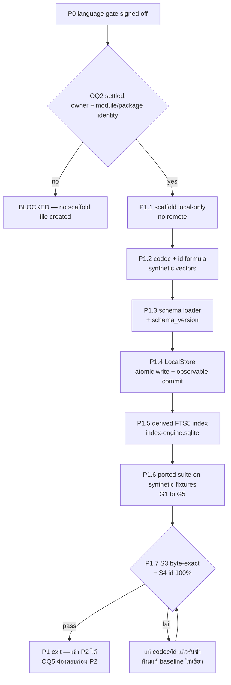

# Spec: P1 — local-only engine scaffold + codec/schema/store/index

## TL;DR

P1 เสร็จเมื่อ **scaffold local-only (ไม่มี remote) ตาม layout ของ design, codec/schema/store/derived-index ผ่าน test บน synthetic fixtures, และ S3 (byte-exact) + S4 (id 100%) ผ่านบน fresh real clone พร้อม negative control ที่ทำให้ gate แดง**
ก่อน scaffold มี checkpoint เดียวที่ข้ามไม่ได้: **OQ2 (repo owner/name + module path / package name) ต้องถูกตัดสินก่อน** เพราะมันล็อก import ทุกบรรทัดของภาษาที่ P0 เลือก
สเปกนี้คงความเป็นกลางทางภาษาและไม่เลือกภาษา — index filename จึงเป็น `index-<engine>.sqlite` ไม่ใช่ชื่อ literal ของภาษาใดภาษาหนึ่ง

---

## 1. Phase goal

เปลี่ยนผลของ language gate ให้กลายเป็น **repo ที่ build/test ได้จริงและพิสูจน์แล้วว่าอ่าน-เขียน record เดิมซ้ำได้ทุกไบต์**: scaffold engine repo แบบ local-only, port codec (`FRONT_ORDER`, quoting/inline-vs-block list, filename convention, id formula), schema loader ที่ enforce จริง, LocalStore ที่ atomic และไม่กลืน error, derived FTS5 index ที่แยกไฟล์และมี `schema_version` — แล้วปิด **P1-exit gates S3 + S4** บน clone จริงของ data repo (design §9.2 ข, §9.3; plan P1)

## 2. Entry criteria

| # | เงื่อนไข | หลักฐานที่ต้องมีก่อนเริ่ม P1.1 |
|---|---|---|
| E1 | **P0 language gate ปิดแล้ว** | `$WF/spikes/P0/language-gate.md` มีคำตัดสิน + `verify-language-gate.sh` exit `0` + owner sign-off (spec `p0-language-gate.spec.md`) |
| E2 | **OQ2 ถูกตัดสิน (hard gate)** | owner ระบุ owner/name ของ repo + **module path / package name** ของภาษาที่ล็อก เป็นข้อความบนดิสก์ — ไม่มี placeholder, ไม่มีสมมติฐานว่าเปลี่ยนทีหลังได้ |
| E3 | Task 0 baseline ยังใช้ได้ | `WF/baseline.md` มี `verify` = `0 problems`, `stats` snapshot, `eval` 30 คู่ และ suite `N passed, 0 failed` โดย `N` ตรงกับค่าที่บันทึก |
| E4 | platform matrix สำหรับ CI | คำตอบ **OQ4** (ถ้า P0 ยังไม่ปิดประเด็นนี้) — ใช้กำหนด matrix ของ P1.6 |
| E5 | ยังไม่มี remote | `test -z "$(git -C "$ENGINE_DIR" remote)"` exit `0` และจะคงเป็นเช่นนี้ตลอด P1 (NFR-RELEASE-01) |
| E6 | testdata เป็น synthetic เท่านั้น | ไม่มีไฟล์ที่ derive จาก record จริง; ทุก fixture ต้องมี provenance label `synthetic` |

## 3. Exit criteria

P1 ปิดได้เมื่อครบทุกข้อ:

| Gate | ต้องได้อะไร | หลักฐาน |
|---|---|---|
| **S3** (byte-exact codec) | read→write ทั้ง corpus บน fresh independent clone แล้ว `git diff --exit-code` ว่าง 100% | `$WF/parity/P1/S3.md` + control ที่ทำให้ gate แดง |
| **S4** (id 100%) | recompute id ทุก record ตรงกับ frontmatter เดิม 100% (รวม edge case title derive จาก body บรรทัดแรก) | `$WF/parity/P1/S4.md` + control ที่ทำให้ gate แดง |
| suite | selected-language full suite exit `0` และ **`>0` tests** (ไม่รับ `Ran 0 tests`) | CI log + local run |
| index isolation | Python `.memory/index.sqlite` ไม่ถูกแตะ; index ของ engine มี `schema_version` | `find "$REPO/.memory" -name 'index*.sqlite*'` ก่อน/หลัง |
| repo state | ไม่มี remote, ไม่มี corpus, ไม่มี `LICENSE` (OQ1 ยังไม่ตอบ) | `git remote -v` ว่าง; tracked-path check |
| evidence | artifact ทุก gate มี 5 ฟิลด์ (command · real exit code · version/SHA · date · probe result) | `$WF/parity/P1/` |

## 4. Scope in / out

### 4.1 In scope

- P1.1 scaffold local engine repo ตาม design §6.2 layout (ไม่มี `.git` history ของ data repo, ไม่มี remote)
- P1.2 codec + golden vectors (synthetic) รวม id formula
- P1.3 schema loader/enforcement + `schema/` defaults + `schema_version`
- P1.4 LocalStore: `MEM_HOME`/`MY_MEMORY_HOME` resolution, scan/skip rules, atomic write, observable commit failure, flock
- P1.5 derived FTS5 index: `unicode61` + `bm25`, rebuild, `schema_version`, substring fallback
- P1.6 ported black-box suite บน synthetic fixtures + CI gates G1–G5 (synthetic เท่านั้น)
- P1.7 private real-clone S3/S4 runner (`$WF/parity/private-parity.sh`) + artifacts

### 4.2 Out of scope

| ไม่อยู่ใน P1 | เหตุผล | ไปอยู่ที่ |
|---|---|---|
| domain lifecycle (add guards/dedup/supersede/cite/review/expiry), scoring/selection, render | ต้องมี codec/schema/store ก่อน | P2.1 |
| CLI 18 commands + `init` + `doctor`, sync | ยังไม่มี domain | P2.2 |
| MCP adapter 9 tools, hook 4 formats, installer | contract จริงเป็นงาน P2 | P2.3/P2.4 |
| **S5 recall parity** | P2 exit / P3 entry (design §9.2 ข) | P2.6 |
| cutover 6 harness | ต้องมี P2 | P3 |
| remote / push / publication / `LICENSE` | OQ1 + NFR-RELEASE-01 + hygiene gate | P4 |
| public packaging (GoReleaser/notarize/SBOM/Homebrew) | fast-follow หลัง P3 | post-P3 |
| real corpus, prompt log, personal record ใน repo/CI/`testdata/` | NFR-PRIV-01/02 | ห้ามทุก phase |
| incremental index | MVP = full rebuild (trigger records ≥ 400 หรือ p50 > 150 ms) | later |
| provider REST adapter, object store, MCP HTTP, daemon, semantic search | design §2.2/§6.1 | นอก MVP |

## 5. Blocking checkpoint — OQ2 ก่อน scaffold

**นี่คือ hard gate ที่ block P1.1 ทั้ง task** (design §9.3 P1, §12 OQ2; plan P1.1 + Checkpoints ข้อ 2)

- owner/name ที่อนุมัติจะกลายเป็น **Go module path ใน `go.mod` · npm/Bun package name · Rust crate identity** — และทุก `import` ในทุกไฟล์อ้างค่านี้
- **ห้ามใช้ placeholder** และ **ห้ามสมมติว่าเปลี่ยนชื่อทีหลังได้** — plan กำหนดว่าการเปลี่ยนหลัง scaffold = หยุดและขอ decision ใหม่
- ชื่อ repo ถูกตัดสินแล้วว่า `my-memory-engine` (2026-10-19, plan preamble) แต่ **namespace/owner ยังเปิด** — ห้ามตีความว่าชื่อ repo = identity ครบ
- ทางออกเมื่อยังไม่มีคำตอบ: บันทึก P1 เป็น `BLOCKED — OQ2 pending` และไม่สร้างไฟล์ scaffold ใด ๆ (ไม่ใช่ "scaffold ไปก่อนแล้วแก้ทีหลัง")
- การยืนยันซ้ำจะเกิดอีกครั้งก่อน P4 public gate — ค่าที่ใช้ตอน P1 ต้องตรงกับ destination จริงใน P4

## 6. ความเป็นกลางทางภาษา และ index filename

- ภาษาถูกเลือกที่ P0 language gate แล้ว แต่ **สเปกนี้ไม่เลือกภาษาและไม่ผูกชื่อไฟล์กับภาษา** — ทุกคำสั่งเขียนเป็น "selected-language command" พร้อม branch ที่ plan ระบุ (Go `go test ./...` · Bun `bun test` · Rust `cargo test`) และให้รัน **branch เดียว** ที่ล็อกแล้วเท่านั้น
- **Index filename:** design §5.2/§6.1 เขียน literal `index-go.sqlite` ในฐานะตัวอย่างของ Go; **plan P1.5 ใช้รูป generic `index-<engine>.sqlite`** และระบุว่า engine อื่นใช้ชื่อเฉพาะของตัวเอง ห้ามใช้ร่วม — สเปกนี้ใช้ **รูป generic ของ plan** และถือว่า literal `index-go.sqlite` ถูก supersede แล้ว ไม่ใช่เลือกชื่อใดแทนภาษา
- บังคับด้วย test: index ของ engine ต้องไม่ใช่ `index.sqlite` ของ Python และต้องไม่แชร์ชื่อกับ engine อื่น (REQ-IDX-01)

## 7. Requirements covered

| Requirement | P1 ต้องส่งมอบอะไร | AC ที่พิสูจน์ |
|---|---|---|
| **REQ-REC-01** | หนึ่ง fact = หนึ่ง markdown + frontmatter ใน working tree; index ไม่ใช่ source ของ bytes (ส่วนคำสั่ง `mem verify` เองเป็นงาน P2.2 — P1 พิสูจน์ที่ระดับ store/index) | AC-P1-02, AC-P1-06, AC-P1-09 |
| **REQ-REC-02** | codec parse/dump byte-exact: `FRONT_ORDER`, quoting decisions, inline vs block list, unknown keys ต่อท้าย, body ไม่เปลี่ยน | AC-P1-02 (fixtures), AC-P1-12 (S3 real clone) |
| **REQ-REC-03** | id = `<layer>.<sha1("{layer}\|{scope}\|{title}\|{body}")[:8]>`, title derive จาก body บรรทัดแรกเมื่อไม่ส่งมา; ไม่เปลี่ยน id ที่มีอยู่ | AC-P1-03 (vectors), AC-P1-13 (S4 real clone) |
| **REQ-REC-04** | enforce `record.schema.json` + `taxonomy.json`, เติม `superseded_by`/`uses`, stamp `schema_version`, refuse เมื่อ version ไม่รองรับ | AC-P1-04 |
| **REQ-STORE-01** | resolution order `MEM_HOME` → `MY_MEMORY_HOME` → walk-up `schema/taxonomy.json` → documented default; fail loud; ไม่มี absolute path ของเครื่องใน binary/defaults/docs | AC-P1-01, AC-P1-05 |
| **REQ-STORE-02** | skip `_`-prefix components + append-only `ops/`; frontmatter พังต้องไม่ถูกนับเป็น record เงียบ ๆ; count คงที่ก่อน/หลัง no-op | AC-P1-06 |
| **REQ-STORE-03** | atomic temp+rename; git ไม่มี/commit fail → record อยู่ + `committed: false` + reason + runtime log ใต้ `.memory/`; ห้ามกลืน error | AC-P1-07 |
| **REQ-IDX-01** | derived FTS5 (`unicode61`, `bm25`) ที่ `.memory/index-<engine>.sqlite` + `schema_version`; ไม่แตะ `index.sqlite` ของ Python | AC-P1-08 |
| **REQ-IDX-02** | ลบ/เสีย/version ไม่ตรง → rebuild จาก markdown; FTS5 ไม่มี → substring fallback + บอกผู้ใช้ | AC-P1-09 |
| **NFR-NET-01** | default path (context/search/show/add/verify/stats/render/hook ที่มีใน P1 เท่าที่มี) ไม่มี network call | AC-P1-10 |
| **NFR-OPS-01** | partial failure ทุกจุด observable (field / non-zero / log line) ไม่มี empty catch | AC-P1-07, AC-P1-09 |
| **NFR-OPS-02** | artifact ทุก P1 gate มี 5 ฟิลด์ + สถานะ | AC-P1-14 |
| **NFR-PRIV-02 / TB-4** | `testdata/` synthetic + provenance; artifact ที่ derive จาก corpus อยู่ใต้ `$WF` | AC-P1-11, AC-P1-14 |
| **NFR-PORT-01** *(partial)* | suite ต้องรัน native บน OS ที่ประกาศใน CI; cross-build ไม่นับ | AC-P1-11 |
| **NFR-RELEASE-01** *(partial)* | ไม่มี remote ตลอด P1 (ครึ่งหลังของ requirement อยู่ที่ P4) | AC-P1-01 |
| **REQ-COMPAT-01** *(partial)* | ครึ่ง record-format: bytes + id ไม่เปลี่ยน (S3/S4); ครึ่ง MCP/hook อยู่ที่ P2/P3 | AC-P1-12, AC-P1-13 |

### 7.1 Not in this phase (พร้อมเหตุผลและ gate)

| Requirement | ทำไมไม่ใช่ P1 | phase / gate |
|---|---|---|
| REQ-REC-05 (guards/dedup/hygiene), REQ-REC-06 (supersede), REQ-REC-07 (quarantine), REQ-REC-08 (expiry) | ต้องมี domain layer | P2.1 |
| REQ-DOM-01 | scoring/selection/render/cite | P2.1 · S5 = P2 exit |
| REQ-CLI-01, REQ-CLI-02 | command surface + exit codes | P2.2 |
| REQ-MCP-01 | 9-tool contract (P0 พิสูจน์แค่ feasibility) | P2.3 (ต้องมี OQ5 ก่อน) |
| REQ-HOOK-01/02, REQ-INST-01 | hook + installer | P2.4 |
| REQ-SYNC-01/02 | transport | P2.2 |
| REQ-EVAL-01 | ต้องมี eval runner + domain | P2.6 |
| REQ-CUTOVER-01 | cutover | P3 |
| NFR-PERF-01 | ต้องมี hook จริง | P2.7 |
| NFR-SEC-01 | ยังไม่มี credential surface | P2.2, P4.2 |
| NFR-PRIV-01 | hygiene ของ public repo | P4.2 |
| NFR-QUAL-01 (delivery) | G1 ต้องมี eval; P1.6 วาง CI + synthetic baseline เท่านั้น | P2.6 |
| NFR-COMPAT-01 | ยังไม่มี command/tool ให้ generate count (P1.6 วาง CI skeleton ไว้) | P2.2/P2.3 |

## 8. Flow ของ phase



## 9. Acceptance criteria

### AC-P1-01 · Scaffold local-only ตาม layout + ไม่มี remote + identity ตรง OQ2

**Proves:** REQ-STORE-01 (ไม่มี absolute path/identity ผิด), NFR-RELEASE-01 (partial), NFR-OPS-02
**Plan task:** `plan.md` P1.1 · **Gate:** ไม่ปิด gate ใด — ตั้งฐานให้ G2–G5

```gherkin
Given the OQ2 decision recorded on disk with the exact module path or package name
When the scaffold is created in $ENGINE_DIR
Then `git -C "$ENGINE_DIR" status --short` is empty after the scaffold commit
  And `test -z "$(git -C "$ENGINE_DIR" remote)"` exits 0
  And the top-level layout matches design §6.2 and contains none of lessons/ knowledge/ ops/ handoffs/ docs/workflow/
  And the language baseline command (selected branch) exits 0 with at least one real test
But a placeholder module path, a copied data-repo history, or a remote makes this criterion fail
```

**Command + expected:** `git -C "$ENGINE_DIR" status --short` → ว่าง; `test -z "$(git -C "$ENGINE_DIR" remote)"` → exit `0`; `find "$ENGINE_DIR" -maxdepth 2 -type d` → ตรวจด้วยตา; selected-language baseline → exit `0`
**Discriminating control:** ใส่ remote ชั่วคราว → `test -z` ต้อง exit ≠ `0`

### AC-P1-02 · Codec byte-exact บน synthetic fixtures

**Proves:** REQ-REC-01, REQ-REC-02
**Plan task:** `plan.md` P1.2 · **Gate:** precursor ของ **S3 / G2**

```gherkin
Given synthetic fixtures that cover flat YAML subset, quoting decisions, inline versus block lists,
      unknown keys, and a body containing blank lines and markdown
When each record is parsed and re-serialised without semantic change
Then the output bytes are identical to the input bytes
  And frontmatter keys follow FRONT_ORDER with unknown keys appended after the known keys
  And the body bytes are unchanged
But changing one quoting decision, one list style, or one key order in a control copy makes the specific assertion fail
```

**Command + expected:** Go `go test ./internal/codec ./tests/codec` · Bun `bun test tests/codec` · Rust `cargo test codec` → exit `0`
**Discriminating control:** mutate quote/list/order 1 จุด → assertion แดง

### AC-P1-03 · Id formula เสถียรและ reproduce ได้

**Proves:** REQ-REC-03
**Plan task:** `plan.md` P1.2 · **Gate:** precursor ของ **S4**

```gherkin
Given golden vectors with layer, scope, title and body, including a case where title must be derived from the first body line
When the id is computed
Then it equals layer + "." + first 8 hex chars of sha1("{layer}|{scope}|{title}|{body}")
  And an explicitly supplied title and a derived title produce the documented id for the same record
  And recomputing ids for fixtures that already carry an id does not change any id
But mutating one id input field in a control vector makes the assertion fail
```

**Command + expected:** same codec test command as AC-P1-02 → exit `0`; golden vectors tracked in `tests/codec/`
**Discriminating control:** เปลี่ยน `title` ใน control vector → assertion แดง

### AC-P1-04 · Schema enforcement + version refusal

**Proves:** REQ-REC-04
**Plan task:** `plan.md` P1.3 · **Gate:** precursor ของ **G2**

```gherkin
Given the engine's schema defaults and a valid synthetic fixture for each of the seven layers
When each fixture is written or verified
Then it is accepted, and unknown tags are reported as warnings rather than hard failures
  And the schema includes the fields the current engine writes but the schema omitted (superseded_by, uses)
  And schema_version is stamped and reported
But a fixture with a wrong field, type, layer, directory or missing required field is rejected with the offending field named
  And a record carrying an unsupported schema_version is refused rather than overwritten
```

**Command + expected:** selected-language schema test → exit `0`; fixture ที่ผิดต้อง reject พร้อมชื่อ field
**Discriminating control:** ลบ required field 1 ตัว → reject; ตั้ง `schema_version` เป็นค่าที่ไม่รองรับ → refuse + ไม่มีไฟล์ถูกเขียนทับ (ตรวจ mtime/bytes)

### AC-P1-05 · `MEM_HOME` resolution และไม่ hardcode path เครื่อง

**Proves:** REQ-STORE-01, TB-5
**Plan task:** `plan.md` P1.4 · **Gate:** precursor ของ **G3/G4**

```gherkin
Given no environment variable, one environment variable, and both
When the home is resolved
Then the order is MEM_HOME, then MY_MEMORY_HOME, then an upward walk for schema/taxonomy.json, then the documented default
  And an unresolvable home fails loudly with a diagnosable message and a non-zero exit
  And no machine-specific absolute path appears in the binary, schema defaults, or docs
But a path containing a real user name in defaults or docs makes the check fail
```

**Command + expected:** store test → exit `0`; `grep` absolute-path pattern ใน binary/schema/docs → ไม่พบ
**Discriminating control:** `HOME` ที่ไม่มี `schema/taxonomy.json` และไม่มี env → non-zero + ข้อความ

### AC-P1-06 · Scan rules และ count ที่ไม่ขยับโดย no-op

**Proves:** REQ-STORE-02, REQ-REC-01
**Plan task:** `plan.md` P1.4 · **Gate:** precursor ของ **G4**

```gherkin
Given a fixture home containing underscore-prefixed directories, an append-only ops/ layer, and one file with broken frontmatter
When the home is scanned
Then underscore-prefixed components and ops/ are skipped
  And the broken file is surfaced by verify rather than silently counted as a record
  And the record count is identical before and after a no-op operation
But removing the skip rule makes the count change and the test fail
```

**Command + expected:** store test → exit `0`
**Discriminating control:** ถอด skip rule ใน control build → count เปลี่ยน → แดง

### AC-P1-07 · Atomic write + commit failure ที่ observable

**Proves:** REQ-STORE-03, NFR-OPS-01
**Plan task:** `plan.md` P1.4 · **Gate:** **RK2/RK7** precursor

```gherkin
Given a memory home where git is absent or the commit fails
When a valid record is written
Then the record file exists on disk with valid frontmatter
  And the result reports committed: false with a reason
  And exactly one line is appended to the gitignored runtime log under .memory/
  And no line is written to a committed ops/ ledger
But a process killed between the temp write and the rename must leave the previous record bytes intact
  And swallowing the commit error makes the test fail
```

**Command + expected:** store test → exit `0`; fault injection (kill between temp write and rename) ต้องเห็น record เดิมครบ
**Discriminating control:** ทำให้ commit ล้มแล้วถ้าไม่มี `committed: false` + log line → แดง

### AC-P1-08 · Derived FTS5 index แยกไฟล์ + `schema_version` + ไม่แตะ Python index

**Proves:** REQ-IDX-01
**Plan task:** `plan.md` P1.5 · **Gate:** **RK5**

```gherkin
Given a fixture home and an existing Python index.sqlite
When the engine builds its index
Then it writes .memory/index-<engine>.sqlite with the documented FTS5 tokenizer and bm25 ordering
  And it stamps schema_version in the file
  And the Python index.sqlite is byte-identical before and after
But writing to index.sqlite, or sharing an index filename with another engine, makes the test fail
```

**Command + expected:** index test → exit `0`; `find "$REPO/.memory" -name 'index*.sqlite*'` ก่อน/หลัง → รายการเดิมครบ + ไฟล์ใหม่ของ engine
**Discriminating control:** control build ที่เขียน `index.sqlite` → guard test ต้องแดง

### AC-P1-09 · Index recovery และ fallback

**Proves:** REQ-IDX-02, NFR-OPS-01, REQ-REC-01 (index ไม่ใช่ source)
**Plan task:** `plan.md` P1.5 · **Gate:** precursor ของ **G4**

```gherkin
Given a built index
When the index file is deleted, corrupted, or stamped with a mismatched schema_version
Then the next query rebuilds it from markdown and answers
  And no record file is modified by the rebuild
  And when FTS5 is unavailable the substring fallback answers and the fallback is reported to the user
But a rebuild that mutates record bytes, or a silent fallback with no report, fails
```

**Command + expected:** index test → exit `0`; ลบ/ทำ corrupt/เปลี่ยน version แล้ว query ยังได้ผล
**Discriminating control:** FTS5-disabled build → ต้องเข้า fallback และมีข้อความบอก

### AC-P1-10 · Default path ไม่มี network call

**Proves:** NFR-NET-01, TB-1
**Plan task:** `plan.md` P1.4, P1.6 · **Gate:** precursor ของ **G3**

```gherkin
Given a no-network container or sandbox
When the P1 surface that exists (store read/write, index build/query, scan, verify-count) runs
Then all of them succeed
  And no network call is attempted
But an injected network call in a control build makes the no-network test fail
```

**Command + expected:** no-network test → exit `0`; injected call → test แดง
**Discriminating control:** control build ที่เรียก network → แดง

### AC-P1-11 · Ported suite บน synthetic fixtures ตาม matrix

**Proves:** NFR-PRIV-02, TB-3, NFR-PORT-01 (partial), NFR-OPS-02
**Plan task:** `plan.md` P1.6 · **Gate:** **G1/G2/G3/G4/G5** (synthetic เท่านั้น), **GAP-5**

```gherkin
Given the engine repo with testdata that contains only synthetic fixtures carrying a provenance label
When the selected-language full suite and the CI matrix run natively on the declared OS set
Then the suite exits 0 with more than zero tests
  And the provenance test passes for every fixture file
  And no real corpus, prompt log, or personal record exists in the tree or in CI config
But a tree that contains a corpus-derived fixture, or a suite that reports zero tests, fails
```

**Command + expected:** selected-language full suite → exit `0` และ `>0` tests; CI matrix ตาม OQ4 → เขียว; provenance test → exit `0`
**Discriminating control:** เพิ่ม fixture ที่ไม่มี provenance label → provenance test แดง

### AC-P1-12 · S3 — byte-exact บน fresh real clone

**Proves:** REQ-REC-02, REQ-COMPAT-01 (partial)
**Plan task:** `plan.md` P1.7 · **Gate:** **S3 / RK2 = P1 exit**

```gherkin
Given a fresh independent clone of the real data repo at $REAL_CLONE (never a linked worktree)
When every record is read and re-written by the new codec through the private runner
Then `git diff --exit-code` on that clone is empty
  And the artifact records the clone SHA, record counts, command and exit code
But changing one quoting decision in a copy of the clone makes the S3 gate return non-zero
```

**Command + expected:** `MEM_HOME="$REAL_CLONE" "$WF/parity/private-parity.sh" --gate S3,S4 --engine "$ENGINE_BIN"` → exit `0`; S3 diff ว่าง 100%
**Discriminating control:** เปลี่ยน quoting 1 จุด → runner exit ≠ `0`

### AC-P1-13 · S4 — id ตรง 100% บน fresh real clone

**Proves:** REQ-REC-03, REQ-COMPAT-01 (partial)
**Plan task:** `plan.md` P1.7 · **Gate:** **S4 / RK2 = P1 exit**

```gherkin
Given the same fresh clone
When ids are recomputed from layer, scope, title and body for every record
Then matched/total equals 100%, including records whose title derives from the first body line
  And the artifact records total, matched, clone SHA, command and exit code
But mutating one id input field in a copy of the clone makes the S4 gate return non-zero
```

**Command + expected:** same runner call → exit `0`; S4 `matched/total = 100%`
**Discriminating control:** เปลี่ยน `title` 1 record ในสำเนา → runner exit ≠ `0`

### AC-P1-14 · Evidence ของ P1 ครบและอยู่ใต้ `$WF`

**Proves:** NFR-OPS-02, NFR-PRIV-02, TB-4
**Plan task:** `plan.md` P1.7 (evidence clause) · **Gate:** ปิดด้วย S3/S4

```gherkin
Given the P1 artifacts on disk
When each is inspected
Then every artifact carries command, real exit code, version/SHA, date and probe result with a status
  And all real-clone artifacts live under $WF/parity/P1/
  And the engine tree contains no corpus-derived artifact
But deleting the exit-code line from a copy makes the evidence check fail
```

**Command + expected:** `test -z "$(git -C "$ENGINE_DIR" ls-files | grep -E '(^|/)(spikes|parity)/')"` → exit `0`; `test -s "$WF/parity/P1/S3.md"` และ `S4.md` → exit `0`
**Discriminating control:** ลบ field 1 ตัวในสำเนา → evidence check (สคริปต์เดียวกับ P0 verifier ถ้ามี) exit ≠ `0`

## 10. Test skeletons

**LANGUAGE-NEUTRAL SKELETONS.** skeletons ทั้งไฟล์นี้เป็น pseudocode เพราะภาษาเพิ่งจะถูกล็อกที่ปลาย P0 — **กฎ: transliterate เป็นภาษาที่เลือกทันทีที่ language gate ปิด (ก่อน P1.1) และห้าม commit เป็น code ที่รันได้ก่อนตอนนั้น** — เมื่อ transliterate แล้ว skeleton ของ P1 อยู่ใต้ `$ENGINE_DIR/tests/…` และใช้ synthetic fixtures เท่านั้น

```text
// ===========================================================================
// AC-P1-01 · Scaffold local-only with the approved identity
// LANGUAGE-NEUTRAL SKELETON — transliterate to the language chosen at the P0
// language gate once that gate closes; never commit runnable code before then.
// ===========================================================================
test "P1/scaffold layout, no remote, approved module identity" {
    // Given: the OQ2 decision with the exact module path or package name on disk
    // When:  the scaffold exists in $ENGINE_DIR
    // Then:  status is clean, remote list is empty, top-level layout matches the design,
    //        no private directories present, baseline test command exits 0 with real tests
    //        (assertion — to be implemented)
    // And (negative control): adding a remote or a private directory fails this test
    //        (assertion — to be implemented)
}
```

```text
// ===========================================================================
// AC-P1-02 · Codec byte-exact round trip on synthetic fixtures
// LANGUAGE-NEUTRAL SKELETON — transliterate after the language gate closes.
// ===========================================================================
test "P1/codec parse then serialise reproduces input bytes" {
    // Given: synthetic fixtures covering quoting, inline versus block lists, unknown keys, multi-line body
    // When:  each record is parsed and re-serialised
    // Then:  bytes are identical; FRONT_ORDER holds; unknown keys are appended after known keys
    //        (assertion — to be implemented)
    // And (negative control): changing one quoting decision in a control copy fails the assertion
    //        (assertion — to be implemented)
}
```

```text
// ===========================================================================
// AC-P1-03 · Stable record id formula
// LANGUAGE-NEUTRAL SKELETON — transliterate after the language gate closes.
// ===========================================================================
test "P1/codec id equals sha1(layer|scope|title|body) prefix" {
    // Given: golden vectors including a title derived from the first body line
    // When:  the id is computed and existing ids are recomputed
    // Then:  ids match the formula and none changes
    //        (assertion — to be implemented)
    // And (negative control): mutating one input field in a vector fails the assertion
    //        (assertion — to be implemented)
}
```

```text
// ===========================================================================
// AC-P1-04 · Schema enforcement and version refusal
// LANGUAGE-NEUTRAL SKELETON — transliterate after the language gate closes.
// ===========================================================================
test "P1/schema accepts valid fixtures and rejects named violations" {
    // Given: schema defaults plus one valid fixture per layer
    // When:  fixtures are written or verified
    // Then:  valid ones are accepted, unknown tags warn, superseded_by and uses are known fields,
    //        schema_version is stamped
    //        (assertion — to be implemented)
    // And (negative control): a wrong field/type/layer/directory and an unsupported schema_version
    //        are rejected or refused with the offending field named
    //        (assertion — to be implemented)
}
```

```text
// ===========================================================================
// AC-P1-05 · MEM_HOME resolution order and no hardcoded machine path
// LANGUAGE-NEUTRAL SKELETON — transliterate after the language gate closes.
// ===========================================================================
test "P1/store resolves home in the documented order and fails loudly" {
    // Given: environments with neither, one, and both variables set; a directory tree with schema/taxonomy.json
    // When:  the home is resolved
    // Then:  MEM_HOME wins, then MY_MEMORY_HOME, then the upward walk, then the documented default
    //        an unresolvable home exits non-zero with a diagnosable message
    //        (assertion — to be implemented)
    // And (negative control): a machine-specific absolute path in defaults or docs fails the check
    //        (assertion — to be implemented)
}
```

```text
// ===========================================================================
// AC-P1-06 · Scan rules and stable counts
// LANGUAGE-NEUTRAL SKELETON — transliterate after the language gate closes.
// ===========================================================================
test "P1/store skips underscore components and append-only ops" {
    // Given: a fixture home with underscore-prefixed directories, an ops/ layer, and one broken-frontmatter file
    // When:  the home is scanned and a no-op runs
    // Then:  skipped paths are not counted, the broken file is surfaced, and the count is unchanged
    //        (assertion — to be implemented)
    // And (negative control): removing the skip rule changes the count and fails the test
    //        (assertion — to be implemented)
}
```

```text
// ===========================================================================
// AC-P1-07 · Atomic write and observable commit failure
// LANGUAGE-NEUTRAL SKELETON — transliterate after the language gate closes.
// ===========================================================================
test "P1/store survives a broken git and reports it" {
    // Given: a home where git is absent or the commit fails
    // When:  a valid record is written, and a process is killed between temp write and rename
    // Then:  the record exists with valid frontmatter, committed is false with a reason,
    //        exactly one runtime-log line is appended, no ops/ ledger line is written
    //        (assertion — to be implemented)
    // And (negative control): swallowing the commit error fails the test
    //        (assertion — to be implemented)
}
```

```text
// ===========================================================================
// AC-P1-08 · Derived index isolation and version stamp
// LANGUAGE-NEUTRAL SKELETON — transliterate after the language gate closes.
// ===========================================================================
test "P1/index writes its own engine file and never the Python one" {
    // Given: a fixture home and an existing index.sqlite from the Python engine
    // When:  the engine builds and queries its index
    // Then:  the engine file is index-<engine>.sqlite, carries schema_version, uses the documented
    //        tokenizer and ordering, and index.sqlite is byte-identical afterwards
    //        (assertion — to be implemented)
    // And (negative control): a build that writes index.sqlite or a shared filename fails the guard test
    //        (assertion — to be implemented)
}
```

```text
// ===========================================================================
// AC-P1-09 · Index recovery and substring fallback
// LANGUAGE-NEUTRAL SKELETON — transliterate after the language gate closes.
// ===========================================================================
test "P1/index rebuilds after delete, corruption or version mismatch" {
    // Given: a built index
    // When:  the file is deleted, corrupted, or version-mismatched, and a query runs
    // Then:  the index is rebuilt from markdown, the query answers, and no record byte changes
    //        when FTS5 is unavailable the fallback answers and reports itself
    //        (assertion — to be implemented)
    // And (negative control): a silent fallback with no report fails the test
    //        (assertion — to be implemented)
}
```

```text
// ===========================================================================
// AC-P1-10 · Default path makes no network call
// LANGUAGE-NEUTRAL SKELETON — transliterate after the language gate closes.
// ===========================================================================
test "P1/no-network store, index and scan succeed offline" {
    // Given: a no-network sandbox
    // When:  the P1 surface runs
    // Then:  every operation succeeds and no network call is attempted
    //        (assertion — to be implemented)
    // And (negative control): an injected network call makes this test fail
    //        (assertion — to be implemented)
}
```

```text
// ===========================================================================
// AC-P1-11 · Ported suite on synthetic fixtures across the declared matrix
// LANGUAGE-NEUTRAL SKELETON — transliterate after the language gate closes.
// ===========================================================================
test "P1/suite is green, non-empty, synthetic-only" {
    // Given: testdata containing only synthetic fixtures with a provenance label
    // When:  the full suite and the CI matrix run natively on the declared OS set
    // Then:  exit 0 with more than zero tests; the provenance test passes for every fixture
    //        no real corpus, prompt log or personal record is present
    //        (assertion — to be implemented)
    // And (negative control): an unlabeled fixture or a suite reporting zero tests fails
    //        (assertion — to be implemented)
}
```

```text
// ===========================================================================
// AC-P1-12 · S3 byte-exact on a fresh independent real clone
// LANGUAGE-NEUTRAL SKELETON — transliterate after the language gate closes.
// ===========================================================================
test "P1/S3 rewriting the whole real corpus leaves git diff empty" {
    // Given: a fresh independent clone at $REAL_CLONE, never a linked worktree
    // When:  every record is read and re-written by the new codec
    // Then:  git diff --exit-code is empty; the artifact records clone SHA, counts, command, exit code
    //        (assertion — to be implemented)
    // And (negative control): changing one quoting decision in a copy makes the gate non-zero
    //        (assertion — to be implemented)
}
```

```text
// ===========================================================================
// AC-P1-13 · S4 id parity on a fresh independent real clone
// LANGUAGE-NEUTRAL SKELETON — transliterate after the language gate closes.
// ===========================================================================
test "P1/S4 recomputed ids match 100 percent" {
    // Given: the same fresh clone
    // When:  ids are recomputed for every record, including derived-title records
    // Then:  matched/total equals 100 percent; the artifact records total, matched, SHA, command, exit code
    //        (assertion — to be implemented)
    // And (negative control): mutating one id input field in a copy makes the gate non-zero
    //        (assertion — to be implemented)
}
```

```text
// ===========================================================================
// AC-P1-14 · P1 evidence completeness and private location
// LANGUAGE-NEUTRAL SKELETON — transliterate after the language gate closes.
// ===========================================================================
test "P1/evidence five fields present, private artifacts outside the engine tree" {
    // Given: the P1 artifacts on disk
    // When:  each artifact is inspected
    // Then:  command, real exit code, version/SHA, date, probe result and status are present
    //        real-clone artifacts live under $WF/parity/P1/
    //        the engine tree tracks no spikes/ or parity/ artifact
    //        (assertion — to be implemented)
    // And (negative control): deleting the exit-code line from a copy fails the evidence check
    //        (assertion — to be implemented)
}
```

## 11. Gate evidence requirements

| # | ต้องมีอะไร | ที่อยู่ | หมายเหตุ |
|---|---|---|---|
| EV1 | artifact ต่อ gate/phase step พร้อม 5 ฟิลด์ (command · real exit code · version/SHA · date · probe result) + status | `$WF/parity/P1/` | NFR-OPS-02 |
| EV2 | `S3.md` — clone SHA, จำนวน record ที่อ่าน/เขียน, `git diff --exit-code` result | `$WF/parity/P1/S3.md` | ห้าม raw record content |
| EV3 | `S4.md` — total, matched, percentage, edge-case list (derived title), mismatch samples แบบ redacted | `$WF/parity/P1/S4.md` | GAP-7: ระบุ metric ที่ใช้นับ `total` |
| EV4 | negative-control record ของ S3 (quote mutation) และ S4 (field mutation) | ใน `S3.md`/`S4.md` | ต้องเห็น gate แดงอย่างน้อยหนึ่งครั้ง |
| EV5 | CI log + selected-language suite summary (`>0` tests) + provenance test result | `$WF/parity/P1/` | synthetic เท่านั้น |
| EV6 | index isolation check: `find "$REPO/.memory" -name 'index*.sqlite*'` ก่อน/หลัง | `$WF/parity/P1/` | Python index ต้องไม่เปลี่ยน |

**ห้าม:** artifact ที่มีข้อมูล corpus จริง (แม้แต่ partial record, path ที่มีชื่อผู้ใช้, หรือ output ที่ quote body) อยู่ใต้ `$WF/parity/P1/` เท่านั้น — **ห้ามเข้า `$ENGINE_DIR`, CI หรือ `testdata/`** (NFR-PRIV-01/02, TB-3/TB-4, AGENTS.md) · ห้ามใช้ linked worktree สำหรับ discrimination run (design §9.1 — real clone เท่านั้น)

**Resumability:** ถ้างานหยุด ให้ resume ที่ step แรกที่ยังไม่มี `PASS` (เช่น S3 ผ่านแล้วแต่ S4 ยังไม่มี artifact → เริ่มที่ S4)

## 12. Open questions และ gaps ที่ block phase นี้

### 12.1 Blocking P1

| id | Block gate ไหน | Owner/เจ้าของต้องทำอะไร |
|---|---|---|
| **OQ2** | **P1.1 ทั้ง task** (hard gate) → ถ้าไม่ตอบ P1 เป็น `BLOCKED` | ระบุ owner/name + **module path / package name** ของภาษาที่ล็อก เป็นข้อความบนดิสก์; ห้าม placeholder; เปลี่ยนหลัง scaffold = หยุดและขอ decision ใหม่ (design §9.3, §12; plan Checkpoints ข้อ 2) |
| **GAP-5** | **P1.6** (suite/CI acceptance และ drift check) | plan ต้อง pin นิยาม metric (assertion sites vs printed pass count) และจำนวนที่ใช้เป็น drift check — `187` (exploration 2026-10-17) กับ `352` helper call sites / `219` `chk` (2026-10-19 @ `2333e53`) เป็นคนละ metric |
| **OQ4** | **P1.6 CI matrix** (ถ้า P0 ยังไม่ปิด) | targets + Linux libc variant; ไม่มี runner = native matrix เป็น `BLOCKED` ไม่ใช่ pass (NFR-PORT-01) |
| **GAP-1** | evidence ของ P1.7 (ความเทียบกันได้กับ P0) | plan/tech-lead ตัดสิน schema กลางของ artifact (5 ฟิลด์เป็นขั้นต่ำ) |

### 12.2 ไม่ block P1 แต่มี gate ของตัวเอง

| id | Gate | หมายเหตุ |
|---|---|---|
| **OQ1** | ก่อน public push (P4) | **ห้ามสร้าง `LICENSE` ใน P1** |
| **OQ3** | ก่อน P3 | cutover appetite |
| **OQ5** | **ก่อน P2** | freeze 9 MCP tools — P1 ไม่ปิด OQ5 แต่ P2 เริ่มไม่ได้ถ้าไม่ตอบ |
| **OQ6** | defer ได้ | ไม่ทำ semantic search |
| **OQ7** | ปิดแล้วที่ P0 (หรือค้างถ้า B7 เปิด) | ถ้า Bun ถูกเลือกเพราะ `setCustomSQLite` ต้องอ้างคำตอบ OQ7 ใน scaffold docs |
| **GAP-2** | P1.7 runner CLI | plan pin `private-parity.sh --gate S3,S4 --engine` ไว้แล้ว = ปิดสำหรับ S3/S4; `cutover-probe.sh`/`benchmark-hook.sh` ยังเปิด (P2/P3) |
| **GAP-3** | P1.6 CI matrix | native runner ต่อ OS |
| **GAP-7** | P1.7 `total` ของ S4 | ต้องระบุฐานนับ (file count vs `stats` vs active only) ก่อนอ้างตัวเลขกับใคร |

## 13. Exit checklist / DoD

```sh
REPO="$HOME/my-memory"
WF="$REPO/docs/workflow/my-memory-framework-migration"
ENGINE_DIR="$HOME/Work/my-memory-engine"
REAL_CLONE="<fresh-independent-clone-under-private-temp-dir>"

# 1. scaffold state
git -C "$ENGINE_DIR" status --short                       # ว่าง
test -z "$(git -C "$ENGINE_DIR" remote)"                  # exit 0
test -z "$(git -C "$ENGINE_DIR" ls-files | grep -E '(^|/)(lessons|knowledge|ops|handoffs|docs/workflow)(/|$)')"  # exit 0
test ! -e "$ENGINE_DIR/LICENSE"                           # exit 0 (OQ1 ยังไม่ตอบ)

# 2. suite (selected branch เท่านั้น)
cd "$ENGINE_DIR" && go test ./...      # Go  — exit 0 และ >0 tests
cd "$ENGINE_DIR" && bun test           # Bun — exit 0 และ >0 tests
cd "$ENGINE_DIR" && cargo test         # Rust — exit 0 และ >0 tests

# 3. P1 exit gates (private, real clone — never a worktree)
MEM_HOME="$REAL_CLONE" "$WF/parity/private-parity.sh" --gate S3,S4 --engine "$ENGINE_BIN"
# exit 0; S3 diff empty; S4 matched/total = 100%

# 4. evidence + index isolation
test -s "$WF/parity/P1/S3.md"                              # exit 0
test -s "$WF/parity/P1/S4.md"                              # exit 0
find "$REPO/.memory" -name 'index*.sqlite*'                # Python index เดิม + ไฟล์ของ engine เท่านั้น
```

**Discriminating negative controls ที่ต้องเห็น "แดง" อย่างน้อยหนึ่งครั้งก่อนปิด P1**

| control | การแก้ | ผลที่ต้องเห็น |
|---|---|---|
| byte drift | เปลี่ยน quoting 1 จุดในสำเนา clone | S3 gate exit ≠ `0` |
| id drift | เปลี่ยน `title` 1 record ในสำเนา clone | S4 gate exit ≠ `0` |
| schema bypass | ลบ required field หรือตั้ง `schema_version` ที่ไม่รองรับ | reject/refuse — ไม่มีไฟล์ถูกเขียนทับ |
| silent commit | ทำให้ git commit ล้ม | `committed: false` + log line; ถ้าเงียบ = แดง |
| index collision | control build เขียน `index.sqlite` | guard test แดง |
| network leak | control build เรียก network | no-network test แดง |
| provenance | เพิ่ม fixture ที่ไม่มี label | provenance test แดง |

**Definition of Done ของ P1:** scaffold local-only ที่ identity ตรง OQ2; codec/schema/store/index ผ่าน test บน synthetic fixtures; **S3 + S4 ผ่านบน fresh real clone พร้อม control ที่เห็นแดง**; suite `>0` tests เขียวบน native matrix; ไม่มี remote/push/`LICENSE`/corpus; artifact ครบ 5 ฟิลด์ใต้ `$WF/parity/P1/`

---

**Status:** DRAFT — awaiting owner approval

### Owner-approval checklist (P1)

- [ ] ยืนยัน **OQ2** เป็น hard gate ก่อน scaffold (owner/name + module path/package name) และยอมรับว่าเปลี่ยนทีหลัง = rewrite หลายไฟล์
- [ ] ยืนยันว่า P1 ไม่มี domain/CLI/MCP/hook/sync/cutover และ **ไม่มี S5** (S5 = P2 exit)
- [ ] ยืนยันว่า index filename ใช้รูป generic `index-<engine>.sqlite` (literal `index-go.sqlite` ใน design ถูก supersede โดย plan P1.5) และห้ามใช้ร่วมกับ Python
- [ ] ยืนยันว่า `testdata/` เป็น synthetic + provenance label และ artifact จาก real clone อยู่ใต้ `$WF` เท่านั้น
- [ ] ยืนยันว่า S3/S4 ต้องมี negative control ที่ทำให้ gate แดง (ไม่รับเขียวที่พิสูจน์ไม่ได้ว่าแยกแยะได้)
- [ ] ยืนยันว่าจะไม่สร้าง `LICENSE` ก่อน OQ1 และไม่สร้าง remote/push ใน P1
- [ ] ยืนยันว่า **GAP-5** ต้องถูกปิด (นิยาม metric) ก่อน P1.6 และ **OQ5** ก่อน P2
- [ ] เปลี่ยน `**Status:**` เป็น `APPROVED` พร้อมวันที่

### Change log

| Rev | Date | Change | Author |
|---|---|---|---|
| 1 | 2026-10-19 | แรก — P1 acceptance surface: entry/exit (S3+S4 = P1 exit), OQ2 blocking checkpoint, language-neutrality + `index-<engine>.sqlite` note, 14 AC (`AC-P1-01`…`AC-P1-14`), 14 language-neutral test skeletons, gate evidence requirements ใต้ `$WF/parity/P1/`, OQ/GAP binding, DoD พร้อม negative controls | opencode |

*สเปกนี้เป็น DRAFT — ไม่ authorize implementation ก่อน owner อนุมัติ และไม่ authorize remote, push, publication หรือการสร้าง `LICENSE`*
