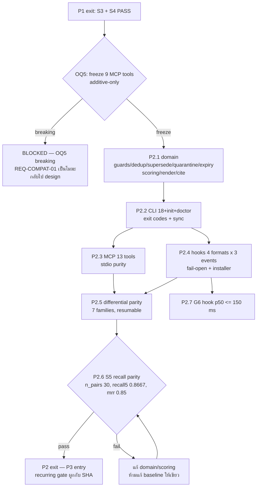

# Spec: P2 — domain / CLI / MCP / hooks + real-clone differential parity

## TL;DR

P2 เสร็จเมื่อ **domain lifecycle ครบ (guards/dedup/supersede/quarantine/expiry/scoring/render/cite), CLI 20 คำสั่ง, MCP 13 tools, hook 4 formats × 3 events ทำงานเท่ากับ Python baseline, differential parity ทุก command family PASS บน fresh independent real clone — แล้วปิด S5 (`n_pairs = 30`, `recall5 ≥ 0.8667`, `mrr ≥ 0.85`)**; G1–G6 ใน public CI ยังเป็น synthetic-only และ G7 ยังเป็น manual matrix
ก่อน task แรกมี checkpoint เดียวที่ข้ามไม่ได้: **OQ5 (freeze 9 MCP tools + additive-only)** — ถ้า owner เลือก breaking, `REQ-COMPAT-01` ของ `framework.spec.md` เป็นโมฆะ และ parity/cutover plan ทั้งชุดต้องกลับไป design ใหม่
สเปกนี้ไม่ re-design และไม่ re-plan: มัน bind `REQ-*`/`NFR-*` เข้ากับ `plan.md` P2.1–P2.7 และกำหนด acceptance surface + evidence ที่ต้องอยู่บนดิสก์ · ไม่มี real corpus ใน repo นี้; artifact ที่ derive จาก corpus อยู่ใต้ `$WF/parity/P2/` เท่านั้น

---

## 1. Phase goal

ย้าย **พฤติกรรมที่ harness พึ่งอยู่** ทั้งหมดจาก Python ไป engine ใหม่โดยไม่เปลี่ยนสัญญา: domain write/read lifecycle (guards, dedup, supersede, quarantine, expiry, scoring/selection, render, cite), command surface + exit codes, MCP stdio 13 tools, hook 4 formats × 3 events, และ generic Git sync — แล้วพิสูจน์ด้วย **differential parity บนข้อมูลจริง** (คำสั่งเดียวกัน, clone เดียวกัน, diff ต่อ family) และ **recall parity S5** ที่วัดจาก golden corpus 30 คู่ใน private data repo (design §9.2 ข, §9.3 P2; plan P2.1–P2.7)

P2 ไม่แตะ data จริงแบบ canonical: engine ใหม่เป็น shadow read-only ภายนอก clone ทดสอบ และเขียนได้เฉพาะใน clone (design §9.3 P2 "Writer of record" = Python)

## 2. Entry criteria

ต้องครบทุกข้อก่อนเริ่ม P2.1:

| # | เงื่อนไข | หลักฐานที่ต้องมีก่อนเริ่ม |
|---|---|---|
| E1 | P1 exit gates ผ่าน | `$WF/parity/P1/S3.md` + `S4.md` มีสถานะ `PASS` พร้อม negative control ที่เห็นแดง และ suite >0 tests (spec `p1-engine-scaffold.spec.md`) |
| E2 | **OQ5 ถูกตอบ** (hard gate) | `$WF/parity/P2/compat-decision.md` ระบุ "freeze 9 MCP tools + additive-only" พร้อมชื่อ owner + วันที่; ถ้าเป็น breaking → P2 เป็น `BLOCKED` และ `REQ-COMPAT-01` เป็นโมฆะ (design §9.1, §12; plan P2 entry + Checkpoints ข้อ 4) |
| E3 | S3/S4 ยังใช้ได้กับ binary ที่จะรัน P2 | sha256 ของ `$ENGINE_BIN` ตรงกับ SHA ที่ `S3.md`/`S4.md` บันทึกไว้ **หรือ** S3+S4 ถูก re-run กับ binary นี้แล้ว |
| E4 | frozen baseline enumerations อยู่บนดิสก์ | snapshot ที่ดึงจาก Python engine พร้อม data-repo SHA: `tools/list` 13 tools, hook output 4 formats, command manifest 18 legacy (`add_parser` count) — ใช้เป็น diff target ของ parity |
| E5 | S5 baseline อ่านได้จาก private repo | `eval/golden.jsonl` (30 คู่) + `eval/baseline.json` (`recall5 = 0.8667`, `mrr = 0.85`) อยู่ใต้ data repo และเข้าถึงได้จากเครื่องที่รัน gate |
| E6 | ไม่มี remote | `test -z "$(git -C "$ENGINE_DIR" remote)"` → exit `0` และคงเป็นเช่นนี้ตลอด P2 (NFR-RELEASE-01 partial) |
| E7 | engine suite เขียวที่ SHA เข้า P2 | selected-language full suite → exit `0`, >0 tests |
| E8 | harness clients สำหรับ G7 precursor | 6 ตัว (claude, codex, gemini, opencode, cursor, hermes) เข้าถึงได้ หรือบันทึก `BLOCKED` **ต่อ client** — ห้ามเฉลี่ยเป็น pass |

## 3. Exit criteria

P2 ปิดได้เมื่อครบทุกข้อ:

| Gate | ต้องได้อะไร | หลักฐานที่ยอมรับ |
|---|---|---|
| **S5** (private recall parity) | `n_pairs = 30`, `recall5 ≥ 0.8667`, `mrr ≥ 0.85`, exit `0` บน fresh independent real clone | `$WF/parity/P2/S5-initial.md` + negative control (perturbed scoring/ranking → non-zero) |
| **Differential parity** | ทั้ง 7 family (`context-search`, `show-list`, `write-lifecycle`, `verify-stats`, `render`, `hook`, `mcp`) มีผล `PASS` บน clone เดียวกัน | artifact ต่อ family ใต้ `$WF/parity/P2/` พร้อม 5 ฟิลด์ |
| **Recurring private gate** | กฎ "ทุก engine version/config ที่อาจกระทบ retrieval ต้องรัน S5 ใหม่" ถูกบันทึกและมี artifact ล่าสุดที่ SHA ตรงกับ binary | `$WF/parity/recurring/<date>-<sha>.md` |
| **G1–G6** | public CI เขียวที่ SHA ของ exit และ **synthetic เท่านั้น** | CI log + `testdata/` provenance test |
| **G7 precursor** | MCP/hook probe ต่อ harness 6 ตัวมี artifact (หรือ `BLOCKED` ต่อตัว) — full manual G7 matrix ยังเป็น gate ก่อน release (P4.3) | `$WF/parity/P2/g7-<harness>.md` |
| suite | selected-language full suite exit `0` และ `>0` tests | CI log + local run |
| repo state | ไม่มี remote, ไม่มี push, ไม่มี artifact ที่ derive จาก corpus ใน engine tree | `git remote -v` ว่าง; tracked-path check |
| compat | ไม่มี tool/hook/command ใดถูกเปลี่ยนชื่อหรือ argument ใน P2 | snapshot diff = 0 |

**ห้ามปิด P2 ด้วย:** `G1` แทน `S5`; family ที่ไม่มี artifact ถือว่า "ข้ามได้"; `BLOCKED` ถูกนับเป็น pass (NFR-QUAL-01, NFR-OPS-02)

## 4. Scope in / out

### 4.1 In scope (plan P2.1–P2.7)

- **P2.1** domain lifecycle: add guards (secret/absolute-path → exit `2`), dedup bands (`≥ 0.88` block exit `3`, `0.60–0.88` warn), cross-layer knowledge pointer warning (`≥ 0.60`), supersede chain, quarantine + review-only release, expiry normalization, scoring/selection (`pick_for_query`), render budgets/modes, cite under exclusive lock
- **P2.2** CLI: 18 legacy command families + `init` + `doctor`; exit codes `0/1/2/3`; `--json` purity (`stats`, `eval`); local Git sync + explicit generic remote only; conflict handling
- **P2.3** MCP stdio adapter: 9 frozen tools, `initialize`/`instructions`/protocolVersion, `tools/list`, `tools/call`, stdout purity
- **P2.4** hook adapters (3 events × 4 formats, budgets 2500/1400, per-harness payload extraction), fail-open + runtime log, installer/plugin (dry-run/apply/backup/idempotency; refuse linked worktree), `tools/cutover-probe.sh` fixture mode
- **P2.5** differential parity runner (private) + 7 command-family artifacts, resumable
- **P2.6** S5 private recall parity + recurring-gate rule
- **P2.7** G6 hook latency บน synthetic reference corpus

### 4.2 Out of scope (พร้อมเหตุผลและที่ไป)

| ไม่อยู่ใน P2 | เหตุผล | ไปอยู่ที่ |
|---|---|---|
| S3 byte-exact · S4 id 100% | ปิดแล้วที่ P1 exit; P2 เพียง re-run ถ้า codec เปลี่ยน (E3) | P1 |
| cutover harness ใด ๆ | ต้องมี S5 + OQ3 ก่อน; P2 ห้ามแก้ config harness จริง | P3 (P3.1–P3.6) |
| Python read-only / archive / data repo shim | เป็นหลัง cutover ครบ | P4.1 |
| public hygiene gate, `LICENSE`, remote, push, publication | NFR-RELEASE-01, OQ1, OQ2 | P4.2/P4.3 |
| public packaging/distribution (GoReleaser, notarize, SBOM, Homebrew) | fast-follow หลัง personal cutover (design §8.2) | post-P3 |
| corpus จริง / prompt log / record ส่วนตัวใน repo, CI หรือ `testdata/` | NFR-PRIV-01/02, TB-3/TB-4 | ห้ามทุก phase; ใช้ `$WF` |
| semantic/vector search | OQ6 = defer (design §2.2) | reopen trigger §11.3 |
| provider REST adapter, object-store sink, MCP HTTP transport, daemon, incremental index | design §2.2/§6.1 (later) | นอก MVP |
| `invalid_at` bi-temporal | REQ-REC-08 ระบุชัดว่าไม่อยู่ใน scope | future versioned migration |

## 5. Compatibility surface ที่ถูก freeze ใน P2

P2 คือเฟสที่ "สัญญาเดิม" ถูกย้ายทั้งก้อน — ทุก surface ในตารางนี้เป็น **additive-only** ตาม OQ5 (design §8.1 "harness ↔ mem", §9.1, §9.5)

| Surface | จำนวน/รูปที่ freeze | Snapshot ที่ใช้ diff | ถ้าแตก |
|---|---|---|---|
| MCP tools | **9**: `memory_context, memory_search, memory_show, memory_cite, memory_add, memory_list, memory_verify, memory_stats, memory_sync` — ชื่อ + arguments เดิม | frozen `tools/list` snapshot (E4) | breaking = major version + dual-server window; **นอก scope P2** |
| MCP transport | stdio เท่านั้น; stdout protocol-pure (ห้าม banner/warning/log) | capture stdout ทุกบรรทัด parse เป็น frame | purity failure = P2 ไม่ผ่าน |
| Hook output formats | **4**: `text` (claude/codex), `json` (`hookSpecificOutput.additionalContext`, gemini), `hermes` (`{"context"}`), `cursor` (`{"additional_context"}` + `continue: true`) | format snapshot ต่อ format × harness entry | snapshot diff ≠ 0 = P2 ไม่ผ่าน |
| Hook events | **3**: `session-start` (budget 2500), `user-prompt` (budget 1400; เงียบถ้า content token < 2), `stop` (reindex + local commit เท่านั้น — ไม่ push) | per-event snapshot + budget assertion | event หาย/เกิน budget = P2 ไม่ผ่าน |
| CLI families | **20** = 18 legacy (`context, search, list, show, add, touch, cite, review, supersede, verify, reindex, render, sync, import, hook, stats, eval, mcp`) + `init` + `doctor` | command manifest (18 legacy จาก `add_parser`) | คำสั่งหาย/เปลี่ยนชื่อ = P2 ไม่ผ่าน |
| Exit codes | `0` success · `1` check/eval failure · `2` unsafe input · `3` guard block | integration tests ต่อกรณี | code เปลี่ยน = P2 ไม่ผ่าน |
| `--json` | เฉพาะคำสั่งที่ประกาศรองรับ (`stats --json`, `eval --json`): stdout เป็น JSON document เดียว ไม่มีข้อความปน | JSON parser ต่อบรรทัด/ทั้ง document | ปนข้อความ = P2 ไม่ผ่าน |
| Record format / ids | ไม่เปลี่ยน (S3/S4) | P1 artifacts + E3 | ถ้าเปลี่ยน = กลับไป P1 |

### 5.1 ผลของ OQ5 = breaking (ต้องเขียนไว้ให้ชัด)

ถ้า owner ตอบ OQ5 ว่า breaking schema:

- `REQ-COMPAT-01` ของ `framework.spec.md` **เป็นโมฆะ** และ P2 ทั้งเฟสหยุดที่ `BLOCKED — OQ5 breaking`
- parity plan (P2.5), cutover plan (P3) และ compatibility promise ทั้งหมดใช้ต่อไม่ได้ — ต้องมี **design แยกเรื่อง compatibility/config migration สำหรับ 6 harness** ก่อน (design §9.1 NIT-4, §12 OQ5)
- ห้าม "ทำครึ่งเดียว": ห้าม freeze บาง tool แล้วประกาศ breaking บาง tool ภายใน P2

## 6. Requirements covered

| Requirement | P2 ต้องส่งมอบอะไร | AC ที่พิสูจน์ |
|---|---|---|
| **REQ-REC-05** | guards ก่อน write ทุกครั้ง: secret/absolute-path → exit `2`; near-dup `≥ 0.88` block (exit `3`), `0.60–0.88` warn; lesson↔knowledge `≥ 0.60` pointer warning; `source: external:*` ไม่มี `--evidence` → reject; override (`--force`/`--supersede`/`--supersedes`) ทำงาน; ไม่ persist record ที่ fail blocking guard | AC-P2-02 |
| **REQ-REC-06** | supersede เก็บทั้งสองไฟล์, `status: superseded` + `superseded_by` + `supersedes`, body เดิมไม่ถูกเขียนทับ | AC-P2-03 |
| **REQ-REC-07** | quarantine: `external:*` ที่ accept → `sensitivity: quarantine`; ถูกกันจาก context/hook recall/render/default search; ปลดได้เฉพาะ review + evidence → `internal`; reject record ที่อ้าง quarantine โดยไม่มี `external:*` | AC-P2-04 |
| **REQ-REC-08** | expiry normalization (`none`, `YYYY-MM-DD`, `+Nd`, `+Nw`, `+Nm`); expired ถูก treat เป็น expired ใน scoring และ handoff selection | AC-P2-05 |
| **REQ-DOM-01** | scoring additive ตาม weights ใน taxonomy (override ต่อ call สำหรับ eval); select/`pick_for_query` path เดียวกันสำหรับ CLI context, hook recall และ eval; `pick_for_query` เฉพาะ lesson/decision/handoff, drop expired handoff, dedupe by id, ≤ limit; render ตาม budget + mode (`render`/`pointer` เขียน, `pull`/`tool` skip + report); cite เพิ่ม `uses` ภายใต้ exclusive lock | AC-P2-06, AC-P2-16, AC-P2-17 |
| **REQ-CLI-01** | 20 command families; `init` scaffold home ใหม่โดยไม่แตะ home เดิม; `doctor` รายงาน file↔index↔remote consistency | AC-P2-07 |
| **REQ-CLI-02** | exit codes `0/1/2/3` ตรงสัญญา; `stats --json`/`eval --json` เป็น JSON document เดียว ไม่ปนข้อความ | AC-P2-08 |
| **REQ-MCP-01** | 13 tools ชื่อ/arguments เดิม, `initialize` + `instructions` + protocolVersion negotiation, `tools/list`, `tools/call`; stdout protocol-pure; เปลี่ยน schema ได้แค่ additive | AC-P2-09 |
| **REQ-HOOK-01** | 3 events × 4 formats, budget 2500/1400, payload extraction ต่อ harness (ไม่ใช้ key เดียวร่วม), gemini JSON เข้ม | AC-P2-10 |
| **REQ-HOOK-02** | hook exit `0` ทุกกรณี (engine/git/log/index พัง), ไม่ push, ไม่ network, failure → 1 บรรทัดใน runtime log ใต้ `.memory/` (ไม่ใช่ committed `ops/`) | AC-P2-11 |
| **REQ-INST-01** | installer dry-run เป็น default; `--yes`/TTY เท่านั้นที่เขียน; `.bak-<timestamp>` ต่อไฟล์; idempotent; refuse linked worktree; ไม่แตะ harness ที่ไม่ได้เลือก | AC-P2-12 |
| **REQ-SYNC-01** | verify contract → refresh index → commit local → fetch → `pull --rebase --autostash` (retry ≤ 3) → push แบบไม่ `--force`; default ไม่มี remote; git CLI เท่านั้น; ไม่เก็บ credential | AC-P2-13 |
| **REQ-SYNC-02** | conflict → หยุด, ระบุชื่อไฟล์, non-zero, ไม่ auto-merge frontmatter, ไม่ push ต่อ | AC-P2-14 |
| **REQ-EVAL-01** | S5 บน fresh real clone (30 คู่, thresholds) + re-run ทุก engine version/config ที่อาจกระทบ retrieval รวมหลัง P4; ห้ามใช้ G1 แทน; ห้าม corpus/ผลออก public | AC-P2-16, AC-P2-17 |
| **REQ-COMPAT-01** | freeze/parity ตาม §5: MCP 13 tools, hook 4 formats, CLI surface, record format/ids; ไม่มี versioned break ใน scope | AC-P2-01, AC-P2-09, AC-P2-10, AC-P2-15 |
| **REQ-STORE-03** *(slice: write path)* | add path ที่ commit ล้มยังเก็บ record และรายงาน `committed: false` + reason + 1 runtime-log line — ไม่กลืน error | AC-P2-02 |
| **NFR-PERF-01** | hook p50 ≤ 150 ms บน synthetic reference corpus; injected delay → gate แดง | AC-P2-18 |
| **NFR-NET-01** | default path ไม่มี network call; egress เฉพาะ `sync` ที่ configure ไว้ต่อ home | AC-P2-11, AC-P2-13, AC-P2-14 |
| **NFR-SEC-01** | ไม่เก็บ credential/token ใน config/binary/log; พึ่ง git credential helper | AC-P2-13 |
| **NFR-OPS-01** | partial failure observable ทุกจุด (result field / non-zero / log line); ไม่มี empty catch | AC-P2-02, AC-P2-11, AC-P2-14 |
| **NFR-OPS-02** | artifact ต่อ family/gate มี command · real exit code · version/SHA · date · probe result + สถานะ; resume ได้ | AC-P2-15, AC-P2-16, AC-P2-17, AC-P2-19 |
| **NFR-OPS-02 / NFR-QUAL-01** | public CI synthetic-only; S5 แยกจาก CI; CI ไม่ถูกเรียกว่า recall parity | AC-P2-16, AC-P2-19 |
| **NFR-COMPAT-01** | จำนวน command/tools ใน docs generate จาก code; drift = CI แดง | AC-P2-07, AC-P2-09 |
| **NFR-PRIV-02 / TB-4** | parity/S5 artifact อยู่ใต้ `$WF` เท่านั้น; engine tree ไม่มี artifact ที่ derive จาก corpus | AC-P2-15, AC-P2-16, AC-P2-19 |
| **NFR-PORT-01** *(partial)* | P2 suite/CI รัน native บน target ที่ประกาศ; cross-build ไม่นับ native pass | AC-P2-19 |
| **NFR-RELEASE-01** *(partial)* | ไม่มี remote/push ตลอด P2 (ครึ่งหลังอยู่ที่ P4.3) | AC-P2-19 |
| **TB-7** | hook ไม่ push และไม่เรียก network | AC-P2-11 |

### 6.1 Not in this phase (พร้อมเหตุผลและ gate)

| Requirement | ทำไมไม่ใช่ P2 | phase / gate |
|---|---|---|
| REQ-REC-01 … REQ-REC-04 | ปิดแล้วที่ P1 (codec/schema/store) | P1 |
| REQ-STORE-01, REQ-STORE-02 | ปิดแล้วที่ P1 | P1 |
| REQ-IDX-01, REQ-IDX-02 | ปิดแล้วที่ P1 (index เดิมใช้ต่อ; P2 ห้าม incremental) | P1 |
| REQ-CUTOVER-01 | ต้องผ่าน S5 + OQ3 ก่อน | P3 |
| NFR-PRIV-01 (hygiene gate + publication) | ต้องมี public gate ครบ + owner approval | P4.2/P4.3 (P2 ยังคง invariant "ไม่มี corpus ใน repo" ผ่าน AC-P2-19) |
| NFR-LANG-01 | ปิดที่ P0 | P0 |
| NFR-RELEASE-01 (remote creation/publication) | ห้ามก่อน public gate | P4.3 |
| OQ1/OQ2/OQ3/OQ4/OQ6/OQ7 | ไม่มี gate ของ P2 (ดู §12) | ตาม gate ของแต่ละข้อ |

## 7. Differential parity harness (plan P2.5)

### 7.1 หน่วยของ parity = command family

รัน **คำสั่งเดียวกัน** ผ่าน Python engine และ engine ใหม่บน **clone เดียวกัน** แล้ว diff ผลต่อ family; ผลถูก commit ลงดิสก์ทีละ family

| Family | คำสั่งที่เทียบ | เทียบอะไร | Artifact |
|---|---|---|---|
| `context-search` | `context`, `search` | ชุด record id ที่ถูกเลือก/อันดับ, จำนวน, exit code | `context-search.md` |
| `show-list` | `show`, `list` | field ที่แสดง, จำนวนแถว, exit code | `show-list.md` |
| `write-lifecycle` | `add`, `touch`, `cite`, `review`, `supersede` | ไฟล์ที่เกิด/เปลี่ยน (path + bytes), frontmatter ที่เปลี่ยน, `uses`, exit code — เขียนเฉพาะ synthetic marker ใน clone | `write-lifecycle.md` |
| `verify-stats` | `verify`, `stats` | `problems` count, จำนวนต่อ layer/status, exit code | `verify-stats.md` |
| `render` | `render` | block ที่เขียนต่อ agent, budget ที่ใช้, skip + report ของ mode `pull`/`tool` | `render.md` |
| `hook` | `hook` (3 events × 4 formats) | output bytes ต่อ format, exit code, push count = 0 | `hook.md` |
| `mcp` | `mcp` (stdio) | `tools/list` schema, tool call result, stdout purity | `mcp.md` |

**diff summary ไม่ใช่ raw output:** artifact เก็บจำนวนบรรทัดที่ต่าง, field ที่ต่าง, และ sample ที่ redact แล้ว — ห้าม copy record body หรือ prompt log ลง artifact ที่จะถูกอ่านนอกเครื่อง (NFR-PRIV-02, TB-4)

### 7.2 Resumability

- runner อ่าน artifact ตามลำดับคงที่ (`context-search → show-list → write-lifecycle → verify-stats → render → hook → mcp`) และเริ่มที่ **family แรกที่ยังไม่มี `PASS`**
- การหยุดกลางทางต้องไม่ทำให้ family ก่อนหน้าถูกรันซ้ำโดยไม่จำเป็น และไม่ทำให้ family ที่ยังไม่รันถูกนับว่าผ่าน
- ต้องมี `BLOCKED` แยกจาก `FAIL`: `BLOCKED` = รันไม่ได้ (เช่น harness client ไม่มี) และไม่นับเป็น pass

### 7.3 Negative controls ที่บังคับ

| control | การแก้ | ผลที่ต้องเห็น |
|---|---|---|
| mutated record | แก้ 1 record ใน disposable clone (เช่น body/status) | family ที่อ่าน record นั้น `FAIL` |
| changed schema | เปลี่ยน field/enum ในสำเนา `schema/` | family ที่ validate schema `FAIL` |
| threshold flip | เปลี่ยน expected ranking/scoring param | S5 non-zero; `context-search` `FAIL` |
| resume gap | kill runner หลัง 3 families | restart เริ่มที่ family ที่ 4 |

## 8. Flow ของ phase



## 9. Acceptance criteria

### AC-P2-01 · OQ5 freeze ถูกบันทึกเป็น precondition + snapshot ฐานพร้อม

**Proves:** REQ-COMPAT-01 · NFR-OPS-02
**Plan task:** `plan.md` P2 (entry) + P2.3 · **Gate:** **OQ5 phase gate** (ก่อน P2 ทั้งเฟส)

```gherkin
Given the owner's OQ5 answer recorded on disk with owner name and date
  And a frozen tools/list snapshot of exactly 13 tools, 4 hook-format snapshots and the 18-command manifest,
      each carrying the Python engine's data-repo SHA
When P2 work begins
Then `compat-decision.md` states freeze plus additive-only and cites the snapshot provenance
  And no P2 task changes a tool name/argument, a hook output key, or a CLI command name
But if the recorded answer is "breaking", P2 stops at BLOCKED, REQ-COMPAT-01 is void,
    and a separate compatibility design is required before any further P2 work
```

**Command + expected:** `test -s "$WF/parity/P2/compat-decision.md"` → exit `0`; `test -s "$WF/parity/P2/baseline-tools-snapshot.json"` → exit `0`
**Discriminating control:** เปลี่ยน snapshot ให้เหลือ 8 tools แล้วรัน snapshot check → ต้อง exit ≠ `0`

### AC-P2-02 · Write path: guards, dedup bands, external-source screening, commit failure ที่ observable

**Proves:** REQ-REC-05 · REQ-STORE-03 (slice) · NFR-OPS-01
**Plan task:** `plan.md` P2.1 · **Gate:** **RK7** precursor + G2 precursor

```gherkin
Given a fixture home with active records in the same layer and scope
When an add is attempted for each case: near-duplicate at 0.879, at 0.881, a secret, an absolute path,
     source external:web without evidence, and source external:web with evidence
Then 0.879 warns and continues, 0.881 blocks with exit 3, secret and absolute path exit 2,
     external without evidence is rejected, and external with evidence is stored with sensitivity quarantine
  And a lesson add with a knowledge record at 0.60 similarity emits the canonical-pointer warning
  And --force, --supersede and --supersedes treat the duplicate as intentional and continue
But a home where the git commit fails still stores the record on disk and reports committed: false with a reason
    plus exactly one line in the gitignored runtime log under .memory/
  And removing a blocking guard makes its test fail
```

**Command + expected:** selected-language domain test — Go `go test ./internal/domain ./tests/domain` · Bun `bun test tests/domain` · Rust `cargo test domain` → exit `0`
**Discriminating control:** fixture ที่ 0.881 ต้อง exit `3`; ถ้าถอด guard แล้วยังเขียว = test ใช้ไม่ได้

### AC-P2-03 · Supersede chain เก็บทั้งสองฝั่ง

**Proves:** REQ-REC-06
**Plan task:** `plan.md` P2.1 · **Gate:** G2 precursor

```gherkin
Given an active record and a replacement fact
When the fact is superseded through the documented path
Then both files still exist and the old record is status superseded with superseded_by set
  And the new record carries supersedes with the old id
  And the superseded body bytes are unchanged
  And stats counts one additional superseded record
But deleting or rewriting the superseded body makes this criterion fail
```

**Command + expected:** domain test → exit `0`; บน fixture home: `stats --json` → `superseded` เพิ่มขึ้น 1
**Discriminating control:** เขียนทับ body ของ old record ในสำเนา → test แดง

### AC-P2-04 · Quarantine ถูกกันจากทุก injection path และปลดได้ทางเดียว

**Proves:** REQ-REC-07
**Plan task:** `plan.md` P2.1 · **Gate:** G2/G4 precursor

```gherkin
Given an accepted record with sensitivity quarantine and source external:web
When context, hook recall, render and default search run against that home
Then the record appears in none of those outputs
  And only an explicit review with evidence releases it, setting sensitivity internal
  And a record claiming quarantine without an external: source is rejected at write time
But removing the exclusion filter from any single path (context, recall, render, search) makes the test fail
```

**Command + expected:** domain + integration test → exit `0`; 4 path assertions แยกกัน (ไม่ใช่ assertion รวม)
**Discriminating control:** ถอด filter จาก path ใด path หนึ่ง → test ของ path นั้นแดง

### AC-P2-05 · Expiry normalization และผลต่อ scoring/handoff

**Proves:** REQ-REC-08
**Plan task:** `plan.md` P2.1 · **Gate:** G2 precursor

```gherkin
Given records carrying expires as none, YYYY-MM-DD, +Nd, +Nw and +Nm
When the records are normalized and scored
Then each form resolves to the documented ISO date or none
  And an expired record is treated as expired in scoring
  And an expired handoff is not returned by pick_for_query
But treating one expired handoff as selectable makes the test fail
```

**Command + expected:** domain test → exit `0`; normalization table test ครบทุก input form
**Discriminating control:** ตั้ง handoff ที่ expired แล้วอยู่ในผลลัพธ์ → แดง

### AC-P2-06 · Scoring, selection, render และ cite ใช้ path เดียวกันและรักษา budget

**Proves:** REQ-DOM-01
**Plan task:** `plan.md` P2.1 · **Gate:** G2 precursor + RK4 precursor

```gherkin
Given a fixture home and taxonomy weights (w_conf, w_recency, tau_days, w_uses, threshold_hook)
When CLI context, hook recall and eval run for the same query
Then all three use the same select/pick_for_query path and return the same record ids in the same order
  And weights can be overridden per call for eval without changing the stored taxonomy
  And pick_for_query considers lesson/decision/handoff only, drops expired handoffs, dedupes by id
      and returns at most limit records at or above the threshold
  And render writes the block only for agents whose mode is render or pointer, within each agent budget,
      emits a pointer (not record bodies) in pointer mode, and reports a skip for pull/tool
But cite, run concurrently, loses no uses increment and refreshes the index
  And a render that overruns an agent budget fails this criterion
```

**Command + expected:** domain test → exit `0`; concurrent cite test (N parallel cites → `uses` เพิ่ม N)
**Discriminating control:** เปลี่ยนน้ำหนัก 1 ตัวแล้ว expected order ไม่เปลี่ยน → test ที่ assert order ต้องแดง

### AC-P2-07 · Command surface 20 คำสั่ง + `init`/`doctor` ทำงานจริง

**Proves:** REQ-CLI-01 · NFR-COMPAT-01
**Plan task:** `plan.md` P2.2 · **Gate:** G3/G4 precursor

```gherkin
Given the engine binary and an empty temp HOME
When the command manifest is generated from code and init runs there
Then the manifest lists the 18 legacy families plus init and doctor, and the documented count equals the code count
  And init scaffolds a usable home whose verify reports 0 problems
  And running init against an existing home leaves that home's bytes and mtimes unchanged
  And doctor reports file, index and remote consistency, exiting 0 when consistent and 1 when it finds an inconsistency
      (1 = check failure ตามสัญญา exit-code ของ REQ-CLI-02)
But adding a command to code without updating the documented count makes the count test fail
  And a doctor that reports nothing when the index is missing fails this criterion
```

**Command + expected:** selected-language CLI test → exit `0`; `"$ENGINE_BIN" init` บน temp HOME → exit `0`; `"$ENGINE_BIN" verify` → exit `0`, `0 problems`; `"$ENGINE_BIN" doctor` → exit `0`/`1` ตามสภาพ
**Discriminating control:** ลบ tool/command 1 ตัวจาก manifest ในสำเนา → count test แดง

### AC-P2-08 · Exit codes และ `--json` purity

**Proves:** REQ-CLI-02
**Plan task:** `plan.md` P2.2 · **Gate:** G3 precursor

```gherkin
Given a CLI command per failure class
When success, a failed check, unsafe input (secret or absolute path) and a guard block are exercised
Then the exit codes are 0, 1, 2 and 3 respectively
  And stats --json and eval --json each emit a single JSON document on stdout
  And no human text, banner or warning is interleaved with that JSON
But a command that prints a log line before its JSON makes the parse fail
```

**Command + expected:** integration tests → exit `0`; `"$ENGINE_BIN" stats --json | jq -e . >/dev/null` → exit `0`
**Discriminating control:** control build พิมพ์ข้อความก่อน JSON → parse fail

### AC-P2-09 · MCP 13 tools frozen + stdio protocol-pure

**Proves:** REQ-MCP-01 · REQ-COMPAT-01 · NFR-COMPAT-01
**Plan task:** `plan.md` P2.3 · **Gate:** **RK3** + G7 precursor

```gherkin
Given the frozen tools/list snapshot with 13 tools and the documented instructions
When an MCP client connects over stdio, negotiates protocolVersion, lists tools and calls each tool
Then the emitted schema snapshot diffs to zero against the frozen snapshot
  And every stdout line parses as a protocol frame with no banner, warning or log line
  And each tool has one positive call and a malformed-input negative test with an observable error
  And initialize returns the existing instructions and a negotiated protocolVersion
But dropping a tool, renaming an argument, or printing one log line to stdout makes this criterion fail
```

**Command + expected:** `cd "$ENGINE_DIR" && ./tools/test-mcp-contract.sh` → exit `0`; 13/13 tools; snapshot diff = 0
**Discriminating control:** control build ที่ตัด 1 tool ออกจาก `tools/list` → tools-count assertion แดง

### AC-P2-10 · Hook 3 events × 4 formats + per-harness payload extraction

**Proves:** REQ-HOOK-01
**Plan task:** `plan.md` P2.4 · **Gate:** G3/G7 precursor

```gherkin
Given six harness entries in schema/agents.json declaring their hook format
When session-start, user-prompt and stop fire with each harness's own payload shape
Then the output matches that harness's format snapshot (text, json, hermes, cursor)
  And each output stays within 2500 (session-start) and 1400 (user-prompt) budget
  And user-prompt stays silent when the content token count is below 2
  And gemini's json parses under a strict JSON parser
  And the query/session is extracted from that harness's adapter keys, not one shared key
But swapping one harness's format or using the shared key yields a snapshot mismatch
```

**Command + expected:** `cd "$ENGINE_DIR" && ./tools/test-hooks.sh` → exit `0`; snapshot ต่อ format × harness entry
**Discriminating control:** เปลี่ยน format ของ 1 harness ในสำเนา → snapshot แดง

### AC-P2-11 · Hook fail-open, ไม่ push, ไม่ network, observable ใน `.memory/`

**Proves:** REQ-HOOK-02 · NFR-NET-01 · NFR-OPS-01 · TB-7
**Plan task:** `plan.md` P2.4 · **Gate:** **RK7** + G3 precursor

```gherkin
Given a harness firing each of the three hook events
When the engine binary is missing, git fails, the index is corrupt, the log path is unwritable,
     and a hook runs with no reachable harness context (one at a time)
Then every invocation exits 0
  And no push is attempted and no network call is made (fake git records push calls = 0)
  And for the writable-log cases exactly one line is appended to the gitignored runtime log under .memory/
  And no line is written to a committed ops/ ledger
But a hook that exits non-zero, pushes, or fails with no observable trace when the log is writable fails this criterion
  And an unwritable log path is recorded as a known observability gap, not as a silent pass
```

**Command + expected:** `cd "$ENGINE_DIR" && ./tools/test-hooks.sh` → exit `0`; fault-injection matrix ครบ 4 กรณี
**Discriminating control:** ทำให้ hook เงียบ (ไม่มี log line) → assertion แดง; fake git push count ≠ 0 → แดง

### AC-P2-12 · Installer dry-run / apply / backup / idempotency / worktree refusal

**Proves:** REQ-INST-01
**Plan task:** `plan.md` P2.4 · **Gate:** G3 precursor

```gherkin
Given a sandbox HOME that mimics harness configs, and never the real HOME
When the installer runs without an apply flag
Then it prints the planned changes only and modifies no harness file
  And with --yes or an interactive TTY confirmation it writes one .bak-<timestamp> per changed file
  And a second apply run is idempotent and creates no additional backup
  And a linked worktree is refused
  And no harness configuration that was not selected is modified
But touching an unselected harness, or writing to the real HOME, fails this criterion
```

**Command + expected:** `cd "$ENGINE_DIR" && HOME="$SANDBOX" bash harness/install.sh` → exit `0` (dry-run); ซ้ำด้วย `--yes` → exit `0`; hash ของ real `$HOME` ก่อน/หลังเท่ากัน
**Discriminating control:** ใช้ linked worktree → ต้องถูก refuse (exit ≠ `0`)

### AC-P2-13 · Generic Git sync บน local bare repo

**Proves:** REQ-SYNC-01 · NFR-NET-01 · NFR-SEC-01
**Plan task:** `plan.md` P2.2 · **Gate:** G3/G5 precursor + **RK7**

```gherkin
Given a temp home whose only remote is a local bare repository
When sync runs
Then it verifies the home contract, refreshes the index, commits local changes, fetches,
     pulls with --rebase --autostash (retry at most 3) and pushes without --force
  And a home with no remote performs the local commit only and says so
  And the real clone's `git remote -v` is unchanged
  And no credential, token or keyring field is written to config, binary or log
But a force push, a provider REST call, or a stored token makes this criterion fail
```

**Command + expected:** `cd "$ENGINE_DIR" && ./tools/test-sync-local.sh` → exit `0`; `git -C "$REAL_CLONE" remote -v` ก่อน/หลังเท่ากัน
**Discriminating control:** fake remote ที่บังคับให้ push fail → ต้อง observable; `grep` credential field = 0

### AC-P2-14 · Sync conflict หยุดก่อน push

**Proves:** REQ-SYNC-02 · NFR-NET-01 · NFR-OPS-01
**Plan task:** `plan.md` P2.2 · **Gate:** **RK7**

```gherkin
Given a local commit and a conflicting remote commit touching the same record
When sync runs
Then it stops with a non-zero result, names the conflicting file(s) and explains the recovery path
  And no frontmatter is auto-merged
  And no commit or push follows the conflict
But continuing to push after a conflict, or merging frontmatter automatically, fails this criterion
```

**Command + expected:** conflict fixture test → exit ≠ `0` พร้อมชื่อไฟล์; remote ref ไม่ขยับหลัง conflict
**Discriminating control:** ถ้า conflict แล้วยัง push → test แดง (ไม่ใช่แค่ warn)

### AC-P2-15 · Differential parity ทั้ง 7 family บน fresh real clone + resumable

**Proves:** REQ-COMPAT-01 · NFR-OPS-02 · NFR-PRIV-02 · TB-4
**Plan task:** `plan.md` P2.5 · **Gate:** parity harness readiness (supports S5, ไม่แทน S5)

```gherkin
Given a fresh independent clone at $REAL_CLONE (never a linked worktree)
  And the Python engine and the new engine built at the recorded SHA
When the private runner executes all command families against that clone
Then each of the 7 families has an artifact with the Python command and exit code,
     the new-engine command and exit code, a diff summary, a test count and the clone SHA
  And every family verdict is PASS for P2 to close
  And writes occur only as synthetic markers inside the clone, never in the canonical home
  And killing the runner after 3 families and restarting resumes at the 4th, not at the 1st
But mutating one record or changing the schema in a disposable clone makes the corresponding family FAIL
```

**Command + expected:** `MEM_HOME="$REAL_CLONE" "$WF/parity/private-parity.sh" --families all --engine "$ENGINE_BIN"` → exit `0`; `test -s` ทุก artifact 7 ไฟล์
**Discriminating control:** mutated record → family ที่เกี่ยวข้อง `FAIL`; schema change → family ที่ validate `FAIL`

### AC-P2-16 · S5 — recall parity บน real clone (P2 exit / P3 entry)

**Proves:** REQ-EVAL-01 · REQ-DOM-01 · NFR-QUAL-01 · NFR-OPS-02
**Plan task:** `plan.md` P2.6 · **Gate:** **S5 / RK4** = P2 exit, P3 entry

```gherkin
Given the golden corpus of 30 pairs and baseline.json in the private data repo
  And a fresh independent clone
When the engine eval runs against that clone
Then it exits 0 and reports n_pairs = 30, recall5 >= 0.8667 and mrr >= 0.85
  And the artifact records the actual metrics, engine and clone SHA, command, counts and date
  And the public synthetic eval G1 is not used as a substitute
But perturbing one scoring or ranking parameter in a disposable clone makes the gate non-zero
  And no corpus or metric artifact is copied into the engine repo or CI
```

**Command + expected:** `MEM_HOME="$REAL_CLONE" "$ENGINE_BIN" eval --json` → exit `0`; `test -s "$WF/parity/P2/S5-initial.md"` → exit `0`
**Discriminating control:** perturbed scoring param → exit ≠ `0`; ถ้า G1 เขียวแต่ S5 ไม่ได้รัน = P2 ไม่ผ่าน

### AC-P2-17 · Recurring private gate ผูกกับ engine version/config

**Proves:** REQ-EVAL-01 (recurring clause) · NFR-OPS-02
**Plan task:** `plan.md` P2.6 (recurring) · **Gate:** **S5 recurring** — ทุก version/config ที่อาจกระทบ retrieval รวมหลัง P4

```gherkin
Given the S5 rule recorded as an obligation, not a one-off
When any engine version or configuration changes in a way that can affect retrieval
     (scoring weights, tokenizer, index build, selection, expiry handling, render-to-injection path)
Then a new private artifact is appended under $WF/parity/recurring/ with sha256 of the binary,
     date, command, real exit code, metrics and probe result
  And a P3 per-harness cutover or P4 final gate must reference a recurring artifact
     whose binary sha256 equals the binary being cut over
But a cutover or release step whose latest recurring artifact has a different sha256 is BLOCKED,
    and the absence of an artifact is never treated as a pass
```

**Command + expected:** `ls "$WF/parity/recurring/"` มี artifact; `shasum -a 256 "$ENGINE_BIN"` ตรงกับค่าใน artifact ล่าสุด
**Discriminating control:** ใช้ binary ที่ SHA ใหม่แต่ artifact เก่า → cutover check ต้อง `BLOCKED`

### AC-P2-18 · G6 — hook p50 ≤ 150 ms บน synthetic reference corpus

**Proves:** NFR-PERF-01
**Plan task:** `plan.md` P2.7 · **Gate:** **G6**

```gherkin
Given the synthetic reference corpus in testdata/perf and a fixed machine/runtime profile
When the hook benchmark runs
Then it exits 0 and reports p50 <= 150 ms with the machine profile in the artifact
  And the corpus is synthetic with a provenance label and contains no real record
But injecting a blocking delay in a control run makes the threshold gate exit non-zero
```

**Command + expected:** `cd "$ENGINE_DIR" && ./tools/benchmark-hook.sh --corpus testdata/perf/reference` → exit `0`, p50 ≤ 150 ms
**Discriminating control:** injected delay → exit ≠ `0`

### AC-P2-19 · Evidence, private location และ public CI ที่เป็น synthetic-only

**Proves:** NFR-OPS-02 · NFR-PRIV-02 · TB-3/TB-4 · NFR-QUAL-01 · NFR-PORT-01 (partial) · NFR-RELEASE-01 (partial)
**Plan task:** `plan.md` P2.1–P2.7 (evidence clause) · **Gate:** ปิดพร้อม S5

```gherkin
Given the P2 artifacts, CI config and engine tree on disk
When each is inspected
Then every artifact carries command, real exit code, version/SHA, date and probe result with a status
  And all corpus-derived artifacts live under $WF/parity/P2/ or $WF/parity/recurring/
  And the engine tree tracks no spikes/ or parity/ artifact and testdata/ is synthetic with provenance labels
  And public CI config references no real corpus and runs natively on the declared targets
  And no remote exists and no push occurred during P2
But adding a corpus-derived fixture to the tree, or presenting G1 as recall parity, fails this criterion
```

**Command + expected:** `test -z "$(git -C "$ENGINE_DIR" ls-files | grep -E '(^|/)(spikes|parity)/')"` → exit `0`; `test -z "$(git -C "$ENGINE_DIR" remote)"` → exit `0`; provenance test → exit `0`
**Discriminating control:** เพิ่ม fixture ไม่มี provenance label → provenance test แดง

## 10. Test skeletons

**LANGUAGE-NEUTRAL SKELETONS.** skeletons ทั้งไฟล์เป็น pseudocode เพราะ repo นี้ยังไม่มี engine code; ภาษาจะถูกล็อกที่ P0 language gate — **กฎ: transliterate เป็นภาษาที่เลือกก่อน P2.1 และห้าม commit เป็น code ที่รันได้ก่อนตอนนั้น** · skeleton ที่แตะข้อมูลจริง (parity/S5) ทำงานผ่าน runner ใต้ `$WF` และใช้ clone เท่านั้น

```text
// ===========================================================================
// AC-P2-01 · OQ5 freeze recorded and baseline snapshots present
// LANGUAGE-NEUTRAL SKELETON — transliterate to the selected language.
// ===========================================================================
test "P2/compat decision is freeze and snapshots have provenance" {
    // Given: the OQ5 answer with owner and date; frozen 13-tool, 4-format, 18-command snapshots
    // When:  the decision file and snapshots are read
    // Then:  the decision is freeze + additive-only, provenance SHA is present, and 13 tools are listed
    //        (assertion — to be implemented)
    // And (negative control): an 8-tool snapshot fails the count check; a breaking answer blocks P2
    //        (assertion — to be implemented)
}
```

```text
// ===========================================================================
// AC-P2-02 · Guards, dedup bands, external screening, observable commit failure
// LANGUAGE-NEUTRAL SKELETON — transliterate to the selected language.
// ===========================================================================
test "P2/add guards block or warn at the documented boundaries" {
    // Given: a fixture home with active records in one layer and scope
    // When:  adds at 0.879 / 0.881 similarity, secret, absolute path, external with and without evidence run
    // Then:  warn+continue, exit 3, exit 2, exit 2, reject, and quarantine respectively
    //        lesson vs knowledge at 0.60 warns; overrides continue; failed commit reports committed:false + one log line
    //        (assertion — to be implemented)
    // And (negative control): removing a guard makes its boundary test fail
    //        (assertion — to be implemented)
}
```

```text
// ===========================================================================
// AC-P2-03 · Supersede keeps both files and both links
// LANGUAGE-NEUTRAL SKELETON — transliterate to the selected language.
// ===========================================================================
test "P2/supersede sets status and links without rewriting the old body" {
    // Given: an active record and a replacement fact
    // When:  supersede runs
    // Then:  both files exist, links point both ways, the old body bytes are unchanged,
    //        and stats reports one more superseded record
    //        (assertion — to be implemented)
    // And (negative control): rewriting the superseded body fails this test
    //        (assertion — to be implemented)
}
```

```text
// ===========================================================================
// AC-P2-04 · Quarantine is invisible on every injection path
// LANGUAGE-NEUTRAL SKELETON — transliterate to the selected language.
// ===========================================================================
test "P2/quarantined record never reaches context, recall, render or search" {
    // Given: an accepted quarantine record with an external: source
    // When:  context, hook recall, render and default search run
    // Then:  none of them includes the record; review with evidence releases it to internal;
    //        quarantine without an external: source is rejected
    //        (assertion — to be implemented)
    // And (negative control): removing one path's filter fails that path's assertion
    //        (assertion — to be implemented)
}
```

```text
// ===========================================================================
// AC-P2-05 · Expiry normalization and expired handoff exclusion
// LANGUAGE-NEUTRAL SKELETON — transliterate to the selected language.
// ===========================================================================
test "P2/expires forms normalize and expired handoffs are never selected" {
    // Given: records with none / YYYY-MM-DD / +Nd / +Nw / +Nm
    // When:  records are normalized, scored and selected
    // Then:  each form resolves as documented, expired records score as expired,
    //        and pick_for_query drops expired handoffs
    //        (assertion — to be implemented)
    // And (negative control): returning one expired handoff fails the test
    //        (assertion — to be implemented)
}
```

```text
// ===========================================================================
// AC-P2-06 · One selection path, budgeted render, locked cite
// LANGUAGE-NEUTRAL SKELETON — transliterate to the selected language.
// ===========================================================================
test "P2/context hook eval share selection; render budgets; cite is lossless" {
    // Given: a fixture home and taxonomy weights
    // When:  the same query runs through CLI context, hook recall and eval; N cites run concurrently
    // Then:  identical ids and order, per-call weight overrides only for eval, documented pick_for_query filters,
    //        render writes only render/pointer agents within budget, pull/tool skipped and reported,
    //        and uses increases by N with a refreshed index
    //        (assertion — to be implemented)
    // And (negative control): a render over budget, or a lost cite increment, fails the test
    //        (assertion — to be implemented)
}
```

```text
// ===========================================================================
// AC-P2-07 · Command surface 20 and init/doctor behaviour
// LANGUAGE-NEUTRAL SKELETON — transliterate to the selected language.
// ===========================================================================
test "P2/cli exposes 18 legacy plus init and doctor with real behaviour" {
    // Given: the binary and an empty temp HOME; an existing home
    // When:  the manifest is generated and init/doctor run
    // Then:  18 legacy + init + doctor are present and the documented count equals the code count,
    //        init yields a home where verify is 0 problems, an existing home is untouched,
    //        doctor exits 0 when consistent and 1 when it finds an inconsistency
    //        (assertion — to be implemented)
    // And (negative control): removing one command from the manifest fails the count test
    //        (assertion — to be implemented)
}
```

```text
// ===========================================================================
// AC-P2-08 · Exit codes and JSON purity
// LANGUAGE-NEUTRAL SKELETON — transliterate to the selected language.
// ===========================================================================
test "P2/exit codes are 0 1 2 3 and --json output is a single document" {
    // Given: one command per failure class
    // When:  success, failed check, unsafe input and guard block run; stats --json and eval --json run
    // Then:  exit codes are 0, 1, 2, 3 and each JSON output parses as one document with no interleaved text
    //        (assertion — to be implemented)
    // And (negative control): a build that prints a banner before JSON fails parsing
    //        (assertion — to be implemented)
}
```

```text
// ===========================================================================
// AC-P2-09 · MCP 13 tools frozen, stdout protocol-pure
// LANGUAGE-NEUTRAL SKELETON — transliterate to the selected language.
// ===========================================================================
test "P2/mcp snapshot equals frozen tools/list and stdout has only frames" {
    // Given: the frozen snapshot and an MCP client over stdio
    // When:  initialize, tools/list and a positive plus malformed call per tool run
    // Then:  snapshot diff is zero, 13/13 tools, instructions and protocolVersion negotiated,
    //        every stdout line is a frame, malformed input yields an observable error
    //        (assertion — to be implemented)
    // And (negative control): dropping a tool or printing a banner fails the assertions
    //        (assertion — to be implemented)
}
```

```text
// ===========================================================================
// AC-P2-10 · Hook formats, events, budgets, per-harness extraction
// LANGUAGE-NEUTRAL SKELETON — transliterate to the selected language.
// ===========================================================================
test "P2/hooks match four format snapshots across three events" {
    // Given: six harness entries with declared formats
    // When:  session-start, user-prompt and stop fire with each harness payload
    // Then:  each output matches its format snapshot, stays within 2500/1400,
    //        user-prompt stays silent below 2 content tokens, gemini json parses strictly,
    //        and extraction uses that harness's keys
    //        (assertion — to be implemented)
    // And (negative control): swapping one harness format or sharing one key fails the snapshot
    //        (assertion — to be implemented)
}
```

```text
// ===========================================================================
// AC-P2-11 · Hook fail-open with an observable runtime log
// LANGUAGE-NEUTRAL SKELETON — transliterate to the selected language.
// ===========================================================================
test "P2/every hook fault exits 0 without push or network" {
    // Given: three events and four injected faults (missing binary, git failure, corrupt index, unwritable log)
    // When:  each hook invocation runs
    // Then:  exit 0 every time, push count 0, no network, one line in .memory/ log when writable,
    //        nothing in the committed ops/ ledger, and the unwritable-log case is recorded as a known gap
    //        (assertion — to be implemented)
    // And (negative control): a non-zero exit, a push, or a silent writable-log failure fails the test
    //        (assertion — to be implemented)
}
```

```text
// ===========================================================================
// AC-P2-12 · Installer is gated, backed up, idempotent and sandboxed
// LANGUAGE-NEUTRAL SKELETON — transliterate to the selected language.
// ===========================================================================
test "P2/installer dry-run touches nothing and apply is idempotent with backups" {
    // Given: a sandbox HOME with harness configs, never the real HOME
    // When:  the installer runs dry, then with --yes, then again; and from a linked worktree
    // Then:  dry-run modifies nothing, apply writes one .bak-<timestamp> per changed file,
    //        the second run adds no backup, the linked worktree is refused,
    //        and unselected harness configs are untouched
    //        (assertion — to be implemented)
    // And (negative control): modifying an unselected harness fails this test
    //        (assertion — to be implemented)
}
```

```text
// ===========================================================================
// AC-P2-13 · Generic git sync on a local bare remote
// LANGUAGE-NEUTRAL SKELETON — transliterate to the selected language.
// ===========================================================================
test "P2/sync commits fetches rebases and pushes without force or credentials" {
    // Given: a temp home whose only remote is a local bare repository
    // When:  sync runs; and a home with no remote runs sync
    // Then:  contract verify, index refresh, commit, fetch, pull --rebase --autostash (<=3 retries),
    //        push without --force; no-remote home commits locally and says so;
    //        the real clone's remotes are unchanged; no credential field is stored
    //        (assertion — to be implemented)
    // And (negative control): a force push or a stored token fails the test
    //        (assertion — to be implemented)
}
```

```text
// ===========================================================================
// AC-P2-14 · Sync conflict stops before push
// LANGUAGE-NEUTRAL SKELETON — transliterate to the selected language.
// ===========================================================================
test "P2/conflict names the file and never merges frontmatter" {
    // Given: a local and a conflicting remote commit on the same record
    // When:  sync runs
    // Then:  non-zero exit, conflicting file named, recovery path explained, no auto-merge, no push
    //        (assertion — to be implemented)
    // And (negative control): pushing after the conflict fails this test
    //        (assertion — to be implemented)
}
```

```text
// ===========================================================================
// AC-P2-15 · Differential parity across seven families, resumable
// LANGUAGE-NEUTRAL SKELETON — transliterate to the selected language.
// ===========================================================================
test "P2/differential parity passes every family and resumes at the first gap" {
    // Given: a fresh independent clone, both engines at the recorded SHA
    // When:  the private runner executes all families; and is killed after three and restarted
    // Then:  seven artifacts each carry both commands, both exit codes, a redacted diff summary,
    //        a test count and the clone SHA; every verdict is PASS; restart begins at family four;
    //        writes exist only as synthetic markers inside the clone
    //        (assertion — to be implemented)
    // And (negative control): a mutated record or a changed schema fails the matching family
    //        (assertion — to be implemented)
}
```

```text
// ===========================================================================
// AC-P2-16 · S5 recall parity on the real clone
// LANGUAGE-NEUTRAL SKELETON — transliterate to the selected language.
// ===========================================================================
test "P2/S5 reports 30 pairs with recall5 and mrr at or above baseline" {
    // Given: the golden 30-pair corpus and baseline.json in the private repo; a fresh clone
    // When:  eval runs against the clone
    // Then:  exit 0, n_pairs 30, recall5 >= 0.8667, mrr >= 0.85, metrics and SHAs in the artifact,
    //        and nothing copied into the engine repo or CI
    //        (assertion — to be implemented)
    // And (negative control): a perturbed scoring parameter makes the gate non-zero
    //        (assertion — to be implemented)
}
```

```text
// ===========================================================================
// AC-P2-17 · Recurring private gate tied to the binary SHA
// LANGUAGE-NEUTRAL SKELETON — transliterate to the selected language.
// ===========================================================================
test "P2/recurring S5 artifact matches the binary being cut over" {
    // Given: the recurring rule and the latest artifact
    // When:  a cutover or release step checks the artifact against the binary sha256
    // Then:  the step proceeds only when the SHAs match and the artifact carries the five fields
    //        (assertion — to be implemented)
    // And (negative control): a new binary with a stale artifact blocks the step
    //        (assertion — to be implemented)
}
```

```text
// ===========================================================================
// AC-P2-18 · Hook p50 within G6 on synthetic corpus
// LANGUAGE-NEUTRAL SKELETON — transliterate to the selected language.
// ===========================================================================
test "P2/hook p50 is at most 150 ms on the synthetic reference corpus" {
    // Given: the synthetic reference corpus and a fixed machine profile
    // When:  the hook benchmark runs
    // Then:  exit 0, p50 <= 150 ms, profile recorded, corpus provenance synthetic
    //        (assertion — to be implemented)
    // And (negative control): an injected blocking delay fails the gate
    //        (assertion — to be implemented)
}
```

```text
// ===========================================================================
// AC-P2-19 · Evidence, private artifacts, synthetic-only CI, no remote
// LANGUAGE-NEUTRAL SKELETON — transliterate to the selected language.
// ===========================================================================
test "P2/evidence is complete, private and CI stays synthetic" {
    // Given: P2 artifacts, CI config and the engine tree
    // When:  each is inspected
    // Then:  five fields plus status on every artifact, corpus-derived artifacts only under $WF,
    //        no spikes/parity tracked in the engine tree, testdata synthetic with labels,
    //        CI has no corpus and runs natively on declared targets, no remote and no push
    //        (assertion — to be implemented)
    // And (negative control): an unlabeled fixture or a corpus reference in CI fails the test
    //        (assertion — to be implemented)
}
```

## 11. Gate evidence requirements

ทุกข้อผูกกับ **NFR-OPS-02** — gate ที่ไม่มี evidence บนดิสก์ = ยังไม่ผ่าน

| # | ต้องมีอะไร | ที่อยู่ | ตรวจอย่างไร |
|---|---|---|---|
| EV1 | artifact ต่อ family พร้อม 5 ฟิลด์: **command (ทั้ง Python และ engine ใหม่) · real exit code · version/SHA (engine binary sha256 + clone SHA) · date · probe result** + สถานะ `PASS`/`FAIL`/`BLOCKED` | `$WF/parity/P2/<family>.md` | `test -s` + อ่าน verdict |
| EV2 | `S5-initial.md` — metrics จริง (`n_pairs`, `recall5`, `mrr`), baseline ที่ใช้อ้าง, SHA, command, date | `$WF/parity/P2/S5-initial.md` | ค่าเทียบค่าคงที่ 30 / 0.8667 / 0.85 |
| EV3 | negative-control record ต่อ gate: mutated record, schema change, threshold flip, resume gap | artifact ของ family/S5 | ต้องเห็นแดงอย่างน้อย 1 ครั้งต่อ family |
| EV4 | G6 artifact: p50, machine/runtime profile, corpus provenance | `$WF/parity/P2/g6-hook.md` | p50 ≤ 150 ms |
| EV5 | G7 precursor ต่อ harness: probe command, exit code, tool count, format ที่สังเกต | `$WF/parity/P2/g7-<harness>.md` | 6 ไฟล์ หรือ `BLOCKED` ต่อตัว |
| EV6 | recurring artifact ล่าสุด: sha256 ของ binary + metrics | `$WF/parity/recurring/<date>-<sha>.md` | sha256 ตรงกับ `$ENGINE_BIN` |
| EV7 | CI log ของ G1–G6 ที่ SHA เดียวกับ exit + provenance test | `$WF/parity/P2/ci-<sha>.log` | synthetic-only; >0 tests |
| EV8 | ยืนยันว่า engine tree ไม่มี artifact ที่ derive จาก corpus | `$WF/parity/P2/tree-check.txt` | `git ls-files` grep ว่าง |

**ข้อห้าม:** artifact ที่มีข้อมูล corpus จริง (แม้แต่ partial record, path ที่มีชื่อผู้ใช้, หรือ output ที่ quote body) อยู่ใต้ `$WF` เท่านั้น — **ห้ามเข้า `$ENGINE_DIR`, CI หรือ `testdata/`** · **ห้ามใช้ linked worktree** สำหรับ discrimination run (design §9.1) · diff summary ต้อง redact ก่อนเขียนลง artifact

**Resumability:** งานหยุดให้ resume ที่ family/gate แรกที่ยังไม่มี `PASS` — ไม่ใช่เริ่ม P2 ใหม่ทั้งเฟส

## 12. Open questions และ gaps ที่ block phase นี้

**ไม่ renumber และไม่ re-list** — id ทั้งหมดเป็นของ `specs/framework.spec.md` §11

### 12.1 Blocking P2

| id | Block gate ไหน | Owner ต้องตอบอะไร |
|---|---|---|
| **OQ5** | **P2 ทั้งเฟส** (hard gate ก่อน P2.1) | ยืนยัน freeze 9 MCP tools + additive-only; ถ้าเลือก breaking → P2 `BLOCKED`, `REQ-COMPAT-01` เป็นโมฆะ และต้องมี design แยกเรื่อง compatibility/config migration ก่อน (design §9.1 NIT-4, §12) |
| **GAP-2** | P2.5/P2.7 runner interface (`private-parity.sh --families`, `benchmark-hook.sh`, `cutover-probe.sh`) | plan/tech-lead ต้อง pin CLI จริงของ runner (plan pin เพียง `--families all --engine` และ `--corpus`); ถ้าไม่ pin, test skeleton ของ AC-P2-15/AC-P2-18 อ้าง command ที่ยังไม่มีสัญญา |
| **GAP-1** | evidence ของ AC-P2-15/16/17/19 (ความเทียบกันได้กับ P0/P1) | schema กลางของ artifact (5 ฟิลด์เป็นขั้นต่ำ) ยังไม่ถูกกำหนด |

### 12.2 ไม่ block P2 แต่มี gate ของตัวเอง

| id | Gate | หมายเหตุ |
|---|---|---|
| **OQ1** | ก่อน public push (P4) | ห้ามสร้าง `LICENSE` ใน P2 |
| **OQ2** | ยืนยันซ้ำก่อน P4 public gate | ค่าที่ใช้ต้องตรง destination จริง |
| **OQ3** | ก่อน P3 | staged vs one-shot — P2 ไม่ปิดข้อนี้ |
| **OQ4** | CI matrix / release | target + libc variant; ไม่มี runner = `BLOCKED` |
| **OQ6** | defer ได้ | ไม่ทำ semantic search — P2 ห้ามเพิ่ม |
| **OQ7** | ปิดแล้วที่ P0 (หรือค้างถ้า B7 เปิด) | ไม่กระทบ P2 ยกเว้นเลือก Bun เพราะ `setCustomSQLite` |
| **GAP-3** | native CI matrix | runner ต่อ OS |
| **GAP-4** | P3 (ก่อน `sync` กับ remote จริง) | P2 sync test ใช้ local bare repo เท่านั้น จึงไม่ block P2 — แต่ **ห้ามใช้ remote จริงใน P2** |
| **GAP-5** | ไม่ block P2 | metric ของ legacy suite; P2 ใช้ injected-guard tests ไม่ใช่ assertion count |
| **GAP-6** | P3 | harness 6 vs registry 7 — P2 ไม่ตัดสิน |
| **GAP-7** | S4/REC counts | P2 ใช้ `n_pairs = 30` ซึ่งเป็นค่าคงที่ ไม่พึ่ง record count |

## 13. Exit checklist / DoD

```sh
REPO="$HOME/my-memory"
WF="$REPO/docs/workflow/my-memory-framework-migration"
ENGINE_DIR="$HOME/Work/my-memory-engine"
ENGINE_BIN="$ENGINE_DIR/<selected-language build output>"     # ตามภาษาที่ล็อกที่ P0
REAL_CLONE="<fresh-independent-clone-under-private-temp-dir>"

# 1. freeze precondition
test -s "$WF/parity/P2/compat-decision.md"                                # exit 0
test -s "$WF/parity/P2/baseline-tools-snapshot.json"                      # exit 0

# 2. suite + contract tools (selected branch เท่านั้น)
cd "$ENGINE_DIR" && go test ./...      # Go  — exit 0 และ >0 tests
cd "$ENGINE_DIR" && bun test           # Bun — exit 0 และ >0 tests
cd "$ENGINE_DIR" && cargo test         # Rust — exit 0 และ >0 tests
cd "$ENGINE_DIR" && ./tools/test-mcp-contract.sh                          # exit 0
cd "$ENGINE_DIR" && ./tools/test-hooks.sh                                 # exit 0
cd "$ENGINE_DIR" && ./tools/test-sync-local.sh                            # exit 0
cd "$ENGINE_DIR" && ./tools/benchmark-hook.sh --corpus testdata/perf/reference   # exit 0, p50 <= 150 ms

# 3. differential parity (private, real clone)
MEM_HOME="$REAL_CLONE" "$WF/parity/private-parity.sh" --families all --engine "$ENGINE_BIN"
# exit 0; 7 family PASS; resumed run starts at the first family without PASS

# 4. S5 + recurring gate (private, never public CI)
MEM_HOME="$REAL_CLONE" "$ENGINE_BIN" eval --json          # exit 0; n_pairs=30; recall5>=0.8667; mrr>=0.85
test -s "$WF/parity/P2/S5-initial.md"                     # exit 0
test -s "$(ls -t "$WF"/parity/recurring/*.md | head -1)"  # exit 0
shasum -a 256 "$ENGINE_BIN"                               # ตรงกับค่าใน artifact ล่าสุด

# 5. private location + no remote
test -z "$(git -C "$ENGINE_DIR" ls-files | grep -E '(^|/)(spikes|parity)/')"   # exit 0
test -z "$(git -C "$ENGINE_DIR" remote)"                                       # exit 0
```

**Discriminating negative controls ที่ต้องเห็น "แดง" อย่างน้อยหนึ่งครั้งก่อนปิด P2**

| control | การแก้ | ผลที่ต้องเห็น |
|---|---|---|
| mutated record | แก้ 1 record ใน disposable clone | family ที่เกี่ยวข้อง `FAIL` |
| changed schema | เปลี่ยน field/enum ในสำเนา `schema/` | family ที่ validate `FAIL` |
| dedup boundary | fixture 0.879 vs 0.881 | warn vs exit `3` |
| silent commit | ทำให้ commit ล้ม | `committed: false` + log line |
| banner stdout | control build พิมพ์ banner | MCP purity assertion แดง |
| quota/unselected harness | installer แตะ harness ที่ไม่เลือก | test แดง |
| force push | control build ใช้ `--force` | sync test แดง |
| threshold flip | perturb scoring param | S5 exit ≠ `0` |
| resume gap | kill runner หลัง 3 families | restart ที่ family 4 |
| delay injection | เพิ่ม blocking delay | G6 exit ≠ `0` |
| stale recurring | binary ใหม่ + artifact เก่า | cutover check `BLOCKED` |

**Definition of Done ของ P2:** OQ5 = freeze บนดิสก์; domain/CLI/MCP/hook/sync ผ่าน test บน synthetic fixture; **differential parity 7/7 PASS และ S5 ผ่านบน fresh real clone พร้อม control ที่เห็นแดง**; สัญญา 13 tools/4 formats/20 commands ไม่แตก (snapshot diff = 0); G1–G6 เขียวแบบ synthetic; G7 precursor มี artifact ต่อ harness; recurring gate ผูกกับ SHA; ไม่มี remote/push; artifact ครบ 5 ฟิลด์ใต้ `$WF/parity/P2/`

---

**Status:** DRAFT — awaiting owner approval

### Owner-approval checklist (P2)

- [ ] ยืนยัน **OQ5 = freeze 9 MCP tools + additive-only** ก่อน P2.1 และยอมรับว่า breaking ทำให้ `REQ-COMPAT-01` + parity/cutover plan เป็นโมฆะ
- [ ] ยืนยันว่า P2 ไม่มี cutover, ไม่แตะ data จริงแบบ canonical และไม่ archive Python (อยู่ที่ P3/P4)
- [ ] ยืนยัน compatibility surface ใน §5 (13 tools · 4 formats · 3 events · 20 commands · exit codes · `--json`) ว่าเป็นสัญญาที่ต้อง freeze
- [ ] ยืนยันว่า S5 (`n_pairs = 30`, `recall5 ≥ 0.8667`, `mrr ≥ 0.85`) เป็น P2 exit/P3 entry และ **ห้ามใช้ G1 แทน**
- [ ] ยืนยันกฎ recurring private gate (ทุก version/config ที่กระทบ retrieval รวมหลัง P4) และการผูก artifact กับ binary sha256
- [ ] ยืนยันว่า G7 ยังเป็น manual matrix และ `BLOCKED` ต่อ client ไม่ถูกนับเป็น pass
- [ ] ยืนยันว่า artifact ที่ derive จาก corpus อยู่ใต้ `$WF` เท่านั้น และ engine repo/CI/`testdata/` เป็น synthetic
- [ ] ยืนยันว่า **GAP-2** (runner CLI) และ **GAP-1** (artifact schema) ต้องถูกปิดก่อน P2.5/P2.7 และ **OQ3** ก่อน P3
- [ ] เปลี่ยน `**Status:**` เป็น `APPROVED` พร้อมวันที่

### Change log

| Rev | Date | Change | Author |
|---|---|---|---|
| 1 | 2026-10-19 | แรก — P2 acceptance surface: entry/exit (S5 = P2 exit), OQ5 blocking checkpoint + ผลถ้า breaking, compatibility surface ที่ freeze, differential parity 7 family + resumability, 19 AC (`AC-P2-01`…`AC-P2-19`), 19 language-neutral test skeletons, recurring private gate, evidence ใต้ `$WF/parity/P2/`, OQ/GAP binding, DoD + negative controls | opencode |

*สเปกนี้เป็น DRAFT — ไม่ authorize implementation ก่อน owner อนุมัติ และไม่ authorize cutover, remote, push หรือ publication ใด ๆ*
