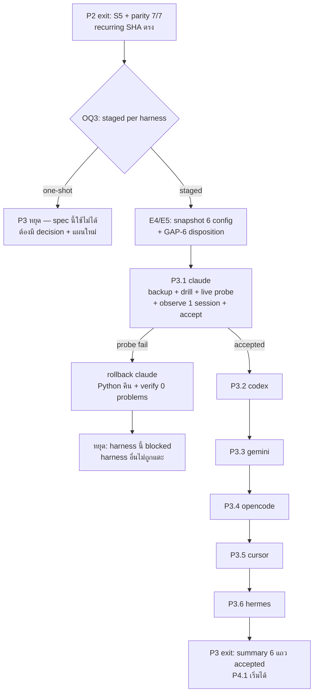

# Spec: P3 — staged cutover ของ 6 harness (harness ละ checkpoint)

## TL;DR

P3 เสร็จเมื่อ **harness ทั้ง 6 ตัว (claude, codex, gemini, opencode, cursor, hermes) ถูกสลับไป engine ใหม่ทีละตัว, แต่ละตัวผ่าน live probe (`agent:<name>` writes > 0, hook exit `0`, ไม่ push, ไม่ network นอก `sync` ที่ configure), เฝ้า 1 session จริง, owner accept, และ rollback path ถูกพิสูจน์ว่าใช้ได้จริง — โดยมี artifact ต่อ harness ใต้ `$WF/parity/P3/`**
ก่อน P3.1 มี **OQ3** (staged ราย harness vs one-shot) เป็น phase gate — plan ใช้ staged; ถ้า owner เลือก one-shot, โครง serial + rollback ต่อ harness ของสเปกนี้ใช้ไม่ได้และต้องขอ decision/plan ใหม่
สเปกนี้ไม่ re-design: มัน bind `REQ-CUTOVER-01` (และ slice ของ `REQ-COMPAT-01`, `REQ-HOOK-02`, `NFR-NET-01`, `NFR-OPS-01/02`) เข้ากับ `plan.md` P3.1–P3.6 · **GAP-6 (registry 7 vs cutover 6)** ถูกอ้างและบันทึกไว้ ไม่ถูกตัดสินแทน owner/design

---

## 1. Phase goal

เปลี่ยน **writer of record ต่อ harness** จาก Python ไป engine ใหม่แบบย้อนกลับได้: สลับ config ของ harness เดียว, พิสูจน์ด้วย live probe ว่า harness นั้นยังเขียน/อ่าน/ฉีดความจำได้จริง, เฝ้าหนึ่ง session, ให้ owner accept — แล้วจึงไป harness ถัดไป; ถ้า probe ไม่ผ่าน ให้คืน Python ของ harness นั้นก่อนแตะ harness อื่น (design §9.3 P3; plan P3.1–P3.6)

P3 ไม่เปลี่ยน record format, ไม่เปลี่ยน MCP/hook contract, ไม่แตะ canonical data นอกเหนือจากการเขียน record ปกติของ harness ที่เพิ่งสลับ

## 2. Entry criteria

ต้องครบทุกข้อก่อนเริ่ม P3.1:

| # | เงื่อนไข | หลักฐานที่ต้องมีก่อนเริ่ม |
|---|---|---|
| E1 | P2 exit ผ่าน | `$WF/parity/P2/S5-initial.md` มี `n_pairs = 30`, `recall5 ≥ 0.8667`, `mrr ≥ 0.85` + parity 7/7 + negative controls (spec `p2-engine-parity.spec.md`) |
| E2 | **OQ3 ถูกตอบ** (hard gate) | `$WF/parity/P3/cutover-decision.md` ระบุ "staged ราย harness" พร้อม owner + วันที่; ถ้า one-shot → §5.1 มีผล |
| E3 | recurring gate ตรงกับ binary ที่จะ cut over | artifact ล่าสุดใต้ `$WF/parity/recurring/` มี sha256 เท่ากับ `shasum -a 256 "$ENGINE_BIN"` (spec P2 AC-P2-17) |
| E4 | harness ทั้ง 6 ถูกระบุ config surface จริง | snapshot ต่อ harness: path ของ MCP config / hook wrapper / plugin, sha256 ของไฟล์ก่อนแตะ, วิธี backup — 6 รายการ ไม่ขาดตัว |
| E5 | **GAP-6 disposition ถูกบันทึก** | `cutover-decision.md` ระบุว่า scope = 6 ตัวตาม design/plan และ `kirocrew` (entry ที่ 7 ใน `schema/agents.json`, mode `pull`) ใช้ path ไหนระหว่าง/หลัง cutover — **ห้ามปล่อยว่างและห้ามเดาแทน** |
| E6 | G7 precursor evidence ต่อ harness | `$WF/parity/P2/g7-<harness>.md` ครบ 6 หรือ `BLOCKED` ต่อตัว (P2 spec AC-P2-09/AC-P2-10) |
| E7 | canonical home สุขภาพดี | `python3 "$REPO/bin/mem" verify` → exit `0`, `0 problems`; `git -C "$REPO" status --short` ว่างหรือมีแต่การเปลี่ยนแปลงที่ตั้งใจ |
| E8 | credential boundary พร้อม (ถ้ามี remote) | ถ้า home ของ harness ใดมี remote จริงสำหรับ `sync`, **GAP-4** ต้องถูกตอบก่อนเปิด `sync` บน harness นั้น; ถ้ายังไม่ตอบ → `sync` บน harness นั้นต้องเป็น local-commit-only ระหว่าง P3 |
| E9 | ไม่มี remote/push ใน engine repo | `test -z "$(git -C "$ENGINE_DIR" remote)"` → exit `0` |

## 3. Exit criteria

P3 ปิดได้เมื่อครบทุกข้อ:

| Gate | ต้องได้อะไร | หลักฐานที่ยอมรับ |
|---|---|---|
| **G7** (per-harness probe) | live probe ผ่านต่อ harness: MCP/hook probe สำเร็จ, `stats` มี `source: agent:<name>` writes `> 0`, hook exit `0`, ไม่ push, ไม่ network นอก `sync` | `$WF/parity/P3/<harness>.md` พร้อม 5 ฟิลด์ |
| **Cutover accounting** | 6 แถวมีสถานะ `accepted` / `rolled_back` / `blocked` ครบ; แถว `blocked` หรือ `rolled_back` ที่ยังไม่ได้แก้ = P3 ยังไม่ปิด | `$WF/parity/P3/summary.md` |
| **Rollback proof** | ทุก harness มี rollback drill ที่พิสูจน์ว่า config คืนได้และ Python กลับมาทำงาน; ถ้า probe fail จริง ต้องมี live rollback record | artifact ต่อ harness + `rollback-<harness>.md` |
| **Serial proof** | ไม่มี harness ใดถูกสลับก่อนตัวก่อนหน้าจะ `accepted` | `summary.md` + timestamp/sequence check |
| **Data integrity** | `verify` = `0 problems`; จำนวน record เปลี่ยนเท่าที่ harness เขียนจริง (ไม่มี record หาย/ถูกเขียนทับ) | `verify` output + count ก่อน/หลังต่อ harness |
| **No push** | remote-tracking ref ของ data repo ไม่ขยับจาก hook/cutover; engine repo ไม่มี remote | digest ของ `git for-each-ref refs/remotes` ก่อน/หลัง + `git remote -v` ว่าง |
| **Evidence** | artifact ทุกใบมี command · real exit code · version/SHA · date · probe result | `$WF/parity/P3/` |

**ห้ามปิด P3 ด้วย:** harness ที่ "น่าจะทำงาน" โดยไม่มี live probe; `BLOCKED` ที่ถูกนับเป็น accepted; rollback ที่ไม่ได้พิสูจน์ว่า Python กลับมาจริง

## 4. Scope in / out

### 4.1 In scope (plan P3.1–P3.6)

- cutover ทีละ harness ตามลำดับ claude → codex → gemini → opencode → cursor → hermes
- config backup `.bak-<timestamp>` ต่อไฟล์ + rollback command ที่เขียนไว้ล่วงหน้า
- live probe (`tools/cutover-probe.sh --harness <name> --live`), stats write check, hook exit check, no-push/no-network check
- observation window 1 session จริงต่อ harness + owner acceptance
- rollback drill (sandbox) ก่อน live cutover และ live rollback เมื่อ probe fail
- per-harness artifact + summary + sequence/order evidence
- GAP-6 disposition recording (ไม่ใช่การตัดสิน)

### 4.2 Out of scope

| ไม่อยู่ใน P3 | เหตุผล | ไปอยู่ที่ |
|---|---|---|
| แก้ engine code เพื่อให้ probe ผ่าน (นอกจาก defect fix ที่แคบและบันทึกไว้) | P3 คือ cutover ไม่ใช่พัฒนา; defect fix ต้องไม่เปลี่ยน contract | ถ้าเป็น shared contract failure → กลับไป P2 |
| Python read-only / archive / data repo shim | ต้อง cutover ครบก่อน | P4.1 |
| public hygiene / `LICENSE` / remote / push / publication | NFR-RELEASE-01, OQ1, OQ2 | P4.2/P4.3 |
| public packaging/distribution | fast-follow หลัง personal cutover (design §8.2) | post-P3 |
| เปลี่ยน MCP schema / hook format / record format | OQ5 = freeze (P2) | ห้าม; breaking = major version นอก scope |
| `sync` กับ remote จริงเมื่อ GAP-4 ยังเปิด | credential wire boundary ยังไม่ถูกตอบ | หลัง GAP-4 |
| corpus จริง/prompt log ใน engine repo หรือ artifact สาธารณะ | NFR-PRIV-01/02 | ห้ามทุก phase |

## 5. Cutover protocol (serial, reversible)

### 5.1 ผลของ OQ3 = one-shot

ถ้า owner เลือก one-shot ทั้ง 6 ตัวพร้อมกัน:

- ลำดับ serial, per-harness checkpoint, rollback ต่อ harness และ "observe 1 session ก่อนไปตัวถัดไป" ของสเปกนี้ **ใช้ไม่ได้**
- ต้องมี decision record ใหม่ + แผน cutover ใหม่ที่ระบุความเสี่ยงรวม (พังพร้อมกัน 6 ช่องทาง) และ rollback แบบทั้งชุด — สเปกนี้ไม่ authorize one-shot
- ห้ามใช้ P3 artifact ของสเปกนี้เป็นหลักฐานของ one-shot cutover

### 5.2 ลำดับและ config surface (plan P3.1–P3.6)

| Task | Harness | Config surface ที่แตะ | Probe ที่ต้องผ่าน |
|---|---|---|---|
| P3.1 | claude | Claude MCP/hook config + installer backup | `agent:claude` writes `> 0`; MCP + hook probe สำเร็จ; hook exit `0`; no push |
| P3.2 | codex | Codex MCP/hook config | `agent:codex` writes `> 0`; no push; rollback พร้อม |
| P3.3 | gemini | Gemini MCP/hook config | `agent:gemini` writes `> 0`; emitted JSON parse แบบ strict; ไม่มี stdout noise; no push |
| P3.4 | opencode | plugin/config symlink หรือ module path + MCP config | `agent:opencode` writes `> 0`; plugin resolve ไป engine path ที่อนุมัติ; no push |
| P3.5 | cursor | Cursor MCP/hook config | `agent:cursor` writes `> 0`; cursor JSON schema parse; no push |
| P3.6 | hermes | Hermes MCP/hook config (manual configuration ที่ installer ต้องให้คนทำ) | `agent:hermes` writes `> 0`; Hermes output schema parse; no push |

**ลำดับเป็น serial เด็ดขาด** — ทุก harness ใช้ user configuration ร่วมกันและสถานะ cutover ร่วมกัน; ห้ามทำ parallel (plan P3 dependency/order)

### 5.3 กฎต่อ harness (ทุกตัวเหมือนกัน)

1. **Snapshot + backup:** sha256 ต่อไฟล์ config ก่อนแตะ, backup `.bak-<timestamp>` ต่อไฟล์ที่เปลี่ยน
2. **Rollback ที่เขียนไว้ล่วงหน้า:** คำสั่งเดียวที่คืน `python3 bin/mem` + path ของ backup; ต้องรันได้โดยไม่ต้องเดา
3. **Rollback drill ใน sandbox ก่อน live:** apply → rollback → bytes ของ config เท่ากับ backup → Python probe ผ่าน — บันทึกผล
4. **Live cutover:** เปลี่ยนเฉพาะ harness นี้; harness อื่นต้องไม่ถูกแตะ (hash ยืนยัน)
5. **Live probe:** ตามตาราง §5.2 + hook exit `0` + ไม่ push + ไม่ network นอก `sync`
6. **Observation window:** 1 session จริง; บันทึก session marker (เวลา, จำนวน write, hook events)
7. **Owner acceptance:** ลายเซ็น/วันที่ใน artifact ก่อนไปตัวถัดไป
8. **ถ้า probe fail:** คืน Python ของ harness นี้ทันที, บันทึก live rollback, **หยุด** — ห้ามไปตัวถัดไป

### 5.4 สิ่งที่พิสูจน์ว่า rollback "worked"

| หลักฐาน | ต้องเห็นอะไร |
|---|---|
| Config bytes | `diff` ระหว่าง backup กับ config ปัจจุบัน = ว่าง (หรือเท่ากับค่าก่อน cutover ทุกไบต์) |
| Harness กลับมาทำงาน | probe ของ harness นั้นผ่านเมื่อชี้ Python: hook exit `0`, MCP call สำเร็จ, memory ถูกอ่าน/เขียนผ่าน Python |
| Write path | `python3 "$REPO/bin/mem"` เห็น write ของ harness นั้นอีกครั้ง (หรือ record ที่ harness เขียนระหว่าง cutover ยังอ่านได้) |
| ผลกระทบข้าม harness | hash ของ config harness อื่นไม่เปลี่ยน |
| Data | `verify` = `0 problems`; record count ไม่ลดลง |
| Index | engine index (`index-<engine>.sqlite`) ไม่ถูกใช้เป็น source หลัง rollback; Python index ยังอยู่ |

## 6. Requirements covered

| Requirement | P3 ต้องส่งมอบอะไร | AC ที่พิสูจน์ |
|---|---|---|
| **REQ-CUTOVER-01** | สลับทีละ harness + live probe (`agent:<name>` writes > 0, hook exit `0`, no push); เก็บ backup ที่คืน Python ได้; serial และ owner accept ต่อตัว; probe fail → คืนก่อนแตะตัวอื่น | AC-P3-01 … AC-P3-10 |
| **REQ-COMPAT-01** | ระหว่างและหลัง cutover สัญญาเดิมไม่เปลี่ยน: MCP 13 tools, hook 4 formats, record format/ids; config ที่คืนได้คือ config เดิม | AC-P3-04, AC-P3-06, AC-P3-08 |
| **REQ-HOOK-02** *(operational slice)* | hook ของ harness ที่ cut over แล้วยัง exit `0` และไม่ push ในสภาพจริง | AC-P3-04, AC-P3-10 |
| **REQ-MCP-01** *(operational slice)* | MCP probe ของ harness ที่ cut over ยังเรียก 13 tools ได้ | AC-P3-04 |
| **REQ-EVAL-01** *(recurring slice)* | binary ที่ cut over ต้องมี recurring S5 artifact ที่ SHA ตรงกัน | AC-P3-02 |
| **NFR-NET-01** | ไม่มี network call ใน probe ยกเว้น `sync` ที่ configure ไว้ต่อ home | AC-P3-04 |
| **NFR-SEC-01** | config ที่เปลี่ยนไม่มี credential/token ถูกเขียนลงไฟล์หรือ log | AC-P3-04 |
| **NFR-OPS-01** | probe fail/rollback ต้อง observable และ non-zero ตามสัญญา — ไม่เงียบ | AC-P3-07, AC-P3-10 |
| **NFR-OPS-02** | artifact ต่อ harness มี 5 ฟิลด์ + สถานะ; resume ที่ harness แรกที่ยังไม่ accepted | AC-P3-05, AC-P3-11 |
| **NFR-PRIV-02 / TB-4** | cutover log/artifact อยู่ใต้ `$WF` เท่านั้น; engine repo ไม่มีข้อมูลจริง | AC-P3-11 |
| **NFR-RELEASE-01** *(partial)* | ไม่มี remote/push ตลอด P3 | AC-P3-10, AC-P3-11 |

### 6.1 Not in this phase (พร้อมเหตุผลและ gate)

| Requirement | ทำไมไม่ใช่ P3 | phase / gate |
|---|---|---|
| REQ-REC-01 … REQ-REC-08 | ปิดแล้วที่ P1/P2 | P1/P2 |
| REQ-DOM-01 | ปิดที่ P2.1/P2.6 | P2 |
| REQ-CLI-01/02, REQ-SYNC-01/02 | ส่งมอบที่ P2.2; P3 ใช้ `stats`/`verify` เป็นเครื่องมือ probe เท่านั้น | P2 |
| REQ-MCP-01, REQ-HOOK-01/02, REQ-INST-01 (delivery) | ส่งมอบที่ P2.3/P2.4 | P2 |
| REQ-EVAL-01 (initial S5) | ปิดที่ P2.6; P3 ใช้ recurring slice เท่านั้น | P2 |
| NFR-PERF-01 | G6 ปิดที่ P2.7 | P2 |
| NFR-PRIV-01 (hygiene + publication) | ต้องมี public gate | P4.2/P4.3 |
| NFR-RELEASE-01 (remote/push) | ห้ามก่อน public gate | P4.3 |
| NFR-LANG-01, NFR-PORT-01 | P0 / CI matrix — P3 ไม่ประกาศ target ใหม่ | P0 / P1.6 |
| OQ1, OQ2 | ไม่มี gate ของ P3 (OQ2 ยืนยันซ้ำที่ P4) | P4 |

## 7. Flow ของ phase



## 8. Acceptance criteria

### AC-P3-01 · OQ3 ถูกบันทึกเป็น precondition (staged)

**Proves:** REQ-CUTOVER-01 (entry)
**Plan task:** `plan.md` P3 (entry) · **Gate:** **OQ3 phase gate**

```gherkin
Given the owner's OQ3 answer recorded on disk with owner name and date
When P3 begins
Then the record states staged per harness, and the serial order claude → hermes is acknowledged
But if the answer is one-shot, P3 stops, this spec's serial and per-harness rollback are void,
    and a new decision plus cutover plan is required
```

**Command + expected:** `test -s "$WF/parity/P3/cutover-decision.md"` → exit `0`; เนื้อหาระบุ `staged`
**Discriminating control:** เปลี่ยนคำตอบในสำเนาเป็น `one-shot` → P3 status ต้องเป็น `BLOCKED` ไม่ใช่ accepted

### AC-P3-02 · Pre-cutover readiness ต่อ harness (snapshot + backup + SHA + recurring gate)

**Proves:** REQ-CUTOVER-01 (backup obligation) · REQ-EVAL-01 (recurring slice) · NFR-OPS-02
**Plan task:** `plan.md` P3.1–P3.6 (per-harness preamble) · **Gate:** **G7** precursor

```gherkin
Given a harness selected for cutover
When readiness is recorded before any config change
Then the artifact contains the config path(s), sha256 of each file, the created .bak-<timestamp> path,
     the exact rollback command, sha256 of the engine binary, and the recurring S5 artifact sha256
  And the canonical home is clean and verify reports 0 problems
  And the recurring artifact's sha256 equals the binary about to be cut over
But a missing backup, a mismatched recurring SHA, or an unrecorded config path blocks that harness
```

**Command + expected:** `test -s "$WF/parity/P3/<harness>.md"` → exit `0`; `shasum -a 256 "$ENGINE_BIN"` ตรงกับ artifact
**Discriminating control:** ใช้ SHA เก่าในสำเนา → readiness check `BLOCKED`

### AC-P3-03 · Rollback drill ใน sandbox พิสูจน์ว่าคืนได้

**Proves:** REQ-CUTOVER-01 (rollback obligation)
**Plan task:** `plan.md` P3.1–P3.6 (backup/rollback clause) · **Gate:** **G7** precursor

```gherkin
Given the recorded backup and rollback command for one harness in a sandbox copy of its config
When apply then rollback are executed
Then the config bytes equal the pre-cutover backup exactly
  And the Python probe passes again (hook exit 0, memory read/write through Python)
  And no other harness's config hash changes
But a rollback that leaves any config byte different, or that needs manual guessing, fails this criterion
```

**Command + expected:** drill script/commands ตาม artifact → exit `0`; `diff -u "$BACKUP" "$CONFIG"` → exit `0`
**Discriminating control:** แตะ config ของ harness อื่นระหว่าง drill ในสำเนา → test แดง

### AC-P3-04 · Live probe ต่อ harness (writes > 0, hook 0, ไม่ push, ไม่ network เกิน)

**Proves:** REQ-CUTOVER-01 · REQ-MCP-01 · REQ-HOOK-02 (slice) · NFR-NET-01 · NFR-SEC-01
**Plan task:** `plan.md` P3.1–P3.6 · **Gate:** **G7**

```gherkin
Given one harness cut over to the new engine and all other harnesses untouched
When the live probe runs for that harness
Then tools/cutover-probe.sh --harness <name> --live exits 0
  And stats shows writes with source agent:<name> greater than zero
  And the hook path exits 0 and performs no push
  And no network call occurs outside an explicitly configured sync
  And the harness's own output schema parses (gemini strict JSON, cursor JSON, hermes schema)
  And no credential or token is written into the changed config or the runtime log
But a nonzero probe, zero writes, a push, an unexpected network call, or an unparsable output fails this criterion
```

**Command + expected:** `"$ENGINE_DIR/tools/cutover-probe.sh" --harness <name> --live` → exit `0`; `MEM_HOME="$REPO" "$ENGINE_BIN" stats --json` → `agent:<name>` > 0
**Discriminating control:** fake git ที่นับ push → ต้องเป็น `0`; ถ้าไม่ใช่ = แดง

### AC-P3-05 · Observation window 1 session + owner acceptance + serial enforcement

**Proves:** REQ-CUTOVER-01 (serial + acceptance) · NFR-OPS-02
**Plan task:** `plan.md` P3.1–P3.6 (checkpoint) · **Gate:** **G7**

```gherkin
Given a harness that passed its live probe
When one real session is observed
Then the artifact records the session marker (time window, write count, hook events) with no error signal
  And the owner records acceptance with name and date
  And the next harness is not started before that acceptance exists
But starting the next harness with the previous artifact not accepted makes the sequence check non-zero
```

**Command + expected:** `summary.md` แสดง sequence + accepted status; sequence check → exit `0`
**Discriminating control:** สลับลำดับในสำเนา `summary.md` (codex ก่อน claude accepted) → sequence check แดง

### AC-P3-06 · Rollback live เมื่อ probe fail (negative control แบบบังคับ)

**Proves:** REQ-CUTOVER-01 (restore before touching another) · REQ-COMPAT-01 · NFR-OPS-01
**Plan task:** `plan.md` P3.1–P3.6 (failed probe path) · **Gate:** **G7**

```gherkin
Given a harness whose config points at a deliberately broken engine path
When the probe runs and then the documented rollback is executed
Then the probe fails with a non-zero result and an observable reason
  And the rollback restores the backup bytes, the Python probe passes, verify reports 0 problems,
      and no other harness config changed
  And the artifact records the failure, the rollback commands and the post-rollback probe result
But a rollback that leaves the harness unusable, or that changes another harness, fails this criterion
```

**Command + expected:** broken-config probe → exit ≠ `0`; rollback → Python probe exit `0`; `verify` → `0 problems`
**Discriminating control:** ใช้ broken config แล้ว probe ยัง exit `0` → probe ไม่ discriminate = แดง

### AC-P3-07 · Failure containment: shared contract failure หยุดทั้งชุด, harness defect หยุดตัวเดียว

**Proves:** REQ-CUTOVER-01 · REQ-COMPAT-01
**Plan task:** `plan.md` P3 (dependency/order) · **Gate:** **G7**

```gherkin
Given a failure observed during cutover
When the failure is classified as a shared MCP/hook contract failure versus a harness-specific defect
Then a shared contract failure blocks every subsequent cutover and returns to P2 for a contract fix
  And a harness-specific defect blocks only that harness; the others may continue after it is resolved
  And the classification and decision are recorded in the summary artifact
But continuing to the next harness after an unclassified shared failure fails this criterion
```

**Command + expected:** summary artifact มี field `failure_class` + `scope`; check → exit `0`
**Discriminating control:** บันทึก shared failure เป็น harness-specific ในสำเนา → check แดง

### AC-P3-08 · GAP-6: scope 6 ตัวชัดเจน, `kirocrew` มีคำตอบบนดิสก์

**Proves:** REQ-CUTOVER-01 (scope) · NFR-OPS-02
**Plan task:** `plan.md` P3.1–P3.6 (scope note) · **Gate:** **GAP-6** (บันทึก ไม่ตัดสิน)

```gherkin
Given schema/agents.json contains 7 entries while design/plan cut over 6
When the cutover scope is recorded
Then the artifact names exactly the 6 cutover harnesses
  And it states which path the seventh entry (kirocrew, mode pull) uses during and after cutover,
      as an owner/design decision with a date — not as an inference
  And no artifact claims 7/7 cutover or counts kirocrew as cut over
But a missing disposition blocks P3 entry; an unstated assumption in prose fails this criterion
```

**Command + expected:** `cutover-decision.md` มี disposition; `grep -c` รายชื่อ 6 ตัวใน `summary.md` = 6 และไม่มี `7/7`
**Discriminating control:** เพิ่มแถว `kirocrew` เป็น `accepted` ในสำเนา → scope check แดง (GAP-6 ยังไม่ถูกตัดสิน)

### AC-P3-09 · Final accounting: 6 แถวมีสถานะจริง + writer of record ต่อ harness

**Proves:** REQ-CUTOVER-01 · NFR-OPS-01
**Plan task:** `plan.md` P3.1–P3.6 (resumability/accounting) · **Gate:** P3 exit

```gherkin
Given all six harness tasks have been attempted
When the summary is written
Then each harness row has exactly one status: accepted, rolled_back or blocked
  And each accepted row names the engine binary sha256 and the writer of record (engine)
  And each rolled_back row names the Python path restored and the post-rollback probe result
  And any blocked or unresolved rolled_back row keeps P3 open
But a row with no status, or a status that contradicts its artifact, fails this criterion
```

**Command + expected:** `summary.md` 6 แถว + status ครบ; cross-check กับ artifact ต่อ harness → exit `0`
**Discriminating control:** ตั้ง `accepted` บนแถวที่ artifact เป็น `FAIL` → check แดง

### AC-P3-10 · Data integrity + no push ตลอด P3

**Proves:** NFR-OPS-01 · REQ-HOOK-02 (no push) · NFR-RELEASE-01 (partial)
**Plan task:** `plan.md` P3.1–P3.6 + resumability clause · **Gate:** **G7**

```gherkin
Given the canonical home before and after each harness cutover
When verify, record counts and remote-tracking refs are compared
Then verify reports 0 problems and no record is lost or overwritten
  And record counts change only by the writes the harness actually performed
  And the digest of `git for-each-ref refs/remotes` is unchanged across the cutover window
  And the hook path records zero push attempts
But a lost record, a changed remote ref, or a push attempt fails this criterion
```

**Command + expected:** `python3 "$REPO/bin/mem" verify` → exit `0`, `0 problems`; `git -C "$REPO" for-each-ref refs/remotes` digest ก่อน/หลังเท่ากัน
**Discriminating control:** จำลอง push 1 ครั้งใน disposable clone → digest เปลี่ยน → check แดง

### AC-P3-11 · Evidence ครบ 5 ฟิลด์และอยู่ใต้ `$WF`

**Proves:** NFR-OPS-02 · NFR-PRIV-02 · TB-4 · NFR-RELEASE-01 (partial)
**Plan task:** `plan.md` P3 (resumability/evidence) · **Gate:** ปิดพร้อม P3 exit

```gherkin
Given the P3 artifacts on disk
When each is inspected
Then each harness artifact and summary carries command, real exit code, version/SHA, date and probe result with a status
  And all cutover artifacts live under $WF/parity/P3/
  And the engine tree tracks no cutover artifact and no personal record
  And no remote exists in the engine repo and no push occurred
But deleting the exit-code line from a copy makes the evidence check fail
```

**Command + expected:** `test -z "$(git -C "$ENGINE_DIR" ls-files | grep -E '(^|/)(spikes|parity)/')"` → exit `0`; 6 harness artifacts + summary มีอยู่
**Discriminating control:** ลบ field 1 ตัวในสำเนา → evidence check exit ≠ `0`

## 9. Test skeletons

**LANGUAGE-NEUTRAL SKELETONS.** probe/rollback เหล่านี้เป็น operational checks — pseudocode ที่ไม่ผูกภาษา เช่นเดียวกับ P0/P1; เมื่อ engine language ถูก transliterate แล้ว ส่วนที่ต้องรันจริงคือ `tools/cutover-probe.sh` + shell checks ใต้ `$WF`

```text
// ===========================================================================
// AC-P3-01 · OQ3 recorded as a precondition
// LANGUAGE-NEUTRAL SKELETON — transliterate to the selected language.
// ===========================================================================
test "P3/cutover decision is staged and dated" {
    // Given: the OQ3 answer with owner and date
    // When:  P3 starts
    // Then:  the decision is staged per harness and the serial order is acknowledged
    //        (assertion — to be implemented)
    // And (negative control): a one-shot answer blocks P3
    //        (assertion — to be implemented)
}
```

```text
// ===========================================================================
// AC-P3-02 · Per-harness readiness: snapshot, backup, SHA, recurring gate
// LANGUAGE-NEUTRAL SKELETON — transliterate to the selected language.
// ===========================================================================
test "P3/readiness records config hashes, backup, rollback command and matching SHA" {
    // Given: a harness selected for cutover
    // When:  readiness is recorded before any change
    // Then:  config paths and hashes, .bak-<timestamp>, rollback command, binary sha256
    //        and the matching recurring S5 artifact are present; verify is 0 problems
    //        (assertion — to be implemented)
    // And (negative control): a mismatched recurring SHA blocks that harness
    //        (assertion — to be implemented)
}
```

```text
// ===========================================================================
// AC-P3-03 · Sandbox rollback drill restores bytes and Python behaviour
// LANGUAGE-NEUTRAL SKELETON — transliterate to the selected language.
// ===========================================================================
test "P3/rollback drill returns the exact backup and Python probe passes" {
    // Given: a sandbox copy of one harness config with its backup
    // When:  apply then rollback run
    // Then:  config bytes equal the backup, Python probe passes, other harness hashes unchanged
    //        (assertion — to be implemented)
    // And (negative control): touching another harness during the drill fails the test
    //        (assertion — to be implemented)
}
```

```text
// ===========================================================================
// AC-P3-04 · Live probe per harness
// LANGUAGE-NEUTRAL SKELETON — transliterate to the selected language.
// ===========================================================================
test "P3/live probe proves writes, hook exit, no push and no extra network" {
    // Given: one harness cut over and the others untouched
    // When:  cutover-probe --harness <name> --live runs
    // Then:  exit 0, agent:<name> writes > 0, hook exit 0, push count 0,
    //        no network outside configured sync, harness output parses, no credential written
    //        (assertion — to be implemented)
    // And (negative control): a fake-git push counter other than zero fails the probe
    //        (assertion — to be implemented)
}
```

```text
// ===========================================================================
// AC-P3-05 · Observation window, acceptance and serial order
// LANGUAGE-NEUTRAL SKELETON — transliterate to the selected language.
// ===========================================================================
test "P3/session observation and owner acceptance gate the next harness" {
    // Given: a harness that passed its probe
    // When:  one real session is observed and acceptance is recorded
    // Then:  the session marker is present, acceptance carries owner and date,
    //        and no later harness starts before it
    //        (assertion — to be implemented)
    // And (negative control): reordering the summary makes the sequence check non-zero
    //        (assertion — to be implemented)
}
```

```text
// ===========================================================================
// AC-P3-06 · Live rollback after a failing probe
// LANGUAGE-NEUTRAL SKELETON — transliterate to the selected language.
// ===========================================================================
test "P3/broken config fails the probe and rollback restores Python" {
    // Given: a harness pointed at a broken engine path
    // When:  the probe fails and the documented rollback runs
    // Then:  the probe is non-zero with an observable reason, backup bytes are restored,
    //        Python probe passes, verify is 0 problems, other configs unchanged
    //        (assertion — to be implemented)
    // And (negative control): a probe that exits 0 on the broken config is not discriminating
    //        (assertion — to be implemented)
}
```

```text
// ===========================================================================
// AC-P3-07 · Failure containment classification
// LANGUAGE-NEUTRAL SKELETON — transliterate to the selected language.
// ===========================================================================
test "P3/shared contract failure blocks all later cutovers" {
    // Given: a failure during cutover
    // When:  it is classified as shared contract versus harness-specific
    // Then:  shared blocks all later cutovers and returns to P2; harness-specific blocks only that harness
    //        the classification and decision are recorded
    //        (assertion — to be implemented)
    // And (negative control): continuing after an unclassified shared failure fails the test
    //        (assertion — to be implemented)
}
```

```text
// ===========================================================================
// AC-P3-08 · GAP-6 scope and the seventh registry entry
// LANGUAGE-NEUTRAL SKELETON — transliterate to the selected language.
// ===========================================================================
test "P3/scope is six harnesses and kirocrew has a recorded path" {
    // Given: seven entries in schema/agents.json
    // When:  the cutover scope is read
    // Then:  exactly six harnesses are named, kirocrew's path is recorded as an owner/design decision,
    //        and no artifact claims 7/7
    //        (assertion — to be implemented)
    // And (negative control): marking kirocrew accepted fails the scope check
    //        (assertion — to be implemented)
}
```

```text
// ===========================================================================
// AC-P3-09 · Six-row accounting with real statuses
// LANGUAGE-NEUTRAL SKELETON — transliterate to the selected language.
// ===========================================================================
test "P3/summary has one true status per harness and a writer of record" {
    // Given: all six attempts
    // When:  the summary is written
    // Then:  each row is accepted, rolled_back or blocked, accepted rows name the engine SHA
    //        and blocked/unresolved rows keep P3 open
    //        (assertion — to be implemented)
    // And (negative control): a status contradicting its artifact fails the check
    //        (assertion — to be implemented)
}
```

```text
// ===========================================================================
// AC-P3-10 · Data integrity and no push
// LANGUAGE-NEUTRAL SKELETON — transliterate to the selected language.
// ===========================================================================
test "P3/verify stays at zero problems and remote refs do not move" {
    // Given: the canonical home before and after each cutover
    // When:  verify, record counts and remote-ref digests are compared
    // Then:  verify is 0 problems, no record is lost, counts move only by real writes,
    //        the remote-ref digest is unchanged and push attempts are zero
    //        (assertion — to be implemented)
    // And (negative control): a simulated push in a disposable clone fails the digest check
    //        (assertion — to be implemented)
}
```

```text
// ===========================================================================
// AC-P3-11 · Evidence completeness and private location
// LANGUAGE-NEUTRAL SKELETON — transliterate to the selected language.
// ===========================================================================
test "P3/every artifact has five fields and stays under the private workflow dir" {
    // Given: the P3 artifacts
    // When:  each is inspected
    // Then:  command, real exit code, version/SHA, date, probe result and status are present,
    //        all live under $WF/parity/P3/, the engine tree tracks none, no remote and no push
    //        (assertion — to be implemented)
    // And (negative control): deleting the exit-code line from a copy fails the evidence check
    //        (assertion — to be implemented)
}
```

## 10. Gate evidence requirements

| # | ต้องมีอะไร | ที่อยู่ | ตรวจอย่างไร |
|---|---|---|---|
| EV1 | `cutover-decision.md` — OQ3 = staged + GAP-6 disposition (kirocrew path) + owner/date | `$WF/parity/P3/cutover-decision.md` | `test -s` + เนื้อหา |
| EV2 | artifact ต่อ harness: config paths + hashes, backup path, rollback command, binary sha256, recurring S5 SHA, probe command, real exit code, date, probe result, status | `$WF/parity/P3/<harness>.md` | 5 ฟิลด์ + cross-check SHA |
| EV3 | sandbox rollback drill record ต่อ harness: apply/rollback commands, `diff` result, Python probe result | `$WF/parity/P3/rollback-<harness>.md` | `diff` ว่าง + probe exit `0` |
| EV4 | live probe output (ไม่ใช่สรุปจากความจำ) + stats snapshot ที่มี `agent:<name>` > 0 | artifact ต่อ harness + log | อ่านค่าจริง |
| EV5 | observation window record: session marker, write count, hook events, owner acceptance | artifact ต่อ harness | owner + date |
| EV6 | remote-ref digest ก่อน/หลัง + push count | `$WF/parity/P3/remote-refs-{before,after}.txt` | digest เท่ากัน |
| EV7 | `summary.md` 6 แถว + status + failure classification + sequence | `$WF/parity/P3/summary.md` | cross-check กับ EV2 |
| EV8 | `verify`/count ก่อน/หลัง + index note (Python index ยังอยู่, engine index แยกไฟล์) | `$WF/parity/P3/data-integrity.md` | `0 problems`, count ไม่ลด |

**ข้อห้าม:** artifact ที่มีเนื้อหา record จริง (แม้แต่ partial หรือ path ที่มีชื่อผู้ใช้) อยู่ใต้ `$WF` เท่านั้น — **ห้ามเข้า `$ENGINE_DIR`, CI หรือ commit ใด ๆ ใน repo นี้** (NFR-PRIV-01/02, TB-3/TB-4) · ห้าม copy config ที่มี token/credential ลง artifact — redact ก่อนเสมอ (NFR-SEC-01)

**Resumability:** ถ้างานหยุด ให้ resume ที่ harness แรกที่ยังไม่มีสถานะ `accepted`; harness ที่ accepted แล้วห้าม cut over ซ้ำโดยไม่มีเหตุผล (เช่น defect fix) และถ้าต้องทำซ้ำต้องมี artifact ใหม่

## 11. Open questions และ gaps ที่ block phase นี้

**ไม่ renumber และไม่ re-list** — id ทั้งหมดเป็นของ `specs/framework.spec.md` §11

### 11.1 Blocking P3

| id | Block gate ไหน | Owner/เจ้าของต้องทำอะไร |
|---|---|---|
| **OQ3** | **P3 ทั้งเฟส** (hard gate ก่อน P3.1) | ยืนยัน staged ราย harness (design/plan ใช้ staged) หรือรับความเสี่ยง one-shot แบบชัดแจ้ง — ถ้า one-shot สเปกนี้ใช้ไม่ได้ (design §12 OQ3; plan Open items) |
| **GAP-6** | **P3 entry + AC-P3-08** | design/plan ต้องระบุว่า `kirocrew` (entry ที่ 7, mode `pull`) ใช้ path ไหน และถ้าต้อง cutover ต้องเพิ่ม task — ห้ามสเปกนี้ตัดสินแทน (design §3.2/plan P3 scope) |
| **GAP-4** | **P3.1–P3.6 เฉพาะ harness ที่เปิด `sync` กับ remote จริง** | owner ตัดสิน credential wire boundary (อะไรข้าม network ได้, home ที่มี `sensitivity: private` sync ได้หรือไม่, credential helper ส่งอะไรออก) ก่อนเปิด `sync`; ถ้ายังไม่ตอบ → local-commit-only |
| **GAP-2** | **AC-P3-04/06** | `tools/cutover-probe.sh` CLI ถูก pin ใน plan เพียง `--harness <name> --live` และ `--fixture`; ถ้าต้องการ option อื่น (เช่น `--json`, `--timeout`) ต้อง pin ก่อนใช้ใน DoD |
| **GAP-1** | evidence ของ AC-P3-11 | schema กลางของ artifact (5 ฟิลด์เป็นขั้นต่ำ) |

### 11.2 ไม่ block P3 แต่มี gate ของตัวเอง

| id | Gate | หมายเหตุ |
|---|---|---|
| **OQ1** | ก่อน public push (P4) | ห้ามสร้าง `LICENSE` ใน P3 |
| **OQ2** | ยืนยันซ้ำก่อน P4 public gate | ไม่กระทบ cutover ภายในเครื่อง |
| **OQ4** | release / CI matrix | ไม่ block cutover บนเครื่องผู้ใช้ |
| **OQ5** | ปิดแล้วที่ P2 (ต้องคง freeze) | ถ้า freeze ถูกทำลายระหว่าง P3 = shared contract failure → กลับ P2 |
| **OQ6** | defer ได้ | ไม่ทำ semantic search |
| **OQ7** | ปิดแล้วที่ P0 | ไม่กระทบ P3 |
| **GAP-3** | CI matrix | ไม่ block P3 |
| **GAP-5** | legacy suite metric | P3 ใช้ `verify`/`stats` เป็น probe ไม่ใช้ assertion count |
| **GAP-7** | count ฐานของ corpus | P3 รายงาน count ต่อ harness ด้วย metric ที่ระบุ ไม่ผสมฐาน |

## 12. Exit checklist / DoD

```sh
REPO="$HOME/my-memory"
WF="$REPO/docs/workflow/my-memory-framework-migration"
ENGINE_DIR="$HOME/Work/my-memory-engine"
ENGINE_BIN="$ENGINE_DIR/<selected-language build output>"

# 1. precondition
test -s "$WF/parity/P3/cutover-decision.md"                      # exit 0; staged + GAP-6 disposition
test -s "$WF/parity/P2/S5-initial.md"                            # exit 0
shasum -a 256 "$ENGINE_BIN"                                      # ตรงกับ recurring artifact ล่าสุด

# 2. per-harness artifacts (6 ไฟล์)
for h in claude codex gemini opencode cursor hermes; do
  test -s "$WF/parity/P3/$h.md" || exit 1                        # exit 0 ทุกตัว
done
test -s "$WF/parity/P3/summary.md"                               # exit 0

# 3. live probe (รันต่อ harness หลัง cutover; ตัวอย่าง claude)
"$ENGINE_DIR/tools/cutover-probe.sh" --harness claude --live      # exit 0
MEM_HOME="$REPO" "$ENGINE_BIN" stats --json                       # agent:claude > 0
python3 "$REPO/bin/mem" verify                                    # exit 0; 0 problems

# 4. no push / no remote
git -C "$REPO" for-each-ref refs/remotes > "$WF/parity/P3/remote-refs-after.txt"
diff -u "$WF/parity/P3/remote-refs-before.txt" "$WF/parity/P3/remote-refs-after.txt"   # exit 0
test -z "$(git -C "$ENGINE_DIR" remote)"                          # exit 0

# 5. artifact ไม่อยู่ใน engine repo
test -z "$(git -C "$ENGINE_DIR" ls-files | grep -E '(^|/)(spikes|parity)/')"   # exit 0
```

**Discriminating negative controls ที่ต้องเห็น "แดง" อย่างน้อยหนึ่งครั้งก่อนปิด P3**

| control | การแก้ | ผลที่ต้องเห็น |
|---|---|---|
| one-shot answer | เปลี่ยน OQ3 ในสำเนาเป็น one-shot | P3 `BLOCKED`, ไม่ใช่ accepted |
| broken engine path | ชี้ config ไป binary ที่ไม่มี | live probe exit ≠ `0` แล้ว rollback คืนได้ |
| rollback leakage | แตะ config harness อื่นระหว่าง drill | drill test แดง |
| zero writes | probe ที่ไม่มีการเขียน record | `agent:<name>` = 0 → probe แดง |
| push attempt | fake git push 1 ครั้ง | push count ≠ 0 / remote digest เปลี่ยน → แดง |
| order violation | สลับลำดับ harness ใน summary | sequence check แดง |
| 7/7 claim | เพิ่ม `kirocrew` เป็น accepted | scope check แดง |
| status contradiction | accepted บนแถวที่ artifact FAIL | accounting check แดง |
| evidence gap | ลบ exit-code line ในสำเนา | evidence check exit ≠ `0` |

**Definition of Done ของ P3:** OQ3 = staged และ GAP-6 disposition บนดิสก์; 6 harness มี artifact ครบ (accepted/rolled_back พร้อมหลักฐาน); live probe ผ่านพร้อม `agent:<name>` writes > 0, hook exit `0`, no push, no network เกิน; rollback drill พิสูจน์ได้ทุกตัว; `verify` = `0 problems` และ count ไม่ลด; summary 6 แถวตรงกับ artifact; remote-ref digest ไม่ขยับ; engine repo ไม่มี remote และไม่มี artifact; **ห้ามปิด P3 ถ้ามี harness `blocked` ที่ยังไม่ได้แก้**

---

**Status:** DRAFT — awaiting owner approval

### Owner-approval checklist (P3)

- [ ] ยืนยัน **OQ3 = staged ราย harness** และยอมรับว่า one-shot ทำให้สเปกนี้ใช้ไม่ได้ (ต้องมี decision + แผนใหม่)
- [ ] ยืนยันลำดับ serial claude → codex → gemini → opencode → cursor → hermes และ per-harness acceptance ก่อนไปตัวถัดไป
- [ ] ยืนยันว่า rollback ต้องพิสูจน์ได้ (config bytes + Python probe + data integrity) ก่อนถือว่า harness ใด accepted
- [ ] ยืนยัน **GAP-6**: scope = 6 ตัว และมีคำตอบเรื่อง `kirocrew` บนดิสก์ก่อน P3.1; ห้ามเดา
- [ ] ยืนยัน **GAP-4** ก่อนเปิด `sync` กับ remote จริงของ harness ใด ๆ; ไม่ตอบ = local-commit-only
- [ ] ยืนยันว่า P3 ไม่แตะ MCP/hook/record contract และ shared contract failure ต้องกลับไป P2
- [ ] ยืนยันว่า cutover artifact อยู่ใต้ `$WF/parity/P3/` เท่านั้น และ redact config ที่มี credential
- [ ] เปลี่ยน `**Status:**` เป็น `APPROVED` พร้อมวันที่

### Change log

| Rev | Date | Change | Author |
|---|---|---|---|
| 1 | 2026-10-19 | แรก — P3 acceptance surface: entry/exit (G7 per harness, accounting, rollback proof), OQ3 blocking checkpoint + ผลถ้า one-shot, cutover protocol 6 harness + กฎ 8 ข้อ + rollback evidence, GAP-6 disposition, 11 AC (`AC-P3-01`…`AC-P3-11`), 11 language-neutral test skeletons, evidence ใต้ `$WF/parity/P3/`, OQ/GAP binding, DoD + negative controls | opencode |

*สเปกนี้เป็น DRAFT — ไม่ authorize cutover, การแก้ config harness จริง, remote, push หรือ publication ใด ๆ ก่อน owner อนุมัติ*
