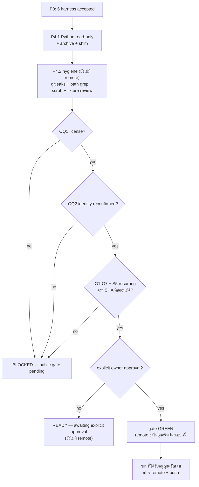
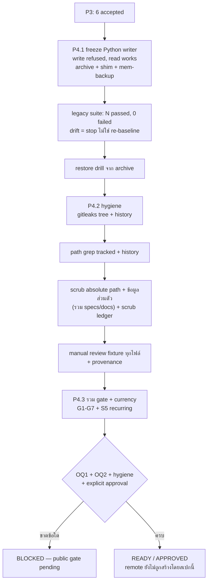

# Spec: P4 — Python read-only legacy / archive + public approval gate

## TL;DR

P4 เสร็จเมื่อ **Python กลายเป็น read-only legacy ที่ archive ไว้โดย history ครบ, data repo ตัด engine code ออกเหลือ shim + `bin/mem-backup`, และ public gate ผ่านครบ: OQ1 (license) + OQ2 (owner/module identity ยืนยันซ้ำ) + hygiene (gitleaks + manual review ทุก synthetic fixture + path grep + scrub absolute path/ข้อมูลส่วนตัว) + explicit owner approval** — และ **เฉพาะหลังจากนั้น** run ที่ได้รับอนุญาตชัดเจนจึงจะสร้าง remote ได้
ก่อนถึง approval: `git remote -v` ของ engine repo ต้องว่าง และถ้า gate ใดขาด ให้บันทึกเป็น **`BLOCKED — public gate pending`** — ห้ามบันทึกเป็น pass
**ข้อที่ต้องพูดตรง ๆ:** เอกสารชุดนี้ (รวม `specs/**` และ `docs/spec/**`) ยังมี absolute private path และรายละเอียดส่วนตัวของผู้ใช้อยู่ในเนื้อหา — ต้อง scrub ก่อน public push ทุกกรณี และ hygiene gate คือกลไกที่บังคับข้อนี้ (`NFR-PRIV-01`, `NFR-RELEASE-01`)
**public packaging/distribution (Homebrew, Windows signing, notarization, SBOM) ไม่อยู่ใน MVP** — เป็น fast-follow หลัง personal cutover (design §8.2) และไม่ใช่ P4

---

## 1. Phase goal

ปิด migration: หยุด Python ในฐานะ writer of record อย่างชัดเจนและย้อนกลับได้, เก็บ archive ที่ restore ได้, ตัด engine code ออกจาก data repo โดยเหลือ shim, แล้วทำ **public readiness** แบบพิสูจน์ได้ — ไม่ใช่ "ดูสะอาด" — ด้วย gitleaks, path grep, การ scrub เอกสาร, และการอ่าน fixture ทุกไฟล์ด้วยตาก่อนขออนุมัติ owner (design §7, §8.2, §9.3 P4; plan P4.1–P4.3)

P4 ไม่สร้าง remote, ไม่ push และไม่ publish ด้วยตัวเอง — มันผลิต **gate + evidence + approval artifact** ให้ run ที่ได้รับอนุญาตแยกต่างหาก

## 2. Entry criteria

| # | เงื่อนไข | หลักฐานที่ต้องมีก่อนเริ่ม P4.1 |
|---|---|---|
| E1 | P3 ปิดครบ 6 harness | `$WF/parity/P3/summary.md` มี 6 แถว `accepted`; ไม่มี `blocked`/`rolled_back` ที่ยังไม่ได้แก้ |
| E2 | recurring S5 ตรงกับ binary ปัจจุบัน | artifact ล่าสุดใต้ `$WF/parity/recurring/` มี sha256 = `shasum -a 256 "$ENGINE_BIN"` (spec P2 AC-P2-17) |
| E3 | ไม่มี remote / ไม่มี push ใน engine repo | `test -z "$(git -C "$ENGINE_DIR" remote)"` → exit `0` (NFR-RELEASE-01) |
| E4 | data repo อยู่ในสภาพที่ backup ได้ | `git -C "$REPO" status --short` ว่างหรือมีแต่การเปลี่ยนแปลงที่ตั้งใจ; backup bundle ล่าสุดจาก `bin/mem-backup` มีอยู่และตรวจได้ |
| E5 | **สถานที่ archive ถูกกำหนด** | owner/plan ระบุว่า Python engine จะ archive ที่ไหน (git tag/branch หรือ archive artifact) และที่ไหนที่ restore ได้ — **สถานที่ยังไม่ถูกกำหนดใน design** (ดู §11 under-specified) |
| E6 | gitleaks พร้อมและมี config | `gitleaks version` ทำงาน; config ของ repo ใช้ได้ (design §7 ระบุว่ามี config เดิม [OBS]) |

## 3. Exit criteria

P4 ปิดได้เมื่อครบทุกข้อ:

| Gate | ต้องได้อะไร | หลักฐานที่ยอมรับ |
|---|---|---|
| **P4.1 writer transition** | Python write ถูก refuse, read ยังทำงาน, `verify` = `0 problems`, legacy suite `N passed, 0 failed` (N ตรง baseline), archive restore ได้, shim + `bin/mem-backup` อยู่ | `$WF/parity/P4/python-readonly.md`, `archive.md`, `rollback-restore.md` |
| **Hygiene** | gitleaks exit `0` + `no leaks found` (tree + history); tracked/history path grep ไม่มี `lessons`, `knowledge`, `ops`, `handoffs`, `docs/workflow`; absolute path/ข้อมูลส่วนตัวถูก scrub; fixture ทุกไฟล์ถูกอ่านด้วยตา + provenance | `$WF/parity/P4/public-hygiene.md`, `tracked-paths.txt`, `history-paths.txt`, `fixture-review.md`, `scrub-ledger.md` |
| **OQ1** | license decision เป็นลายลักษณ์ + `LICENSE` ตรงกับการตัดสิน (สร้างหลังตัดสินเท่านั้น) | `license-decision.md` + ไฟล์ `LICENSE` |
| **OQ2** | owner/name + module/package namespace ยืนยันซ้ำและตรงกับ destination | `identity-confirmation.md` |
| **Approval** | explicit owner publication approval (ชื่อ, วันที่, scope, destination) | `public-approval.md` |
| **Pre-approval state** | `git remote -v` ว่าง และไม่มี push; gate ที่ขาดถูกบันทึกเป็น `BLOCKED — public gate pending` | `status.md` |
| **Gate currency** | G1–G6 + G7 manual matrix + S5 recurring ตรงกับ SHA ที่จะขออนุมัติ; suite >0 tests; CI matrix native | `gate-currency.md` + CI log |
| **Evidence** | artifact ทุกใบมี 5 ฟิลด์ | `$WF/parity/P4/` |

**สถานะที่อนุญาต:** `BLOCKED — public gate pending` (gate ใดขาด) · `READY — awaiting explicit approval` (gate ครบแต่ยังไม่อนุมัติ) · `APPROVED — publication authorized` (มี approval artifact) — **ห้ามใช้คำว่า pass/Done แทนสถานะใดในสามนี้**

## 4. Scope in / out

### 4.1 In scope (plan P4.1–P4.3)

- P4.1 freeze Python writer, refuse write, คง read path, archive + shim, คง `bin/mem-backup`, ตรวจ legacy suite
- P4.2 hygiene review ทั้ง tree + history: gitleaks, path grep, scrub absolute path/ข้อมูลส่วนตัว (รวมเอกสาร spec), manual fixture review, provenance
- P4.3 รวม gate + owner approval artifact + pre-approval remote check; **ไม่สร้าง remote เอง**
- data repo: ตัด engine code ออก เหลือ shim (ทำใน private repo; ไม่แตะ canonical markdown/ops ledger)

### 4.2 Out of scope

| ไม่อยู่ใน P4 | เหตุผล | ไปอยู่ที่ |
|---|---|---|
| **การสร้าง remote / push / publish จริง** | ต้องมี explicit owner instruction แยก และ run ที่ได้รับอนุญาต; สเปกนี้ไม่ authorize | หลัง P4.3 approval |
| **public packaging/distribution**: GoReleaser, Homebrew tap, Windows codesign/EV cert, notarization, SBOM, checksums | design §8.2 ระบุชัดว่าเป็น fast-follow หลัง personal cutover ไม่ใช่งาน MVP | post-P4 fast-follow (gate ด้วย OQ1/OQ2 + approval) |
| การเลือก license แทน owner | OQ1 เป็นสิทธิ์ owner | owner |
| เปลี่ยน MCP/hook/record contract | freeze ที่ P2 | ห้าม |
| semantic search, provider REST adapters, object store, MCP HTTP, daemon, incremental index | design §2.2/§6.1 | นอก MVP |
| ลบ git history ของ data repo เพื่อ "ทำให้สะอาด" | history ของ data repo ต้องคงเดิม; hygiene ทำที่ engine repo เท่านั้น | ห้าม |
| telemetry / update check | design §8.3 ไม่มีโดยสิ้นเชิง | ห้าม |
| corpus จริง/prompt log ใน engine repo | NFR-PRIV-01/02 | ห้ามทุก phase |

## 5. Public gate: องค์ประกอบและลำดับ

### 5.1 Gate = 4 องค์ประกอบ (ขาดข้อใดข้อหนึ่ง = `BLOCKED — public gate pending`)

| # | องค์ประกอบ | เจ้าของคำตัดสิน | หลักฐาน |
|---|---|---|---|
| 1 | **OQ1 — license** | owner | `license-decision.md` (เลือก license + ตรวจ compatibility) + `LICENSE` ที่ตรงกัน |
| 2 | **OQ2 — owner/module identity** | owner | `identity-confirmation.md` (repo owner/name + module path/package name ตรง destination) |
| 3 | **Hygiene** | plan + owner review | gitleaks (`no leaks found`), path grep (tracked + history), scrub ledger, manual fixture review |
| 4 | **Explicit publication approval** | owner | `public-approval.md` (ชื่อ, วันที่, scope, destination, "อนุญาตให้สร้าง remote/push") |

**ห้ามตีความว่า "test เขียว = อนุมัติ"** — approval เป็น action ของ owner เท่านั้น (plan P4.3; design §8.2)

### 5.2 ลำดับ (approval-controlled)



### 5.3 Scrub requirement (บังคับ ไม่ใช่ optional)

เนื้อหาที่ tracked อยู่ใน repo นี้ — โดยเฉพาะ `specs/**/*.md`, `docs/spec/*.md`, `README.md`, `AGENTS.md` — เขียนขึ้นในบริบทของ workflow ส่วนตัว และมีอย่างน้อย:

- absolute path ของเครื่องผู้ใช้ (`/Users/<name>/...`, `/home/...`, `/private/var/...`)
- path ของ private workflow directory (`docs/workflow/my-memory-framework-migration` และค่าของ `$WF`, `$REPO`, `$ENGINE_DIR`)
- ชื่อ/อีเมล/hostname ส่วนตัว และตัวอย่างที่ derive จาก record จริง

**ก่อน public push ต้อง scrub:** แทน absolute path ด้วยตัวแปร (`$HOME`, `$REPO`, `$WF`, `$ENGINE_DIR`) หรือ path แบบ generic, ตัดรายละเอียด workflow ส่วนตัวที่ไม่จำเป็นต่อผู้ใช้ภายนอก, และลบตัวอย่างที่อ้างถึง record จริง · **ทุก hit ต้องมีบันทึกใน `scrub-ledger.md`** (hit → การแก้ → ผู้ตรวจ → วันที่) ใต้ `$WF` (ledger มี path จริงจึงอยู่ private) · หลัง scrub ต้อง grep tracked files + history แล้วไม่พบ pattern เหล่านี้อีก

**ทำไมต้องพูดตรง ๆ:** เนื้อหาที่ tracked อยู่ตอนนี้มี absolute path ของเครื่องผู้ใช้จริงอยู่ใน `docs/spec/research-bun-addendum.md` และ `docs/spec/exploration.md` (ตรวจเมื่อ 2026-10-19 — ไม่คัดลอกค่าจริงมาที่นี่) นอกเหนือจาก path แบบ variable ในสเปก. fixture provenance label เป็นเพียง metadata check ไม่ใช่ข้อพิสูจน์ว่าเนื้อหา synthetic จริง (framework §8, design §7 ข้อ 3) — automated gate จับได้แค่ pattern; การรับรองเนื้อหาต้องมาจาก manual review + checklist + owner approval

**ข้อห้าม:** ห้าม "แก้ history" ของ engine repo เพื่อกลบ path (เช่น filter-branch) เพื่อให้ gate ผ่าน — ถ้า history มีข้อมูลส่วนตัวจริง ต้องตัดสินใจเรื่อง history กับ owner ก่อน (design §7 ข้อ 1 ระบุ engine repo ต้องเริ่มจาก commit แรกที่สะอาด ไม่ใช่ rewrite repo เดิม)

## 6. Requirements covered

| Requirement | P4 ต้องส่งมอบอะไร | AC ที่พิสูจน์ |
|---|---|---|
| **NFR-RELEASE-01** | ไม่มี remote ก่อน hygiene + OQ1 + OQ2 + explicit approval; gate ที่ขาด = `BLOCKED — public gate pending`; ไม่มี pass จากการอนุมาน | AC-P4-05, AC-P4-10, AC-P4-11, AC-P4-12, AC-P4-13 |
| **NFR-PRIV-01** | repo ไม่มี corpus จริง/prompt log/record ส่วนตัว/secret; gitleaks + path grep + scrub เอกสาร + manual fixture review | AC-P4-05, AC-P4-06, AC-P4-07, AC-P4-08 |
| **NFR-SEC-01** | ไม่มี credential/token/key ใน tree หรือ history; gitleaks ยืนยัน | AC-P4-05, AC-P4-12 |
| **NFR-OPS-02** | artifact ต่อ gate มี command · real exit code · version/SHA · date · probe result + สถานะ; resume ที่ gate แรกที่ขาด | AC-P4-04, AC-P4-10, AC-P4-12, AC-P4-13 |
| **NFR-OPS-01** | Python read-only refusal, archive restore, gate ที่ขาด ต้อง observable — ไม่เงียบ | AC-P4-01, AC-P4-04, AC-P4-10 |
| **REQ-CUTOVER-01** *(closing slice)* | Python ถูก freeze ได้เฉพาะเมื่อ 6 harness accepted ครบ; ไม่มี writer สองตัว | AC-P4-01, AC-P4-03 |
| **REQ-COMPAT-01** *(read-path slice)* | read path เดิมยังใช้ได้หลัง freeze (shim); record format/ids ไม่เปลี่ยน; index ไม่ถูกแชร์ | AC-P4-01, AC-P4-03 |
| **REQ-EVAL-01** *(recurring, หลัง P4)* | gate currency ต้องมี S5 artifact ที่ SHA ตรง; recurring gate ยังบังคับหลัง P4 | AC-P4-11 |
| **NFR-QUAL-01** | G1 ยังเป็น synthetic; S5 เป็น private; ไม่มีการเรียก CI ว่า recall parity | AC-P4-11 |
| **NFR-COMPAT-01** | จำนวน command/tool ใน docs generate จาก code และตรง ณ SHA ที่ขออนุมัติ | AC-P4-11 |
| **NFR-PORT-01** | CI matrix รัน native บน target ที่ประกาศ ณ SHA ที่ขออนุมัติ; ไม่มี runner = `BLOCKED` | AC-P4-11 |
| **NFR-PRIV-02 / TB-4** | artifact ที่อ้าง path/ข้อมูลจริงอยู่ใต้ `$WF/parity/P4/` เท่านั้น | AC-P4-10, AC-P4-13 |

### 6.1 Not in this phase (พร้อมเหตุผลและ gate)

| Requirement | ทำไมไม่ใช่ P4 | phase / gate |
|---|---|---|
| REQ-REC-01 … REQ-REC-08 | ปิดแล้ว P1/P2 | P1/P2 |
| REQ-DOM-01 | ปิดที่ P2 | P2 |
| REQ-CLI-01/02, REQ-SYNC-01/02 | ปิดที่ P2 | P2 |
| REQ-MCP-01, REQ-HOOK-01/02, REQ-INST-01 | ปิดที่ P2 | P2 |
| REQ-CUTOVER-01 (delivery) | ปิดที่ P3 | P3 |
| REQ-EVAL-01 (initial) | ปิดที่ P2.6 | P2 |
| NFR-PERF-01 | G6 ปิดที่ P2.7 (P4 เพียงตรวจว่ายัง current) | P2 |
| NFR-NET-01 | เป็น invariant ของ engine; P4 ไม่เปลี่ยน behavior | P1/P2 |
| NFR-LANG-01 | ปิดที่ P0 | P0 |
| OQ3, OQ4 (packaging), OQ6, OQ7 | ไม่มี gate ของ P4 | ตาม gate ของแต่ละข้อ |

## 7. Flow ของ phase



## 8. Acceptance criteria

### AC-P4-01 · Python กลายเป็น read-only writer จริง

**Proves:** NFR-OPS-01 · REQ-CUTOVER-01 (closing) · REQ-COMPAT-01 (read path)
**Plan task:** `plan.md` P4.1 · **Gate:** closes writer transition (P4.1)

```gherkin
Given all six harnesses accepted in P3
When Python is frozen to read-only legacy
Then `python3 "$REPO/bin/mem" verify` exits 0 and reports 0 problems
  And a write attempt in a disposable clone is refused with a non-zero result and a message naming the read-only state
  And Python read commands still answer (search, show, context) against the same data
  And `git -C "$REPO" status --short` shows no unintended record or index change
  And no second writer exists: the engine index and the Python index are separate files
But a write that still succeeds, or a read path that breaks, fails this criterion
```

**Command + expected:** `python3 "$REPO/bin/mem" verify` → exit `0`, `0 problems`; write attempt ใน disposable clone → exit ≠ `0`; read command → exit `0`
**Discriminating control:** รัน write 1 ครั้งกับสำเนา data repo → ต้องถูก refuse; ถ้าสำเร็จ = แดง

### AC-P4-02 · Legacy suite ยังเขียวและ N ตรง baseline (drift = หยุด)

**Proves:** NFR-OPS-01 · NFR-COMPAT-01 (drift discipline)
**Plan task:** `plan.md` P4.1 · **Gate:** P4.1

```gherkin
Given the recorded baseline N of the legacy suite (runtime pass count at the recorded data-repo SHA)
When the suite runs against the private data repo after Python is frozen
Then it exits 0 and its terminal summary reads "N passed, 0 failed"
  And the printed N equals the recorded baseline, not the assertion-helper count
  And nested backup bundle/drill checks run in an isolated sandbox and do not write to canonical data
But a different N stops the phase for a drift investigation; re-baselining to make it green is forbidden
  And if read-only enforcement conflicts with a suite fixture that requires a writable home, the conflict is recorded, not bypassed
```

**Command + expected:** `MEM_TEST_REPO="$REPO" bash "$REPO/tests/test-mem.sh"` → exit `0`, `N passed, 0 failed`; N == baseline
**Discriminating control:** เทียบ N กับ assertion-helper count → ต้องไม่ตรง (พิสูจน์ว่าใช้ metric ถูก) และถ้า N ไม่ตรง baseline → phase หยุด

### AC-P4-03 · Archive + data repo shim + `bin/mem-backup` คงอยู่

**Proves:** REQ-CUTOVER-01 · REQ-COMPAT-01 · NFR-OPS-01
**Plan task:** `plan.md` P4.1 · **Gate:** P4.1

```gherkin
Given the Python engine and its history in the private data repo
When the engine code is archived and removed from the active path
Then the archive exists at the location recorded for E5 with history intact (no rewrite, no squashed-away commits)
  And the data repo keeps a shim plus bin/mem-backup, and the shim's behaviour is documented
  And canonical markdown records and ops ledgers are untouched by the removal
  And the shim fails loudly with a diagnosable message when the new engine binary is missing — never silently
But deleting record data, rewriting history, or leaving a shim that silently succeeds without an engine fails this criterion
```

**Command + expected:** archive ref/path มีอยู่ (`test -d` หรือ `git rev-parse`); `test -x "$REPO/bin/mem-backup"` → exit `0`; shim test → loud failure exit ≠ `0`
**Discriminating control:** รัน shim โดยไม่มี engine binary → ต้อง error ชัดเจน; ถ้า exit `0` เงียบ ๆ = แดง

### AC-P4-04 · Rollback archive ถูกเก็บและ restore ได้จนกว่า owner จะรับ retirement

**Proves:** NFR-OPS-01 · NFR-OPS-02 · REQ-CUTOVER-01
**Plan task:** `plan.md` P4.1 (retain rollback archive) · **Gate:** P4.1

```gherkin
Given the archive and the owner's retirement acceptance state
When a restore drill extracts the archive into a temp directory and runs verify
Then the restored engine reports 0 problems and can read the same data
  And nothing from the archive is deleted before the retirement acceptance record exists
  And the drill records command, exit code, archive SHA, date and result
But an archive that cannot be restored, or deletion before acceptance, fails this criterion
```

**Command + expected:** restore drill → exit `0`; `test -s "$WF/parity/P4/rollback-restore.md"` → exit `0`
**Discriminating control:** restore จาก archive ที่ตัดไฟล์ 1 ไฟล์ในสำเนา → verify ≠ `0` / drill แดง

### AC-P4-05 · gitleaks ผ่านทั้ง tree และ history

**Proves:** NFR-PRIV-01 · NFR-SEC-01 · NFR-RELEASE-01
**Plan task:** `plan.md` P4.2 · **Gate:** **G5** + public hygiene

```gherkin
Given the engine repo tree and its full local history
When gitleaks scans the source with redaction
Then it exits 0 and explicitly reports "no leaks found"
  And the scan covers every local branch and tag that will be pushed
  And no certificate, private key, token, .env value or credential appears in any commit
But any finding, or a scan that only covers the working tree while history is unscanned, fails this criterion
```

**Command + expected:** `gitleaks detect --source "$ENGINE_DIR" --redact -v` → exit `0` + `no leaks found`
**Discriminating control:** ใส่ dummy secret ในสำเนา repo แล้วสแกน → exit ≠ `0`

### AC-P4-06 · Tracked paths และ history paths ไม่มี private layers

**Proves:** NFR-PRIV-01 · TB-3
**Plan task:** `plan.md` P4.2 · **Gate:** public hygiene

```gherkin
Given the tracked file list and the all-history path list of the engine repo
When both are grepped for private layer paths
Then neither contains lessons/, knowledge/, ops/, handoffs/ or docs/workflow/
  And private backup config and any offsite path are absent
  And every testdata path present is synthetic and labelled
But one matching path in either list fails this criterion
```

**Command + expected:** `git -C "$ENGINE_DIR" ls-files > "$WF/parity/P4/tracked-paths.txt"`; `! grep -E '(^|/)(lessons|knowledge|ops|handoffs|docs/workflow)(/|$)' ...` → exit `0`; such check ซ้ำกับ `history-paths.txt`
**Discriminating control:** เพิ่มไฟล์ใน `lessons/` ให้ tracked list ในสำเนา → grep ต้อง exit `0` ไม่ได้ (คือต้องเจอ)

### AC-P4-07 · Scrub absolute path และข้อมูลส่วนตัว (รวมเอกสาร spec)

**Proves:** NFR-PRIV-01 · NFR-RELEASE-01
**Plan task:** `plan.md` P4.2 (+ scrub requirement §5.3) · **Gate:** public hygiene

```gherkin
Given every tracked file, including specs/**, docs/spec/** and README/AGENTS
When absolute paths, home directories, personal names, emails and hostnames are searched
Then no tracked file contains a machine-specific absolute path or personal identifier
  And every hit found during the scrub has a ledger entry: location, action, reviewer, date
  And private workflow details that only matter to the owner are removed or generalized
  And the same search over history is clean, or the history decision is recorded with the owner
But a doc that still contains /Users/<name> or a private workflow path fails this criterion
  And rewriting history to hide a path is not an acceptable fix
```

**Command + expected:** tracked-file grep สำหรับ `/Users/`, `/home/`, personal email/hostname patterns → ไม่พบ (exit `1` จาก grep); `test -s "$WF/parity/P4/scrub-ledger.md"` → exit `0`
**Discriminating control:** ใส่ path `/Users/<name>/...` ในสำเนาเอกสาร → grep พบ → gate แดง

### AC-P4-08 · Manual review ทุก synthetic fixture + provenance

**Proves:** NFR-PRIV-01
**Plan task:** `plan.md` P4.2 · **Gate:** public hygiene

```gherkin
Given every file under testdata/ in the engine repo
When each file is opened and reviewed by a human
Then every file carries the synthetic provenance label
  And the review record lists file path, reviewer, date and verdict
  And the record states explicitly that the label is metadata, not proof of synthetic content
  And any file whose content is uncertain is marked FAIL and blocks publication
But an unlabeled file, or a review that only runs the label test without opening files, fails this criterion
```

**Command + expected:** `find "$ENGINE_DIR/testdata" -type f | wc -l` = จำนวนแถวใน `fixture-review.md`; provenance test → exit `0`
**Discriminating control:** เพิ่ม fixture ไม่มี label → provenance test แดง; หรือไฟล์ที่ไม่อยู่ใน review record → count check แดง

### AC-P4-09 · OQ1 license + OQ2 identity ถูกตัดสินก่อนสร้าง `LICENSE`

**Proves:** NFR-RELEASE-01
**Plan task:** `plan.md` P4.2/P4.3 (user decision) · **Gate:** **OQ1 / OQ2**

```gherkin
Given the public gate requires license and identity decisions
When the owner records the OQ1 license choice and reconfirms OQ2 owner/name plus module or package namespace
Then license-decision.md names the license, the compatibility check performed, owner and date
  And a LICENSE file exists only after that decision and its text matches it
  And identity-confirmation.md matches the actual public destination (repo owner/name and namespace)
But creating LICENSE before the decision, or a namespace that differs from the destination, fails this criterion
```

**Command + expected:** `test -s "$WF/parity/P4/license-decision.md"` → exit `0`; `test -f "$ENGINE_DIR/LICENSE"` → exit `0` **หลัง** decision เท่านั้น; `test -s identity-confirmation.md` → exit `0`
**Discriminating control:** ใช้ namespace เก่า/คนละค่ากับ destination ในสำเนา → check แดง

### AC-P4-10 · Pre-approval state: ไม่มี remote, ไม่มี push, gate ที่ขาด = `BLOCKED`

**Proves:** NFR-RELEASE-01 · NFR-OPS-01 · NFR-OPS-02 · TB-4
**Plan task:** `plan.md` P4.3 · **Gate:** public gate

```gherkin
Given the gate components and their evidence
When the status artifact is written before any approval
Then `git remote -v` is empty and no push has occurred
  And the status is BLOCKED — public gate pending when any component is missing,
      READY — awaiting explicit approval when all are present but approval is absent,
      and APPROVED — publication authorized only with the approval artifact
  And a missing component is never recorded as pass or as inferred consent
But creating a remote or pushing before approval fails this criterion
```

**Command + expected:** `test -z "$(git -C "$ENGINE_DIR" remote)"` → exit `0`; `grep -F 'BLOCKED — public gate pending' "$WF/parity/P4/status.md"` → exit `0` เมื่อ gate ขาด
**Discriminating control:** เพิ่ม remote ชั่วคราวในสำเนา → `test -z` exit ≠ `0`; ลบ approval แล้วยังเขียน APPROVED → check แดง

### AC-P4-11 · Gate currency: G1–G7 + S5 recurring ตรง SHA ที่ขออนุมัติ

**Proves:** REQ-EVAL-01 (recurring) · NFR-QUAL-01 · NFR-COMPAT-01 · NFR-PORT-01
**Plan task:** `plan.md` P4.3 · **Gate:** G1–G7 currency

```gherkin
Given the binary SHA that the publication request names
When every gate is checked against that SHA
Then the selected-language full suite exits 0 with more than zero tests
  And G1 is synthetic-only, G2/G3/G4/G5/G6 are current, and the G7 manual matrix has evidence for all six harnesses
  And the recurring S5 artifact's sha256 equals that binary and its metrics still meet baseline
  And documented command and tool counts are generated from code and match
  And CI ran natively on the declared targets, with any missing target recorded BLOCKED
But a stale gate, a synthetic eval presented as recall parity, or a missing native target fails this criterion
```

**Command + expected:** `test -s "$WF/parity/P4/gate-currency.md"` → exit `0`; เนื้อหาอ้าง SHA เดียวกับ `shasum -a 256 "$ENGINE_BIN"`; CI log อยู่ใน `$WF/parity/P4/`
**Discriminating control:** ใช้ gate log ของ SHA เก่า → currency check `BLOCKED`

### AC-P4-12 · Explicit owner publication approval + ขอบเขตของ run ที่สร้าง remote

**Proves:** NFR-RELEASE-01 · NFR-SEC-01 · NFR-OPS-02
**Plan task:** `plan.md` P4.3 · **Gate:** public gate

```gherkin
Given all gate components are present
When the owner records the publication approval
Then the artifact states owner, date, scope, destination and that remote creation plus push are authorized
  And only a later, explicitly authorized run may create the remote and push
  And this spec and its artifacts do not themselves create a remote, push, or infer consent from tests
  And no credential is placed in the engine repo, CI config or artifact
But any remote creation without that artifact fails this criterion
```

**Command + expected:** `test -s "$WF/parity/P4/public-approval.md"` → exit `0`; approval ระบุ destination ตรงกับ identity-confirmation
**Discriminating control:** ไม่มี approval artifact แล้วพยายามบันทึกว่า published → check แดง

### AC-P4-13 · Evidence ครบ 5 ฟิลด์และอยู่ใต้ `$WF`

**Proves:** NFR-OPS-02 · NFR-PRIV-02 · TB-4
**Plan task:** `plan.md` P4.1–P4.3 (evidence clause) · **Gate:** ปิดพร้อม public gate

```gherkin
Given the P4 artifacts on disk
When each is inspected
Then each carries command, real exit code, version/SHA, date and probe result with a status
  And all path-bearing artifacts, the scrub ledger and the fixture review live under $WF/parity/P4/
  And no engine-repo artifact contains a personal path or record content
But deleting one field from a copy makes the evidence check fail
```

**Command + expected:** `test -s` ต่อ artifact; `test -z "$(git -C "$ENGINE_DIR" ls-files | grep -E '(^|/)(spikes|parity)/')"` → exit `0`
**Discriminating control:** ลบ exit code line ในสำเนา → evidence check exit ≠ `0`

## 9. Test skeletons

**LANGUAGE-NEUTRAL SKELETONS.** P4 ส่วนใหญ่เป็น operational/gate checks — pseudocode ไม่ผูกภาษา เช่นเดียวกับ P0/P1; ที่รันจริงคือ shell/gitleaks/grep ตาม AC

```text
// ===========================================================================
// AC-P4-01 · Python read-only writer, read path intact
// ===========================================================================
test "P4/python refuses writes, still reads, verify is 0 problems" {
    // Given: six accepted harnesses
    // When:  Python is frozen and write/read/verify run
    // Then:  write is refused non-zero with a read-only message, read answers, verify is 0 problems,
    //        repo status is clean of unintended changes, and the two indexes stay separate
    //        (assertion — to be implemented)
    // And (negative control): a write that still succeeds fails the test
    //        (assertion — to be implemented)
}
```

```text
// ===========================================================================
// AC-P4-02 · Legacy suite green with the baseline N
// ===========================================================================
test "P4/legacy suite prints the recorded N with 0 failed" {
    // Given: the recorded baseline runtime pass count
    // When:  the legacy suite runs against the private data repo
    // Then:  exit 0, "N passed, 0 failed", N equals the baseline, backup drills stay in a sandbox
    //        (assertion — to be implemented)
    // And (negative control): a different N stops the phase; re-baselining is forbidden
    //        (assertion — to be implemented)
}
```

```text
// ===========================================================================
// AC-P4-03 · Archive, shim and backup utility survive the code removal
// ===========================================================================
test "P4/archive keeps history and the shim fails loudly without the engine" {
    // Given: the Python engine and its history
    // When:  the code is archived and removed from the active path
    // Then:  the archive exists with history intact, the shim and bin/mem-backup remain,
    //        canonical records are untouched, and the shim errors loudly with no engine
    //        (assertion — to be implemented)
    // And (negative control): a silently succeeding shim fails the test
    //        (assertion — to be implemented)
}
```

```text
// ===========================================================================
// AC-P4-04 · Rollback archive restorable until retirement is accepted
// ===========================================================================
test "P4/archive restore drill reads the same data" {
    // Given: the archive and the retirement acceptance state
    // When:  the archive is restored into a temp directory and verify runs
    // Then:  0 problems, data readable, nothing deleted before acceptance, drill recorded with SHA and date
    //        (assertion — to be implemented)
    // And (negative control): an incomplete archive fails the restore
    //        (assertion — to be implemented)
}
```

```text
// ===========================================================================
// AC-P4-05 · gitleaks clean over tree and full history
// ===========================================================================
test "P4/gitleaks reports no leaks for every branch and tag to be pushed" {
    // Given: the engine tree and full local history
    // When:  gitleaks runs with redaction
    // Then:  exit 0 with "no leaks found" across all local refs
    //        (assertion — to be implemented)
    // And (negative control): a dummy secret in a copy makes the scan non-zero
    //        (assertion — to be implemented)
}
```

```text
// ===========================================================================
// AC-P4-06 · No private layer paths in tracked files or history
// ===========================================================================
test "P4/tracked and history path lists contain no private layers" {
    // Given: the tracked list and the all-history path list
    // When:  both are grepped for lessons, knowledge, ops, handoffs, docs/workflow
    // Then:  neither matches, and every testdata path is synthetic and labelled
    //        (assertion — to be implemented)
    // And (negative control): adding a tracked lessons/ file makes the grep match
    //        (assertion — to be implemented)
}
```

```text
// ===========================================================================
// AC-P4-07 · Absolute paths and personal details are scrubbed
// ===========================================================================
test "P4/no tracked doc contains an absolute home path or personal identifier" {
    // Given: every tracked file including specs and design docs
    // When:  home paths, names, emails and hostnames are searched
    // Then:  no match remains, every scrub hit has a ledger entry, private workflow details are generalized,
    //        and history is clean or the history decision is recorded
    //        (assertion — to be implemented)
    // And (negative control): a /Users/<name> path in a copied doc fails the check
    //        (assertion — to be implemented)
}
```

```text
// ===========================================================================
// AC-P4-08 · Every fixture is opened and reviewed
// ===========================================================================
test "P4/fixture review covers every testdata file with provenance" {
    // Given: every file under testdata/
    // When:  each is opened and reviewed
    // Then:  the label is present, the review record covers every file with reviewer/date/verdict,
    //        the record states the label is metadata only, and uncertainty is FAIL
    //        (assertion — to be implemented)
    // And (negative control): an unlabeled or unreviewed file fails the check
    //        (assertion — to be implemented)
}
```

```text
// ===========================================================================
// AC-P4-09 · License and identity decided before LICENSE
// ===========================================================================
test "P4/license decision precedes the LICENSE file and identity matches destination" {
    // Given: the OQ1 and OQ2 decisions
    // When:  the license and identity artifacts are checked against the tree
    // Then:  the decision exists first, LICENSE matches it, and the namespace matches the destination
    //        (assertion — to be implemented)
    // And (negative control): a LICENSE without a decision, or a stale namespace, fails
    //        (assertion — to be implemented)
}
```

```text
// ===========================================================================
// AC-P4-10 · Pre-approval: no remote, no push, honest status
// ===========================================================================
test "P4/status is BLOCKED or READY before approval and never inferred" {
    // Given: gate evidence and the status artifact
    // When:  status is evaluated before approval
    // Then:  remote list is empty, no push occurred, a missing component yields BLOCKED — public gate pending,
    //        and APPROVED requires the approval artifact
    //        (assertion — to be implemented)
    // And (negative control): a temporary remote or an inferred approval fails the check
    //        (assertion — to be implemented)
}
```

```text
// ===========================================================================
// AC-P4-11 · All gates current at the requested SHA
// ===========================================================================
test "P4/G1-G7 and recurring S5 match the binary being approved" {
    // Given: the binary SHA named in the publication request
    // When:  every gate artifact is compared to that SHA
    // Then:  suite >0 tests, G1 synthetic, G2-G6 current, G7 all six harnesses, S5 recurring matching,
    //        counts generated from code, native CI targets accounted for
    //        (assertion — to be implemented)
    // And (negative control): a stale log or a synthetic eval used as recall parity fails
    //        (assertion — to be implemented)
}
```

```text
// ===========================================================================
// AC-P4-12 · Explicit approval authorizes a later run, not this one
// ===========================================================================
test "P4/approval artifact exists and no remote is created here" {
    // Given: all gate components present
    // When:  the approval artifact and the repo remote state are checked
    // Then:  approval names owner, date, scope, destination and authorization; no remote exists yet;
    //        no credential is stored anywhere in the repo
    //        (assertion — to be implemented)
    // And (negative control): a remote created without approval fails the check
    //        (assertion — to be implemented)
}
```

```text
// ===========================================================================
// AC-P4-13 · Evidence completeness and private location
// ===========================================================================
test "P4/every artifact has five fields and path-bearing artifacts stay private" {
    // Given: the P4 artifacts
    // When:  each is inspected
    // Then:  command, exit code, version/SHA, date, result and status are present,
    //        path-bearing artifacts live under $WF/parity/P4/, and no engine artifact holds personal data
    //        (assertion — to be implemented)
    // And (negative control): deleting one field fails the evidence check
    //        (assertion — to be implemented)
}
```

## 10. Gate evidence requirements

| # | ต้องมีอะไร | ที่อยู่ | ตรวจอย่างไร |
|---|---|---|---|
| EV1 | `python-readonly.md` — verify result, write refusal, read check, status | `$WF/parity/P4/python-readonly.md` | `0 problems`; write exit ≠ `0` |
| EV2 | legacy suite log + terminal summary + baseline N ที่ใช้อ้าง | `$WF/parity/P4/legacy-suite.log` | `N passed, 0 failed`; N == baseline |
| EV3 | `archive.md` — archive location/ref, SHA, history note, shim behaviour | `$WF/parity/P4/archive.md` | archive เข้าถึงได้; history intact |
| EV4 | `rollback-restore.md` — restore drill command/result/date | `$WF/parity/P4/rollback-restore.md` | restore verify = `0 problems` |
| EV5 | `public-hygiene.md` + gitleaks output | `$WF/parity/P4/public-hygiene.md` | exit `0`, `no leaks found` |
| EV6 | `tracked-paths.txt` + `history-paths.txt` + grep results | `$WF/parity/P4/` | grep ไม่พบ private layer |
| EV7 | `scrub-ledger.md` — ทุก hit + การแก้ + reviewer + วันที่ | `$WF/parity/P4/scrub-ledger.md` | ครบทุก hit; หลัง scrub grep สะอาด |
| EV8 | `fixture-review.md` — ไฟล์ทุกไฟล์ + reviewer + date + verdict | `$WF/parity/P4/fixture-review.md` | count ตรงกับจำนวนไฟล์จริง |
| EV9 | `license-decision.md`, `identity-confirmation.md`, `public-approval.md` | `$WF/parity/P4/` | owner + date + destination |
| EV10 | `status.md` + `gate-currency.md` | `$WF/parity/P4/` | สถานะในสามค่าที่อนุญาต; SHA ตรง |

**ข้อห้าม:** artifact ที่มี path จริงหรือเนื้อหา record (รวม scrub ledger, config snapshot) อยู่ใต้ `$WF` เท่านั้น — **ห้ามเข้า `ENGINE_DIR`, CI หรือ commit ใด ๆ ใน repo นี้** (NFR-PRIV-01/02) · agent ไม่บันทึก credential/token ลง artifact · ห้าม "แก้ history" ให้ gate ผ่าน

**Resumability:** ถ้างานหยุด ให้ resume ที่ gate แรกที่ยังไม่มี `PASS` (เช่น gitleaks ผ่านแล้วแต่ fixture review ยังไม่ครบ → เริ่มที่ fixture review)

## 11. Open questions และ gaps ที่ block phase นี้

**ไม่ renumber และไม่ re-list** — id ทั้งหมดเป็นของ `specs/framework.spec.md` §11

### 11.1 Blocking P4

| id | Block gate ไหน | Owner/เจ้าของต้องทำอะไร |
|---|---|---|
| **OQ1** | **public gate component 1** → ไม่มีคำตอบ = `BLOCKED — public gate pending` | เลือก license (design แนะนำ Apache-2.0) + ตรวจ compatibility; **ห้ามสร้าง `LICENSE` ก่อนตัดสิน** (design §12, §7) |
| **OQ2** | **public gate component 2** | ยืนยัน owner/name + module path/package name ให้ตรง destination จริง (ค่าที่ใช้ตั้งแต่ P1 ต้องไม่เปลี่ยน) |
| **GAP-1** | evidence ของ AC-P4-13 และความเทียบกันได้กับ P0–P3 | schema กลางของ artifact (5 ฟิลด์เป็นขั้นต่ำ) |
| **GAP-5** | **AC-P4-02** (drift check) | นิยาม metric ของ N ที่ใช้เทียบ (runtime pass count vs assertion-helper count) ต้องถูก pin; `187` / `352` helper sites / `219` `chk` / `399` runtime passes เป็นคนละ metric |
| **under-specified (ยังไม่มี id)** | **E5 + AC-P4-03/04** | design/plan ไม่ได้กำหนด **สถานที่และรูปแบบของ archive** (tag/branch/artifact) — plan/owner ต้องระบุก่อน P4.1; สเปกนี้ไม่เดา |

### 11.2 ไม่ block P4 แต่มี gate ของตัวเอง

| id | Gate | หมายเหตุ |
|---|---|---|
| **OQ3** | ปิดแล้วที่ P3 | ถ้า one-shot ถูกเลือก P3 จะไม่ปิด → P4 entry ไม่ครบ |
| **OQ4** | public packaging / release (fast-follow) | P4 ไม่รวม Homebrew/codesign/SBOM; Windows codesign decision ยังเป็นของ owner |
| **OQ5** | ปิดแล้วที่ P2 | freeze ต้องคงอยู่; ถ้าแตก = shared contract failure |
| **OQ6** | defer ได้ | ไม่ทำ semantic search |
| **OQ7** | ปิดแล้วที่ P0 | ไม่กระทบ P4 |
| **GAP-2** | runner CLI | P4 ใช้ `cutover-probe`/parity runner ที่มีอยู่; ถ้า CLI เปลี่ยน ต้อง pin |
| **GAP-3** | native CI target | ไม่มี runner = `BLOCKED` ในการทำ gate currency ไม่ใช่ pass |
| **GAP-4** | sync/credential boundary | P4 ไม่เปิด sync ใหม่; ถ้า data repo sync อยู่แล้ว owner ต้องรับทราบว่า record เป็น plaintext ใน git (design §5.5) |
| **GAP-6** | scope harness | ปิด/บันทึกที่ P3 |
| **GAP-7** | record count metric | ถ้า P4 รายงานจำนวน record ต้องระบุฐานนับ (file count vs `stats` vs active only) |

## 12. Exit checklist / DoD

```sh
REPO="$HOME/my-memory"
WF="$REPO/docs/workflow/my-memory-framework-migration"
ENGINE_DIR="$HOME/Work/my-memory-engine"
ENGINE_BIN="$ENGINE_DIR/<selected-language build output>"
ARCHIVE_DIR="<archive location recorded for E5>"

# 1. Python read-only + suite + backup utility
python3 "$REPO/bin/mem" verify                                    # exit 0; 0 problems
MEM_TEST_REPO="$REPO" bash "$REPO/tests/test-mem.sh"              # exit 0; "N passed, 0 failed"; N == baseline
test -x "$REPO/bin/mem-backup"                                    # exit 0
git -C "$REPO" status --short                                     # เฉพาะการเปลี่ยนแปลงที่ตั้งใจ

# 2. archive + restore drill
test -e "$ARCHIVE_DIR"                                            # exit 0 (หรือ git ref ตาม E5)
test -s "$WF/parity/P4/rollback-restore.md"                       # exit 0

# 3. hygiene (ทำก่อน approval; ยังไม่มี remote)
gitleaks detect --source "$ENGINE_DIR" --redact -v                # exit 0 + "no leaks found"
git -C "$ENGINE_DIR" ls-files > "$WF/parity/P4/tracked-paths.txt"
! grep -E '(^|/)(lessons|knowledge|ops|handoffs|docs/workflow)(/|$)' "$WF/parity/P4/tracked-paths.txt"
git -C "$ENGINE_DIR" log --all --name-only --format= > "$WF/parity/P4/history-paths.txt"
! grep -E '(^|/)(lessons|knowledge|ops|handoffs|docs/workflow)(/|$)' "$WF/parity/P4/history-paths.txt"
! grep -RInE '/Users/|/home/[a-z]|/private/var/' "$(git -C "$ENGINE_DIR" ls-files | sed "s#^#$ENGINE_DIR/#")"
test -s "$WF/parity/P4/scrub-ledger.md"                           # exit 0
test -s "$WF/parity/P4/fixture-review.md"                         # exit 0

# 4. decisions + gate currency
test -s "$WF/parity/P4/license-decision.md"                       # OQ1
test -s "$WF/parity/P4/identity-confirmation.md"                  # OQ2
test -s "$WF/parity/P4/gate-currency.md"                          # G1-G7 + S5 SHA ตรง
test -s "$WF/parity/P4/status.md"                                 # สถานะในสามค่าที่อนุญาต

# 5. pre-approval remote state (ตรวจก่อน approval)
test -z "$(git -C "$ENGINE_DIR" remote)"                          # exit 0

# 6. approval (ถ้ามี) — ไม่มี = "BLOCKED — public gate pending" ไม่ใช่ Done
test -s "$WF/parity/P4/public-approval.md"                        # exit 0 เฉพาะเมื่อ owner อนุมัติแล้ว
```

**หมายเหตุ:** หลัง approval + run ที่ได้รับอนุญาตสร้าง remote แล้ว `git remote -v` จะไม่ว่าง — การตรวจข้อ 5 คือการตรวจ **ก่อน** approval และต้องบันทึกเวลาไว้ใน `status.md`

**Discriminating negative controls ที่ต้องเห็น "แดง" อย่างน้อยหนึ่งครั้งก่อนปิด P4**

| control | การแก้ | ผลที่ต้องเห็น |
|---|---|---|
| Python ยังเขียนได้ | write กับสำเนา data repo | ต้องถูก refuse; ถ้าสำเร็จ = แดง |
| suite drift | N ไม่ตรง baseline | หยุด phase (ไม่ใช่ re-baseline) |
| archive ไม่ครบ | ตัดไฟล์ 1 ไฟล์ในสำเนา archive | restore verify ≠ `0` |
| dummy secret | ใส่ secret ในสำเนา repo | gitleaks exit ≠ `0` |
| private layer | เพิ่ม `lessons/x.md` ให้ tracked | path grep เจอ → แดง |
| absolute path | ใส่ `/Users/<name>/...` ในสำเนา doc | scrub grep เจอ → แดง |
| unlabeled fixture | เพิ่ม fixture ไม่มี label | provenance test แดง |
| LICENSE ก่อน decision | สร้าง `LICENSE` ในสำเนาก่อนมี decision | OQ1 check แดง |
| remote ก่อน approval | เพิ่ม remote ชั่วคราว | `test -z` exit ≠ `0` |
| stale gate | ใช้ log ของ SHA เก่า | currency `BLOCKED` |
| approval inference | ไม่มี approval แต่เขียน APPROVED | status check แดง |

**Definition of Done ของ P4:** Python read-only + archive restore ได้ + shim/`bin/mem-backup` อยู่ + legacy suite `N passed, 0 failed` ตรง baseline; hygiene ครบ (gitleaks, path grep, scrub ledger, fixture review); OQ1 + OQ2 บนดิสก์; G1–G7 + S5 currency ตรง SHA; `git remote -v` ว่างก่อน approval; `status.md` เป็น `BLOCKED`/`READY`/`APPROVED` ตามจริง; approval artifact มีก่อนการสร้าง remote ใด ๆ; artifact ครบ 5 ฟิลด์ใต้ `$WF/parity/P4/`

**สถานะ publication:** ถ้า approval ยังไม่มี → migration ถือว่า **local-only complete แต่ publication = `BLOCKED — public gate pending`** ไม่ใช่ public release Done (plan DoD)

---

**Status:** DRAFT — awaiting owner approval

### Owner-approval checklist (P4)

- [ ] ยืนยันว่า Python ถูก freeze เป็น read-only ได้เฉพาะเมื่อ P3 accepted ครบ 6 harness และไม่มี writer สองตัว
- [ ] ยืนยันสถานที่/รูปแบบ archive (E5) — design ไม่ได้กำหนด และสเปกนี้ไม่เดา
- [ ] ยืนยันว่า `N` ที่ใช้เป็น drift check คือ runtime pass count ไม่ใช่ assertion-helper count (**GAP-5**)
- [ ] ยืนยัน **OQ1** license และ **OQ2** owner/module identity ให้ตรง destination; `LICENSE` สร้างหลังตัดสินเท่านั้น
- [ ] ยืนยันว่า hygiene = gitleaks + path grep + **scrub absolute path/ข้อมูลส่วนตัวในเอกสาร (รวม specs/) + manual review ทุก fixture** และ automated label ไม่ถูกอ้างเป็นข้อพิสูจน์
- [ ] ยืนยันว่า `BLOCKED — public gate pending` เป็นสถานะที่ยอมรับได้ และ **ห้าม** บันทึกเป็น pass/Done
- [ ] ยืนยันว่า P4 ไม่สร้าง remote/push/publish เอง และ approval เป็น action ของ owner เท่านั้น
- [ ] ยืนยันว่า public packaging/distribution (Homebrew, codesign/notarize, SBOM) อยู่นอก MVP และเป็น fast-follow หลัง personal cutover
- [ ] เปลี่ยน `**Status:**` เป็น `APPROVED` พร้อมวันที่

### Change log

| Rev | Date | Change | Author |
|---|---|---|---|
| 1 | 2026-10-19 | แรก — P4 acceptance surface: entry/exit (public gate 4 องค์ประกอบ + สถานะสามค่า), Python read-only/archive/shim, hygiene (gitleaks + path grep + scrub เอกสาร + fixture review), OQ1/OQ2/approval, gate currency, 13 AC (`AC-P4-01`…`AC-P4-13`), 13 language-neutral test skeletons, evidence ใต้ `$WF/parity/P4/`, OQ/GAP + under-specified archive binding, DoD + negative controls; ระบุชัดว่า packaging/distribution ไม่อยู่ใน MVP | opencode |

*สเปกนี้เป็น DRAFT — ไม่ authorize การสร้าง remote, push, publication, การเลือก license หรือการลบข้อมูลใด ๆ ก่อน owner อนุมัติ*
